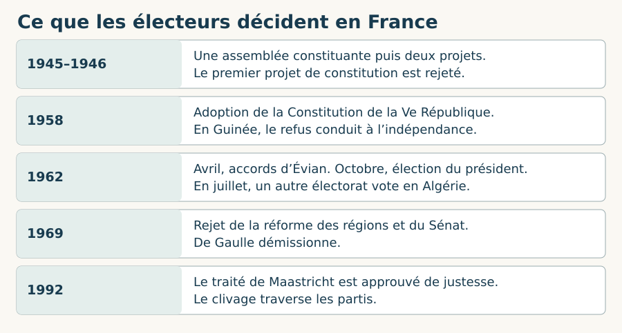
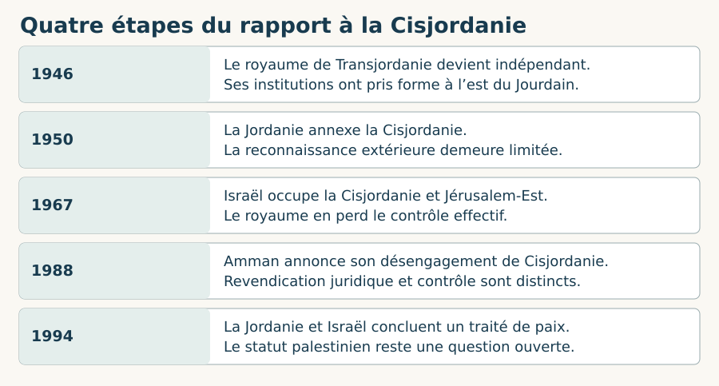

# BEL · AL — Histoire contemporaine (oral tronc commun 22 juin) 2026 · Corrigé guidé

*Corrigé rédigé par IA, non officiel. Signalez toute erreur.*

**Rédaction** · GPT-6.2 Astra Ultra · vitesse non renseignée

**Autocontrôle** · GPT-6.2 Astra Ultra · vitesse non renseignée

## Préparer les deux options de chacun des douze billets

L’index de l’ENS rattache le 22 juin à la commission 2. Le fascicule lui-même porte « Histoire 22 juin commission 1 ». Le corrigé suit ses vingt-quatre intitulés dans leur ordre. Le cinquième billet commence sur la première page et se termine avec la corruption politique sur la suivante.

| Billet | Relance sur le premier sujet | Relance sur le second sujet |
|---|---|---|
| 1 | Pourquoi mentionner l’équipe du FLN ? Les trajectoires de joueurs professionnels montrent qu’un même sport peut soutenir des appartenances nationales concurrentes. | L’Afrique où intervient la France est-elle son ancien empire ? Le Rwanda de 1994 déborde cet ensemble. |
| 2 | Quel contraste entre le Maroc et l’Algérie ? Le sultan incarne une continuité de souveraineté dans un protectorat. Les départements algériens s’inscrivent dans une revendication française d’intégration et un régime colonial inégalitaire. | Comment mesurer l’utilité du TGV ? Comparer temps de trajet et accès réel à une gare en tenant compte des lieux contournés. |
| 3 | Pourquoi les Hachémites ne gardent-ils ni Damas ni La Mecque ? La reconnaissance dynastique se heurte à des rapports de force, français en Syrie et saoudiens au Hedjaz. | Que montre le ballotage de 1965 ? Une forte audience présidentielle coexiste avec l’existence de candidatures et de publics concurrents. |
| 4 | Comment distinguer résultats militaire et politique de Suez ? Les forces égyptiennes subissent l’invasion. Le retrait des envahisseurs et le maintien de la nationalisation donnent ensuite un prestige international à Nasser. | Pourquoi distinguer 1967 et 1988 ? La perte du contrôle effectif de la Cisjordanie précède le désengagement juridique et administratif. |
| 5 | Deux Grands toujours opposés ? En 1947, ils approuvent le projet de partage de la Palestine. En 1956, ils veulent tous deux un retrait des envahisseurs d’Égypte. | Si les révélations se multiplient, la corruption augmente-t-elle ? Il faut contrôler les changements du droit, des enquêtes journalistiques et des capacités judiciaires. |
| 6 | Le même corps électoral approuve-t-il les accords d’Évian et l’indépendance de l’Algérie ? Les scrutins d’avril et de juillet 1962 ont des électorats et des objets distincts. | Un cabinet instable implique-t-il une politique discontinue ? La planification et la construction européenne se poursuivent à travers plusieurs gouvernements. |
| 7 | Pourquoi séparer 1948 et 1967 dans une histoire de la question palestinienne ? La première guerre produit une dispersion massive. La seconde place les populations de Gaza et de Cisjordanie sous occupation israélienne. | Qui prononce l’arrêt Canal ? Le Conseil d’État, juridiction administrative, contrôle l’acte qui institue une juridiction d’exception. |
| 8 | Qui fait la révolution iranienne et qui en sort renforcé ? Plusieurs groupes affaiblissent le shah. Le nouvel ordre constitutionnel concentre ensuite le pouvoir au profit d’une partie des révolutionnaires. | Quel objet banal prolonge la guerre au-delà de la victoire ? Le ticket de rationnement atteste des pénuries et de la gestion publique des approvisionnements. |
| 9 | La résolution 181 crée-t-elle deux États ? Elle recommande un partage sans pouvoir en garantir la mise en œuvre. | Pourquoi la départementalisation vient-elle de revendications locales ? En 1946, l’égalité des droits sociaux et politiques paraît à ses promoteurs passer par cette voie. |
| 10 | Quels pouvoirs distinguer à Jérusalem ? Souveraineté revendiquée, administration religieuse, accès des fidèles et contrôle policier peuvent relever d’autorités différentes. | Pourquoi présenter le projet de mai 1946 ? Le refus des électeurs contribue à expliquer le compromis constitutionnel adopté en octobre. |
| 11 | Pourquoi étudier les Palestiniens d’Israël et des camps ? La dispersion et des statuts différents structurent les trajectoires et la représentation du groupe. | Pourquoi distinguer condamnations et exécutions ? La commutation de la peine de Pétain et l’exécution de Laval en 1945 illustrent concrètement la différence. |
| 12 | Quel rôle attribuer aux réseaux numériques ? Ils facilitent visibilité et diffusion. Les relations locales, les grèves et les organisations préexistantes expliquent aussi comment une mobilisation se maintient. | Une hausse des inscriptions suffit-elle à mesurer l’égalité ? Il faut comparer les parcours, la réussite et l’accès aux différentes filières selon l’origine sociale et le genre. |

## Billet 1

### Le football en France

Quand la France organise la Coupe du monde de 1938, le football professionnel existe depuis six ans. Sa popularité tient pourtant aussi à des milliers de rencontres sans spectateurs payants. Comment un jeu organisé par des clubs est-il devenu à la fois pratique locale, spectacle national et lieu de définition de l’appartenance ? Une première réponse vient des terrains. Les patronages, les clubs de quartiers, de mines ou d’usines procurent des équipements et inscrivent les matches dans le calendrier du travail. Les recrutements venus d’Italie, d’Europe centrale ou du Maghreb rencontrent des mobilités ouvrières déjà anciennes. Sous Vichy, le projet de moraliser et d’encadrer le sport aboutit notamment à l’expérience des équipes fédérales en 1943-1944. Le retour au championnat des clubs à la Libération marque l’échec de cette réorganisation.

Le stade, la radio puis la télévision changent l’échelle du public. Le Stade de Reims, deux fois finaliste de la Coupe d’Europe dans les années 1950, les Bleus de 1958 et les Verts de Saint-Étienne dans les années 1970 font vivre des appartenances locales au niveau national. Elles ne se fondent pas nécessairement dans une seule mémoire. En 1958, des joueurs professionnels quittent leurs clubs français pour former l’équipe du FLN, donnant à la cause algérienne une représentation internationale. Le titre européen de 1984 ou la victoire marseillaise en 1993 disent la puissance de l’identification collective, l’affaire de corruption de Valenciennes les contraintes de sa commercialisation. Le football féminin, reconnu par la Fédération en 1970 après une longue marginalisation, rappelle enfin combien l’accès au terrain et à l’antenne reste inégal. La victoire de 1998 dépasse les bornes.

### La France et l’Afrique (1944-1994)

Brazzaville en 1944 et Kigali en 1994 obligent à interroger deux réalités de la puissance française. La conférence de Brazzaville promet des réformes dans un empire dont les métropolitains entendent conserver l’unité. Cinquante ans plus tard, la France agit sur un continent d’États souverains qui sollicitent, négocient ou récusent son intervention. Dans l’intervalle, ni la décolonisation ni l’indépendance ne suivent une trajectoire unique. L’Union française de 1946 maintient des distinctions de statut et de représentation, malgré des avancées comme l’abolition du travail forcé. Les dirigeants africains utilisent les assemblées locales et parisiennes pour défendre des projets concurrents de fédération, d’autonomie et d’indépendance. Les violences de Sétif en 1945, de Madagascar en 1947 et de la guerre d’Algérie empêchent de réduire la période à une suite de réformes pacifiques.

La Tunisie et le Maroc retrouvent leur indépendance en 1956. La Guinée refuse la Communauté en 1958, de nombreux États d’Afrique subsaharienne deviennent indépendants en 1960, l’Algérie en 1962. Les accords monétaires, militaires et techniques donnent ensuite une durée aux relations privilégiées. La Côte d’Ivoire d’Houphouët-Boigny en tire des ressources et une capacité d’initiative propre. Les migrations, les associations et les échanges culturels relient aussi les sociétés en dehors des présidences. En 1990, le discours de La Baule associe l’aide française aux progrès démocratiques, avec des applications sélectives. En 1994, la dévaluation du franc CFA montre le poids des interdépendances. Au Rwanda, ancien territoire administré par la Belgique, le soutien antérieur de Paris au régime Habyarimana et l’opération Turquoise durant le génocide des Tutsi rendent particulièrement vive la question des responsabilités. Le champ africain de la politique française déborde ainsi l’ancien empire.

## Billet 2

### La décolonisation du Maghreb français

Le mot « français » réunit ici des pays placés dans des rapports juridiques profondément différents avec Paris. La Tunisie et le Maroc sont des protectorats où subsistent un bey et un sultan. L’Algérie du Nord est départementalisée et comprend une importante population européenne, tandis que l’immense majorité musulmane subit des inégalités politiques. Ces statuts offrent des prises différentes aux mouvements indépendantistes, sans déterminer à eux seuls l’issue. Dans les trois cas, partis, syndicats, mobilisations urbaines et rurales, répression coloniale et recherche d’alliés à l’étranger transforment les conditions de négociation après 1945.

En Tunisie, le Néo-Destour de Bourguiba et l’UGTT contribuent à constituer une force nationale. Le gouvernement Mendès France annonce en 1954 l’acceptation de l’autonomie interne. Au Maroc, la déposition de Mohammed Ben Youssef en 1953 renforce, autour du sultan exilé, une revendication déjà portée par l’Istiqlal. Son retour en 1955 ouvre la voie à la reconnaissance de l’indépendance. Maroc et Tunisie sont indépendants en mars 1956, mais la présence militaire française à Bizerte demeure un contentieux jusqu’en 1963. En Algérie, le FLN engage la lutte dès novembre 1954. La question divise aussi les Algériens, notamment entre FLN et MNA. Les pouvoirs exceptionnels, les déplacements et la torture donnent une dimension massive à la violence coloniale. Cette guerre provoque une crise de régime en France en 1958. Les accords d’Évian puis l’indépendance de 1962 s’accompagnent de départs, de violences et d’abandons, notamment pour les harkis. Les indépendances ouvrent trois histoires nationales distinctes et laissent de part et d’autre des liens familiaux, sociaux et mémoriels.

### Les transports en France (1939-1995)

Pourquoi les déplacements sont-ils devenus à la fois plus rapides et plus inégalement accessibles ? En 1939, le réseau ferré que vient de reprendre la SNCF structure le territoire. La mobilisation, l’Occupation, les destructions et les pénuries rappellent la dépendance des populations à quelques voies et sources d’énergie. Les chemins de fer servent aussi aux réquisitions et à la déportation. La reconstruction rétablit ponts, ports et liaisons, puis modernise le rail par l’électrification. L’État aménage à la fois les réseaux collectifs et une voirie adaptée à la production automobile de grande série. Les ménages équipés accèdent à de nouvelles destinations de travail et de vacances. Les lotissements éloignés rendent ensuite la voiture pratiquement indispensable à certains foyers.

Les autoroutes relient prioritairement de grands pôles. Orly puis Roissy, ouvert en 1974, accompagnent l’essor du trafic aérien, tandis que les ports de marchandises s’adaptent au pétrole et aux conteneurs. Le choc pétrolier accroît le coût de la mobilité, et l’insécurité routière devient un enjeu public. Dans les agglomérations, le RER parisien puis le retour du tramway, notamment à Nantes en 1985, témoignent de choix collectifs concurrents pour desservir les périphéries. Le TGV entre Paris et Lyon en 1981, puis le tunnel sous la Manche ouvert en 1994, raccourcissent certaines distances sans rapprocher tous les lieux de la même manière. Un chef-lieu desservi, une commune dont la gare ferme et un quartier où les horaires ne correspondent pas au travail posté vivent trois géographies distinctes. L’histoire des transports associe ainsi infrastructures, usages sociaux et décisions sur les territoires à desservir.

## Billet 3

### Les Hachémites et la construction des États au Moyen-Orient

Une même famille a régné brièvement en Syrie, trois décennies et demie en Irak, et durablement à Amman. Ce contraste permet de mesurer ce que peut une dynastie lorsqu’il faut constituer un territoire en État. Issue de la famille du chérif de La Mecque Hussein, la maison hachémite invoque sa filiation prophétique et son rôle dans la révolte arabe de 1916. Ces ressources nourrissent un projet de royauté arabe. Elles se heurtent aux ambitions d’autres acteurs arabes et au partage franco-britannique. La royauté de Fayçal à Damas prend fin devant l’intervention française de 1920. Hussein perd le Hedjaz au profit des Saoud dans les années 1920. Une généalogie prestigieuse ne suffit pas à établir l’autorité sur une capitale ou un territoire.

En Irak, Fayçal devient roi en 1921 avec l’appui britannique. Une administration héritée en partie de l’époque ottomane, l’armée et des élites urbaines permettent de construire des institutions. L’entrée à la SDN en 1932 consacre l’indépendance juridique, mais les traités avec Londres, les inégalités foncières et les concurrences politiques fragilisent la légitimité monarchique. La révolution de 1958 emporte la dynastie. En Transjordanie, Abdallah bâtit à partir de 1921 un émirat appuyé par Londres, des notables et des groupes tribaux qu’il faut rallier. L’indépendance en 1946 puis l’annexion de la Cisjordanie en 1950 transforment le corps politique. Sous Hussein, la monarchie doit composer avec la question palestinienne, les guerres régionales et les bailleurs étrangers. La courte union irako-jordanienne de 1958 et son échec montrent finalement que la parenté des souverains ne produit ni une nation unique ni la même assise sociale. C’est en construisant des alliances à l’intérieur et à l’extérieur que la branche jordanienne survit.

### L’image de De Gaulle chez les Français (1939-1995)

Une image publique se fabrique à plusieurs voix. Il faut distinguer ce que de Gaulle donne à voir, ce que diffusent ses adversaires et ce que les publics peuvent effectivement recevoir. En 1939, le colonel connu de cercles politiques et militaires n’est pas une figure familière de tous. L’appel du 18 Juin, peu entendu sur le moment, prend son importance à travers les émissions ultérieures de Londres, la circulation des mots d’ordre et les efforts pour relier la France libre aux résistances intérieures. La propagande de Vichy construit une figure de dissident au service de l’étranger. À la Libération, la descente des Champs-Élysées et les images filmées transforment le chef de la France combattante en incarnation visible de la continuité républicaine. La reconnaissance est large mais la mémoire communiste ou les récits des résistants de l’intérieur ne s’y dissolvent pas.

Devenu opposant sous la IVe République, le chef du RPF apparaît à certains comme recours et à d’autres comme candidat au pouvoir personnel. En 1958, la perspective de sortir de la crise algérienne lui vaut des soutiens contradictoires qui se divisent devant l’autodétermination. Les conférences de presse, la télévision et les consultations référendaires mettent en scène une relation directe au pays. Le ballotage de 1965, les satires et les contestations de mai 1968 révèlent les limites de cette représentation. Son départ en 1969, puis sa mort en 1970, rendent possible une appropriation plus consensuelle, y compris par d’anciens adversaires. Les cérémonies de 1990 autour de sa naissance, de l’appel et de sa mort fixent plusieurs figures en une même commémoration. Le succès d’une mémoire nationale ne prouve donc pas l’unanimité des Français du temps où il gouvernait.

## Billet 4

### Nasser (1918-1970)

Gamal Abdel Nasser naît en Égypte alors que le pays demeure soumis à l’emprise britannique. Sa carrière de militaire, la défaite arabe de 1948 et l’action des Officiers libres expliquent comment un officier peut devenir une figure politique. La chute de Farouk en juillet 1952 est d’abord l’œuvre d’un groupe. La République est proclamée en 1953. Nasser évince progressivement Naguib et accède à la présidence en 1956. Le régime liquide des institutions de la monarchie, réforme la propriété foncière et réduit la place des partis indépendants. Mobilisation populaire et encadrement autoritaire avancent ensemble, comme le montre la répression des Frères musulmans et d’autres oppositions.

La nationalisation de la Compagnie du canal en juillet 1956 sert à affirmer la souveraineté et à financer le développement. L’invasion israélienne, britannique et française est un revers militaire, mais le retrait des envahisseurs sous pression internationale transforme Nasser en symbole anticolonial. Le haut barrage d’Assouan, soutenu par l’URSS, condense la promesse d’électricité, d’irrigation et d’indépendance économique. La radio du Caire et le discours panarabe élargissent son audience bien au-delà des frontières. L’union avec la Syrie de 1958 à 1961 révèle toutefois les résistances à une construction dominée par l’administration égyptienne. L’intervention au Yémen pèse sur les ressources. La défaite de juin 1967 et la perte du Sinaï démentent les promesses de puissance, même si la mobilisation après son annonce de démission manifeste la persistance d’un attachement. À sa mort en 1970, son héritage associe l’élargissement des attentes sociales et de la souveraineté à la concentration durable de l’autorité. Sadate pourra modifier les alliances et l’économie tout en héritant de cet appareil d’État.

### Transjordanie, Jordanie : construction d’un État

Le changement de nom invite à poser une question de territoire. Dans les années 1920, rien n’impose que l’espace à l’est du Jourdain, traversé de réseaux commerciaux, pastoraux et familiaux, forme un État durable centré sur Amman. En 1921, l’émir Abdallah, fils du chérif Hussein, s’impose comme interlocuteur des Britanniques. Leurs subsides et l’organisation de la Légion arabe consolident une administration qui doit aussi obtenir l’adhésion de notables, de villes et de tribus. La fixation des frontières et la constitution d’un budget transforment le pouvoir dynastique en gouvernement territorial, sans effacer la dépendance financière. L’indépendance du royaume de Transjordanie est reconnue en 1946.

La guerre de 1948 bouleverse l’échelle du pays. Les réfugiés palestiniens y arrivent en nombre et la monarchie annexe la Cisjordanie en 1950, après avoir pris le nom de Jordanie. L’extension de la citoyenneté relie des populations aux expériences politiques distinctes, tandis que la portée de l’annexion demeure internationalement contestée. Hussein renvoie le commandant britannique Glubb en 1956. En 1967, l’occupation israélienne de la Cisjordanie sépare territoires revendiqués et territoires effectivement gouvernés. La crise de septembre 1970 et l’exclusion ultérieure des organisations palestiniennes armées mettent à l’épreuve le monopole du pouvoir. Le désengagement juridique et administratif de la Cisjordanie annoncé en 1988 réoriente le projet territorial. Le traité de paix avec Israël de 1994, les aides extérieures et une libéralisation politique limitée étayent la survie du royaume. La Jordanie a donc construit sa continuité par plusieurs redéfinitions de sa population politique et de ses frontières, avec un poids décisif de leurs habitants.

## Billet 5

### États-Unis et URSS au Moyen-Orient

Quand Paris et Londres administrent les mandats dans les années 1920, ni les États-Unis ni l’Union soviétique ne dominent la région. Des compagnies pétrolières et des établissements d’enseignement américains y sont présents. L’URSS partage des frontières avec la Turquie et l’Iran. Pendant la Seconde Guerre mondiale, le ravitaillement de l’URSS par l’Iran et les liens entre Washington et Riyad renforcent leur implication. Après 1945, la confrontation Est-Ouest fait de la sécurité des détroits, du pétrole et des frontières des enjeux internationaux. L’aide américaine à la Turquie, la crise du retrait soviétique d’Iran en 1946 et le choix de régimes locaux d’accepter ou de refuser des pactes donnent à cette rivalité des formes diverses.

Il serait pourtant trompeur de tracer deux camps fixes. En 1947, Washington et Moscou soutiennent le partage de la Palestine à l’ONU. En 1956, les deux puissances veulent le retrait des envahisseurs d’Égypte, selon des moyens et pour des raisons différents. Nasser trouve auprès du bloc soviétique un appui pour son armement et pour Assouan sans renoncer à se dire non aligné. Après 1967, les relations militaires américano-israéliennes et soviéto-arabes se resserrent, mais l’Égypte de Sadate se rapproche des États-Unis et obtient une médiation américaine décisive à Camp David en 1978. L’alliance avec le shah n’empêche pas Washington de perdre son principal relais iranien en 1979. La fin de la guerre froide et la coalition conduite par les États-Unis en 1991 changent ensuite l’asymétrie. L’invasion américaine de l’Irak en 2003 révèle les coûts d’une puissance sans rival soviétique et la capacité des sociétés régionales à déjouer les projets extérieurs.

### La corruption politique en France (1939-1995)

Le soupçon de corruption et le jugement d’un tribunal sont deux objets historiques différents. On peut appeler corruption l’usage d’une fonction ou d’un pouvoir de décision public au bénéfice indu d’intérêts privés ou partisans. Sous l’Occupation, la pénurie multiplie trafics et interventions de faveur, mais le marché noir n’est pas, en lui-même, une affaire de corruption politique. Il faut repérer qui dispose d’une autorité publique et quel avantage s’échange. Les spoliations autorisées par l’État de Vichy relèvent d’une politique de persécution dont des particuliers ont aussi tiré profit. La qualification juridique des faits, la dénonciation morale et le changement de régime à la Libération dessinent des frontières différentes.

Le scandale des piastres indochinoises, stimulé par un taux de change officiel favorable aux transferts vers la métropole, suscite des accusations de trafic d’influence sous la IVe République. Une accusation peut abîmer durablement une réputation sans établir une transaction illicite. Sous la Ve République, l’extension des marchés publics, l’urbanisation, la décentralisation et l’augmentation du coût des campagnes mettent en relation décideurs, entreprises et partis. Les affaires de financement de la fin des années 1980, dont Urba, révèlent des circuits où commissions et fonds politiques se mêlent. La presse d’investigation, les magistrats et la concurrence électorale contribuent à rendre visibles des pratiques auparavant moins exposées. Les lois de 1988 et 1990 encadrent le financement politique et électoral. La loi Sapin de 1993 vise notamment la transparence des activités économiques et des procédures publiques. En 1995, le législateur interdit les dons des personnes morales aux partis et aux campagnes, sauf ceux des partis dans les conditions prévues. Le nombre d’affaires rendues publiques mesure donc aussi l’évolution de la surveillance, du droit et de ce que les citoyens jugent acceptable.

## Billet 6

### Les référendums (1945-1992)

Le vote du 21 octobre 1945 demande aux électeurs si l’assemblée élue le même jour sera constituante et s’ils approuvent l’organisation provisoire des pouvoirs. Les Françaises participent pour la première fois à une consultation nationale. Le corps électoral peut ensuite refuser le premier projet de Constitution en mai 1946 avant d’en adopter un autre en octobre. Ces scrutins attestent une fonction constituante qui n’emporte pas mécaniquement l’adhésion à un chef. Celui de septembre 1958 sert à la fois à fonder la Ve République et à redéfinir le lien avec les territoires d’outre-mer. Le « non » guinéen prend le sens d’un choix d’indépendance. Un seul bulletin peut ainsi engager des décisions très différentes selon le territoire et le statut des votants.

Sous de Gaulle, les consultations sur l’autodétermination algérienne en 1961 et sur les accords d’Évian en avril 1962 accompagnent une sortie de guerre. Il faut les distinguer du vote d’autodétermination organisé en Algérie en juillet. Le référendum d’octobre 1962 sur l’élection présidentielle au suffrage universel direct suscite une controverse sur l’emploi de l’article 11 pour réviser la Constitution. En 1969, le rejet de la réforme régionale et du Sénat entraîne la démission de de Gaulle, qui avait engagé son maintien en fonction. Ses successeurs dissocient davantage sort du texte et sort personnel du président. Le scrutin de 1972 sur l’élargissement des Communautés européennes, celui de 1988 sur la Nouvelle-Calédonie et le « oui » très serré à Maastricht en 1992 montrent des mobilisations très variables. Il faut donc demander, pour chaque consultation, qui vote, sur quel texte, avec quels effets juridiques, et quelle interprétation politique est donnée au résultat.

### La chute de la IVe République

La brièveté des gouvernements de la IVe République n’explique pas pourquoi le régime tombe en mai 1958 et pas plusieurs années auparavant. Des ministres et des administrateurs poursuivent, malgré l’instabilité des cabinets, la reconstruction, la planification et les négociations européennes. La relative continuité des politiques coexiste avec l’émiettement des majorités après la fin du tripartisme en 1947. La guerre d’Indochine, puis les décolonisations marocaine et tunisienne éprouvent ces majorités. L’Algérie, dont le statut et la population européenne donnent à la revendication d’indépendance un retentissement particulier, divise les partis eux-mêmes. Les pouvoirs spéciaux de 1956, le poids de l’armée et la crise diplomatique consécutive au bombardement de Sakiet Sidi Youssef en février 1958 rétrécissent la marge parlementaire.

La journée du 13 mai à Alger conjugue mobilisation des partisans de l’Algérie française, implication de chefs militaires et constitution d’un comité de salut public. À Paris, Pierre Pflimlin est néanmoins investi. Une crise d’autorité se noue entre pouvoir légal, dirigeants algérois, armée et réseaux gaullistes. De Gaulle se présente comme disponible pour exercer les pouvoirs républicains. La perspective d’un affrontement pèse sur les choix parlementaires. Après la démission de Pflimlin, René Coty appelle de Gaulle, investi par l’Assemblée le 1er juin. Le vote de la loi constitutionnelle du 3 juin autorise son gouvernement à préparer un nouveau texte sous certaines conditions. L’approbation référendaire en septembre donne à la rupture une sanction populaire ultérieure. Il faut donc tenir ensemble la contrainte extraparlementaire et l’usage de procédures parlementaires. En 1958, la République change d’institutions avant que la guerre qui a précipité sa chute soit résolue.

## Billet 7

### Les guerres d’Israël

Le pluriel impose de distinguer des conflits dont les protagonistes, les espaces et les effets politiques changent. La première guerre s’ouvre par des affrontements en Palestine mandataire après le plan de partage de novembre 1947. La proclamation de l’État d’Israël en mai 1948 et l’intervention des États arabes voisins en font une guerre interétatique. Les armistices de 1949 fixent des lignes de cessez-le-feu. Pour Israël, cette séquence est celle de l’indépendance. Pour les Palestiniens, la Nakba désigne la fuite ou l’expulsion de centaines de milliers d’habitants et la destruction d’une grande partie de leur monde social. Ces expériences simultanées structurent deux mémoires que l’on ne peut déduire d’une simple carte des frontières.

En 1956, Israël participe avec la France et le Royaume-Uni à la guerre de Suez, puis évacue le Sinaï. En juin 1967, l’occupation du Sinaï, de Gaza, de la Cisjordanie, de Jérusalem-Est et du Golan place la question des territoires et des populations occupées au centre du conflit. La guerre de 1973 engagée par l’Égypte et la Syrie modifie les conditions de négociation. Le traité israélo-égyptien de 1979 puis la restitution du Sinaï illustrent une issue diplomatique territoriale. Au Liban en 1982, Israël affronte notamment l’OLP sur le territoire d’un autre État, dans une guerre civile déjà ancienne. La première Intifada de 1987 constitue encore un autre type de confrontation, née dans les territoires occupés. L’accord avec la Jordanie en 1994 ne clôt ni le conflit israélo-palestinien ni les guerres au Liban et à Gaza. En 2011, la succession des traités, des occupations et des déplacements de civils explique mieux la géographie politique que l’idée d’une seule guerre continue.

### Juges et institutions judiciaires (1939-1962)

Comment juger au nom de l’État lorsque l’autorité dont on applique la loi change de nature ? À la fin de la IIIe République, magistrats professionnels, juridictions ordinaires et justice militaire appartiennent déjà à des institutions distinctes. La guerre accroît le poids des procédures d’exception. Vichy maintient nombre de tribunaux et de personnels, exige des marques de fidélité et exclut selon des critères antisémites. La création des sections spéciales en 1941 montre comment une forme judiciaire peut servir la répression politique, y compris par la rétroactivité. Les juges français travaillent aussi dans un territoire soumis à l’occupant, dont les juridictions et les pouvoirs de police suivent leurs propres chaînes d’autorité. Il faut examiner les actes des juridictions et les trajectoires individuelles pour mesurer collaboration, accommodation ou opposition.

À la Libération, la restauration de la légalité républicaine s’accompagne d’institutions spécifiques. Les cours de justice jugent des collaborations, les chambres civiques peuvent prononcer la dégradation nationale, la Haute Cour connaît de hauts responsables. Les magistères d’avant et d’après 1944 ne sont pourtant pas peuplés de deux corps totalement différents. L’épuration professionnelle, les politiques de grâce et d’amnistie interrogent capacité de jugement et continuité administrative. La Constitution de 1946 institue un Conseil supérieur de la magistrature. Celle de 1958 confie au président un rôle de garant de l’indépendance de l’autorité judiciaire. L’ordonnance statutaire et la formation des magistrats renouvellent le corps. Or la guerre d’Algérie étend les compétences militaires et exceptionnelles et place certains magistrats devant la répression et la torture. En 1962, le Conseil d’État annule l’ordonnance instituant la Cour militaire de justice dans l’arrêt Canal. Ce juge administratif contrôle un dispositif d’exception, illustration de la pluralité même des institutions chargées de dire le droit.

## Billet 8

### Révolutionnaires au Moyen-Orient (1920-2011)

Qui appelle-t-on révolutionnaire ? L’Irakien qui exige en 1920 la fin de la tutelle britannique, l’officier égyptien qui renverse la monarchie en 1952 et la manifestante qui réclame en 2011 la chute d’un président ne portent pas le même projet. Le mot peut relever d’une autodésignation, du récit officiel d’un régime né d’une rupture ou de l’analyse d’un changement social. Sous les mandats, des indépendances nationales mobilisent notables, paysans et militants urbains. La grande révolte syrienne de 1925-1927 contre la France élargit des alliances sans produire un programme uniforme de société. Il faut distinguer la composition sociale d’un mouvement de l’image unifiée qu’en transmettent ultérieurement les États.

Après 1945, des officiers se présentent comme porteurs de la justice sociale et de la souveraineté. En Égypte, les mesures agraires et la nationalisation du canal donnent au régime une légitimité au-delà du milieu militaire, en même temps que l’opposition indépendante est réprimée. En Irak en 1958, la chute de la royauté ouvre des luttes entre nationalistes arabes, communistes et autres forces. L’Iran de 1979 révèle une autre pluralité. Religieux, étudiants, salariés, commerçants et courants de gauche concourent à isoler le shah. La République islamique qui s’impose ensuite marginalise plusieurs de ces groupes. Les révoltes de 2011 donnent enfin une place marquante aux associations, aux travailleurs et aux jeunes sans organisation partisane dominante. Leur capacité à faire tomber certains présidents ne garantit ni la maîtrise de la succession ni un bouleversement social durable. Il convient donc de raconter les révolutionnaires jusque dans leurs divisions et leurs défaites, sans confier la définition de la révolution aux seuls vainqueurs.

### Sortir de la Seconde Guerre mondiale en France

Les habitants de Paris libéré en août 1944, les rescapés de déportation rapatriés au printemps 1945 et les ménages qui utilisent encore des tickets après la paix n’ont pas la même date de sortie de guerre. Le processus commence par des libérations militaires échelonnées et par la reconstitution de pouvoirs publics reconnus. Le Gouvernement provisoire fait valoir la continuité de la République, s’appuie sur des commissaires de la République, des élus et des résistants, et cherche à rétablir le monopole de l’autorité. Les violences de la Libération et leur encadrement judiciaire expriment à la fois désir de sanction et nécessité de rétablir des règles. Le vote des Françaises et les premières consultations nationales de 1945 élargissent la communauté politique.

La reconstruction matérielle exige de réparer logements, transports et usines, de ravitailler les villes et de mobiliser du travail. Les nationalisations, la Sécurité sociale et le premier Plan répondent à des projets de réforme autant qu’à des urgences matérielles. Deuils et retours sont plus difficiles à gouverner. Les prisonniers, requis et déportés reviennent dans des conditions très différentes. Les survivants de la persécution antisémite cherchent parents, logements et biens alors que la disparition des familles entières rend le deuil singulier. Dans l’empire, la répression de mai 1945 dans le Constantinois et le déclenchement de la guerre d’Indochine révèlent combien la célébration française de la liberté se heurte au maintien de la domination coloniale. L’adoption de la Constitution en 1946 clôt une transition institutionnelle. Les tickets de rationnement, l’habitat provisoire, le contentieux des spoliations et les guerres coloniales lui survivent. Sortir de la guerre demande donc d’identifier ce qui est restauré, ce qui est inventé et ce qui continue à peser sur des populations différentes.

## Billet 9

### Société des nations, organisation des nations unies et le Moyen-Orient (1920-2011)

Au lendemain de la Première Guerre mondiale, l’article 22 du pacte de la Société des nations confie la tutelle de territoires à des puissances mandataires censées rendre compte de leur administration. Les anciennes provinces ottomanes classées parmi les mandats « A » sont jugées assez avancées pour que leur existence comme nations indépendantes soit provisoirement reconnue. Cette formule entretient une contradiction entre souveraineté promise et autorité franco-britannique. Londres gouverne notamment en Palestine, Paris en Syrie et au Liban. Des habitants utilisent pétitions et recours auprès de la Commission permanente des mandats, mais le contrôle international offre peu de prise directe sur les politiques du mandataire. L’admission de l’Irak à la SDN en 1932 consacre une indépendance reconnue malgré la persistance de liens britanniques.

À partir de 1945, des États de la région participent à l’ONU et cherchent à y faire inscrire leurs causes. La résolution 181 de l’Assemblée générale recommande en 1947 un partage de la Palestine. Elle ne suffit ni à imposer les frontières proposées ni à faire naître deux États. L’UNRWA, créée en 1949, assure aux réfugiés palestiniens des services durables d’enseignement et d’assistance. La force d’urgence déployée après Suez en 1956 illustre un nouveau rôle de maintien de la paix. En 1967, la résolution 242 du Conseil de sécurité fournit une référence diplomatique dont l’interprétation divise. Après l’invasion du Koweït, le Conseil autorise en 1990 l’usage de tous les moyens nécessaires sous conditions, tandis que l’intervention de 2003 ne reçoit pas de nouvelle autorisation explicite. Assemblée, Conseil, agences et États membres ne disposent donc ni des mêmes compétences ni de la même capacité à transformer une décision de droit en situation politique.

### La France d’outre-mer (1939-1995)

En 1939, « outre-mer » désigne, depuis la métropole, des territoires extrêmement divers par leur statut, leur population et leurs rapports avec l’État. L’Algérie comprend des départements, la Tunisie est un protectorat, la Guadeloupe est encore une colonie et la Nouvelle-Calédonie conserve les marques de la dépossession foncière kanak. Aux Antilles comme en Afrique, la guerre impose blocus, pénuries, réquisitions ou mobilisations. Les ralliements de territoires d’Afrique équatoriale à la France libre et la conférence de Brazzaville en 1944 illustrent le rôle politique de l’empire dans la restauration d’une autorité française qui n’envisage pas encore d’y renoncer.

La départementalisation de la Guadeloupe, de la Martinique, de la Guyane et de La Réunion en 1946 répond à des revendications d’égalité sociale et politique. D’autres territoires accèdent à l’autonomie puis à l’indépendance. La guerre d’Indochine, les indépendances africaines de 1960 et celle de l’Algérie en 1962 recomposent la carte. Le mot « outre-mer » renvoie désormais à des départements et territoires aux liens institutionnels différents avec Paris. Les transferts publics, la mobilité vers la métropole organisée notamment par le BUMIDOM à partir de 1963 et les inégalités de prix ou de chômage changent les sociétés sans mettre fin aux revendications d’autonomie. Le centre spatial guyanais et les essais nucléaires en Polynésie inscrivent ces territoires dans des stratégies nationales dont les habitants discutent les coûts et les bénéfices. En Nouvelle-Calédonie, les accords de Matignon de 1988 tentent de répondre à un conflit autour de l’indépendance par un calendrier et un rééquilibrage territorial. En 1995, la reprise des essais en Polynésie avive la contestation. L’outre-mer contemporain est autant produit par les décisions et mobilisations locales que par la réduction du domaine impérial.

## Billet 10

### Lieux saints et politique au Moyen-Orient

Un lieu saint devient un enjeu politique parce que des fidèles doivent pouvoir y accéder, parce qu’un gardien en administre l’espace et parce qu’une autorité peut invoquer sa protection pour légitimer un pouvoir. Ces trois dimensions ne coïncident pas. À La Mecque et à Médine, la conquête du Hedjaz par les Saoud au milieu des années 1920 déplace l’autorité des Hachémites. Le pèlerinage apporte des ressources, impose des travaux et met le souverain en relation avec des musulmans étrangers qui n’ont pas à lui reconnaître une autorité politique universelle. La prise de la Grande Mosquée de La Mecque en 1979 met en cause sa légitimité religieuse au cœur même du royaume. La gestion des pèlerinages et des relations avec l’Iran reste source de tensions.

Jérusalem concentre des lieux tenus pour saints par plusieurs religions, dont le Saint-Sépulcre, le mur occidental et l’esplanade des Mosquées, aussi appelée mont du Temple. Les traditions d’administration et de culte ne donnent pas un titre unique de souveraineté. Le projet d’internationalisation de la ville recommandé par l’ONU en 1947 ne se réalise pas. La guerre de 1948 partage la ville, puis Israël s’empare de Jérusalem-Est en 1967. Le contrôle politique et policier, la gestion religieuse de l’esplanade par le waqf et les positions internationales sur le statut de la partie orientale restent distincts. Nadjaf et Kerbala, en Irak, montrent encore un autre rapport entre ville de pèlerinage, réseaux chiites transfrontaliers et gouvernement national. La circulation des fidèles intéresse aussi commerçants, transporteurs et municipalités. L’explication doit partir de ces arrangements concrets pour comprendre comment la sacralité peut alimenter une revendication politique ou, au contraire, imposer des accommodements quotidiens.

### Constitutions et institutions de la IVe République

Le pluriel du sujet invite à examiner la fabrication constitutionnelle avant son application. L’ordonnance de 1944 rétablit la légalité républicaine, tandis que la loi constitutionnelle provisoire approuvée en octobre 1945 confie au Gouvernement provisoire et à l’Assemblée constituante des fonctions limitées. Les électeurs rejettent en mai 1946 le premier projet, marqué par la prééminence d’une assemblée unique, puis adoptent le second en octobre. La Constitution du 27 octobre 1946 joint aux droits de 1789 un préambule reconnaissant des droits économiques et sociaux. Elle organise l’Union française sans effacer les inégalités entre ses populations. La phase des projets ne doit donc pas conduire à compter comme deux constitutions en vigueur les deux textes soumis au suffrage.

L’Assemblée nationale vote la loi et peut mettre en cause le gouvernement. Le Conseil de la République, seconde chambre aux pouvoirs initialement limités, regagne une part d’influence, notamment avec la révision de 1954. Le président de la République, élu par le Parlement, dispose de marges de désignation et d’influence, mais le président du Conseil et ses ministres assurent la conduite gouvernementale. Des règles veulent rationaliser investiture, responsabilité et dissolution. La pratique de la double investiture, les démissions sans vote formel et la fragmentation des coalitions réduisent leur efficacité. La dissolution de 1955, unique sous le régime, montre toutefois que l’instrument existe. L’instabilité des cabinets cohabite avec la continuité des administrations et de certaines politiques européennes et sociales. En 1958, la crise algérienne sort l’affrontement de l’enceinte parlementaire. Le vote du 3 juin ouvre la procédure qui donnera une autre Constitution. Expliquer l’écroulement suppose donc d’articuler textes, pratiques des partis et crise impériale.

## Billet 11

### Les Palestiniens (1920-2011)

Suivre les Palestiniens exige de changer de carte en cours d’exposé. Sous le mandat britannique, la majorité arabe de Palestine forme une société de villes et de villages, musulmane et chrétienne, traversée de hiérarchies foncières, de solidarités familiales et de différences sociales. La presse, les congrès et les associations expriment des revendications nationales dans une configuration où la Grande-Bretagne soutient le principe d’un foyer national juif. L’immigration, la question des terres et l’absence d’institutions représentatives communes structurent les tensions. Le soulèvement de 1936-1939 et sa répression affaiblissent une part des cadres politiques palestiniens à la veille de la fin du mandat.

La Nakba de 1948 disperse la population entre l’exil régional, la Cisjordanie, Gaza et les frontières du nouvel État d’Israël. Citoyenneté, condition de réfugié et accès au travail ou à la terre diffèrent dès lors entre ces espaces. Des camps deviennent des quartiers durables où l’UNRWA, les familles et les organisations assurent une partie de la vie sociale. La création de l’OLP en 1964 puis l’occupation de la Cisjordanie et de Gaza par Israël en 1967 modifient les conditions de la représentation. L’OLP s’affirme internationalement depuis l’exil, tandis que la première Intifada en 1987 met au premier plan les mobilisations des territoires. Les accords d’Oslo et la création de l’Autorité palestinienne organisent une autonomie partielle, laissant ouvertes les questions des frontières, de Jérusalem et des réfugiés. La division entre Gaza sous contrôle du Hamas et la Cisjordanie administrée en partie par l’Autorité palestinienne après 2007 souligne la fragmentation du pouvoir. L’admission de la Palestine à l’UNESCO en 2011 manifeste un succès de représentation qui ne résout ni les différences de statut ni la question de souveraineté.

### Réalités et limites de l’épuration dans la France de la Libération

À la Libération, la revendication de punir la collaboration se heurte à deux questions concrètes. Comment établir ce qu’a fait un individu dans un territoire occupé ? Quelle autorité peut juger quand la République rétablit à peine ses institutions ? Les sanctions commencent parfois avant l’arrivée des pouvoirs réguliers et se poursuivent parallèlement à la justice officielle. Exécutions sommaires et tontes ne constituent pas une étape chronologique unique, remplacée d’un seul coup par les tribunaux. Les tontes exposent particulièrement des femmes accusées de relations avec des Allemands, révélant une représentation genrée de l’honneur national très éloignée d’une qualification judiciaire uniforme.

Les cours de justice connaissent d’actes de collaboration. Les chambres civiques traitent notamment de l’indignité nationale et peuvent prononcer la dégradation nationale. La Haute Cour juge Pétain et Laval en 1945. La condamnation à mort du premier est commuée, celle du second exécutée. Fonction publique, presse, milieux artistiques et entreprises connaissent aussi suspensions, interdictions et sanctions économiques. Pour en apprécier la portée, il faut distinguer dossiers ouverts, condamnations, peines prononcées et peines exécutées. La disponibilité des preuves, la fuite de certains responsables, les besoins de continuité professionnelle et les différences locales expliquent des résultats inégaux. Les grâces et les amnisties de 1951 et 1953 réduisent progressivement la portée de nombreuses sanctions. Une autre limite tient à l’objet même des poursuites. La trahison et la collaboration occupent initialement davantage de place que la spécificité de la persécution des Juifs. Les procès ultérieurs pour crimes contre l’humanité appartiennent donc à une autre temporalité. L’épuration a reconstruit une légalité et sanctionné de nombreux actes tout en laissant ouverts de profonds conflits sur les responsabilités.

## Billet 12

### Causes et formes des Printemps arabes

La mort de Mohamed Bouazizi, qui s’est immolé en décembre 2010 à Sidi Bouzid, est un événement déclencheur dans une histoire tunisienne plus ancienne de chômage, d’inégalités régionales, d’arbitraire administratif et de conflits du travail. Pourquoi une crise locale fait-elle ensuite écho dans de nombreuses sociétés ? Les frustrations ont des traits communs, mais elles ne produisent pas partout le même soulèvement. L’allongement des études ne garantit pas un emploi qualifié. La corruption et la transmission familiale du pouvoir nourrissent les revendications de dignité. Les syndicats, associations, avocats, journalistes et militants accumulent des expériences de mobilisation antérieures à 2011. Les chaînes satellitaires et les réseaux numériques diffusent des images et rendent des expériences mutuellement visibles, sans se substituer aux relations de quartier, aux places et aux grèves.

En Tunisie, la mobilisation gagne les grandes villes et Ben Ali quitte le pouvoir en janvier 2011. En Égypte, l’occupation de la place Tahrir côtoie des mouvements ouvriers et Moubarak démissionne en février. L’armée conserve un pouvoir institutionnel qui oblige à distinguer départ du président et transformation du régime. À Bahreïn, les revendications de représentation se heurtent à une répression appuyée par des forces venues du Golfe. En Syrie, les manifestations parties notamment de Deraa rencontrent une répression qui contribue à la montée de la violence et au basculement vers la guerre. En Libye, la guerre et l’intervention internationale déterminent une issue autre que la négociation tunisienne. Le Maroc connaît manifestations et réforme constitutionnelle sans renversement de la monarchie. Les « printemps » désignent donc une circulation de revendications et de formes d’action. Leur diversité ne s’explique qu’en examinant les soutiens du pouvoir, le rôle des forces armées et les pressions internationales dans chaque pays, dans les limites de 2011.

### L’enseignement supérieur en France (1939-1995)

En 1939, l’enseignement supérieur concerne une minorité scolarisée, répartie entre facultés, grandes écoles et établissements spécialisés. Le coût des études, la concentration parisienne et la sélection tout au long du secondaire pèsent sur le recrutement. Sous Vichy, des universitaires et des étudiants sont exclus en raison des lois antisémites. Mobilisations, départs, persécutions et engagements résistants affectent les établissements. Après la Libération, la reconstruction et l’investissement dans la recherche renforcent la demande de scientifiques, d’ingénieurs, d’enseignants et d’administrateurs. Le baby-boom ne suffit pas à expliquer la croissance des effectifs. L’élargissement de l’accès au baccalauréat, les attentes des familles et les transformations des emplois y contribuent durablement.

Les années 1960 voient s’ouvrir des campus comme Nanterre et des voies technologiques comme les IUT, créés en 1966. Les amphis surchargés, les modes de sélection et la distribution du pouvoir universitaire nourrissent la contestation de 1968. La loi Faure réorganise les universités autour d’établissements plus autonomes et pluridisciplinaires et introduit de nouvelles formes de participation. La filière des grandes écoles subsiste. La loi Savary de 1984 définit un service public de l’enseignement supérieur, tandis que le retrait du projet Devaquet en 1986 montre le caractère politique de l’accès et de la sélection. Au tournant des années 1990, le plan Université 2000 multiplie les capacités d’accueil et les implantations régionales. La croissance du nombre d’étudiantes et d’étudiants modifie profondément la société. Les écarts entre universités, classes préparatoires, filières et disciplines demeurent cependant liés au genre, au milieu social et au territoire. Mesurer la démocratisation demande donc d’observer l’entrée, le parcours et la valeur des diplômes, au-delà des seuls effectifs inscrits.

[Fascicule officiel](https://www.ens.psl.eu/sites/default/files/sujet_oraux_histoire_tc_2_22_juin_al.pdf) · [Index des sujets du jury](https://www.ens.psl.eu/rapports-et-sujets-du-concours-2026-section-des-lettres-groupe-al)
