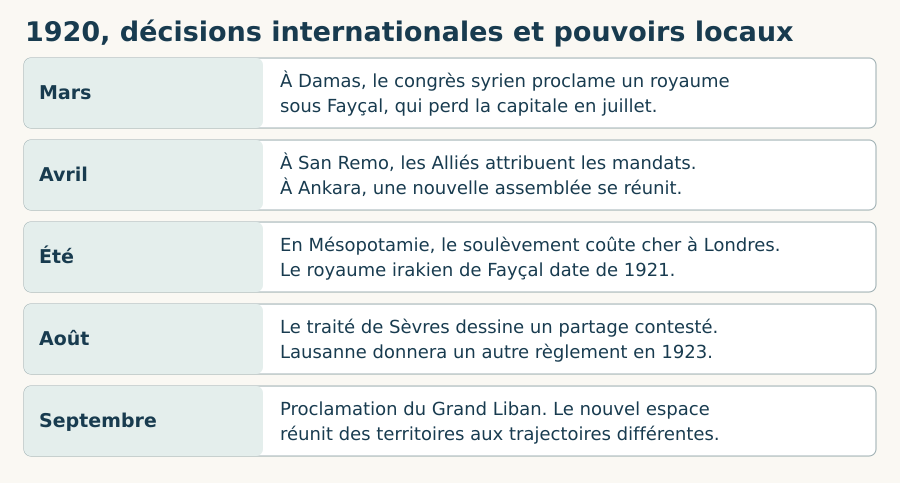
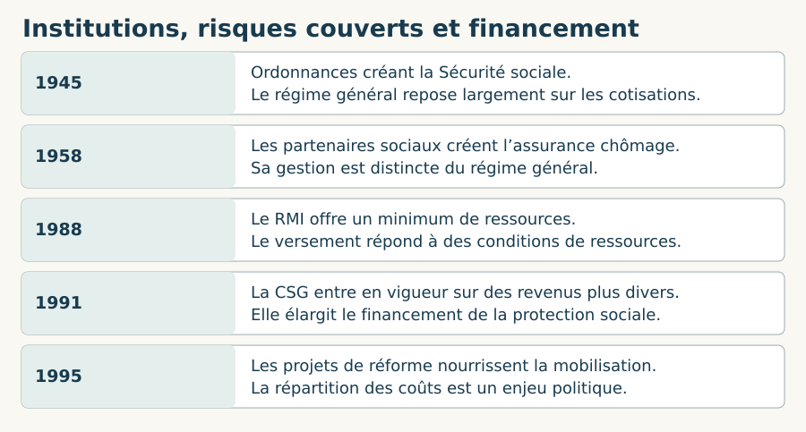

# BEL · AL — Histoire contemporaine (oral tronc commun 23 juin) 2026 · Corrigé brut

*Corrigé rédigé par IA, non officiel. Signalez toute erreur.*

**Rédaction** · GPT-6.2 Astra Ultra · vitesse non renseignée

**Autocontrôle** · GPT-6.2 Astra Ultra · vitesse non renseignée

La feuille contient 12 billets proposant chacun deux sujets au choix. Chaque sujet fait ici l’objet d’un exposé distinct.

## Billet 1

### Le Moyen-Orient dans la Seconde Guerre mondiale

En 1939, la région relie la Méditerranée à l’océan Indien, fournit du pétrole et comprend des États dont les degrés de souveraineté sont très différents. La présence britannique en Égypte, en Irak et en Palestine et celle de la France au Levant deviennent des enjeux de guerre. La défaite de la France en 1940 place la Syrie et le Liban sous l’autorité de Vichy jusqu’à l’intervention britannique et française libre de 1941. En Irak, la crise de Rachid Ali et le rétablissement de l’influence britannique en 1941 révèlent la fragilité de l’indépendance acquise en 1932. Le Farhoud de Bagdad, en juin 1941, frappe la population juive et rappelle le coût humain des tensions politiques et antisémites.

En Iran, l’intervention britannique et soviétique de 1941 garantit des liaisons avec l’URSS et provoque l’abdication de Reza Shah en faveur de son fils. La Turquie, malgré des pressions contradictoires, demeure hors des combats et ne déclare la guerre à l’Allemagne qu’en février 1945. Conscription, pénuries et inflation marquent la vie quotidienne. Les groupes politiques locaux ne réagissent pas uniformément aux mêmes puissances. En Palestine mandataire, des membres du Yichouv servent dans les forces alliées tandis que se poursuit le conflit avec Londres sur l’immigration juive, devenu tragiquement aigu dans le contexte de la Shoah. À la fin du conflit, les indépendances syrienne et libanaise s’affirment, la Ligue arabe se constitue et les États-Unis approfondissent leur relation avec l’Arabie saoudite. L’ordre des mandats se défait ainsi avant que les puissances européennes aient quitté tous leurs points d’appui.

### Jérusalem

Une ville habitée, trois traditions religieuses majeures et plusieurs projets de souveraineté se rencontrent à Jérusalem. En faire seulement une ville sainte empêcherait de comprendre l’administration de l’eau et du sol, les extensions résidentielles et la distribution des services publics qui façonnent aussi ses frontières. Sous le mandat britannique, Jérusalem devient un centre administratif de la Palestine. La vieille ville et les quartiers en expansion rassemblent et séparent des populations juives, chrétiennes et musulmanes aux appartenances politiques multiples. Les tensions de 1929 autour du mur occidental montrent comment des droits de prière sont investis d’un sens national, sans qu’il suffise de rapporter le conflit à l’ancienneté des croyances.

L’ONU recommande en 1947 un régime international pour la ville. La guerre de 1948 aboutit à une division concrète entre une partie occidentale israélienne et une partie orientale, vieille ville comprise, sous contrôle jordanien. Départs et expulsions affectent la carte des quartiers et l’accès aux sanctuaires. En 1967, Israël conquiert la partie orientale et élargit la municipalité. La proclamation en 1980 de Jérusalem comme capitale « complète et réunie » d’Israël se heurte au rejet international de l’annexion. Les Palestiniens revendiquent Jérusalem-Est comme capitale. La gestion religieuse de l’esplanade, la police de ses accès et l’administration municipale renvoient à des autorités et à des échelles distinctes. Logements, permis de résidence, circulation et inégalités de services font de la souveraineté une expérience quotidienne. Les négociations d’Oslo reportent le règlement du statut de la ville, encore disputé en 2011.

## Billet 2

### Grèves et manifestations en France (1939-1995)

Faire grève suspend une activité de travail. Manifester rend une revendication visible dans un espace public. Les deux pratiques se rencontrent mais leurs acteurs et leur statut diffèrent. Sous l’Occupation, les mineurs du Nord et du Pas-de-Calais en 1941 font de revendications alimentaires et professionnelles une contestation du pouvoir de l’occupant. Le rassemblement parisien du 11 novembre 1940 réinvestit une date patriotique dans un espace interdit. Risque d’arrestation et de déportation, clandestinité et pénurie changent radicalement le sens de ces actes. Le préambule de la Constitution de 1946 reconnaît le droit de grève dans le cadre des lois qui le réglementent. La grève devient une institution de la République sans perdre son caractère conflictuel, comme le montrent les grandes grèves de 1947 et la grève des mineurs de 1948.

La croissance des années 1950 et 1960 ne désarme pas les revendications sur les salaires, les conditions de travail et l’autorité dans l’usine. Mai-juin 1968 associe une mobilisation étudiante, des grèves massives, des occupations et des cortèges dont les participants ne poursuivent pas tous les mêmes objectifs. Les manifestations contre la guerre d’Algérie et leur répression, notamment le 17 octobre 1961 et à Charonne en 1962, rappellent que l’espace public n’est pas également ouvert à tous. Après les fermetures industrielles des années 1970, des conflits défendent l’emploi et le territoire. Les mobilisations pour l’école privée en 1984 ou contre le projet Devaquet en 1986 élargissent encore le répertoire. En 1995, les grèves des transports et de la fonction publique contre les projets de réforme sociale cristallisent une opposition nationale. Interroger les participants, les organisations, les moyens d’expression et le résultat précis de chaque conflit évite d’en faire autant de copies de Mai 68.

### L’« étrange défaite » de 1940

Le titre de Marc Bloch, écrit dès l’été 1940 et publié en 1946, indique une enquête menée par un témoin engagé. Officier et historien, il examine les responsabilités du commandement et les faiblesses de la société française. Il n’écrit pas avec le recul documentaire d’un historien de l’après-guerre. L’effondrement étonne parce que la France dispose d’une armée nombreuse, de matériels parfois modernes et du prestige de 1918. L’affrontement de mai-juin 1940 révèle les difficultés à coordonner commandement, renseignements et alliés et à adapter les décisions à la rapidité de la crise. Les pertes et les combats invalident l’idée d’une armée entière qui aurait refusé de se battre. Les critiques d’un état-major formé par la guerre précédente demandent à être confrontées à la diversité des situations et des décisions.

La défaite militaire ne suffit pas à expliquer la recherche d’un armistice, ni l’établissement d’un autre régime. L’exode désorganise les institutions et jette des millions de civils sur les routes. Au sein du gouvernement, la poursuite de la guerre depuis l’empire reste discutée. La démission de Reynaud, l’arrivée de Pétain, la demande d’armistice et le vote du 10 juillet correspondent à des décisions politiques successives. D’autres Français refusent de tenir cet arrêt des combats en métropole pour la fin de la guerre. Les accusations contre le Front populaire, les divisions sociales ou le parlementarisme deviennent des instruments de justification de Vichy, qu’un historien ne peut reprendre à son compte. L’« étrange » défaite désigne ainsi à la fois l’effondrement rapide d’une puissance, la transformation politique qui s’y greffe et l’énigme que se donne un contemporain pour comprendre son propre pays.

## Billet 3

### Décoloniser le Moyen-Orient

Décoloniser consiste à mettre fin à une domination qui peut être administrative, militaire, économique et culturelle. La dissolution de l’Empire ottoman ne suffit donc pas à décoloniser les anciennes provinces arabes. Après 1918, la France et la Grande-Bretagne y établissent des mandats, alors que le rejet de la tutelle s’exprime en Irak, en Syrie et en Palestine par des pétitions, partis, grèves et révoltes. La Turquie issue du mouvement national obtient une reconnaissance à Lausanne en 1923, puis devient une république. L’Égypte reçoit en 1922 une indépendance assortie de réserves britanniques. En Irak, l’admission à la SDN en 1932 clôt le mandat sans effacer les traités qui maintiennent des moyens d’influence britanniques. La diversité des actes juridiques impose de demander qui exerce désormais les fonctions de l’État.

La Seconde Guerre mondiale affaiblit la capacité de Paris et de Londres à maintenir cet ordre. Les derniers soldats français quittent la Syrie et le Liban en 1946. La fin du mandat palestinien en 1948 coïncide avec la création d’Israël, la guerre et la dépossession d’une grande partie des Palestiniens, qui n’accèdent pas à un État. La nationalisation pétrolière voulue par Mossadegh en 1951 et la nationalisation de la Compagnie du canal de Suez en 1956 lient souveraineté politique et propriété de ressources stratégiques. Le retrait britannique du Golfe en 1971 ouvre de nouvelles indépendances. La circulation d’institutions, de langues et de cadres techniciens hérités des empires demeure, de même que des dépendances financières et militaires recomposées. Les acteurs locaux ont donc obtenu des pouvoirs réels par étapes, sans suivre un calendrier régional unique.

### Candidates et candidats aux élections présidentielles sous la Ve République

En 1958, un collège électoral élargi élit le président. En 1965, les Français choisissent pour la première fois sous la Ve République au suffrage universel direct. La modification de 1962 crée ainsi un autre métier de candidat. Il faut obtenir les présentations requises, réunir des soutiens nationaux, exposer un programme à la radio et à la télévision et anticiper les reports entre deux tours. Face à de Gaulle en 1965, Mitterrand réunit une part de la gauche, tandis que Lecanuet représente une offre centriste. Le ballotage montre que l’autorité du président en exercice ne supprime pas l’incertitude électorale. Après 1976, le seuil des présentations passe de cent à cinq cents élus habilités, condition qui se distingue des primaires ou désignations internes aux partis.

Les candidatures remplissent plusieurs fonctions. Certaines visent l’Élysée, d’autres rendent visible une cause ou donnent une audience à un courant minoritaire. René Dumont en 1974 introduit l’écologie dans la campagne présidentielle. La même année, Arlette Laguiller est la première femme candidate à l’élection présidentielle française. L’égalité d’éligibilité ne supprime ni la sélection masculine dans les appareils ni les inégalités de traitement public. Les rivalités entre gaullistes et giscardiens, puis entre Chirac et Balladur en 1995, démentent l’idée que chaque camp présente naturellement un candidat unique. La candidature de Mitterrand victorieuse en 1981 traduit un travail partisan et une dynamique de rassemblement au second tour. À partir de 1988-1995, le développement des règles de financement et de contrôle rappelle que la candidature est aussi une activité juridique et matérielle. L’histoire des personnes éclaire ainsi l’évolution d’institutions qui valorisent leur visibilité tout en les rendant dépendantes d’organisations.

## Billet 4

### Être premier ministre sous la Ve République

Michel Debré entre à Matignon en 1959 comme premier titulaire de la nouvelle fonction. Les articles 20 et 21 de la Constitution attribuent au gouvernement la détermination et la conduite de la politique de la nation et au Premier ministre la direction de l’action gouvernementale. Le président nomme le Premier ministre. Le gouvernement demeure responsable devant l’Assemblée nationale, qui peut le renverser. Un chef de gouvernement doit donc tenir ensemble les rapports avec l’Élysée, une majorité parlementaire et les administrations. Arbitrer entre ministères, préparer les lois, exercer le pouvoir réglementaire et utiliser les procédures d’engagement de responsabilité donnent à Matignon des moyens propres. En 1962, la censure de Pompidou après le projet de référendum conduit de Gaulle à dissoudre l’Assemblée. La victoire gaulliste qui suit renforce politiquement l’exécutif.

Lorsque majorité présidentielle et majorité législative coïncident, le chef de l’État peut imposer de grandes orientations et obtenir le départ de son Premier ministre, alors que le texte prévoit la présentation par celui-ci de la démission du gouvernement. Chaban-Delmas et son projet de « Nouvelle Société », puis Rocard et le RMI ou les accords de Matignon, montrent qu’il existe une initiative gouvernementale. Rocard doit en outre composer avec une majorité relative. La première cohabitation, entre Mitterrand et Chirac de 1986 à 1988, et la seconde, avec Balladur de 1993 à 1995, rendent au lien parlementaire une force particulière. Le président conserve ses compétences propres et les relations extérieures suscitent coopération et rivalités. Édith Cresson, première femme à Matignon en 1991, se heurte à des attentes souvent sexuées. La fonction est donc stable dans ses attributions fondamentales, variable dans sa capacité d’initiative selon la configuration politique.

### Vivre sa sexualité en France (1939-1995)

L’histoire de la sexualité concerne les expériences intimes mais aussi les conditions publiques qui les rendent possibles, visibles ou risquées. La guerre sépare les couples, multiplie les contraintes matérielles et renforce la surveillance des relations. Vichy réprime l’avortement et introduit en 1942 une discrimination d’âge dans le traitement de certains rapports homosexuels. À la Libération, les tontes publiques de femmes accusées de relations avec des Allemands révèlent combien la sexualité féminine peut être investie d’un sens national. Les normes du mariage et de la procréation demeurent puissantes dans l’après-guerre, mais elles ne décrivent pas toutes les pratiques. Enquêtes, témoignages et dossiers médicaux donnent un accès inégal à des expériences longtemps tues.

Le Mouvement français pour le planning familial, des médecins et des groupes féministes mettent en débat la maîtrise des naissances. La loi Neuwirth de 1967 autorise la contraception, dont l’accès effectif dépend ensuite de textes d’application, du coût et des relations avec les prescripteurs. La loi Veil de 1975 permet l’interruption volontaire de grossesse sous conditions. Les mouvements homosexuels rendent publiques des revendications auparavant marginalisées, et l’abrogation en 1982 de la discrimination pénale sur l’âge des relations entre personnes de même sexe constitue une rupture juridique précise. La pénalisation générale des relations homosexuelles entre adultes consentants avait disparu bien avant cette date. L’épidémie de sida à partir des années 1980 associe deuils, discriminations, transformations des pratiques de prévention et mobilisations associatives. En 1995, la plus grande autonomie légale et la pluralité des modèles affectifs ne placent pas chacun à égalité devant la santé, le jugement familial ou l’accès aux soins.

## Billet 5

### La mer Rouge, enjeu politique et économique

Du canal de Suez à Bab el-Mandeb, la mer Rouge relie la Méditerranée à l’océan Indien, mais elle est aussi un espace de voisinage. Les ports de Suez, Djeddah, Port-Soudan ou Massaoua rattachent des arrière-pays à des circuits de marchandises et de personnes. Le pèlerinage vers La Mecque donne à Djeddah un rôle qui excède le transit mondial. La pêche, le cabotage et les migrations entre les rives africaines et arabes existent indépendamment des grands navires qui traversent la mer. Dans les années 1920, les empires européens gardent des positions sur ses débouchés et ses rives, tandis que la conquête saoudienne du Hedjaz modifie l’autorité sur le littoral oriental.

Après 1945, les indépendances, les exportations pétrolières et les rivalités israélo-arabes changent la valeur des accès maritimes. La nationalisation de la Compagnie du canal par l’Égypte en 1956 affirme une souveraineté sur les recettes d’un passage international. La fermeture des détroits de Tiran en 1967 touche l’accès israélien au golfe d’Aqaba. Ce verrou septentrional diffère de Bab el-Mandeb, au sud. Après la guerre de juin 1967, l’interruption du trafic de Suez jusqu’en 1975 impose des détours qui favorisent les grandes capacités pétrolières et changent le calcul des transporteurs. Au sud, les indépendances de la région d’Aden et de Djibouti et celle de l’Érythrée modifient les autorités des rives sans effacer les présences militaires étrangères. Dans les années 2000, les risques pour le commerce au large de la Corne de l’Afrique suscitent des coopérations internationales. La mer Rouge est ainsi à la fois corridor mondial, ensemble de ports rivaux et espace social habité.

### Voter en France (1944-1995)

L’ordonnance d’avril 1944 reconnaît aux femmes les mêmes droits électoraux qu’aux hommes. Leur premier vote aux municipales de 1945, puis à l’élection nationale d’octobre, change la composition du corps électoral. Il ne fait pas disparaître tous les statuts d’exception. En Algérie et dans l’empire, collèges distincts, conditions d’inscription ou application inégale du suffrage distinguent durablement citoyenneté proclamée et égalité du vote. Dans l’après-guerre, les électeurs choisissent leurs représentants, tranchent sur les projets de Constitution et prennent l’habitude de nouvelles compétitions locales et nationales. La forte implantation de partis militants, de la presse et de réseaux sociaux ou religieux structure la manière de s’informer et de se situer.

La Ve République multiplie les usages du vote. Le scrutin législatif majoritaire à deux tours favorise des alliances et des désistements, le référendum appelle une réponse binaire sur un texte, et l’élection présidentielle directe à partir de 1965 concentre l’attention sur des personnes. La majorité civique à dix-huit ans en 1974 élargit l’électorat. Les élections européennes au suffrage direct en 1979 ajoutent une échelle, tandis que la décentralisation donne de nouveaux enjeux aux scrutins territoriaux. Les mobilisations divergent selon les consultations. Choix du vote, abstention ou vote blanc demandent des interprétations différentes et ne se déduisent pas du seul groupe social. Le « non » de 1969, l’alternance de 1981 et le résultat serré sur Maastricht en 1992 montrent qu’un même électeur peut vouloir sanctionner un gouvernement, porter une formation au pouvoir ou contester une politique précise. Voter revient à choisir dans une offre elle-même façonnée par les institutions, les campagnes et les droits d’accès au scrutin.

## Billet 6

### Violences politiques au Moyen-Orient (1920-2011)

Le qualificatif « politique » demande d’identifier l’autorité en jeu et le sens attribué à la violence par ceux qui l’exercent ou la subissent. Les répressions coloniales, les guerres interétatiques, les violences de guerre civile, les persécutions et les violences de détention ne relèvent pas toutes des mêmes institutions. Dans l’Irak mandataire de 1920 ou la Syrie en révolte en 1925, les puissances européennes cherchent à rendre acceptable leur domination en présentant les révoltes comme de simples troubles de l’ordre. Les contemporains qui les combattent y voient une question de souveraineté. Le contraste entre sources officielles, récits des habitants et témoignages de victimes est ici une part essentielle de l’explication.

Après les indépendances, des régimes se réclament de la révolution ou de la sécurité nationale pour limiter la pluralité politique. L’écrasement du soulèvement de Hama en Syrie en 1982 montre combien une répression d’État atteint une population civile. Dans la guerre civile libanaise de 1975 à 1990, les déplacements forcés et la transformation des quartiers produisent de nouvelles frontières sociales qui subsistent après la fin des combats. En Irak, la campagne de l’Anfal menée par le régime de Saddam Hussein frappe les populations kurdes à la fin des années 1980. Les organisations de défense des droits et les juridictions donnent ensuite aux récits de crimes une visibilité inégale. En 2011, les violences contre des manifestants mettent de nouveau en jeu la légitimité des États et le statut des opposants. La violence n’est ni une propriété naturelle de la région ni une conséquence uniforme des appartenances religieuses. Elle s’explique par des institutions, des rapports de domination et des conjonctures datées, dont il faut aussi écrire les effets sur les survivants.

### La France des montagnes (1939-1995)

Une carte des Alpes ne suffit pas à représenter la France des montagnes. Pyrénées, Massif central, Jura, Vosges, Corse et massifs alpins se distinguent par leurs altitudes, leurs accès et leurs usages. Pendant la guerre, certaines vallées se trouvent sur des frontières de fuite ou dans des zones d’occupation particulières. Le Vercors figure après 1944 parmi les hauts lieux du souvenir résistant et des violences subies par les habitants. Cette mémoire publique est une façon de valoriser la montagne, à côté de l’agro-pastoralisme, des forêts et d’industries de vallée déjà anciennes. L’après-guerre accentue l’exode rural et réduit des services dans une partie des bourgs. Ailleurs, l’activité laitière et fromagère se maintient en associant production, transformation et qualité régionale.

Les barrages, les routes et les stations de sports d’hiver réorganisent les rapports entre hautes vallées et villes de plaine. L’aménagement hydroélectrique de Tignes implique la submersion de l’ancien village au début des années 1950 et cristallise le coût local d’une politique nationale. Le développement des stations intégrées dans les Alpes, soutenu dans les années 1960 et 1970, fournit emplois et recettes tout en renforçant le travail saisonnier et la dépendance à l’enneigement. Les Jeux de Grenoble en 1968 popularisent l’image d’une montagne de loisir et de performance, qui ne décrit pas tous les massifs. Le parc national de la Vanoise créé en 1963 et la loi Montagne de 1985 témoignent des arbitrages entre protection, agriculture, urbanisation et tourisme. Les montagnards sont acteurs de ces choix autant qu’usagers ou victimes de décisions prises ailleurs. L’inégale accessibilité d’une vallée détermine souvent sa trajectoire autant que son altitude.

## Billet 7

### Les Juifs en Palestine (1920-1948)

Vers 1920, les Juifs de Palestine forment une population diverse. Aux communautés installées de longue date dans des villes telles que Jérusalem, Hébron ou Safed s’ajoutent des immigrants liés à différentes formes de sionisme. Religion, langue, origine, statut économique et projet d’avenir ne se confondent pas. Sous le mandat britannique, l’engagement en faveur d’un foyer national juif fournit un cadre institutionnel à la croissance du Yichouv. Les nouvelles immigrations, les achats de terres et le développement urbain modifient le poids et la géographie des implantations. Le kibboutz occupe une place symbolique forte, mais la population juive se concentre largement dans des villes comme Tel-Aviv. Une économie, des écoles hébraïques, la Histadrout et des instances représentatives donnent à la communauté une capacité d’organisation qui ne fait pas disparaître antagonismes sociaux et politiques.

Les relations avec les Arabes palestiniens associent échanges ordinaires, intérêts concurrents et conflits sur l’avenir du pays. Les violences de 1929 puis la révolte arabe de 1936-1939 renforcent la séparation des espaces et des institutions. La montée des persécutions européennes accroît l’urgence de l’immigration. Le Livre blanc britannique de 1939 en limite l’accès au moment où la population juive d’Europe est menacée d’anéantissement. Pendant la guerre, des Juifs de Palestine servent avec les Alliés tout en contestant les restrictions britanniques. Le sort des survivants et des personnes déplacées devient ensuite un enjeu international majeur. Le partage recommandé par l’ONU en 1947, la guerre et la création d’Israël en mai 1948 marquent la transformation d’une communauté politique organisée en population d’un État. Elle s’accompagne de la dispersion des Palestiniens arabes. On ne doit projeter rétrospectivement ni l’issue étatique ni les migrations massives ultérieures sur l’ensemble des expériences juives du mandat.

### L’État providence en France (1939-1995)

L’État providence désigne un ensemble de protections contre des risques sociaux, dont la gestion ne relève pas toujours directement de l’État. En 1939 existent déjà assurances sociales, allocations familiales, mutualité et politiques municipales d’assistance. La guerre et Vichy modifient certaines prestations dans un ordre politique inégalitaire et persécuteur. La Libération porte un projet d’extension des droits. Les ordonnances de 1945 créent la Sécurité sociale, financée largement par cotisations, organisée autour du travail salarié et administrée avec une participation importante de représentants sociaux. Le régime général ne réunit pas d’emblée toute la population. Des régimes professionnels subsistent, et certains groupes demeurent moins bien couverts.

La croissance de l’emploi salarié et la hausse des revenus alimentent la protection contre maladie, vieillesse et charges familiales. Les partenaires sociaux créent en 1958 l’assurance chômage, qui ne constitue pas une branche du régime général. L’hôpital public, les aides au logement et la diffusion des retraites améliorent les conditions de vie avec des résultats variables selon l’emploi, la famille et le lieu de résidence. À partir des années 1970, le chômage durable affaiblit des recettes assises sur le salaire et rend visible la situation de personnes sans droits contributifs suffisants. Le RMI créé en 1988 complète ces droits par un minimum de ressources assorti d’un engagement d’insertion. La contribution sociale généralisée élargit à partir de 1991 les assiettes de financement. Les conflits autour des réformes en 1995 montrent à quel point la répartition des coûts et la place respective de l’État et des partenaires sociaux engagent une définition de la solidarité. L’histoire est celle d’une extension inégale et discutée des protections, accompagnée d’un changement de leurs modes de financement.

## Billet 8

### Les héritages impériaux au Moyen-Orient

Que survit-il à un empire lorsque le souverain, le drapeau ou le nom de l’administration ont changé ? Les provinces arabes de l’Empire ottoman disposent avant 1918 de cadres administratifs, d’infrastructures, de villes et de réseaux familiaux. Des officiers et fonctionnaires passés par les mêmes écoles servent ensuite des États différents. Le droit ottoman de la propriété et les enregistrements fonciers continuent à peser sur la définition des droits à la terre. Une frontière tracée après la guerre peut rompre les parcours de marchands ou de pasteurs tout en suivant parfois des limites déjà administrées. Invoquer l’accord Sykes-Picot de 1916 ne suffit donc pas à expliquer les tracés finaux, produits aussi par les guerres, les négociations et l’action des populations locales.

Les mandats français et britanniques superposent des héritages nouveaux à ces continuités. Les institutions militaires, les langues du droit ou de l’enseignement, les concessions pétrolières et la géographie portuaire attachent les États à des partenaires extérieurs. La monarchie irakienne et l’émirat de Transjordanie associent patronage britannique, dynastie hachémite et personnel politique régional. Au Liban, la représentation confessionnelle s’inscrit dans une histoire plus longue que le mandat et change de sens avec le Grand Liban de 1920 puis le pacte national de 1943. Les gouvernements indépendants peuvent réviser, réinvestir ou dénoncer ces biens et ces arrangements. La nationalisation de Suez en 1956 transforme la propriété de l’entreprise tout en conservant la valeur d’une infrastructure impériale. Les héritages sont donc transmis par des personnes et des institutions qui leur donnent de nouveaux usages. Ils expliquent des contraintes différenciées sans déterminer le destin de chaque État jusqu’en 2011.

### Les artisans et la politique (1939-1995)

L’artisan est un travailleur indépendant qui maîtrise un métier et dirige généralement une petite entreprise. Il peut employer des salariés et travailler à domicile, en boutique ou sur chantier. Ses intérêts ne coïncident pas nécessairement avec ceux de tous les commerçants ou du petit patronat. Sous Vichy, l’éloge du métier et des communautés professionnelles donne une place idéologique à l’artisan. Il coexiste avec les pénuries de matières, les contrôles et les persécutions qui frappent aussi des personnes exerçant ces métiers. Après la guerre, les chambres de métiers, les syndicats professionnels et les élus locaux offrent des voies d’intervention sur les formations, les qualifications, la fiscalité et l’assurance sociale. Cette politique quotidienne de la profession est moins spectaculaire qu’une manifestation mais tout aussi structurante.

Dans les années 1950, le mouvement de Pierre Poujade mobilise notamment commerçants et artisans contre les contrôles fiscaux et la modernisation perçue comme défavorable aux petits indépendants. Son succès électoral de 1956 ne permet ni d’assimiler tous les artisans au poujadisme ni d’oublier ses dimensions antiparlementaires et xénophobes. Dans les décennies suivantes, les mobilisations du CIDUNATI utilisent d’autres relais pour défendre les travailleurs indépendants. Les discussions sur les régimes sociaux, l’apprentissage ou la TVA engagent directement la survie des entreprises. La croissance du bâtiment, de la réparation automobile et des services maintient une demande de savoir-faire alors que d’autres métiers reculent. Selon la qualification, la taille de l’entreprise et la dépendance envers un donneur d’ordres, les intérêts divergent. Il faut donc suivre à la fois des votes, des actions collectives et le travail plus discret des institutions qui font exister l’artisanat comme catégorie politique.

## Billet 9

### Le canal de Suez, enjeu politique et économique

Ouvert en 1869, le canal traverse le territoire égyptien mais sa compagnie concessionnaire et son trafic appartiennent à une économie internationale. Vers 1920, les liaisons impériales britanniques avec l’Asie et les échanges entre Méditerranée et océan Indien donnent au passage une importance qui excède ses recettes locales. L’indépendance égyptienne de 1922 ne fait pas disparaître la présence militaire britannique. Le traité de 1936 maintient une zone de stationnement dans la région du canal. Durant la Seconde Guerre mondiale, la circulation des approvisionnements illustre l’écart entre la souveraineté territoriale reconnue à l’Égypte et sa maîtrise effective de l’infrastructure.

En juillet 1956, Nasser nationalise la Compagnie universelle du canal maritime de Suez. L’État entend percevoir les recettes et contribuer au financement du haut barrage d’Assouan. La nationalisation de l’entreprise ne signifie pas que l’Égypte nie par principe la vocation internationale de la voie. La crise oppose cependant l’Égypte à la France, au Royaume-Uni et à Israël. L’issue politique et le retrait des troupes donnent à l’acte une portée anticoloniale mondiale. En 1967, le canal devient une ligne de front et reste fermé jusqu’en 1975. Les détours par le cap de Bonne-Espérance et le développement de très grands pétroliers montrent comment les opérateurs s’adaptent aux risques d’interruption. La réouverture, le retour du Sinaï à l’Égypte et les travaux de modernisation rétablissent ensuite le rôle du transit et des devises pour l’économie égyptienne. Pour les habitants de Suez, d’Ismaïlia et de Port-Saïd, le canal apporte aussi emplois, destructions, évacuations et retours. Son histoire politique et économique se lit à trois échelles, du quartier portuaire au marché mondial.

### La France rurale sous l’Occupation

En 1940, les campagnes nourrissent le pays, mais les habitants n’accèdent pas tous de la même manière à la terre, au bétail et au marché. Les prisonniers de guerre manquent dans les exploitations, les femmes prennent des responsabilités accrues, les restrictions de carburant et d’engrais pèsent sur les rendements. L’occupant effectue des prélèvements et les autorités françaises organisent le ravitaillement et les livraisons obligatoires. Entre prix administrés, ventes directes, troc et circuits clandestins, la frontière est mouvante pour un ménage qui doit à la fois produire, nourrir les siens et trouver des vêtements ou du matériel. L’image urbaine d’un paysan enrichi par le marché noir occulte les ouvriers agricoles, les petits exploitants et les écarts régionaux.

Vichy exalte le retour à la terre et crée une Corporation paysanne pour encadrer la profession. Les organisations et les notables locaux disposent pourtant de traditions propres et ne s’alignent pas uniformément sur l’État français. L’attitude envers l’occupant et le régime varie aussi dans le temps. L’accueil d’enfants, de réfugiés et de Juifs persécutés, puis de réfractaires au STO, dépend de relations de voisinage, de solidarités organisées et des risques de dénonciation. Certains territoires de montagne ou de forêt deviennent des lieux de maquis, mais la résistance rurale prend aussi des formes ordinaires d’hébergement ou d’entraide. Les représailles et les massacres de 1944 frappent des habitants dans des contextes locaux précis. Les campagnes vivent donc une pluralité de guerres. Les files d’attente de la ville, le registre des livraisons d’une exploitation et le témoignage d’un enfant caché permettent d’en saisir trois réalités complémentaires.

## Billet 10

### La révolution iranienne

La révolution de 1979 met fin à une monarchie qui se voulait à la fois modernisatrice et héritière d’une longue histoire impériale. La « révolution blanche » du shah a modifié les structures foncières, élargi la scolarisation et accompagné l’urbanisation. Les revenus pétroliers permettent des dépenses massives, mais les prix, les inégalités et le sentiment de dépendance à l’égard des États-Unis nourrissent les mécontentements. La limitation du pluralisme et la police politique ferment les voies d’expression. Les critiques viennent de religieux, de libéraux, de nationalistes et de diverses gauches. Les bazaris disposent de ressources et de réseaux différents de ceux des étudiants ou des ouvriers du pétrole. Aucun de ces groupes à lui seul ne suffit à faire tomber le régime.

En 1978, manifestations, deuils publics et grèves donnent une audience croissante à une contestation qui se réclame notamment de Khomeini, alors en exil. La répression mine davantage la légitimité du pouvoir. Le shah quitte le pays en janvier 1979. Khomeini revient en février, et l’effondrement de l’autorité monarchique ouvre une période de concurrence entre gouvernement provisoire, comités, autorités religieuses et autres forces révolutionnaires. Le référendum de mars, puis la Constitution adoptée en décembre, donnent une forme juridique à la République islamique et une place décisive au Guide. Les résistances aux obligations imposées aux femmes et la mise à l’écart d’une partie des gauches rappellent la diversité des attentes de la coalition victorieuse. La crise des otages américains et la guerre lancée par l’Irak en 1980 contribuent à resserrer le pouvoir. La révolution a donc transformé la source de légitimité, les institutions et l’ordre social, à travers un processus dont l’issue n’était pas entièrement écrite au départ du shah.

### Vichy et l’empire colonial

L’armistice de 1940 laisse à l’État français une autorité théorique sur une grande partie de l’empire. Dans sa propagande, Pétain en fait un motif de prestige et de relèvement national. Dans les faits, l’empire se divise. Des territoires d’Afrique équatoriale, dont le Tchad de Félix Éboué, se rallient à la France libre dès 1940. Dakar reste alors sous Vichy, comme la majeure partie de l’Afrique occidentale française. En Syrie et au Liban, l’autorité vichyste prend fin en 1941. À Madagascar, elle est contestée par l’intervention britannique de 1942. En Indochine, l’administration française coexiste sous contrainte avec la présence japonaise jusqu’à sa mise à l’écart en mars 1945. La carte de l’allégeance dépend des autorités locales, des forces disponibles et des rapports avec les Alliés et l’Axe.

Dans les territoires qu’il contrôle, Vichy adapte la Révolution nationale aux hiérarchies coloniales. L’abrogation du décret Crémieux retire en 1940 la citoyenneté française aux Juifs d’Algérie concernés et s’accompagne d’exclusions professionnelles et scolaires. Les populations colonisées connaissent réquisitions, pénuries, travail contraint ou surveillance, avec des situations distinctes aux Antilles, au Maghreb et en Afrique subsaharienne. Les débarquements alliés en Afrique du Nord en novembre 1942 ne rétablissent pas immédiatement tous les droits. Le décret Crémieux n’est pleinement rétabli qu’en 1943. Les revendications nationales colonisées acquièrent aussi leurs calendriers propres, comme le Manifeste du peuple algérien de Ferhat Abbas en 1943. L’empire a donc permis à Vichy de revendiquer une continuité de puissance tout en fournissant à ses adversaires des territoires, des ressources et des hommes. Le passage à la France combattante ne supprime pas les structures de domination que combattront les mouvements d’indépendance.

## Billet 11

### 1920 au Moyen-Orient

La première difficulté est de respecter l’échelle d’une année. Les traités, congrès et révoltes de 1920 dessinent des projets concurrents dont plusieurs échoueront. En mars, un congrès à Damas proclame un royaume arabe de Syrie sous Fayçal. En avril, la conférence de San Remo distribue à la France et à la Grande-Bretagne des responsabilités mandataires sur d’anciennes provinces ottomanes. En juillet, la défaite syrienne de Maysaloun et l’entrée des Français à Damas emportent l’expérience de Fayçal. En septembre, la proclamation du Grand Liban rattache de nouveaux territoires au Mont-Liban. Ces décisions modifient le statut de populations qui n’ont pas toutes défendu la même échelle d’État ni la même organisation politique.

En Mésopotamie, la révolte de 1920 contre l’ordre britannique associe des acteurs tribaux, religieux et urbains. Sa répression et son coût incitent Londres à rechercher un autre mode de gouvernement. L’installation de Fayçal sur le trône irakien se produira en 1921. En Anatolie, l’Assemblée nationale réunie à Ankara conteste l’autorité du gouvernement du sultan. Le traité de Sèvres signé en août 1920 prévoit une réduction considérable du territoire ottoman et des dispositions concernant les Arméniens et les Kurdes. Ces projets ne prennent pas la forme politique durable qu’on pourrait inférer d’une carte de traité. Le règlement de Lausanne et la République turque datent de 1923. En Palestine, l’administration civile britannique s’organise également en 1920, dans un pays traversé de revendications arabes et sionistes antagonistes. L’année ne fixe donc pas une fois pour toutes la carte du Moyen-Orient. Elle fait entrer en concurrence, dans un même temps court, promesses de souveraineté, partage impérial et entreprises nationales.

### Moderniser la France (1945-1995)

À la Libération, moderniser est un projet politique qui associe le relèvement de la production à une transformation de la société. Le Commissariat général du Plan créé en 1946 et le premier plan Monnet concentrent des efforts sur des secteurs jugés décisifs, de l’énergie aux transports. Nationalisations, crédit et aide Marshall nourrissent l’investissement. L’État n’agit pas seul. Directions d’entreprises, ingénieurs, salariés, agriculteurs et institutions européennes déterminent ce qui peut être produit et à quel coût. L’électrification des campagnes, la mécanisation et l’organisation des marchés agricoles accroissent la productivité tout en favorisant l’agrandissement des exploitations et le départ de nombreux actifs.

Dans les décennies de croissance, modernisation signifie aussi eau courante et salles de bains, électroménager, automobiles, autoroutes et logements collectifs. L’accès reste inégal, comme en témoignent bidonvilles et longues attentes de logements. La construction de grands ensembles peut représenter un progrès d’équipement pour les habitants et engendrer ensuite des problèmes d’isolement. Les choix nationaux en matière d’énergie, de télécommunications et d’espace valorisent l’expertise technique et le long terme. Les chocs pétroliers et la concurrence industrielle conduisent cependant à fermer des sites autrefois présentés comme emblèmes du progrès. Dans les années 1980 et 1990, le TGV et le développement des réseaux téléphoniques illustrent le déplacement vers les infrastructures de connexion, le chômage industriel leur contrepartie sociale inégalement territorialisée. Les mouvements écologistes et les débats sur les infrastructures obligent enfin à demander qui définit la modernité et qui supporte ses coûts. En cinquante ans, la transformation des modes de vie est immense, mais elle ne peut s’exprimer par une simple courbe de production.

## Billet 12

### La place des femmes au Moyen-Orient

Le singulier de « la place » appelle une comparaison entre des sociétés où les droits familiaux, l’accès à l’emploi et à l’instruction, le droit de vote et la capacité d’action collective évoluent à des rythmes différents. Dans les années 1920, des associations féminines, des journaux et des militantes accompagnent les mouvements nationaux. En Égypte, Hoda Chaarawi participe à la fondation de l’Union féministe égyptienne en 1923. L’accès à la parole publique de femmes lettrées ne décrit pas à lui seul le travail des paysannes, des domestiques ou des ouvrières. En Turquie, les réformes républicaines du droit et l’accès des femmes aux élections nationales en 1934 font de l’émancipation un signe de modernité officielle. Elles laissent subsister des inégalités professionnelles et régionales.

Les États indépendants développent la scolarisation et les services publics, créant des débouchés dans l’enseignement, la santé ou l’administration. Les droits de la famille et de nationalité continuent souvent d’établir des distinctions entre femmes et hommes. En Iran, les transformations de la période Pahlavi puis la révolution de 1979 font du vêtement et de la famille des domaines d’intervention du pouvoir. Les femmes prennent part à la révolution, contestent des obligations nouvelles et poursuivent études et activités professionnelles sous des contraintes recomposées. Les migrations de travail dans le Golfe donnent accès à des revenus mais exposent de nombreuses travailleuses étrangères à une forte dépendance envers leur employeur. Guerre, déplacement et deuil modifient encore la composition des ménages et les possibilités d’action. En 2011, la visibilité de manifestantes dans plusieurs pays invite à suivre leurs organisations comme leurs droits effectifs après les mobilisations. Comparer un droit inscrit dans un texte, une ressource économique disponible et une capacité de décision dans la famille évite de mesurer toutes ces sociétés sur une échelle unique.

### Une guerre froide culturelle en France

Dans la France de l’après-guerre, le conflit Est-Ouest passe par des romans, des revues, des films, des expositions, des échanges scientifiques et des débats sur la paix. La forte implantation du PCF, le prestige de l’URSS victorieuse et la visibilité des intellectuels communistes placent le pays au premier plan de ces rivalités. Le Mouvement de la paix et l’appel de Stockholm en 1950 rassemblent autour de la dénonciation de l’arme atomique des acteurs dont les degrés d’adhésion au communisme varient. À l’opposé, des revues et des associations soutiennent les libertés intellectuelles et critiquent les régimes soviétiques. Le Congrès pour la liberté de la culture, actif à Paris, reçoit des fonds américains dont l’origine clandestine, révélée dans les années 1960, pose la question de l’autonomie de ses participants.

L’influence américaine passe aussi par le cinéma, le jazz, les biens de consommation et les voyages. Les débats sur les accords Blum-Byrnes de 1946 articulent reconstruction financière, accès des films américains et défense de la production française. Apprécier un film ou écouter du jazz ne signifie pourtant pas adhérer à la politique étrangère des États-Unis. La répression en Hongrie en 1956, l’invasion de la Tchécoslovaquie en 1968 puis la diffusion des écrits de dissidents soviétiques déplacent les appartenances et les polémiques. Les engagements anticoloniaux, le tiers-mondisme et les courants maoïstes ou libertaires compliquent le face-à-face entre Washington et Moscou. Les audiences reçoivent et transforment les œuvres autant que les États cherchent à les diffuser. En 1989-1991, la disparition du bloc soviétique prive la guerre froide culturelle de son principal cadre international, sans effacer les fractures durables qu’elle a inscrites dans les mémoires politiques françaises.

[Fascicule officiel](https://www.ens.psl.eu/sites/default/files/23.06.26_sujets_histoire_2.pdf) · [Index des sujets du jury](https://www.ens.psl.eu/rapports-et-sujets-du-concours-2026-section-des-lettres-groupe-al)
