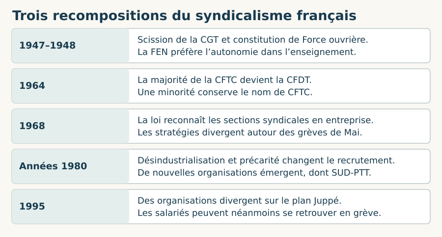
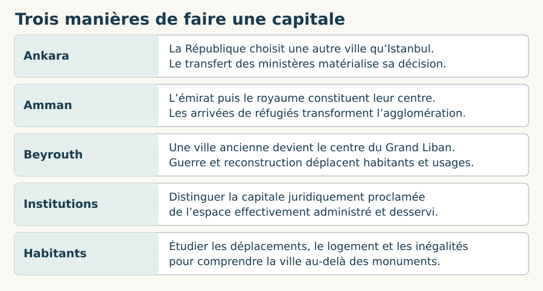

# BEL · AL — Histoire contemporaine (oral tronc commun 24 juin) 2026 · Corrigé brut

*Corrigé rédigé par IA, non officiel. Signalez toute erreur.*

**Rédaction** · GPT-6.2 Astra Ultra · vitesse non renseignée

**Autocontrôle** · GPT-6.2 Astra Ultra · vitesse non renseignée

La feuille contient 12 billets proposant chacun deux sujets au choix. Chaque sujet fait ici l’objet d’un exposé distinct.

## Billet 1

### Britanniques et Français au Moyen-Orient (1920-2011)

Comparer Français et Britanniques conduit à distinguer États, entreprises et individus. Les accords entre gouvernements pendant la Première Guerre mondiale ne fixent pas à eux seuls la forme des mandats. En 1920, la conférence de San Remo attribue à Londres et à Paris des responsabilités sur les provinces arabes de l’ancien Empire ottoman. La France s’impose en Syrie et au Liban, tandis que les Britanniques gouvernent la Palestine et établissent des relations de tutelle avec l’Irak et la Transjordanie. Les deux puissances doivent négocier avec des autorités locales et affrontent de fortes contestations. La France privilégie notamment des découpages territoriaux et une protection affichée de certaines communautés au Levant. La Grande-Bretagne associe en Irak monarchie hachémite, traités et accès aux ressources pétrolières. Ni Paris ni Londres ne pratiquent partout une seule méthode.

La Seconde Guerre mondiale révèle à la fois leur coopération et leur rivalité. En 1941, Britanniques et Français libres interviennent contre les autorités de Vichy au Levant. Les évacuations françaises de 1946 et la fin du mandat palestinien en 1948 défont l’ordre mandataire. En 1956, l’intervention franco-britannique contre l’Égypte après la nationalisation de Suez se solde par un retrait sous pression internationale. Le retrait britannique des protectorats du Golfe en 1971 s’effectue plus tard. Les liens ne disparaissent pas pour autant. Écoles, universités, entreprises, réseaux financiers, diplomatie et commerce militaire entretiennent des relations négociées par des gouvernements désormais souverains. La participation des deux pays à la coalition de 1991 contraste avec leur désaccord sur l’invasion de l’Irak en 2003. Les positions européennes ne constituent donc jamais un bloc intemporel face au Moyen-Orient.

### Pratiques et spectacles sportifs en France

Suivre le sport depuis les vestiaires, les tribunes et le salon familial fait apparaître trois histoires liées. L’activité physique se développe dans les clubs, les entreprises, les écoles et les associations, avec un accès inégal selon le revenu, les horaires, le sexe et la proximité d’équipements. Sous Vichy, le discours sur la régénération physique de la jeunesse et l’autorité politique sur les fédérations s’opposent à une partie de l’autonomie associative. À la Libération, les municipalités, les enseignants et les bénévoles relancent équipements et apprentissages. Dans les décennies suivantes, la croissance du niveau de vie, les congés et les politiques publiques élargissent l’accès aux piscines, aux gymnases, aux sports de raquette et aux loisirs de plein air. Une hausse des licenciés ne mesure pas les pratiques libres ou intermittentes.

Le spectacle utilise d’autres circuits. Le Tour de France, déjà lié à la presse, fait entrer des paysages et des sponsors dans l’expérience collective des auditeurs puis des téléspectateurs. Le football européen attire un public qui n’a jamais joué en club. Les Jeux de Grenoble en 1968 et ceux d’Albertville en 1992 lient infrastructures, retransmission et mise en valeur internationale des Alpes. La multiplication des émissions et des droits télévisés renforce le poids de certaines disciplines et la professionnalisation de leurs acteurs. La visibilité médiatique ne coïncide ni avec le nombre de pratiquants ni avec l’égalité entre femmes et hommes. La reconnaissance du football féminin par la fédération en 1970, les parcours d’athlètes ultramarins et les problèmes de dopage rappellent que le sport distribue aussi des ressources, des normes et des réputations. En 1995, faire du sport et regarder du sport sont devenus deux activités de masse qui ne se recouvrent que partiellement.

## Billet 2

### Mouvements et attentats terroristes au Moyen-Orient (1920-2011)

Le terme « terroriste » est revendiqué, refusé ou imposé de l’extérieur selon les acteurs et les époques. Pour l’historien, il désigne ici des violences politiques qui cherchent à produire, au-delà des victimes immédiates, peur et effets publics. Une cause nationale, une identité religieuse ou la condition de réfugié ne suffisent jamais à caractériser comme terroriste toute une population ou tout un mouvement. Pendant le mandat britannique en Palestine, certains groupes sionistes recourent à des attentats alors que d’autres organisations juives en contestent les choix. La fin du mandat et la guerre de 1948 redéfinissent la qualification des acteurs, les mémoires du conflit et le périmètre des institutions qui en jugent les violences. Les désaccords sur les mots sont eux-mêmes une source pour l’histoire de la légitimité.

Après 1967, la question palestinienne acquiert une visibilité internationale accrue, tandis que des organisations aux objectifs, directions et méthodes différents cherchent à la représenter. Le meurtre d’athlètes israéliens à Munich en 1972 a lieu en Europe mais impose dans les médias mondiaux un conflit lié au Moyen-Orient. La guerre civile libanaise mêle ensuite violences de factions, interventions étrangères, enlèvements et attentats dont les civils sont très largement victimes. À la fin du siècle, des organisations se réclamant du djihad mondial se distinguent des groupes attachés à un territoire et à une cause nationale. Les attentats du 11 septembre 2001 se déroulent aux États-Unis et sont suivis de politiques dont les conséquences affectent profondément la région. La comparaison gagne à présenter pour chaque cas victimes, objectifs déclarés, contexte et conséquences judiciaires ou politiques. Elle doit aussi repérer ce que le cadrage médiatique laisse dans l’ombre, notamment les vies bouleversées et les oppositions internes aux mouvements qui prétendent parler au nom d’une collectivité.

### L’Irak de Saddam Hussein

Saddam Hussein accède à la présidence en 1979, mais sa place dans le régime baasiste se construit après la prise de pouvoir du parti en 1968. Le Baas se réclame du nationalisme arabe, du socialisme et de la modernisation. La nationalisation de l’Iraq Petroleum Company en 1972 et la hausse des recettes pétrolières donnent au pouvoir des moyens pour l’école, la santé et l’investissement. Les administrations et les organisations du parti favorisent aussi surveillance, dépendance et concentration de la décision. Les relations de clientèle et les fidélités de famille ou de région renforcent le système sans faire de la société irakienne une juxtaposition de communautés unanimement fidèles ou hostiles.

La guerre déclenchée contre l’Iran en 1980 absorbe les ressources et militarise la vie sociale. La répression contre les Kurdes, notamment la campagne de l’Anfal à la fin des années 1980, entraîne disparitions, destructions de villages et déplacements. L’invasion du Koweït en 1990 conduit à l’intervention de la coalition internationale en 1991 et à un soulèvement violemment réprimé dans différentes régions d’Irak. Les sanctions internationales, la dégradation des infrastructures et l’appauvrissement de la population font dépendre davantage certaines familles des distributions contrôlées par le régime. Le nord kurde acquiert une autonomie de fait. Le pouvoir conserve ainsi une capacité de contrainte au moment même où l’État perd des ressources et du territoire. L’invasion américaine de 2003 renverse Saddam Hussein. Son jugement, puis son exécution en 2006, ponctuent la fin de la trajectoire personnelle sans résoudre les conflits hérités de son régime, des guerres successives et de l’occupation. Les conséquences après 2003 se comprennent mieux si l’on distingue l’appareil de coercition du pays entier.

## Billet 3

### L’islamisme politique au Moyen-Orient

L’islamisme désigne des mouvements qui souhaitent organiser ou transformer la vie politique en se référant à l’islam. Il ne résume ni la foi des musulmans ni tous les usages officiels de la religion. Les Frères musulmans, fondés par Hassan al-Banna en Égypte en 1928, articulent prédication, action sociale, formation et mobilisation contre la domination étrangère. Leur implantation dans les quartiers passe notamment par des lieux d’éducation et d’assistance. Leurs rapports au pouvoir changent entre monarchie, république nassérienne et présidence de Sadate. La répression peut diviser les courants et modifier les modalités de participation, sans déterminer d’avance les trajectoires de tous les militants.

La révolution iranienne de 1979 débouche sur une constitution qui donne une place décisive au Guide tout en maintenant des fonctions électives sous contrôle. Ce résultat s’inscrit dans une histoire chiite et une coalition révolutionnaire distinctes de celles des Frères égyptiens. Au Liban, le Hezbollah devient à la fois organisation politique, sociale et armée dans un État confessionnel. Dans les territoires palestiniens, le Hamas, né en 1987, lie un projet islamiste à une revendication nationale et remporte les législatives en 2006. En Turquie, des partis issus de courants islamistes investissent la compétition électorale d’une république laïque. Les rapports au vote, à la violence et à l’exercice gouvernemental varient donc considérablement. Les gouvernements peuvent eux-mêmes se réclamer de la religion pour délégitimer une opposition islamiste. Vers 2011, les mobilisations de rue réunissent aussi syndicalistes, libéraux et militants sans affiliation religieuse. Comprendre la place des islamistes demande d’étudier organisations et ressources à un moment donné, plutôt que de projeter un programme identique sur l’ensemble de la région.

### Le vin en France (1939-1995)

Le vin de table qui accompagne un repas quotidien et la bouteille d’appellation exportée comme signe de prestige ne relèvent pas de mondes étanches, mais leurs trajectoires divergent. En 1939, de nombreux territoires vivent de la culture de la vigne et la consommation courante est forte. La guerre affecte main-d’œuvre, transports, achats et réquisitions. L’Algérie coloniale assure jusqu’à son indépendance une part considérable de l’offre à destination du marché métropolitain, en particulier pour les assemblages. La géographie du vin français ne se limite donc pas à Bordeaux, à la Bourgogne ou au Champagne. Le Midi viticole compte aussi des coopératives et des petits producteurs dont le revenu dépend de la quantité écoulée et des décisions publiques.

Après la guerre, mécanisation et amélioration des techniques de cave accroissent la productivité. Les appellations d’origine contrôlée, encadrées dès les années 1930, consolident des hiérarchies de terroir et des stratégies de qualité. La construction du marché européen, la concurrence et la chute de la consommation quotidienne de vins ordinaires aggravent les crises dans certaines régions. La mobilisation de Montredon-des-Corbières en 1976, marquée par la mort d’un viticulteur et d’un CRS, révèle la profondeur sociale du conflit sur les prix et les importations. Les reconversions, la mise en bouteille et l’exportation profitent inégalement aux exploitations. Dans le même temps, l’alimentation change, la sécurité routière et la santé publique requalifient la place de l’alcool. La loi Évin de 1991 encadre sa publicité. Un produit autrefois présenté comme aliment national reste un symbole culturel et un bien commercial, mais sa consommation devient plus souvent occasionnelle et son innocuité plus discutée.

## Billet 4

### S’opposer au pouvoir en place dans les États du Moyen-Orient

S’opposer signifie tantôt contester une politique, tantôt remplacer les gouvernants, tantôt refuser la légitimité du régime entier. Sous les mandats, la revendication d’une assemblée ou de l’indépendance met en cause des autorités locales et des puissances européennes qui se partagent le pouvoir. La grande révolte syrienne de 1925-1927 et les pétitions adressées à la SDN ne se confondent ni dans leurs participants ni dans leurs objectifs immédiats. Après l’indépendance, le degré d’ouverture institutionnelle détermine ce qui peut être exprimé par un journal, un syndicat, un parti ou une campagne électorale. Une association d’entraide ou un lieu religieux peut fournir des relations durables lorsque les réunions politiques sont limitées.

Les exemples nationaux montrent combien ces possibilités changent. En Iran, la coalition qui isole le shah en 1978-1979 associe religieux, ouvriers, étudiants, commerçants et courants de gauche. Plusieurs de ces familles entrent ensuite en opposition au nouvel ordre. En Israël, élections et alternance de 1977 montrent la possibilité de remplacer une majorité au pouvoir, tandis que les Palestiniens des territoires occupés ne disposent pas de ce même vote pour choisir le gouvernement qui exerce sur eux un contrôle considérable. En Syrie ou en Irak, surveillance, prisons et exil imposent d’autres coûts et affectent aussi les familles des opposants. Les mobilisations de 2011 montrent le rôle de réseaux locaux, d’associations, de salariés et de jeunesses urbaines, avec des issues très différentes entre pays. Une histoire de l’opposition comprend les actes publics et les périodes de retrait. Elle se mesure à la capacité d’exprimer un désaccord, de durer et d’entrer effectivement dans la décision, pas seulement au départ d’un dirigeant.

### Le poujadisme

En 1953, à Saint-Céré dans le Lot, la contestation d’un contrôle fiscal par des commerçants autour de Pierre Poujade devient le point de départ d’une mobilisation nationale. L’Union de défense des commerçants et artisans prétend parler au nom de petits indépendants que menacent, selon elle, l’impôt, la concentration économique et des élites administratives éloignées des réalités locales. La croissance des années 1950 n’est pas vécue partout comme une sécurité. Le développement des grandes entreprises et l’évolution des modes de consommation fragilisent certains commerces, tandis que d’autres métiers indépendants prospèrent. L’intérêt historique du poujadisme tient à sa capacité à convertir des inquiétudes hétérogènes en sentiment de dépossession politique.

La mobilisation emprunte aux relations de proximité et aux réunions professionnelles, puis investit les élections. Les listes « Union et fraternité française » obtiennent environ 12 % des suffrages exprimés aux législatives de 1956 et une cinquantaine de sièges avant invalidations. Parmi les élus figure le jeune Jean-Marie Le Pen. Le discours oppose les « petits » aux parlementaires, aux fonctionnaires et aux puissances d’argent. Il comporte des attaques antisémites, notamment contre Pierre Mendès France, et des thèmes nationalistes liés à la question algérienne. Le qualifier seulement de révolte fiscale laisserait de côté cette évolution politique. Les désaccords internes, l’essoufflement des mobilisations et le nouveau système de la Ve République précipitent son recul électoral en 1958. Le terme « poujadisme » survit pourtant pour désigner certains rejets de l’impôt ou des élites. Employer cette étiquette pour d’autres périodes exige de distinguer une analogie polémique de l’histoire précise de l’UDCA et de ses soutiens.

## Billet 5

### La rente des hydrocarbures au Moyen-Orient (1920-2011)

Une rente pétrolière ou gazière est un revenu lié à la maîtrise d’une ressource dont le prix de vente excède les coûts de production et une rémunération normale du capital engagé. Il faut donc demander non seulement où se trouve la ressource mais qui en perçoit le revenu. Les concessions initiales accordent de larges droits à des sociétés étrangères contre redevances. Les gouvernements producteurs réclament des conditions plus avantageuses au fil des découvertes, de l’essor des exportations et des besoins budgétaires. L’Iran de Mossadegh nationalise son industrie pétrolière en 1951, puis subit un blocus et une crise politique. La création de l’OPEP à Bagdad en 1960 associe producteurs moyen-orientaux et Venezuela. Les nationalisations et prises de participation en Irak et dans le Golfe transfèrent davantage de recettes aux États producteurs.

Après 1973, la forte hausse des prix permet équipements, emplois publics, subventions et investissements internationaux. La rente est un rapport fiscal et politique autant qu’une recette économique. Un État peut financer des prestations sans lever le même impôt sur les revenus de ses citoyens, mais il demeure exposé aux variations du marché mondial. Les effets diffèrent selon la population. Les revenus par habitant des petits États du Golfe et leurs besoins de main-d’œuvre étrangère contrastent avec les arbitrages de l’Iran ou de l’Irak. Les non-producteurs reçoivent indirectement transferts des migrants ou aides régionales. Le contre-choc des années 1980 fragilise certains budgets. Le gaz et les fonds souverains permettent à des États de diversifier les revenus sans supprimer la dépendance. Expliquer la politique par la seule rente escamoterait la propriété, les guerres, la démographie et les institutions qui déterminent son usage.

### Le pluralisme syndical en France (1945-1995)

La Libération associe reconstruction et reconnaissance accrue de l’action syndicale. La CGT est très puissante, tandis que la CFTC s’appuie sur des traditions chrétiennes et que d’autres organisations représentent certaines catégories professionnelles. Adhérer à l’une ou à l’autre implique des conceptions de la lutte sociale, des rapports au patronat, aux partis et à l’État. En 1947-1948, la scission de la CGT donne naissance à Force ouvrière, dans un contexte de grèves et de guerre froide. Des courants de l’enseignement restent dans une FEN autonome afin de préserver l’unité de leur milieu. L’histoire syndicale ne s’écrit donc pas seulement à l’échelle des grandes confédérations interprofessionnelles.

La déconfessionnalisation de la majorité de la CFTC en 1964 aboutit à la CFDT, tandis qu’une minorité conserve le nom de CFTC. Mai 1968 fait ressortir des conceptions concurrentes de l’autogestion, de la négociation salariale et du rôle de la grève. La reconnaissance des sections syndicales d’entreprise à la fin de l’année change les possibilités de présence au lieu de travail. Les élections professionnelles permettent de comparer audiences et adhésions sans les confondre. La désindustrialisation, les sous-traitances et l’emploi précaire fragilisent les bastions ouvriers. Des coordinations, de nouveaux syndicats comme SUD-PTT à la fin des années 1980, puis des recompositions dans l’enseignement contestent certains appareils. En décembre 1995, les organisations se divisent sur le plan Juppé, mais des salariés peuvent se retrouver dans les mêmes grèves. Le pluralisme permet à des groupes et stratégies différents d’exister, tout en compliquant la désignation d’un porte-parole unique. Son effet se juge selon le secteur, le niveau de négociation et la mobilisation considérés.

## Billet 6

### Réfugiés et populations déplacées au Moyen-Orient (1920-2011)

Franchir une frontière et être déplacé à l’intérieur de son pays sont deux expériences que le droit distingue, même lorsqu’elles répondent à des dangers voisins. Les frontières elles-mêmes changent au cours de la période. Dans les années 1920, des survivants du génocide arménien reconstruisent des vies à Alep, Beyrouth et ailleurs. L’implantation de quartiers, d’écoles et d’associations fait du refuge une histoire urbaine durable. L’échange obligatoire de populations entre Grèce et Turquie décidé en 1923, avec des exceptions, montre une autre logique. Des États définissent des appartenances nationales à partir d’un classement religieux et imposent des départs. Ces catégories historiques précèdent en partie le régime international de la Convention de 1951.

La dispersion palestinienne de 1948, puis les nouveaux déplacements de 1967, installent la question des réfugiés au cœur de la politique régionale. L’UNRWA fournit des services à des populations dont la citoyenneté et les possibilités d’emploi varient considérablement en Jordanie, au Liban et ailleurs. Un camp durable peut devenir un quartier urbain sans que le droit au retour revendiqué ou la précarité des statuts disparaissent. La guerre civile libanaise déplace aussi des habitants à l’intérieur du pays. Les campagnes du régime irakien contre les Kurdes, la guerre du Golfe et l’invasion de 2003 provoquent des migrations internes et transfrontalières, vers la Syrie ou la Jordanie notamment. En 2011 commencent les déplacements liés à la crise syrienne, dont il faut éviter d’importer ici les bilans des années ultérieures. Une histoire sociale du déplacement suit la perte du logement et des biens mais aussi le travail, la scolarisation, les transferts familiaux et la capacité des réfugiés à se représenter politiquement.

### Les relations franco-allemandes sous la Ve République

En 1958, la relation décisive de la France se noue avec la République fédérale d’Allemagne. La division en deux États empêche pourtant d’identifier toute l’Allemagne à Bonn. La CECA et le marché commun précèdent le retour de de Gaulle. Avec Adenauer, il entend donner à la coopération une dimension politique plus affirmée. La rencontre de Reims en 1962 puis le traité de l’Élysée en 1963 organisent consultations et échanges. L’Office franco-allemand pour la jeunesse donne un prolongement social à cette initiative. Le lien demeure néanmoins dissymétrique sur la défense. Bonn attache une importance particulière à l’Alliance atlantique et à la protection américaine, tandis que Paris défend une autonomie stratégique.

La coopération se poursuit sous des majorités différentes et rencontre des conflits d’intérêts sur l’agriculture, la monnaie ou l’ouverture européenne. Giscard d’Estaing et Schmidt contribuent à la formation du Système monétaire européen à la fin des années 1970. L’industrie et les échanges transfrontaliers construisent une interdépendance dont les effets ne sont pas également répartis. La reconnaissance française de la RDA en 1973 et l’Ostpolitik replacent les relations bilatérales dans une histoire à trois, puis dans la détente européenne. En 1984 à Douaumont, le geste de Mitterrand et Kohl donne à la mémoire de la Grande Guerre une force politique présente. La chute du Mur et l’unification allemande en 1990 suscitent questionnements et ajustements à Paris. Le traité de Maastricht ancre la nouvelle situation dans une construction commune, notamment monétaire, sans résoudre tous les désaccords. La réconciliation résulte donc d’institutions et de pratiques renouvelées, jamais d’une identité spontanée de vues.

## Billet 7

### Les partis de droite en France sous la IVe et la Ve République

En 1946, les droites se recomposent dans un paysage où la collaboration a disqualifié une part des élites d’avant-guerre et où le gaullisme revendique une légitimité résistante. Les indépendants et paysans défendent les intérêts de la propriété, des entreprises et des notables. Le MRP démocrate-chrétien occupe une position centriste dont les alliances évoluent. Le RPF fondé par de Gaulle en 1947 critique le « régime des partis » et propose un autre équilibre institutionnel. Ces traditions se rapprochent ou s’opposent sur le parlementarisme, l’Europe, la politique économique et l’empire. Le succès poujadiste de 1956 fait apparaître une droite protestataire qui ne se laisse pas absorber par les seules organisations parlementaires classiques.

La crise de 1958 et le retour de de Gaulle réorganisent l’espace partisan autour d’une majorité présidentielle. Le mouvement gaulliste change de nom et de structure, de l’UNR à l’UDR puis, avec Chirac en 1976, au RPR. Les Républicains indépendants de Giscard d’Estaing affirment une sensibilité libérale et européenne qui contribue à la formation de l’UDF en 1978. La coalition parlementaire et la concurrence présidentielle coexistent, comme le montrent 1974, 1981 et la rivalité Chirac-Balladur en 1995. L’alternance à gauche en 1981 et les cohabitations de 1986 et 1993 montrent que la droite peut gouverner avec un président issu du camp adverse. La percée électorale du Front national dans les années 1980 cristallise d’autres clivages sur l’immigration et l’identité. L’évolution ne se résume donc pas à la naissance d’un « parti de droite » unique. Les institutions majoritaires poussent au rassemblement pendant que les héritages idéologiques et les ambitions électorales entretiennent les divisions.

### Départements et territoires d’outre-mer (1946-1995)

La loi du 19 mars 1946 érige Guadeloupe, Martinique, Guyane et La Réunion en départements. Ses défenseurs locaux espèrent obtenir par l’intégration juridique les droits sociaux reconnus en métropole. Les territoires d’outre-mer organisés dans le cadre de l’Union française disposent de statuts et de compétences différents. Un DOM et un TOM ne sont donc ni deux degrés naturels d’une même progression ni deux espaces nécessairement éloignés de la même distance politique. À partir de la loi-cadre de 1956 et de la création de la Communauté en 1958, une part importante des anciens TOM accède à l’indépendance. La carte ultramarine se rétrécit et ses catégories continuent de changer. Mayotte, qui choisit de rester française à la suite des consultations aux Comores, reçoit en 1976 un statut de collectivité territoriale particulier. Elle n’est pas un DOM en 1995.

Les DOM restent marqués par le décalage entre égalité juridique, application des prestations, prix et accès à l’emploi. Les migrations encouragées vers la métropole, les mouvements autonomistes et les politiques régionales expriment différentes réponses à ces écarts. Les enjeux stratégiques nationaux se concentrent aussi dans certains espaces, du centre spatial de Kourou aux essais nucléaires en Polynésie française. En Nouvelle-Calédonie, le conflit sur la terre, les institutions et la souveraineté conduit aux accords de Matignon en 1988. Ils organisent un partage territorial des pouvoirs et un calendrier sans trancher immédiatement la question de l’indépendance. Les réformes de décentralisation des années 1980 et la représentation européenne donnent aux départements d’autres leviers. Il faut donc construire une chronologie par territoire, en suivant les décisions de ses habitants et les conditions concrètes de la citoyenneté autant que les catégories fixées à Paris.

## Billet 8

### Les administrations publiques au Moyen-Orient (1920-2011)

Observer un registre foncier, une école, une carte d’identité ou une fonction publique permet de voir comment une souveraineté proclamée devient une pratique de gouvernement. Les administrations formées après 1918 héritent de personnels ottomans et de procédures de recensement, de taxation et de justice. Les mandats ajoutent des circonscriptions, des langues administratives et des cultures de bureau liées à Londres ou à Paris. Des fonctionnaires locaux servent cet ordre, le négocient ou le contestent. L’établissement d’un État irakien suppose ainsi de relier des provinces et leurs élites à Bagdad, d’affecter des budgets et de définir les compétences des agents. La faiblesse du financement ou les inégalités de recrutement limitent la portée réelle de décisions qui paraissent impératives vues depuis la capitale.

Les indépendances puis les régimes de développement étendent les effectifs et les fonctions. En Égypte, la réforme agraire, le barrage d’Assouan, les entreprises nationalisées et l’essor de la scolarisation exigent des techniciens, des enseignants et des bureaux. L’emploi public devient une promesse de mobilité sociale aux diplômés. Les États pétroliers du Golfe développent des services avec des ressources considérables mais recourent aussi au personnel étranger, dont les droits diffèrent de ceux des citoyens. Les administrations peuvent redistribuer, surveiller, produire l’inégalité ou offrir aux habitants des voies de recours. Partis uniques, clientèles et services de sécurité s’articulent de façon variable avec les règles impersonnelles. Guerres et sanctions détériorent les services, comme en Irak après 1991. En 2011, nombre de revendications portent sur l’emploi, les démarches humiliantes, la corruption ou l’accès aux biens. L’histoire des bureaux et des guichets explique ainsi une part de la relation politique ordinaire entre gouvernants et gouvernés.

### De Gaulle et Pétain

Les deux figures se connaissent avant de devenir, en 1940, les symboles de choix adverses. Pétain, maréchal de la Grande Guerre, a exercé une influence sur la carrière du jeune de Gaulle. Des désaccords professionnels et personnels les éloignent avant 1939, mais la rupture décisive tient à leurs choix politiques devant l’effondrement. En juin 1940, Pétain accède à la présidence du Conseil et demande l’armistice, qu’il présente comme protection des Français. De Gaulle, récemment entré au gouvernement comme sous-secrétaire d’État, part pour Londres et appelle à poursuivre une guerre qu’il juge mondiale. Le premier invoque la légalité du gouvernement et son prestige personnel, le second la continuité d’une lutte que permettent, selon lui, l’empire et les alliés.

Le vote du 10 juillet et les actes constitutionnels installent l’État français sous l’autorité de Pétain. La Révolution nationale, la collaboration et la persécution antisémite résultent de décisions du régime dans une situation de domination allemande. De Gaulle organise la France libre, rallie des territoires puis cherche une légitimité commune avec les résistances de l’intérieur et une reconnaissance internationale. La progression de sa position contraste avec le rétrécissement de l’autonomie de Vichy. À la Libération, la République se déclare juridiquement continue et rejette la légitimité du régime vichyste. Pétain est condamné en 1945 et sa peine de mort commuée par de Gaulle. Les représentations ultérieures des deux hommes sont encore un autre objet. La thèse d’un Pétain protecteur secrètement complémentaire du « glaive » gaullien ne rend pas compte de la collaboration attestée ni des risques pris par les résistants combattus par Vichy. Étudier les mémoires exige donc de revenir aux actes et à leurs conséquences plutôt que d’inventer un accord entre les deux trajectoires.

## Billet 9

### Construire des capitales au Moyen-Orient (1920-2011)

Une capitale peut être proclamée en un jour mais elle met parfois plusieurs générations à réunir administrations, populations et capacité à représenter la nation. Ankara en donne un exemple avec son choix comme capitale de la Turquie en octobre 1923. Le déplacement depuis Istanbul valorise l’Anatolie et le siège de l’Assemblée du mouvement national. Les projets d’urbanisme, les ministères et les monuments cherchent ensuite à faire de cette ville l’expression d’un nouvel État républicain. L’ancienne capitale impériale conserve sa puissance commerciale et culturelle. La décision juridique ne transfère donc pas d’un seul coup toutes les fonctions centrales. Amman se développe autour de la monarchie de Transjordanie, des institutions publiques et des migrations. L’arrivée successive de réfugiés palestiniens transforme sa taille et son organisation bien au-delà du programme initial des autorités.

D’autres villes anciennes reçoivent une définition nouvelle. Bagdad devient la capitale d’un royaume issu de trois provinces ottomanes, puis d’une république qui inscrit ses ruptures politiques dans les lieux publics. Beyrouth concentre institutions du Grand Liban, activités financières et diversité communautaire. La guerre civile et la reconstruction de son centre après 1990 posent la question des populations et activités que le projet de capitale inclut ou déplace. Jérusalem montre les limites mêmes de la proclamation lorsqu’Israéliens et Palestiniens revendiquent la ville ou une partie de celle-ci et que la reconnaissance internationale reste contestée. Ministères et palais ne suffisent donc pas à faire une capitale. Il faut des transports, des logements, des services et des habitants qui parfois reprennent la rue pour discuter la définition officielle du pouvoir, comme au Caire en 2011.

### Les femmes dans la Résistance

La photographie d’une libératrice en uniforme et le témoignage d’une femme qui héberge une personne recherchée ne présentent qu’une partie de l’éventail des engagements. Entre 1940 et 1944, des femmes diffusent des journaux, assurent des liaisons, recueillent des renseignements, fabriquent des faux papiers, cachent des persécutés et prennent part aux combats. Métiers, relations familiales et déplacements quotidiens rendent certains engagements possibles et en exposent d’autres au soupçon. Les risques d’arrestation, de torture, de déportation et de mort sont réels. La diversité des situations oblige à distinguer mouvements organisés, action de réseaux et solidarités parfois restées sans dossier officiel.

Lucie Aubrac figure parmi les responsables de Libération-Sud. Berty Albrecht participe à la création de Combat, tandis que Marie-Madeleine Fourcade dirige le réseau Alliance. Ces trajectoires d’autorité contredisent l’image d’un rôle féminin uniformément subalterne. Néanmoins, les postes de direction les plus reconnus et les responsabilités militaires restent très majoritairement masculins. Les femmes engagées dans la France libre, dans des syndicats ou dans des milieux immigrés ne disposent pas non plus des mêmes ressources de visibilité. L’ordonnance d’avril 1944 leur ouvre le vote et l’éligibilité. Ce droit résulte de mobilisations suffragistes plus anciennes autant que de la reconnaissance des engagements de guerre. Après 1945, les critères de validation, les décorations et les premiers récits privilégient souvent des actes qualifiés de militaires. Seules six femmes sont Compagnons de la Libération. Les témoignages et recherches ultérieures ont rendu des parcours individuels plus visibles et repensé la définition de l’action résistante. Ils permettent d’articuler ce que les femmes ont fait avec ce que les institutions ont su ou voulu en reconnaître.

## Billet 10

### Les appareils sécuritaires au Moyen-Orient (1920-2011)

L’expression recouvre des polices, des services de renseignement et des administrations de surveillance, parfois appuyés par des unités militaires. Ces organismes ont des compétences distinctes. Il faut demander de qui ils reçoivent leurs ordres, quels contrôles judiciaires s’exercent sur eux et quelles populations les subissent. Sous les mandats, la surveillance des nationalistes et le maintien de l’ordre servent la domination coloniale. Les indépendances peuvent en changer les dirigeants et les missions sans effacer les fichiers, les modes de recrutement ni la séparation entre centre et périphéries. Dans les États confrontés à des guerres ou à des occupations, la sécurité nationale fournit une justification durable à des mesures d’exception dont l’application affecte aussi des opposants civils.

En Iran, la SAVAK créée sous le shah incarne pour ses adversaires la surveillance et la répression du régime. La révolution de 1979 la dissout, mais de nouvelles institutions révolutionnaires de sécurité se mettent en place. En Syrie et en Irak baasistes, l’existence de plusieurs services et leurs liens avec le parti et la présidence rendent difficile toute assimilation à une police professionnelle unique. En Égypte, l’état d’urgence durable après 1981 élargit le rôle politique des services de sécurité. Détentions, censure, disparition ou exil affectent les familles, le travail des journalistes et les possibilités de mobilisation. Les témoignages de personnes détenues et les archives judiciaires doivent être confrontés aux justifications publiques des autorités. En 2011, des manifestants mettent les violences policières et la dignité au centre de leurs revendications. Un régime peut perdre son président tout en conservant une partie de ces institutions. C’est la continuité ou la transformation de leurs rapports avec la justice et les citoyens qui permet alors de mesurer le changement politique.

### Les partis de gauche en France (1945-1995)

Au sortir de la guerre, SFIO et PCF se réclament tous deux des travailleurs et de la Résistance, mais proposent des stratégies et entretiennent des relations internationales différentes. Ils gouvernent avec le MRP jusqu’au départ des ministres communistes en 1947. La guerre froide, les grèves et les conflits coloniaux approfondissent le clivage. La SFIO participe à des coalitions de gouvernement et porte une responsabilité particulière dans l’intensification de la guerre d’Algérie sous Guy Mollet. Les scissions et la formation du PSU en 1960 montrent qu’une partie de la gauche cherche à articuler anticolonialisme, socialisme démocratique et critique du partage entre communistes et socialistes.

L’élection présidentielle au suffrage universel direct et le scrutin majoritaire incitent les partis à proposer des candidatures ou des accords communs. Mitterrand atteint le second tour en 1965. Le congrès d’Épinay en 1971 place le nouveau Parti socialiste sous sa direction. Le Programme commun signé en 1972 avec le PCF, auquel se rallient les radicaux de gauche, ouvre une stratégie de conquête électorale tout en laissant subsister les désaccords. La victoire de 1981 conduit à des réformes sociales et à des nationalisations. Le tournant de 1983, puis la sortie des ministres communistes du gouvernement en 1984, manifestent les divergences sur la gestion de l’économie. Le PCF décline électoralement tandis que le PS devient la principale force gouvernementale à gauche, sans absorber les écologistes ni les courants d’extrême gauche. En 1995, le candidat socialiste Jospin parvient au second tour après la sévère défaite législative de 1993. Étudier les gauches impose donc de suivre les organisations, les mandats locaux, les militants et les électorats autant que l’alternance au sommet de l’État.

## Billet 11

### Divisions politique et religieuse en Syrie (1920-2011)

Le sujet met en relation deux types de divisions sans permettre de déduire l’un de l’autre. La Syrie comprend des habitants sunnites, alaouites, chrétiens, druzes ou ismaéliens, des populations arabes et kurdes et de fortes différences entre villes, campagnes et régions. Ces classifications ne coïncident pas. Dans les années 1920, le mandat français organise des unités territoriales séparées et accorde une place politique à certaines distinctions communautaires. Il affronte aussi une revendication nationale capable de rapprocher des groupes différents. La révolte commencée dans le Djebel druze en 1925 s’étend très au-delà d’une communauté. Les élites de Damas et d’Alep défendent selon les moments des intérêts urbains, commerciaux ou nationaux qui ne se laissent pas ramener à la religion.

Après l’indépendance et le retrait français en 1946, les luttes entre partis, militaires et notables portent sur le pouvoir d’État, les terres et les rapports avec les autres pays arabes. L’union avec l’Égypte de 1958 à 1961 est un projet panarabe et un conflit sur la répartition de la décision. Le Baas arrivé au pouvoir en 1963 se réclame d’un nationalisme arabe laïque. L’ascension de Hafez al-Assad en 1970 donne un rôle important à des proches issus de milieux alaouites, mais le régime s’appuie aussi sur des responsables et des élites économiques d’autres origines. Tous les Alaouites n’en bénéficient pas. La répression de Hama en 1982 frappe bien au-delà des militants islamistes qui contestent le pouvoir. En 2011, les premières manifestations associent des revendications de dignité, de fin de l’arbitraire et de réforme. Leur relecture comme affrontement religieux inévitable effacerait les choix de répression, les découpages institutionnels et les conflits sociaux par lesquels des différences deviennent des frontières politiques.

### Les septennats de François Mitterrand

En 1981, la première alternance présidentielle de la Ve République porte Mitterrand à l’Élysée avec une majorité de gauche. Abolition de la peine de mort, décentralisation, retraite à soixante ans, cinquième semaine de congés payés et nationalisations donnent un contenu concret à la rupture annoncée. La conjoncture internationale, les contraintes de change et le choix de rester dans le Système monétaire européen conduisent en 1983 à une politique de rigueur. La construction européenne devient une composante essentielle de la présidence. La défaite de la gauche aux législatives de 1986 entraîne la cohabitation avec Chirac. Elle révèle que le septennat présidentiel peut se poursuivre alors qu’une majorité opposée conduit la politique gouvernementale.

Réélu en 1988, Mitterrand dispose d’une majorité parlementaire seulement relative. Rocard fait adopter le RMI et prépare la CSG, tandis que les accords de Matignon ouvrent une issue à la crise néo-calédonienne. La chute du Mur, l’unification allemande et la négociation de Maastricht replacent la relation franco-allemande et le projet européen au premier plan. Le faible écart du référendum de 1992 montre les divisions sur ce choix. La participation française à la coalition lors de la guerre du Golfe et les décisions sur le Rwanda inscrivent également les septennats dans d’importants débats de politique extérieure et de responsabilité. La récession, le chômage, les affaires politiques et les controverses sur le passé de Mitterrand accompagnent la fin du mandat. La nouvelle cohabitation avec Balladur en 1993 rend les arbitrages plus complexes. De 1981 à 1995, la durée présidentielle a ainsi contenu plusieurs gouvernements et plusieurs majorités. On ne peut attribuer au président seul l’ensemble de leurs décisions ni réduire ces années aux symboles personnels des grands travaux.

## Billet 12

### La laïcité en Turquie

La République turque hérite d’institutions ottomanes où pouvoir politique, droit et hiérarchies religieuses étaient étroitement articulés, mais où les réformes du XIXe siècle avaient déjà transformé ces rapports. Sous la direction de Mustafa Kemal, l’abolition du sultanat en 1922, la proclamation de la République en 1923 puis l’abolition du califat en 1924 forment des actes distincts. La réforme du droit civil et de l’enseignement, puis l’inscription constitutionnelle de la laïcité en 1937 réorganisent les sources de l’autorité. La création en 1924 de la Diyanet, direction publique des affaires religieuses, montre qu’il s’agit largement d’un encadrement étatique de la religion. Le modèle ne se confond pas avec une séparation par laquelle l’État renoncerait à administrer le culte.

La laïcité devient un signe de modernisation, de souveraineté nationale et d’appartenance républicaine, mais sa mise en œuvre soulève des différences entre islam sunnite institutionnel, alévis et minorités non musulmanes. Le passage au multipartisme et la victoire du Parti démocrate en 1950 modifient les politiques religieuses tout en maintenant le principe constitutionnel. Les interventions de l’armée, qui se présente comme gardienne du kémalisme, ne produisent pas une stricte neutralité. Après 1980, la place de l’enseignement religieux et des références turco-islamiques en témoigne. Les controverses sur le voile universitaire portent à la fois sur le corps des femmes, l’accès aux études et la définition de l’espace public. L’ascension de partis à référence islamique, puis la victoire de l’AKP en 2002, recompose les rapports entre juges, armée, gouvernement et électorat. En 2011, le principe de laïcité subsiste, tandis que ses usages et la capacité des institutions à en imposer une interprétation sont profondément débattus.

### Voter et élire des dirigeants au Moyen-Orient

Un bulletin peut permettre de remplacer effectivement des dirigeants, de départager des candidats préalablement filtrés ou de ratifier un pouvoir déjà établi. Pour le savoir, il faut examiner corps électoral, candidatures recevables, institution élue, contrôle du dépouillement et effet du résultat. Sous les mandats, des élections locales ou parlementaires donnent une voix à des notables et à des partis, mais les hautes autorités européennes conservent de larges compétences. Dans une monarchie, élire un parlement ne revient pas à choisir le souverain. En Jordanie par exemple, la législation électorale et les pouvoirs du roi limitent l’incidence de la majorité élue sur la composition de l’exécutif. Au Liban, la répartition confessionnelle des sièges et l’élection du président par la Chambre organisent la représentation selon d’autres règles.

En Turquie, la victoire du Parti démocrate en 1950 atteste la possibilité d’une alternance, malgré les interventions militaires ultérieures qui suspendent ou restreignent la compétition. En Israël, le résultat des législatives de 1977 inverse la majorité et permet à Begin de former le gouvernement. Le droit de vote des citoyens arabes d’Israël distingue leur position de celle des habitants palestiniens des territoires occupés. En Iran après 1979, président et députés sont élus dans un ordre où la sélection des candidatures et les pouvoirs du Guide bornent le champ de la décision. Les régimes de parti dominant ou unique mobilisent aussi référendums et scores massifs pour afficher une légitimité. La victoire du Hamas aux législatives palestiniennes de 2006, puis la division entre Gaza et la Cisjordanie, montrent qu’un résultat reconnu dans les urnes ne suffit pas à instaurer une transmission paisible et durable du pouvoir. Le vote a donc des effets variables qu’il faut établir à partir d’institutions et de conjonctures précises.

[Fascicule officiel](https://www.ens.psl.eu/sites/default/files/sujet_oraux_histoire_tc_24.06.26_.pdf) · [Index des sujets du jury](https://www.ens.psl.eu/rapports-et-sujets-du-concours-2026-section-des-lettres-groupe-al)
