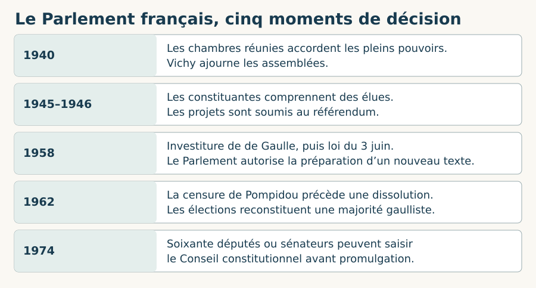
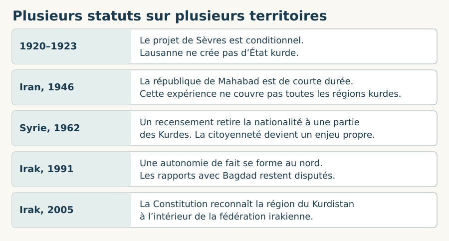

# BEL · AL — Histoire contemporaine (oral tronc commun 25 juin) 2026 · Corrigé guidé

*Corrigé rédigé par IA, non officiel. Signalez toute erreur.*

**Rédaction** · GPT-6.2 Astra Ultra · vitesse non renseignée

**Autocontrôle** · GPT-6.2 Astra Ultra · vitesse non renseignée

## Les vingt-quatre choix du 25 juin

Les deux sujets de chaque billet demeurent indépendants. Pour la biographie de Pétain, sa carrière antérieure à 1939 doit éclairer son autorité au seuil du programme. Pour le sujet kurde, partir du droit prévu à Sèvres, sans traiter comme fondé un État qui n’a pas existé sous cette forme.

| Billet | Relance sur le premier choix | Relance sur le second choix |
|---|---|---|
| 1 | Un Front national progressiste syrien contredit-il la domination du Baas ? Il associe des partis subordonnés, ce qui invite à distinguer monopole effectif et exclusivité juridique. | Pourquoi plusieurs cartes de la France occupée ? La zone sud est occupée en novembre 1942 et les administrations des territoires frontaliers sont elles-mêmes particulières. |
| 2 | Lausanne concerne-t-il les Kurdes comme les non-musulmans ? Le cadre particulier des minorités non musulmanes ne garantit pas de la même manière les droits des Kurdes musulmans. | À quoi sert Verdun dans le sujet ? Il éclaire le prestige de Pétain en 1939. Les actes à expliquer restent ceux de la période, de l’armistice au procès et à la mémoire. |
| 3 | Que prouve la datation d’un objet ? Une chronologie matérielle. Sa présentation comme origine d’une nation moderne est une autre proposition qu’il faut historiciser. | Quelle différence entre voter et « être communiste » ? L’adhésion, les milieux associatifs et les municipalités donnent à l’appartenance des dimensions que le bulletin ne mesure pas. |
| 4 | Quel statut acquiert le Kurdistan irakien en 2005 ? La reconnaissance comme région dans la fédération irakienne, distincte d’une indépendance. | Pourquoi utiliser un bassin comme échelle administrative ? Amont, aval et pollution partagée excèdent les limites des communes et des départements. |
| 5 | Toutes les mesures de 1973 sont-elles prises par l’ensemble de l’OPEP ? Distinguer décisions sur les prix et embargo de producteurs arabes. | Que devient la tutelle en 1982 ? Le préfet transmet au juge administratif les actes qu’il estime illégaux, dans un contrôle exercé après leur adoption. |
| 6 | Une nation arabe implique-t-elle une capitale politique unique ? Le panarabisme en propose des formes différentes et l’échec de la République arabe unie en montre les limites. | Le programme de centrales de 1974 supprime-t-il le besoin de pétrole ? Il transforme surtout la production électrique. Les transports restent largement dépendants des carburants. |
| 7 | Une école de réfugiés dépend-elle forcément d’un ministère national ? L’UNRWA scolarise des élèves palestiniens dans plusieurs territoires. | Comment articuler un exemple local et le Plan ? Au Havre, logement et remise en service du port se jouent à des échelles de décision différentes. |
| 8 | Une ligne d’armistice est-elle une frontière internationale définitive ? Son objet est la cessation des combats. La reconnaissance territoriale peut rester contestée. | Quel risque à compter seulement les personnes inscrites ? Formation, préretraite ou changement de catégorie peuvent modifier les fichiers sans créer d’emploi. |
| 9 | Les foules de 1967 et de 2011 au Caire ont-elles le même rapport au chef de l’État ? Les premières soutiennent le maintien de Nasser, les secondes réclament notamment le départ de Moubarak. | Que quitte la France en 1966 ? Le commandement militaire intégré de l’OTAN. Elle reste membre de l’alliance politique. |
| 10 | Un ancien officier devenu ministre suffit-il à définir un régime militaire ? Il faut établir qui nomme et révoque le gouvernement et à qui il rend compte. | Que comparer entre 1954 et 1992 ? Le rejet parlementaire du projet de défense et la ratification référendaire serrée de Maastricht n’engagent ni le même texte ni les mêmes votants. |
| 11 | À quoi sert la réforme de 1974 ? Soixante députés ou soixante sénateurs peuvent saisir le Conseil constitutionnel, ce qui donne un recours à l’opposition. | Qui peut engager les employeurs dans un accord ? L’organisation munie d’un mandat adapté au niveau de négociation, branche ou accord interprofessionnel. |
| 12 | La transmission de la présidence syrienne en 2000 transforme-t-elle formellement la Syrie en monarchie ? Le fonctionnement dynastique cohabite avec un ordre déclaré républicain. | De Gaulle est-il élu directement en décembre 1958 ? Un collège électoral l’élit. La première présidentielle directe de la Ve République a lieu en 1965. |

## Billet 1

### Les partis uniques au Moyen-Orient

Un parti unique détient légalement ou effectivement le monopole de la représentation politique. Il faut le distinguer d’une organisation dominante qui peut perdre une élection, d’un front de plusieurs partis subordonnés et d’une monarchie qui interdit les partis sans en instituer un seul. La Turquie républicaine offre un premier exemple avec la longue prééminence du Parti républicain du peuple, héritier du mouvement de Mustafa Kemal. Des tentatives limitées de pluralisme précèdent l’ouverture effective du jeu après la Seconde Guerre mondiale. La victoire du Parti démocrate en 1950 permet de dater la fin d’un système dans lequel l’appareil du parti et la construction de la République étaient étroitement liés.

En Égypte, les Officiers libres éliminent les anciennes formations et organisent successivement plusieurs cadres de mobilisation, dont l’Union socialiste arabe sous Nasser. Le parti encadre l’accès à des responsabilités et entend faire participer les citoyens au projet de développement tout en limitant l’expression autonome de conflits. Dans l’Irak et la Syrie baasistes, les deux directions rivales du Baas se réclament d’un programme arabe unitaire. Leurs appareils fonctionnent pourtant au service d’États différents et sont liés aux présidences, aux administrations et aux services de sécurité. En Syrie, le Front national progressiste associe à partir de 1972 des partenaires subordonnés au Baas, ce qui impose de nuancer la formule du parti juridiquement unique. Un congrès ou une organisation de jeunesse peut faire remonter des demandes comme diffuser des décisions. L’étude doit donc porter sur le recrutement, les bénéfices attachés à la carte et le sort des dissidents. La permanence d’un nom de parti ne signifie pas que le lieu réel de décision soit resté le même.

### La France à l’heure allemande (1940-1944)

Le changement d’heure dans la zone occupée rend sensible, jusque dans les horaires de train, la présence de l’occupant. L’expression de Jean-Louis Bory dans son roman publié en 1945 évoque cependant une expérience bien plus vaste. L’armistice de juin 1940 partage le territoire en zones soumises à des autorités et à des contraintes différentes. L’Alsace et la Moselle sont annexées de fait. Le Nord et le Pas-de-Calais dépendent du commandement militaire de Bruxelles. La ligne de démarcation entrave les déplacements, les nouvelles familiales et les échanges de biens. L’occupation de la zone sud en novembre 1942 modifie encore cette géographie. Une carte de 1940 ne suffit donc pas à décrire toute la période.

Prélèvements économiques, réquisitions, frais d’occupation et contrôle du travail pèsent sur l’activité. Rationnement, queues et marché noir transforment les relations entre villes et campagnes. À partir de 1943, le STO contraint une partie des jeunes Français et alimente réfractariat et tensions dans les familles. L’occupant censure, emprisonne et déporte. Les rafles et déportations de Juifs s’appuient notamment sur la coopération des autorités françaises, dont les statuts antisémites résultent aussi d’initiatives propres. Vichy ne se réduit donc pas à un relais passif de l’Allemagne. Attentisme, accommodement, collaboration intéressée ou idéologique, sauvetages et résistances composent une gamme d’attitudes qui peut changer au fil du temps. Les bombardements et les violences de la Libération rendent les dernières semaines particulièrement périlleuses pour des civils. Le temps de l’occupation se mesure ainsi à l’emprise des ordres venus d’Allemagne et aux marges variables que conservent, utilisent ou refusent les acteurs français.

## Billet 2

### Les minorités en Turquie

Appeler un groupe « minorité » oblige à distinguer une reconnaissance juridique, une différence de langue ou de religion, et une expérience sociale de la marginalisation. Le traité de Lausanne de 1923 protège des minorités non musulmanes, dans un pays profondément transformé par les massacres, le génocide des Arméniens et les déplacements issus de la fin de l’Empire ottoman. L’échange de populations entre Grèce et Turquie, défini principalement par la religion et assorti d’exceptions, réduit la présence grecque orthodoxe dans de nombreuses régions. Les communautés arméniennes, grecques et juives sont formellement protégées mais soumises à des politiques d’homogénéisation. L’impôt exceptionnel sur la fortune de 1942 frappe lourdement des non-musulmans. Les violences d’Istanbul en septembre 1955 touchent notamment la minorité grecque et accélèrent des départs.

Les Kurdes, majoritairement musulmans, ne relèvent pas pour cette raison du même cadre minoritaire. La construction d’une nation de langue turque, les restrictions sur l’expression publique du kurde, la répression de révoltes et les déplacements contribuent à politiser des différences linguistiques et régionales. L’apparition du conflit avec le PKK à partir de 1984 ne résume pas la diversité des opinions kurdes. Les alévis, qui peuvent être turcophones ou kurdophones, rencontrent d’autres difficultés liées à la reconnaissance de leurs institutions religieuses et à la place publique donnée à l’islam sunnite. À la fin du siècle, associations, migrations vers les villes et revendications européennes de protection des droits déplacent ces questions. Dans les années 2000, certaines expressions culturelles kurdes deviennent plus visibles tandis que les conflits sur l’égalité et la mémoire se poursuivent. Une histoire des minorités doit donc suivre le droit, les pratiques administratives, les violences subies et la manière dont les intéressés définissent leurs appartenances.

### Philippe Pétain (1856-1951), dans les limites de la période du programme

En 1939, Pétain arrive dans la période au programme avec le prestige acquis à Verdun, le grade de maréchal et une carrière militaire et politique déjà longue. Son ambassade auprès de Franco en Espagne montre qu’il exerce alors aussi une fonction diplomatique. Rappeler ces antécédents suffit à expliquer pourquoi une partie des Français peut voir en lui un recours. En mai 1940, il entre au gouvernement. Président du Conseil à partir du 16 juin, il demande l’armistice et présente la cessation du combat comme une protection des Français présents en métropole. Le vote des pleins pouvoirs constituants le 10 juillet, puis les actes constitutionnels, lui permettent d’assumer l’autorité de chef de l’État français en rompant avec les institutions de la IIIe République.

Le culte du Maréchal et le langage paternaliste de la Révolution nationale contribuent à légitimer une politique autoritaire de hiérarchie sociale, de répression et d’exclusion. Le statut des Juifs d’octobre 1940 et la rencontre de Montoire attestent des choix du régime. Les persécutions, les spoliations et la collaboration d’État se développent dans un pays occupé mais avec la participation active d’institutions françaises. Les responsabilités de Laval et des administrations n’effacent pas celles du chef de l’État. Sa marge diplomatique se réduit à mesure que l’occupation s’étend. En 1944, les Allemands l’emmènent hors de France. Son retour puis son procès en 1945 aboutissent à une condamnation à mort, commuée en détention à perpétuité. Il meurt à l’île d’Yeu en 1951. Les batailles de mémoire postérieures sur Verdun, la collaboration et les victimes du régime prolongent la question dans la France d’après-guerre, sans faire de cette mémoire une excuse pour ses décisions de 1940-1944.

## Billet 3

### Archéologie, histoire et construction nationale au Moyen-Orient (1920-2011)

Un site ancien n’atteste pas par lui-même la continuité d’une nation actuelle. Le choix d’un chantier, la langue d’un cartel, l’ouverture d’un musée et la sélection d’une époque dans un manuel construisent un récit. Au sortir de l’Empire ottoman, les administrations mandataires, les missions savantes étrangères et les nouvelles institutions nationales se disputent les droits de fouiller, de conserver ou de partager des objets. En Irak, la création d’un musée à Bagdad et l’activité du service des Antiquités donnent aux vestiges mésopotamiens une place nationale. Une histoire assyrienne ou babylonienne antérieure à l’arabisation peut devenir un titre d’ancienneté de l’État moderne, sans que tous ses habitants se reconnaissent dans la même généalogie.

En Turquie républicaine, la valorisation des Hittites et d’un passé anatolien préislamique accompagne la recherche d’une histoire nationale territorialisée. En Iran, les célébrations de Persépolis de 1971 mettent le passé achéménide au service de la monarchie Pahlavi. Le renversement de 1979 modifie les préférences officielles sans effacer l’attachement aux sites perses. En Israël et dans les territoires palestiniens, fouilles, toponymes et parcs archéologiques peuvent mettre en concurrence des revendications d’appartenance à la terre. Il faut séparer la datation scientifique d’un vestige et l’usage politique qu’on en fait. Les sites attirent touristes et devises, mobilisent une main-d’œuvre locale et peuvent entraîner l’expropriation ou l’effacement de quartiers plus récents. Le pillage du musée de Bagdad en 2003 suscite ainsi une émotion à la fois nationale et internationale. Construire un passé commun consiste autant à décider de ce que l’on expose qu’à assumer les couches historiques et les habitants que le récit risque d’écarter.

### Être communiste en France (1939-1995)

Être communiste peut vouloir dire adhérer au PCF, militer dans un syndicat ou une association proche, voter pour le parti ou habiter un monde municipal marqué par lui. Ces appartenances ne se confondent pas. Après le pacte germano-soviétique de 1939, le gouvernement français dissout le parti et poursuit ses militants. La clandestinité, les tâtonnements de sa direction et les engagements précoces de certains adhérents précèdent l’entrée massive du PCF dans la lutte contre l’occupant après l’invasion de l’URSS en juin 1941. Les résistances communistes, y compris celles des immigrés de la MOI, subissent arrestations et déportations. À la Libération, le prestige résistant et soviétique nourrit une forte audience électorale et une participation ministérielle jusqu’en 1947.

La guerre froide donne à l’engagement une dimension de contre-société. Cellule d’entreprise, vente de L’Humanité, municipalité de banlieue, activités de jeunesse et luttes pour la paix organisent une sociabilité quotidienne. Des femmes y acquièrent des responsabilités locales tout en rencontrant des hiérarchies souvent masculines. Les discours sur Moscou et le rapport aux guerres coloniales divisent, surtout lors de la répression en Hongrie en 1956 puis de l’invasion de la Tchécoslovaquie en 1968. Rester, rompre ou s’éloigner progressivement sont des expériences différentes. Le Programme commun de 1972 et la participation au gouvernement en 1981 offrent une perspective d’action institutionnelle. Le déclin de bastions industriels, les critiques du modèle soviétique et la concurrence du PS affaiblissent l’électorat. Après 1989-1991, des municipalités, des syndicats et des fidélités familiales demeurent. L’histoire d’une appartenance ne s’achève pas au même rythme que la chute de l’État qui avait longtemps servi de référence.

## Billet 4

### L’impossible État-nation kurde (1920-2011)

Le mot « impossible » invite à expliquer un résultat, sans faire de l’échec un destin naturel. Les Kurdes vivent principalement dans des régions relevant de la Turquie, de l’Irak, de l’Iran et de la Syrie. Ils n’ont ni une langue politique unique ni des expériences identiques de l’État. Le traité de Sèvres de 1920 envisage sous conditions une autonomie puis un éventuel accès à l’indépendance dans une partie de l’ancien territoire ottoman. Il n’entre pas en application sous cette forme. Lausanne en 1923 ne reprend pas ces dispositions. Le partage territorial et le renforcement de plusieurs souverainetés imposent dès lors des interlocuteurs et des frontières distincts. Les grandes puissances peuvent soutenir ponctuellement certaines forces kurdes sans soutenir un projet d’État commun.

En Turquie, l’homogénéisation linguistique, la répression des révoltes puis le conflit avec le PKK après 1984 inscrivent la question kurde dans un long affrontement politique. En Iran, la république de Mahabad ne dure qu’en 1946. En Irak, les luttes pour l’autonomie, les rivalités entre organisations kurdes et la répression baasiste, notamment l’Anfal, produisent une autre trajectoire. Après 1991, le retrait des forces de Bagdad de certaines zones et la protection internationale favorisent des institutions autonomes. La Constitution irakienne de 2005 reconnaît la région du Kurdistan dans un État fédéral. En Syrie, un recensement exceptionnel en 1962 prive une partie des Kurdes de la citoyenneté. Ces expériences montrent pourquoi autonomie territoriale, droits culturels, citoyenneté et indépendance doivent être distingués. À la borne de 2011, un projet national kurde existe sous plusieurs formes et certaines institutions territoriales ont acquis une réalité durable, sans qu’un État indépendant réunissant ces populations ait émergé.

### Les politiques de l’environnement en France

Dès avant qu’un ministère soit créé en 1971, l’État, les communes et les associations administrent des forêts, des paysages, des ressources en eau et des risques sanitaires. La reconstruction pousse à augmenter l’offre d’énergie, les rendements et les logements. Des aménagements qui paraissent alors indispensables ont aussi des conséquences locales sur les vallées submergées, la pollution industrielle ou l’urbanisation du littoral. La loi de 1960 sur les parcs nationaux et la création du parc de la Vanoise en 1963 instituent des espaces protégés. La loi sur l’eau de 1964 organise une gestion par bassin et des instruments de financement qui ne se réduisent pas à la protection d’un paysage remarquable.

Le ministère de l’Environnement confié à Robert Poujade en 1971 réunit des compétences dispersées mais doit négocier avec des administrations économiques mieux dotées. Associations naturalistes, habitants et élus utilisent enquêtes, juridictions et expertises pour contester ou modifier un projet. L’opposition à la centrale de Plogoff en offre un exemple, tandis que l’expansion nationale du nucléaire souligne la force des arbitrages énergétiques après 1973. La loi de 1976 sur la protection de la nature affirme notamment l’importance des études d’impact. Les lois Montagne de 1985 et Littoral de 1986 cherchent à encadrer l’aménagement d’espaces soumis à la pression touristique et immobilière. Accidents industriels, pollution des eaux et débats sur les déchets élargissent les préoccupations de santé publique. Les normes européennes et les mobilisations locales modifient également le champ de l’action. En 1995, la loi Barnier renforce les principes de la protection environnementale. Mesurer une politique oblige encore à comparer le droit voté, les moyens des inspecteurs et les évolutions observables sur un territoire.

## Billet 5

### Le pétrole dans les rivalités régionales au Moyen-Orient

Le pétrole n’est pas réparti uniformément et son transport relie souvent des États qui n’ont pas les mêmes intérêts. Les sociétés concessionnaires jouent longtemps un rôle majeur, mais les conflits entre États de la région ne sont pas de simples prolongements des rivalités européennes. Dans les années 1920, la question de Mossoul oppose la Turquie et l’Irak sous tutelle britannique. La possession d’un territoire potentiellement riche en pétrole compte dans le débat sans effacer les arguments démographiques, frontaliers et stratégiques. Les itinéraires des oléoducs donnent aux pays de transit, notamment la Syrie ou le Liban, des recettes et une marge de négociation différentes de celles d’un producteur.

La création de l’OPEP en 1960 développe une coopération entre États producteurs dont les objectifs de prix et de volumes peuvent pourtant diverger. En 1973, les mesures d’embargo sont décidées par des producteurs arabes et ne concernent pas de la même manière l’Iran, membre de l’OPEP mais non arabe. Les recettes accroissent l’influence financière des monarchies du Golfe, soutiennent des aides et renforcent des concurrences de prestige. Pendant la guerre Iran-Irak, la dépendance aux exportations et les relations avec les autres producteurs s’ajoutent aux enjeux de frontière, de révolution et de sécurité. Le prix du pétrole, les dettes irakiennes et les différends sur l’exploitation des gisements frontaliers pèsent sur la crise qui conduit à l’invasion du Koweït en 1990. Ils n’en constituent pas une explication exclusive. Les décisions de production peuvent unir temporairement des adversaires, tandis qu’une même ressource peut devenir objet de conflit territorial, moyen de financement ou instrument de pression diplomatique.

### Le rôle des préfets en France (1939-1995)

Le préfet représente dans le département une autorité centrale, mais ce qu’il doit y faire appliquer dépend de l’État qui le nomme. Pendant la guerre et l’Occupation, ces hauts fonctionnaires administrent ravitaillement, police et réquisitions. Vichy crée des préfets régionaux et mobilise l’appareil préfectoral dans la persécution antisémite et la collaboration. La préfecture de police de Paris participe aux rafles. Des trajectoires individuelles divergent, celle de Jean Moulin passant du corps préfectoral à l’organisation de la Résistance. Une telle trajectoire n’efface pas la responsabilité d’institutions dont les dossiers documentent les arrestations et les spoliations.

À la Libération, les commissaires de la République et les préfets concourent à la restauration de l’ordre républicain, au ravitaillement et à la réorganisation administrative. Sous les IVe et Ve Républiques, ils demeurent des figures du maintien de l’ordre mais deviennent aussi coordinateurs du développement, des grands travaux et des services de l’État dans les territoires. Le rôle de Maurice Papon, préfet de police lors de la répression du 17 octobre 1961 à Paris, illustre l’enjeu des responsabilités dans la chaîne de commandement. Les préfets de région institués en 1964 renforcent l’échelle régionale de planification. Les lois de décentralisation de 1982 transfèrent l’exécutif départemental au président du conseil général et remplacent la tutelle préalable par un contrôle de légalité après transmission des actes, exercé sous le contrôle du juge. Le préfet conserve la représentation de l’État et la coordination de ses services. Son rôle se transforme donc du commandement administratif vers une combinaison de négociation territoriale et de garantie de légalité, avec de fortes variations selon les fonctions et les crises.

## Billet 6

### Les formes du nationalisme au Moyen-Orient (1920-2011)

Avant de parler de réveil d’une nation, il faut demander quelles frontières et quels membres lui attribuent ses porte-parole. Le kémalisme définit une souveraineté turque centrée sur l’Anatolie et un État républicain successeur de l’Empire ottoman. Le nationalisme arabe peut prendre pour horizon une communauté de langue débordant les frontières, ou soutenir un État arabe déterminé. Des identités syrienne, irakienne ou égyptienne se construisent dans des institutions portées tantôt par les anciennes élites, tantôt par des partis et des mouvements populaires. En Palestine mandataire, le sionisme et le nationalisme arabe palestinien développent des projets concurrents sur le même territoire. Chacun est lui-même traversé de courants politiques et d’interprétations de la religion.

Après les indépendances, la nationalisation de Suez en 1956 vaut simultanément affirmation de la souveraineté égyptienne et succès symbolique pour de nombreux Arabes. La République arabe unie entre Égypte et Syrie de 1958 à 1961 montre combien l’unité proclamée rencontre la concurrence d’élites gouvernementales et de projets économiques. Les deux branches syrienne et irakienne du Baas défendent un imaginaire panarabe tout en affrontant les intérêts d’un État voisin. Le nationalisme iranien peut se référer à la dynastie, aux ressources du pays ou à une opposition démocratique et anticoloniale, selon qui l’énonce. Le mouvement kurde articule de son côté droits culturels, autonomie et, pour certains, indépendance. Armée, école, musée, langue et cérémonies font vivre les nations, mais suscitent aussi des exclusions. En 2011, l’usage d’un drapeau national par des manifestants peut revendiquer un pays contre son propre gouvernement. L’histoire du nationalisme doit ainsi distinguer territoire, État, peuple invoqué et institutions effectivement représentatives.

### Nucléaire civil et nucléaire militaire en France

La création du Commissariat à l’énergie atomique en 1945 donne un cadre public à la recherche, aux industries et aux décisions politiques relatives au nucléaire. Les objectifs scientifiques, énergétiques et stratégiques se croisent dans les mêmes institutions, mais ne se confondent pas. L’explosion française de 1960 au Sahara marque l’entrée dans le cercle des puissances dotées de l’arme nucléaire. La doctrine gaullienne de dissuasion lui donne une signification d’indépendance politique, discutée par ses adversaires et par des mouvements pacifistes. Les essais se poursuivent ensuite en Polynésie française. Ils soulèvent sur place et au-delà des questions de santé, de consentement, d’environnement et de rapport entre métropole et territoires ultramarins. Leur reprise en 1995 provoque de nouvelles contestations.

La production d’électricité répond à une autre décision publique. EDF, le CEA et les entreprises industrielles élaborent des programmes dont les coûts et les stratégies techniques font débat. Le choix d’un vaste programme électronucléaire en 1974, dans le contexte du premier choc pétrolier, transforme progressivement la production d’électricité. Il limite certaines consommations de combustibles fossiles pour ce secteur sans supprimer la dépendance pétrolière des transports. Le financement, la localisation des sites, les déchets et la confiance dans l’expertise deviennent des enjeux politiques. Les mobilisations à Plogoff et les réactions à l’accident de Tchernobyl en 1986 montrent que les populations ne jugent pas les risques à la seule échelle nationale. Les deux histoires ont ainsi en commun une décision publique fortement centralisée et une prétention à l’autonomie. Elles diffèrent quant aux usages, aux institutions de contrôle et à la manière dont les habitants en éprouvent les conséquences.

## Billet 7

### L’éducation au Moyen-Orient (1920-2011)

Une histoire de l’éducation doit suivre les lieux où s’apprennent lire, écrire, calculer et appartenir à une communauté politique. Après 1918 coexistent des enseignements religieux, des écoles publiques héritées ou réorganisées, des missions étrangères, des établissements privés et des formations techniques. Les mandats apportent langues d’enseignement et modèles d’examen liés aux puissances européennes. Des familles et des enseignants y trouvent des ressources d’ascension tout en contestant les récits historiques ou le coût de l’accès. En Turquie, la réforme de l’enseignement et l’adoption de l’alphabet latin en 1928 associent alphabétisation, laïcisation et définition d’une nation. Une réforme d’écriture a aussi des effets de génération sur l’accès aux textes anciens.

Après les indépendances, les États investissent dans les écoles et les universités pour former fonctionnaires, médecins, ingénieurs et enseignants. En Égypte, l’élargissement des études sous Nasser lie davantage diplôme et espoir d’emploi public. Les États du Golfe financent par les hydrocarbures de nouveaux établissements et recrutent aussi des enseignants étrangers. Les réfugiés palestiniens scolarisés par l’UNRWA illustrent un réseau d’éducation qui dépasse les frontières d’un État souverain. Les femmes entrent en plus grand nombre dans le secondaire et le supérieur, mais disponibilité locale d’une école, ressources des familles et normes de genre continuent à peser sur les parcours. La guerre civile au Liban et les guerres en Irak exposent également les enfants à des interruptions durables. En 2011, la mobilisation de jeunes diplômés sans débouchés révèle une contradiction entre les promesses scolaires et les emplois disponibles. L’accès à l’école, le contenu de l’enseignement et la valeur sociale du diplôme demandent donc trois enquêtes distinctes.

### Reconstruire la France à la Libération

Reconstruire commence avant 1945 et ne signifie pas remettre le pays dans son état d’avant-guerre. Ports détruits, voies coupées, logements endommagés et pénuries imposent d’abord de déblayer, transporter, ravitailler et abriter. Les habitants du Havre, par exemple, ne vivent pas la Libération seulement comme une fête nationale. Une part de leur ville vient d’être dévastée par les bombardements. La réparation des bâtiments dépend de matériaux, de main-d’œuvre, du financement des dommages de guerre et de décisions sur la forme future du quartier. Le ministère de la Reconstruction et de l’Urbanisme et les municipalités doivent arbitrer entre urgence, propriété et projet à long terme.

La reconstruction est aussi productive et politique. Les nationalisations et la planification donnent à l’État des moyens pour affecter les ressources au charbon, à l’électricité, aux transports et aux secteurs prioritaires. L’aide Marshall intervient plus tard, à partir de la fin des années 1940, et ne doit pas expliquer les décisions de 1944. La Sécurité sociale et l’extension de droits politiques traduisent la volonté de refonder la solidarité et la citoyenneté. Les femmes votent, le Gouvernement provisoire restaure la légalité républicaine et les constituants discutent des institutions. Les prisonniers, déportés et requis doivent retrouver les leurs, tandis que les survivants de la Shoah affrontent des disparitions irréparables et la question de la restitution des biens. Les grèves et les conflits de répartition montrent que la « bataille de la production » ne rassemble pas durablement tout le monde. La reconstruction a des temporalités différentes selon que l’on mesure le trafic d’un port, la fin du rationnement, le retour d’une famille ou le logement de tous les sinistrés.

## Billet 8

### Les frontières au Moyen-Orient

Une frontière est une ligne de souveraineté, un ensemble de contrôles et parfois une limite vécue très différemment par les populations riveraines. La disparition de l’Empire ottoman met en concurrence projets nationaux, intérêts européens et circulations plus anciennes. L’accord Sykes-Picot de 1916 n’explique pas à lui seul les frontières obtenues. Les décisions de San Remo, les mandats, la mobilisation turque, les traités et les controverses comme celle de Mossoul contribuent à leur fixation. En 1923, Lausanne donne un règlement territorial différent de celui envisagé à Sèvres en 1920. Les parcours kurdes ou les réseaux de villes rappellent que le nouveau tracé peut séparer des populations et lier sous la même administration des espaces auparavant gouvernés autrement.

Après 1945, des lignes d’armistice deviennent des repères politiques sans constituer nécessairement des frontières internationales acceptées. Les lignes de 1949 autour d’Israël, l’occupation de territoires en 1967 et les paix avec l’Égypte puis la Jordanie imposent de distinguer ligne de cessez-le-feu, frontière reconnue et zone contrôlée. L’occupation du Koweït par l’Irak en 1990 puis le rétablissement de sa souveraineté en 1991 montrent la force du principe d’intégrité territoriale. Pour les habitants, un poste-frontière peut être lieu de travail, obstacle à une visite familiale ou seuil entre deux statuts de réfugié. Les oléoducs et l’eau partagée obligent des administrations rivales à discuter du franchissement. Le territoire juridiquement attribué, les contrôles effectifs et l’espace pratiqué ne coïncident donc pas toujours. Une carte historique convaincante doit dater ses traits et préciser la nature de chacun.

### Lutter contre le chômage en France (1939-1995)

Le chômage est une situation sociale, mais aussi une catégorie statistique et un risque que des institutions reconnaissent ou non. La guerre, le travail contraint et les pénuries de main-d’œuvre rendent les séries des années 1940 peu comparables à celles de la fin du siècle. À la Libération, le problème est d’abord de mobiliser du travail dans la reconstruction. Le plein emploi de la croissance n’efface pas les pertes locales de postes ni les inégalités selon l’âge, le sexe ou la qualification. L’assurance chômage négociée en 1958 entre partenaires sociaux protège une partie des salariés privés d’emploi. Elle est distincte de l’assistance et de l’action de placement. L’ANPE, créée en 1967, facilite inscription et mise en relation avec les employeurs.

À partir des chocs pétroliers et des restructurations, la fermeture de mines et d’usines fait du chômage durable une expérience de masse concentrée dans certains bassins. Les gouvernements combinent relance de la demande, soutien aux entreprises, formation et politiques ciblées pour les jeunes. Les préretraites abaissent ponctuellement les effectifs visibles sur le marché du travail sans recréer les postes supprimés. Contrats aidés, stages et allégements de cotisations cherchent ensuite à faciliter les embauches, avec des effets variables sur la qualification et la stabilité des emplois. La réduction du temps de travail à trente-neuf heures en 1982 relève d’un partage de l’emploi et d’un objectif social. Le RMI créé en 1988 répond à l’exclusion et aux insuffisances des revenus plutôt qu’à la création directe de postes. En 1995, mesurer une politique suppose donc d’examiner le nombre d’emplois, la durée du chômage et le sort des personnes sorties des fichiers, autant que le taux de chômage affiché.

## Billet 9

### La rue politique au Moyen-Orient (1920-2011)

Une place centrale réunit trois propriétés politiques. Elle rassemble des personnes qui ne se rencontrent pas nécessairement dans une organisation, rend visibles au pouvoir des revendications et permet à d’autres publics d’en recevoir des images. Aucune de ces propriétés n’assure le succès d’un mouvement. Sous les mandats, défilés, grèves de boutiques et cortèges funéraires donnent aux revendications nationales un point d’appui dans les villes. En Palestine, l’articulation des grèves, des mobilisations de quartier et du monde rural en 1936 montre que la rue politique dépasse la seule manifestation d’une journée. L’autorité qui autorise un cortège, surveille un quartier ou sanctionne une réunion dessine les frontières du public légitime.

Les régimes indépendants utilisent eux aussi la rue. Parades officielles et rassemblements présidentiels peuvent exprimer une adhésion, mais une foule réunie par un appareil d’État n’équivaut pas à un vote libre. Les manifestations qui suivent l’annonce de démission de Nasser en 1967 illustrent la difficulté à mesurer soutien populaire et encadrement politique. En Iran en 1978-1979, commémorations, cortèges et grèves donnent une visibilité commune à des groupes dont les projets restent différents. En 2011, la place Tahrir au Caire devient une scène mondiale et un lieu vécu où se croisent travailleurs, étudiants, hommes, femmes, militants organisés et personnes sans parti. Les images diffusées à l’extérieur ne rendent pas compte de tous les lieux de la mobilisation ni des inégalités entre participants. L’issue dépend aussi de l’armée, des administrations et des négociations hors de la rue. L’histoire d’un espace politique demande donc de raconter sa fréquentation, les risques encourus et ce qu’il advient des revendications lorsque la place se vide.

### La politique extérieure du général De Gaulle (1958-1969)

De Gaulle revient au pouvoir alors que l’Algérie mobilise l’armée, le budget et les relations internationales de la France. L’autodétermination puis l’indépendance en 1962 ont donc une dimension extérieure décisive. La sortie de guerre permet à Paris de redéployer sa diplomatie, tandis que des accords de coopération maintiennent des liens étroits, et parfois très inégaux, avec des États africains indépendants. « Indépendance nationale » signifie pour de Gaulle que la France conserve une capacité propre d’appréciation et de décision. La force de dissuasion et le retrait du commandement militaire intégré de l’OTAN en 1966 en sont des manifestations. La France reste membre de l’Alliance atlantique. Son soutien aux États-Unis lors de la crise de Cuba illustre que l’autonomie ne signifie pas une opposition systématique à Washington.

Dans la construction européenne, le gouvernement défend le marché commun et la politique agricole, tout en refusant une intégration supranationale accrue. Le traité de l’Élysée avec la RFA en 1963, les refus de l’entrée britannique pendant la décennie et la crise de la chaise vide en 1965 procèdent d’une conception de la coopération entre États. Les partenaires ne partagent pas nécessairement ses priorités. La reconnaissance de la République populaire de Chine en 1964, le voyage en URSS en 1966 et le discours de Phnom Penh sur le Vietnam montrent une recherche d’interlocuteurs au-delà du cadre atlantique. Les déclarations sur le Québec en 1967 ou les positions prises après la guerre des Six Jours suscitent d’importants désaccords. Les moyens économiques et militaires limitent les ambitions de « grandeur ». Le bilan doit donc distinguer liberté de parole diplomatique, décisions institutionnelles durables et capacité réelle de transformer les choix d’autres gouvernements.

## Billet 10

### Militaires et pouvoir politique au Moyen-Orient (1920-2011)

Une armée peut constituer un corps de fonctionnaires, un moyen de mobilité sociale, un arbitre de succession ou le centre même d’un régime. Ces rôles ne se recouvrent pas. Dans plusieurs États nouveaux, les officiers sont formés dans des écoles issues de l’Empire ottoman ou des mandats, où ils acquièrent des liens dépassant leurs origines locales. En Turquie, le mouvement national dirigé par Mustafa Kemal établit une république civile dont l’armée affirme ensuite protéger les principes. Les interventions de 1960, 1971 et 1980 produisent des configurations politiques différentes. En Irak, la famille hachémite s’appuie sur une armée qui devient aussi un foyer de nationalisme et dont des cadres finissent par renverser la monarchie en 1958.

En Égypte, les Officiers libres écartent Farouk en 1952. L’ascension de Nasser ne doit pas faire oublier le gouvernement d’un groupe et ses divisions initiales. Sous ses successeurs, l’armée garde des ressources institutionnelles et économiques propres. Le départ de Moubarak en 2011 ne signifie pas la fin de son pouvoir. En Syrie, le Baas et les rivalités entre officiers structurent l’accès à la présidence de Hafez al-Assad. Partis, services de sécurité, familles dirigeantes et officiers se renforcent ou se concurrencent selon les moments. En Israël, l’armée occupe une place sociale majeure et d’anciens officiers entrent en politique, tandis que la formation des gouvernements passe par la majorité parlementaire. Le contraste distingue bien prestige militaire, circulation des élites et gouvernement direct par les forces armées. Menaces extérieures, conscription et budgets expliquent une partie de la place des militaires. Ils ne permettent pas de déduire une même forme politique pour toute la région.

### Les Français face à la construction européenne

Le terme « les Français » demande d’étudier les gouvernements, les groupes économiques et les électeurs, dont les positions ne coïncident pas toujours. La réconciliation après les guerres et l’objectif de reconstruction donnent à la coopération franco-allemande une force particulière. La déclaration Schuman de 1950 puis la CECA organisent une gestion commune du charbon et de l’acier. Pourtant l’Assemblée nationale refuse en 1954 d’ouvrir la voie à la ratification de la Communauté européenne de défense. Communistes, gaullistes ou défenseurs de prérogatives parlementaires contestent ce projet pour des raisons différentes. Une même personne peut soutenir un marché commun et refuser une armée intégrée. Les traités de Rome de 1957 et la politique agricole commune changent les intérêts des entreprises, des agriculteurs et des consommateurs sans les rendre unanimement favorables.

Sous de Gaulle, la participation au marché commun se concilie difficilement avec une conception très nationale de la décision. Après le référendum de 1972 sur l’élargissement et la première élection directe du Parlement européen en 1979, des citoyens sont appelés à s’exprimer davantage sur le projet. Les régions frontalières, les entreprises exportatrices et les bassins industriels en restructuration éprouvent différemment ouverture des marchés et normes communes. Le Système monétaire européen puis le choix français de rester dans son cadre en 1983 rendent le débat sur la souveraineté économique plus visible. Le référendum de 1992 sur Maastricht se conclut par une faible majorité de « oui ». Les partis et les milieux sociaux se divisent sur l’union monétaire, la démocratie et la solidarité. Plutôt qu’une progression continue vers l’adhésion, l’histoire fait apparaître des accords toujours conditionnels sur la paix, le marché, les droits et le pouvoir de décider.

## Billet 11

### La vie parlementaire en France (1939-1995)

La vie parlementaire ne se réduit ni aux textes constitutionnels ni au décompte des cabinets. Elle comprend aussi commissions, débats, votes, groupes et rapports aux électeurs. En 1939, la IIIe République connaît déjà un renforcement du pouvoir exécutif. Le 10 juillet 1940, à Vichy, les parlementaires réunis accordent les pleins pouvoirs constituants à Pétain. Quatre-vingts votent contre dans une assemblée dont de nombreux membres sont absents ou empêchés. Les actes constitutionnels ajournent les chambres et mettent fin à l’exercice normal du parlementarisme. L’Assemblée consultative provisoire d’Alger, puis de Paris, permet une représentation politique de la France combattante, avant les assemblées élues à partir de 1945 et l’entrée des premières femmes au Palais-Bourbon.

Sous la IVe République, l’Assemblée nationale joue un rôle décisif dans l’investiture et le contrôle du gouvernement. Les coalitions fragiles entraînent des crises répétées, mais le travail législatif organise reconstruction, politiques sociales et engagements européens. La crise algérienne de 1958 conduit le Parlement à investir de Gaulle et à autoriser l’élaboration d’un nouveau texte. La Ve République encadre le domaine de la loi et les procédures de responsabilité et renforce l’exécutif. La censure du gouvernement Pompidou en 1962, suivie d’une dissolution, montre la confrontation possible entre les deux légitimités. La discipline majoritaire n’empêche ni l’opposition, ni les commissions, ni les discussions budgétaires. La saisine du Conseil constitutionnel ouverte à soixante députés ou sénateurs en 1974 donne un nouvel instrument aux minorités. Les cohabitations puis la majorité relative après 1988 rappellent enfin que les gouvernements doivent obtenir ou négocier les voix nécessaires. La vie parlementaire change de poids sans se confondre avec une disparition.

### Le syndicalisme patronal en France (1939-1995)

Le syndicalisme patronal rassemble des employeurs pour représenter des intérêts collectifs dans les branches, les territoires et auprès de l’État ou des syndicats de salariés. Le responsable d’une entreprise n’est pas nécessairement syndiqué, et les intérêts d’une petite entreprise intérieure diffèrent de ceux d’un grand groupe exportateur. Sous Vichy, comités d’organisation et projets corporatifs imposent des formes de coordination que la Libération doit réexaminer dans un contexte d’épuration et de reconstruction. Le Conseil national du patronat français, fondé en 1945, cherche à donner une représentation nationale au patronat. La Confédération générale des petites et moyennes entreprises, créée en 1944, fait valoir d’autres contraintes de trésorerie, de réglementation et d’accès aux marchés.

Les organisations patronales négocient conventions collectives, salaires et protection sociale. L’accord de 1958 sur l’assurance chômage illustre une institution paritaire où les employeurs n’agissent ni seuls ni comme simple courroie de l’État. La participation du CNPF aux discussions de Grenelle en 1968 montre comment une organisation négocie dans une crise où son accord ne suffit pas à faire reprendre le travail. Les campagnes sur les charges sociales, l’ouverture internationale et l’organisation de la production évoluent avec la crise industrielle. Sous la gauche arrivée au pouvoir en 1981, les nationalisations et les lois Auroux sur le travail suscitent de vifs débats et des stratégies variées entre branches. Les prises de position du CNPF sur la compétitivité et la flexibilité sous Yvon Gattaz puis Jean Gandois ne résument pas les demandes de tous les employeurs. Avant 1995, le nom de l’organisation est toujours CNPF. Le changement en Medef interviendra en 1998. L’histoire fait apparaître des porte-parole dont l’autorité consiste précisément à transformer des intérêts concurrents en mandat de négociation.

## Billet 12

### Les républiques arabes

Le remplacement d’un roi par un président fait-il d’un pays une république au même sens que son voisin ? Les textes, les modes de succession et les droits des citoyens apportent des réponses différentes. Le Liban acquiert une Constitution républicaine dès 1926 sous mandat français, puis connaît avec l’indépendance une répartition confessionnelle des principales charges. La Syrie devient aussi république sous mandat, avant le retrait français de 1946. En Égypte, les Officiers libres écartent Farouk en 1952 et proclament la République en 1953. La révolution irakienne de 1958 renverse une autre dynastie. Dans ces cas, la forme républicaine se lie à la souveraineté nationale et à une promesse de réforme sociale, sans assurer une compétition électorale ouverte.

Certaines républiques prétendent dépasser l’échelle nationale. De 1958 à 1961, l’Égypte et la Syrie forment la République arabe unie, mais la répartition des pouvoirs et les intérêts des élites locales conduisent à la séparation. En Syrie et en Irak, le Baas se réclame d’un projet analogue tout en consolidant des pouvoirs présidentiels rivaux. Les partis dominants, les armées et les services de sécurité jouent des rôles considérables, mais ces régimes ne fonctionnent pas tous de la même façon. Les pratiques de succession dynastique, comme celle qui porte Bachar al-Assad à la présidence syrienne en 2000 après la mort de son père, révèlent la distance possible entre forme républicaine et ouverture du pouvoir. En 2011, la contestation de présidents installés de longue date en Égypte, en Syrie ou au Yémen atteste que la citoyenneté promise reste au cœur du conflit. La comparaison gagne à observer qui nomme, qui peut être élu et comment un président peut être remplacé, plutôt qu’à déduire le régime du seul titre de l’État.

### L’année 1958 en France

En janvier 1958, rien n’assure que l’année produira une nouvelle Constitution. La guerre d’Algérie pèse sur les dépenses, les majorités et les relations internationales. Le bombardement de Sakiet Sidi Youssef en Tunisie en février aggrave la crise diplomatique. Les hésitations sur une solution politique alimentent les affrontements entre indépendance, maintien de l’Algérie française et autres projets, tandis que l’instabilité des cabinets réduit la confiance des partisans d’une restauration de l’autorité. Le 13 mai à Alger, la contestation du gouvernement et l’implication de chefs militaires dans un comité de salut public changent la nature de la crise. À Paris, Pflimlin est investi, mais ne rétablit pas une autorité incontestée. De Gaulle se déclare prêt à assumer les pouvoirs de la République.

Après la démission de Pflimlin et l’appel de René Coty, l’Assemblée investit de Gaulle le 1er juin. La loi du 3 juin autorise la préparation d’un nouveau texte selon des conditions précises. Le gouvernement est ainsi formé selon des procédures de la IVe République dans une situation de contrainte qui contribue à sa disparition. Le référendum du 28 septembre approuve la Constitution, promulguée le 4 octobre. Le refus guinéen entraîne l’indépendance et révèle la dimension impériale du vote. Les élections législatives puis l’élection de de Gaulle à la présidence en décembre, au collège électoral et non au suffrage universel direct, mettent en place les institutions. Les débuts du marché commun en janvier et les décisions économiques et monétaires de décembre rappellent que l’année n’est pas tout entière absorbée par le changement de régime. À la fin de 1958, les institutions ont changé, mais la guerre d’Algérie demeure ouverte.

[Fascicule officiel](https://www.ens.psl.eu/sites/default/files/25.06.26_sujets_histoire.pdf) · [Index des sujets du jury](https://www.ens.psl.eu/rapports-et-sujets-du-concours-2026-section-des-lettres-groupe-al)
