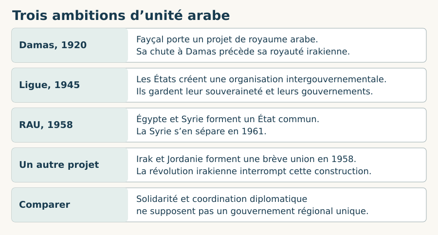

# BEL · AL — Histoire contemporaine (oral tronc commun 26 et 29 juin) 2026 · Corrigé guidé

*Corrigé rédigé par IA, non officiel. Signalez toute erreur.*

**Rédaction** · GPT-6.2 Astra Ultra · vitesse non renseignée

**Autocontrôle** · GPT-6.2 Astra Ultra · vitesse non renseignée

## Lire les onze billets de la feuille commune

L’index de l’ENS renvoie les 26 et 29 juin au même PDF, intitulé « Histoire 3 ». Les deux pages indiquent les choix par « Ou » et ne ventilent les billets ni par date ni par candidat. Le septième billet associe les étudiants en France et le confessionnalisme au Moyen-Orient, de part et d’autre du changement de page.

| Billet | Relance sur le choix français | Relance sur l’autre choix |
|---|---|---|
| 1 | Quels acteurs faut-il ajouter au gouvernement français ? Les élus et militants colonisés formulent leurs propres options d’égalité, d’autonomie ou d’indépendance. | Les six flèches sont-elles six événements ? Elles systématisent des principes dont les lois, les écoles et les institutions montrent la mise en œuvre. |
| 2 | Le libre-service est-il accessible à tous de la même manière ? Le déplacement, l’espace de rangement et le revenu disponible conditionnent les achats. | Pourquoi distinguer la Ligue arabe et la République arabe unie ? L’une coordonne des États souverains, l’autre tente d’unifier l’Égypte et la Syrie. |
| 3 | Une négociation nationale met-elle immédiatement fin aux grèves ? En 1968, les salariés évaluent les avancées et votent la reprise à des rythmes différents. | Suffit-il d’émigrer pour constituer une diaspora ? Il faut étudier les liens de transmission, les représentations d’une origine et les institutions entre plusieurs lieux. |
| 4 | Quelle différence entre tirage et lectorat ? Un exemplaire peut avoir plusieurs lecteurs, et tous les exemplaires tirés ne sont pas vendus. | La SDN administre-t-elle Damas ? La France exerce les pouvoirs du mandataire. La Commission permanente à Genève examine l’administration et les pétitions. |
| 5 | Le goût pour une musique étrangère vaut-il adhésion politique ? Les appropriations locales, la traduction et les usages d’écoute ont leur propre histoire. | Quel statut n’a pas été réalisé ? Le statut international recommandé par l’ONU en 1947 ne correspond pas à la division territoriale issue de la guerre. |
| 6 | Pourquoi la Lorraine industrielle peut-elle devenir une marge ? Une ancienne spécialisation centrale peut être dévalorisée par les restructurations. | Peut-on déduire la trajectoire syrienne des trajectoires égyptienne et jordanienne ? Chaque branche traite avec des institutions et des rapports de force nationaux distincts. |
| 7 | Quelle source documente l’expérience étudiante hors des amphithéâtres ? Une enquête de budget ou de logement renseigne sur le temps et les ressources disponibles. | Que rééquilibre l’accord de Taëf ? Les pouvoirs et les sièges entre communautés dans le cadre de l’État libanais. |
| 8 | Pourquoi comparer Maastricht aux traités de Rome ? Le contenu des décisions, la procédure de ratification et les publics mobilisés ont changé. | Les Kurdes de Turquie forment-ils un bloc partisan ? Ils participent à plusieurs partis et mobilités, et leurs revendications territoriales ou culturelles diffèrent. |
| 9 | Un quartier pavillonnaire est-il une banlieue ? Le mot décrit d’abord une position dans l’agglomération, sans déterminer un habitat ou une classe sociale. | Que reste-t-il du nassérisme après 1970 ? Un appareil étatique et un langage de souveraineté et de justice, réinterprétés malgré l’inflexion économique de Sadate. |
| 10 | Quels citoyens Vichy exclut-il en Algérie ? L’abrogation du décret Crémieux retire la citoyenneté française aux Juifs d’Algérie concernés. | Un village se réduit-il aux agriculteurs ? Les salariés, artisans, retraités et nouveaux habitants interviennent sur les services et les municipalités. |
| 11 | Équiper réduit-il toujours les écarts ? Une liaison rapide peut rapprocher ses terminus tout en contournant un territoire moins favorisé. | L’armée a-t-elle le même recrutement dans les guerres d’Indochine et d’Algérie ? La guerre d’Algérie recourt massivement aux appelés de métropole, à la différence du corps expéditionnaire d’Indochine. |

## Billet 1

### La France dans la décolonisation

En 1945, la France revendique une place retrouvée parmi les vainqueurs et entend y adosser la conservation d’un empire. Elle doit cependant compter avec les colonisés qui réclament égalité, autonomie ou indépendance, et avec un cadre international où l’autodétermination gagne en légitimité. La conférence de Brazzaville en 1944 et l’Union française de 1946 promettent une transformation du lien impérial. Des réformes comme l’abolition du travail forcé modifient réellement les droits. Elles ne suppriment ni les écarts de pouvoir ni les violences, comme en témoignent la répression de mai 1945 dans le Constantinois et celle de Madagascar après l’insurrection de 1947. Les militants indépendantistes ne sont donc pas simplement les bénéficiaires d’une décision prise à Paris.

En Indochine, la guerre conduit aux accords de Genève de 1954. En Tunisie et au Maroc, des mobilisations et négociations distinctes aboutissent aux indépendances de 1956. La guerre d’Algérie, où la division des forces politiques et le sort d’une importante population européenne pèsent particulièrement, provoque une crise de régime en métropole en 1958. Les accords d’Évian et l’indépendance en 1962 s’accompagnent de déplacements et de violences dont les mémoires se prolongent en France. En Afrique subsaharienne, la loi-cadre de 1956, le refus guinéen de la Communauté en 1958 et les indépendances de 1960 révèlent plusieurs choix africains devant les propositions françaises. Les accords de coopération, les migrations et le maintien de territoires ultramarins redéfinissent ensuite la puissance et la citoyenneté françaises. Il faut ainsi étudier la France comme puissance contrainte de négocier sa place et comme société transformée par les départs, les arrivées et les conflits issus de la décolonisation.

### Le kémalisme

Le kémalisme s’enracine dans le refus du règlement territorial imposé après la défaite ottomane et dans le projet de construire une souveraineté nationale à partir d’Ankara. La Grande Assemblée réunie en 1920 dispose d’une légitimité concurrente de celle du sultan. L’abolition du sultanat en 1922, le traité de Lausanne et la proclamation de la République en 1923, puis l’abolition du califat en 1924 correspondent à des ruptures distinctes. Mustafa Kemal donne son nom à une doctrine que les « six flèches » du Parti républicain du peuple systématisent autour du républicanisme, du nationalisme, du populisme, de l’étatisme, de la laïcité et du réformisme. Il faut expliquer ces termes par des institutions plutôt que les réciter.

La réforme du droit civil, l’alphabet latin adopté en 1928, la scolarisation, les droits électoraux des femmes et l’industrie d’État associent transformation des individus et autonomie collective. Le pouvoir entend former des citoyens d’une nation homogène. La marginalisation de langues et d’identités, notamment kurdes, et les contraintes imposées à l’opposition sont le revers de cette ambition. La Diyanet illustre une laïcité qui organise les affaires religieuses sous autorité publique. Après la mort d’Atatürk en 1938, l’alternance électorale de 1950 n’efface pas cette référence. Armée, juges, partis et associations se disputent la responsabilité de la préserver. Les interventions militaires et les débats sur le voile réinterprètent le kémalisme dans des conjonctures nouvelles. La victoire de l’AKP en 2002 et les conflits sur les institutions dans les années 2000 montrent qu’il subsiste en 2011 comme héritage constitutionnel, langage politique et objet de contestation.

## Billet 2

### Consommateurs et consommatrices en France 1939-1995

En 1942, acheter une ration de pain, c’est se présenter à la fois avec de l’argent, un droit prévu par le ravitaillement et la possibilité effective de trouver le produit. Les tickets de rationnement, les files d’attente et le recours aux réseaux familiaux montrent que le pouvoir d’achat n’est pas la seule condition de la consommation. Les femmes, fréquemment chargées des achats alimentaires, portent une part considérable du temps et des inquiétudes liés aux pénuries. Les ménages ruraux et urbains, les foyers disposant d’un jardin et ceux qui dépendent entièrement des magasins ne vivent pas la même économie domestique. La fin de la guerre ne signifie pas la disparition immédiate des restrictions.

À partir des années 1950, hausses de revenus, crédit, publicité et production en série diffusent automobile, réfrigérateur, lave-linge et télévision. L’hypermarché de Sainte-Geneviève-des-Bois en 1963 associe libre-service, parc automobile et achat en volume. Ce modèle suppose place disponible, équipement et ressources. La répartition des tâches domestiques reste inégale et l’électroménager change autant les normes de propreté qu’il économise du temps. Des associations de consommateurs réclament information, protection et contrôle de la qualité. Les crises des années 1970 et le chômage renforcent les écarts d’équipement et la sensibilité aux prix. Une comparaison entre le budget d’un foyer endetté, le panier d’une personne âgée et les achats culturels d’un adolescent fait apparaître des arbitrages irréductibles à un « consommateur moyen ». En 1995, l’offre et les lieux d’achat ont changé d’échelle, mais âge, genre, domicile et revenu continuent à structurer fortement les pratiques.

### Le panarabisme au Moyen-Orient (dans la période au programme)

Le panarabisme défend l’idée que des populations arabes séparées par des frontières peuvent constituer une même communauté politique. Il n’implique pas nécessairement une structure unique. Des projets hachémites placent une ou plusieurs monarchies au centre de l’unification, tandis que les militants baasistes imaginent une nation arabe laïque, sociale et supranationale. L’expérience du royaume arabe de Fayçal à Damas en 1920 puis son installation sur le trône irakien montrent très tôt la tension entre aspiration arabe et existence de territoires sous mandat. La Ligue arabe créée en 1945 reconnaît un patrimoine politique commun, mais elle repose sur la souveraineté de ses États membres.

Nasser donne au panarabisme une audience populaire remarquable par ses discours, la radio du Caire et son prestige après Suez en 1956. La République arabe unie de 1958 réunit effectivement l’Égypte et la Syrie sous une présidence commune. Sa dissolution en 1961 tient notamment aux déséquilibres du pouvoir et aux résistances d’élites syriennes. Le bref rapprochement des royautés irakienne et jordanienne en 1958 représente une réponse rivale, interrompue par la révolution de Bagdad. Le Baas au pouvoir en Syrie puis en Irak soutient des branches concurrentes qui défendent leurs propres appareils d’État. La défaite arabe de 1967 affaiblit le prestige des régimes qui s’étaient présentés comme les agents d’une libération commune. La cause palestinienne et les solidarités de langue continuent néanmoins à mobiliser au-delà des frontières, jusque dans les échos régionaux des soulèvements de 2011. Il faut distinguer ce répertoire de solidarité du consentement à un seul gouvernement.

## Billet 3

### Les grèves en France 1947-1995

Pourquoi commencer en 1947 ? Les ministres communistes sont écartés du gouvernement en mai et les grèves, notamment celles de l’automne, rompent avec les appels de la Libération à donner la priorité à la production. Dans un pays encore marqué par les pénuries, des revendications de salaire et de conditions de vie s’inscrivent dans des oppositions de guerre froide. La mobilisation des mineurs en 1948 et sa répression montrent la force des enjeux liés au charbon. En 1953, les grèves des services publics contre des projets touchant les retraites donnent une importance nouvelle à la défense d’un statut. Identifier secteur, employeur et revendication évite d’interpréter toute grève comme une insurrection ou comme un simple mouvement de prix.

En mai-juin 1968, l’arrêt du travail touche des millions de salariés et de nombreux sites sont occupés. Les discussions de Grenelle sur les salaires et les droits syndicaux ne mettent pas fin partout au conflit au même moment. Les attentes sur l’autorité des directions, le travail à la chaîne et la reconnaissance des qualifications dépassent le contenu de l’accord possible. Dans les années 1970 et 1980, les fermetures industrielles déplacent une partie des luttes vers la défense de l’emploi, comme dans la sidérurgie lorraine. Les salariées et les ouvriers immigrés mobilisés rendent plus visibles d’autres inégalités. Des coordinations, notamment chez les cheminots en 1986, modifient la relation entre syndicats et assemblées de grévistes. En 1995, les grèves des transports et de la fonction publique contestent des projets sociaux et rendent la circulation quotidienne un enjeu national. La grève exprime ainsi des intérêts professionnels, mais sa portée dépend des alliances entre catégories, du soutien public et du choix des interlocuteurs.

### Les diasporas au Moyen-Orient (dans la période au programme)

Une diaspora n’est pas seulement le résultat statistique d’un départ. Des populations dispersées développent, à des degrés divers, relations familiales, institutions, mémoire d’un lieu d’origine ou revendication collective. Le Moyen-Orient est à la fois terre de départ et terre d’accueil. Des Arméniens rescapés du génocide et des déplacements de la fin de l’Empire ottoman s’installent notamment au Liban et en Syrie. Églises, écoles, presse et associations y maintiennent des liens transnationaux, tandis que les familles participent à la vie économique et politique locale. Une identité diasporique peut donc coexister avec la citoyenneté d’un pays d’installation.

La dispersion palestinienne après 1948 possède d’autres causes et d’autres statuts. Un camp au Liban, une famille naturalisée en Jordanie et un travailleur expatrié dans le Golfe n’ont pas les mêmes droits. Les réseaux familiaux, les transferts d’argent et les organisations palestiniennes relient ces lieux à la question du retour et de la représentation. La tradition diasporique juive et l’immigration en Palestine puis en Israël articulent encore autrement religion, persécution, projet national et relations au pays d’origine. Les départs de Juifs de pays arabes après 1948 suivent des calendriers et des conditions propres à chaque État. D’autres mobilités, comme le travail temporaire vers le Golfe, ne constituent pas d’emblée une diaspora durable. Pour parler de diaspora il faut étudier les institutions de transmission, les circulations et les débats parmi les générations. Les États d’accueil, le droit à la citoyenneté et les politiques des gouvernements revendiqués comme pays d’origine contribuent ensemble à ces formations, sans épuiser les choix individuels.

## Billet 4

### Journaux et magazines en France 1939-1995

Pendant la guerre, l’information imprimée est à la fois un bien rationné et un instrument de pouvoir. La censure, la réquisition de papier, les saisies et le contrôle des imprimeries structurent ce qui peut circuler. Une presse autorisée ou collaborationniste coexiste avec des feuilles clandestines qui reposent sur d’autres réseaux et exposent leurs producteurs et lecteurs à des risques. À la Libération, les ordonnances sur la presse, les interdictions et les créations veulent rompre avec la collaboration et les dépendances financières discréditées. Le Monde naît en décembre 1944, tandis que des journaux issus de la Résistance découvrent la difficulté de convertir un prestige politique en lectorat et en ressources durables.

La presse quotidienne nationale n’épuise pas le sujet. Des quotidiens régionaux s’inscrivent dans des habitudes locales, et les magazines illustrés construisent des publics par centres d’intérêt, âge et genre. Elle paraît dès 1945, Paris Match à partir de 1949 et L’Express en 1953. Reportage photographique, publicité et conseils de vie quotidienne modifient la lecture autant que l’éditorial politique. Les guerres coloniales mettent l’indépendance rédactionnelle à l’épreuve des saisies, de la censure et des pressions. La radio puis la télévision transforment la valeur de l’immédiateté, conduisant les hebdomadaires à privilégier enquête, commentaire ou image. Concentration des groupes, coûts d’impression et distribution influent sur le pluralisme réel. À la fin du siècle, les tirages et les lectorats ne suivent pas la même évolution selon la périodicité et le territoire. Pour étudier la presse, il faut donc confronter un contenu, une économie et un usage, par exemple en lisant une couverture de magazine avec ses annonceurs et les courriers de son public.

### L’administration des mandats au Moyen-Orient

Le mandat institue un gouvernement de fait par une puissance étrangère au nom d’une mission internationale temporaire. L’article 22 du pacte de la SDN accorde aux anciennes provinces ottomanes classées « A » une reconnaissance provisoire comme nations indépendantes, tout en confiant conseil et assistance au mandataire. Les puissances auxquelles les Alliés attribuent les mandats à San Remo en 1920 doivent rendre des comptes à Genève. La Commission permanente des mandats examine rapports et pétitions, mais elle n’administre pas elle-même les territoires et dispose de moyens limités pour contraindre Paris ou Londres.

Les administrations concrètes diffèrent. La France crée le Grand Liban et plusieurs entités en Syrie, combine hauts-commissaires, institutions locales et tutelle budgétaire, puis réprime la grande révolte de 1925-1927. Londres soutient en Irak la royauté de Fayçal et gouverne par traités, conseil et présence extérieure jusqu’à l’admission de l’Irak à la SDN en 1932. En Palestine, l’engagement britannique envers un foyer national juif et la revendication politique de la population arabe rendent particulièrement controversées les décisions sur l’immigration, la terre et la représentation. À l’est du Jourdain, l’émirat d’Abdallah reçoit une organisation distincte. Cabinets locaux, enseignants, juges, fonctionnaires et pétitionnaires négocient les modalités concrètes de la tutelle. Les mouvements nationalistes peuvent utiliser les institutions créées sous mandat tout en contestant leur autorité supérieure. La fin des mandats s’étale des années 1930 à 1948 et n’a pas partout le même effet sur la souveraineté des habitants. Il faut donc comparer les outils administratifs autant que les dates d’indépendance.

## Billet 5

### Les influences culturelles étrangères en France 1939-1995

L’expression « influence étrangère » pourrait suggérer un modèle reçu passivement. Les publics français sélectionnent, traduisent et transforment au contraire ce qu’ils lisent, écoutent et regardent. L’Occupation impose la censure et organise la mise en visibilité de la culture allemande, tandis que l’écoute de Londres et la circulation clandestine d’œuvres ou d’informations créent d’autres attaches. Après la Libération, la musique américaine, le cinéma hollywoodien et les techniques de publicité ont une forte visibilité. Les accords Blum-Byrnes de 1946 soulèvent une controverse qui concerne à la fois le financement de la reconstruction et les conditions d’exploitation des films. Les horaires des salles, les pratiques de doublage et les goûts des spectateurs comptent autant que la volonté de l’État.

La guerre froide favorise également la diffusion ou la contestation d’œuvres et de modèles soviétiques. Des intellectuels et des revues traduisent des auteurs du monde entier, avec des révisions profondes après 1956 puis 1968. Paris accueille des exilés et des artistes venus d’Europe, d’Amérique latine, d’Afrique ou du Moyen-Orient. Les migrations italiennes, portugaises, espagnoles ou maghrébines changent les pratiques culinaires, les musiques et les langues entendues. Les catégories nationales deviennent incertaines lorsqu’une œuvre est créée en France par un artiste né ailleurs, ou circule dans les deux sens par le disque et les radios. Le succès du raï en France dans les années 1980 et 1990 le montre. Les débats sur l’exception culturelle au début des années 1990 mettent en cause la concentration des entreprises de diffusion et la place des politiques publiques. Ils n’effacent pas la multiplicité des échanges quotidiens. L’histoire doit donc relier choix commerciaux, médiateurs et appropriations, plutôt que compter seulement les œuvres importées.

### La question de Jérusalem (dans la période au programme)

La difficulté tient à ce que plusieurs questions se rencontrent sans se confondre. Qui peut accéder aux sanctuaires ? Qui administre la ville ? Quel gouvernement peut en faire sa capitale et obtenir une reconnaissance internationale ? Sous le mandat britannique, Jérusalem rassemble des communautés chrétiennes, musulmanes et juives et sert de centre administratif. Les controverses autour des prières au mur occidental et les violences de 1929 montrent que droits religieux, règles d’usage et projets nationaux se renforcent parfois mutuellement. La vieille ville n’épuise pourtant pas la réalité de quartiers nouveaux et d’une agglomération en transformation.

Le plan de partage adopté par l’Assemblée générale de l’ONU en 1947 envisage un statut international particulier pour Jérusalem. La guerre de 1948 en partage le contrôle entre Israël à l’ouest et la Jordanie à l’est. Les lignes d’armistice, les quartiers vidés de leurs habitants et les difficultés d’accès aux lieux saints donnent à cette division une réalité sociale. En 1967, Israël conquiert Jérusalem-Est et modifie les limites municipales. Sa loi fondamentale de 1980 sur le statut de capitale de la ville unifiée ne recueille pas la reconnaissance internationale qu’il revendique. Les Palestiniens souhaitent faire de Jérusalem-Est leur capitale. Gestion religieuse de l’esplanade des Mosquées par le waqf, sécurité et administration municipale relèvent de rapports de pouvoir différents. Les permis de résidence, l’urbanisme et la circulation des travailleurs rendent concrètes ces questions pour les habitants. Les négociations engagées dans les années 1990 reportent le règlement de Jérusalem. À la borne de 2011, il faut donc distinguer contrôle effectif, souveraineté revendiquée et statut négocié.

## Billet 6

### Les marges de la France 1945-1995

Une marge n’est pas nécessairement un bord de carte. Un quartier proche d’une métropole peut être peu desservi ou peu représenté, tandis qu’un port frontalier est fortement inséré dans les échanges. En 1945, de petits villages de montagne, des zones rurales en déclin démographique et des territoires coloniaux connaissent des formes très différentes d’éloignement des services et des centres de décision. La départementalisation de 1946 transforme le statut de quatre anciennes colonies sans effacer les coûts de la distance et les inégalités sociales. Les indépendances redéfinissent ensuite les contours mêmes de ce que l’on appelle « France ». Un exposé doit donc préciser selon la période si l’on parle du territoire métropolitain, des territoires coloniaux ou de la République après les indépendances.

La croissance des villes et l’exode rural produisent de nouvelles périphéries. Des familles trouvent dans des grands ensembles un logement mieux équipé mais éloigné du travail, tandis que des migrants ou des ménages mal logés vivent en bidonville près de zones d’emploi. La DATAR créée en 1963, le soutien à des métropoles d’équilibre et les politiques des villes nouvelles veulent corriger certains déséquilibres. Des massifs deviennent, avec le ski et les parcs naturels, centres de nouvelles activités sans que toutes les vallées en profitent. Après les années 1970, un ancien cœur productif comme le bassin sidérurgique lorrain peut se retrouver marginalisé dans la nouvelle division du travail. Les mobilisations locales demandent desserte, emploi et reconnaissance plutôt que simple rapprochement géographique de Paris. Les politiques de la ville des années 1980-1990 ciblent des quartiers dont les difficultés sont aussi liées au marché du travail national. La marge est donc une relation changeante entre un lieu, une population et un pouvoir.

### Les Frères Musulmans au Moyen-Orient (dans la période au programme)

En 1928, Hassan al-Banna fonde les Frères musulmans à Ismaïlia, dans une Égypte où le pouvoir britannique reste visible et où la question de la souveraineté se lie à celle de la réforme sociale. L’organisation propose de faire de l’islam un principe d’action dans l’éducation, la vie collective et le gouvernement. Ses associations, écoles et activités d’entraide lui donnent une implantation concrète. Le mouvement s’élargit et se divise sur l’attitude envers le pouvoir et sur les formes légitimes de l’action politique. Les épisodes de violence et de répression ne permettent pas de caractériser identiquement chacun de ses membres ni toute son histoire.

Les Frères entretiennent d’abord des relations complexes avec les Officiers libres, puis subissent une répression sous Nasser, particulièrement en 1954 et dans les années 1960. Les écrits de Sayyid Qutb, exécuté en 1966, donnent lieu à des appropriations diverses et à des débats internes. Sous Sadate puis Moubarak, les militants investissent des organisations professionnelles et peuvent intervenir dans certaines compétitions électorales malgré de fortes restrictions. À l’extérieur de l’Égypte, les trajectoires sont nationales autant que transnationales. En Jordanie, les rapports avec la monarchie et la participation électorale ne ressemblent pas à la confrontation syrienne ni à la répression de Hama en 1982. Dans les territoires palestiniens, la formation du Hamas en 1987 associe une filiation avec le mouvement et une cause nationale propre. En 2011, les Frères d’Égypte disposent de réseaux organisés et entrent dans la compétition politique ouverte par la chute de Moubarak, sans avoir seuls déclenché le soulèvement. Une organisation commune de référence n’équivaut donc ni à une direction régionale unique ni à une trajectoire uniforme.

## Billet 7

### Etudiantes et étudiants en France 1939-1995

Pendant la guerre, « étudiant » désigne une minorité de jeunes dont les études peuvent être interrompues par la mobilisation, les persécutions ou la clandestinité. Les exclusions antisémites de Vichy et les engagements résistants d’une partie des élèves et étudiants montrent que l’université n’est pas isolée des rapports politiques. Après la Libération, les associations étudiantes cherchent à faire reconnaître des droits propres à cette condition. La charte de Grenoble adoptée par l’UNEF en 1946 définit l’étudiant comme un « jeune travailleur intellectuel ». Les restaurants, les logements et la sécurité sociale étudiante donnent une traduction matérielle à cette revendication d’autonomie par rapport à la seule famille.

L’extension du secondaire, les bourses et les besoins nouveaux en qualifications accroissent fortement les effectifs, notamment féminins. Les parcours divergent cependant entre universités de province ou parisiennes, grandes écoles et filières techniques. Un étudiant boursier qui doit travailler pour payer son loyer ne dispose pas des mêmes ressources qu’un héritier de famille diplômée. Les mobilisations contre la guerre d’Algérie, puis Mai 68, font de certains campus des lieux politiques majeurs. Elles ne disent pas toutes les pratiques de l’ensemble des inscrits. L’augmentation des effectifs entraîne la construction de campus, la diversification des cursus et des tensions sur la sélection ou la valeur des diplômes. L’opposition au projet Devaquet en 1986 et les mobilisations lycéennes et étudiantes ultérieures relient conditions d’accès, insertion professionnelle et critique des inégalités. En 1995, les étudiantes sont devenues très nombreuses, avec une répartition encore inégale selon les disciplines. Les couloirs d’une faculté et une enquête sur les budgets permettent ainsi d’écrire l’élargissement de la condition étudiante autant que ses clivages.

### Le confessionnalisme et la construction des États au Moyen-Orient (dans la période au programme)

Le confessionnalisme fait de l’appartenance religieuse un principe d’attribution de droits, de représentation ou de responsabilités. Il doit être distingué de l’existence de croyances diverses dans une société. Le Liban constitue le cas central. Les pratiques d’organisation confessionnelle ont des précédents ottomans, se redéfinissent dans le Grand Liban créé en 1920 sous mandat français et acquièrent une autre portée avec l’indépendance. Le pacte national de 1943 associe par coutume la présidence de la République à un maronite, la présidence du Conseil à un sunnite et celle de la Chambre à un chiite. La répartition des sièges parlementaires complète ce compromis. Ce système peut rassurer des minorités et donner une place à des interlocuteurs identifiés, mais aussi figer des catégories, renforcer des chefs communautaires et compliquer l’expression d’intérêts transversaux.

La guerre civile libanaise ne se déduit pas automatiquement de ces appartenances. Questions sociales, intervention de puissances voisines et présence des organisations palestiniennes s’ajoutent aux conflits institutionnels. L’accord de Taëf de 1989 rééquilibre les pouvoirs et institue la parité des sièges parlementaires entre chrétiens et musulmans, sans effacer le partage confessionnel. En Syrie, le pouvoir baasiste se réclame au contraire du nationalisme arabe et de la laïcité. Les réseaux de recrutement et les solidarités communautaires y jouent un rôle sans que les principaux postes soient répartis par un pacte identique au pacte libanais. En Irak après 2003, la distribution des fonctions par compromis entre élites chiites, sunnites et kurdes entremêle critères religieux et ethniques. Étudier le confessionnalisme consiste donc à identifier qui classe les populations, ce que cette classification distribue et quelles autres appartenances elle laisse dans l’ombre.

## Billet 8

### Les Français et la construction européenne 1945-1995

À la Libération, l’idée d’une coopération européenne rencontre en France le souci de garantir la paix, les exigences de la reconstruction et la question du devenir de l’Allemagne. La mise en commun du charbon et de l’acier proposée par Schuman en 1950 change le contrôle de secteurs déterminants pour la souveraineté industrielle. Les attitudes dépendent des métiers, des partis et de la définition donnée au projet. En 1954, l’échec de la Communauté européenne de défense devant l’Assemblée nationale montre qu’on peut accepter la coopération économique mais craindre la perte de maîtrise militaire. En 1957, les traités de Rome engagent le pays dans un marché commun qui offre de nouveaux débouchés mais expose aussi les producteurs à la concurrence.

Les agriculteurs bénéficient inégalement des dispositifs de la PAC, les entreprises repensent leurs marchés et des régions frontalières découvrent d’autres bassins d’emploi. L’Europe devient ainsi une pratique sociale avant d’être pour tous une identité. La première élection directe des députés européens en 1979 offre un espace de concurrence où les listes françaises parlent aussi de politique intérieure. Le développement des échanges universitaires avec Erasmus à partir de 1987 touche d’abord une fraction des jeunes. Le choix de rester dans le Système monétaire européen en 1983 puis le projet de monnaie unique rendent plus vive la question de la capacité nationale à conduire une politique économique. Le référendum de 1992 sur Maastricht divise les principales formations et donne une courte majorité à la ratification. En 1995, certains Français défendent une Europe protectrice ou une puissance politique, d’autres redoutent concurrence et éloignement des décisions. Leurs positions ne s’alignent pas en permanence sur un simple choix entre adhésion et refus.

### Les Kurdes en Turquie (dans la période au programme)

La formation de la république en 1923 fixe une souveraineté qui intègre une partie importante des populations kurdophones. Lausanne ne reconnaît pas d’État kurde et les protections offertes aux minorités non musulmanes ne donnent pas aux Kurdes musulmans un régime de représentation analogue. La construction d’une nation de langue turque modifie les écoles, les noms et l’usage public des langues. Les révoltes, notamment celle du cheikh Saïd en 1925, et les répressions montrent des enjeux où religion, autonomie locale et revendications nationales se combinent différemment. Les violences de Dersim en 1937-1938 touchent des populations aux appartenances kurdes, zazas et alévies discutées et ne peuvent être réduites à un affrontement entre deux blocs homogènes.

L’intégration à des partis turcs, la migration vers Istanbul ou d’autres villes et les mobilités de travail vers l’Europe diversifient les trajectoires. Des Kurdes réclament des droits linguistiques et politiques, d’autres une autonomie ou un projet indépendant, d’autres encore s’inscrivent dans les institutions existantes. Le conflit entre le PKK et l’État devient une guerre durable à partir de 1984. État d’urgence, déplacements, violences et atteintes aux droits transforment la vie des civils et les quartiers d’accueil des migrants. Les partis et associations légaux défendant des intérêts kurdes affrontent interdictions et poursuites, mais des représentants accèdent aussi à des mandats locaux. Les réformes des années 2000 liées en partie au rapprochement avec l’Union européenne permettent une visibilité accrue de la langue, notamment dans les médias, sans résoudre la question des droits ni de la violence. À la borne de 2011, les parcours kurdes relient donc l’est du pays aux métropoles et à la diaspora, bien au-delà de la seule chronique du conflit.

## Billet 9

### Les banlieues en France 1945-1995

Les banlieues désignent les communes ou quartiers situés autour des centres urbains, avec des populations et des fonctions très diverses. En 1945 coexistent des lotissements pavillonnaires, des communes industrielles populaires, des villes aisées et des secteurs encore largement ruraux. L’image de la « banlieue rouge » renvoie à certaines municipalités ouvrières où associations, colonies de vacances et équipements municipaux organisent la vie locale. Elle ne résume ni la périphérie parisienne ni celles de Lyon, Lille ou Marseille. La pénurie de logements, les migrations rurales et internationales et la croissance de l’emploi accélèrent l’étalement des agglomérations. Les foyers, les bidonvilles et les cités de transit rendent particulièrement visibles les inégalités d’accès au logement ordinaire.

Dans les années 1950-1970, les grands ensembles offrent à des familles venues d’habitations vétustes de l’eau courante, du chauffage et des espaces plus vastes. Leur construction loin des emplois ou en avance sur les équipements peut cependant imposer longs trajets et isolement. Les villes nouvelles, les autoroutes et le RER restructurent sélectivement la périphérie. Le développement de l’accession au pavillon modifie à son tour la composition des logements sociaux. Désindustrialisation et chômage concentrent des difficultés dans certains quartiers. Aux Minguettes dans l’agglomération lyonnaise, les événements du début des années 1980 et la Marche pour l’égalité et contre le racisme de 1983 mettent sur la scène nationale les discriminations et les initiatives des habitants. La politique de la ville donne à certains territoires une visibilité et des ressources, en risquant aussi de les réduire à une catégorie de problème public. En 1995, centre commercial, commune résidentielle et quartier d’habitat social appartiennent tous à l’histoire des banlieues.

### Le nassérisme

Le nassérisme tire son nom d’un dirigeant égyptien mais désigne aussi un programme de souveraineté, de justice sociale et d’unité arabe dont l’audience dépasse l’Égypte. Les Officiers libres renversent Farouk en 1952 et proclament la République en 1953. Nasser s’impose progressivement à la tête du nouveau régime. La réforme agraire réduit le pouvoir de grands propriétaires et l’accès élargi à l’enseignement offre de nouvelles voies à des diplômés. Les nationalisations, la planification et le haut barrage d’Assouan donnent un contenu matériel au « socialisme arabe ». Les emplois et les services publics créent des soutiens réels, mais les restrictions sur les partis, les syndicats autonomes et la presse limitent fortement l’expression du désaccord.

La nationalisation de la Compagnie du canal de Suez en 1956 et le retrait final des envahisseurs font de Nasser un symbole de l’anticolonialisme. La radio diffuse largement son discours. L’ouverture aux Soviétiques, notamment pour le barrage et les armements, se combine avec la revendication de non-alignement. La République arabe unie de 1958 à 1961 constitue l’épreuve d’un passage de l’unité proclamée au gouvernement commun. L’inégalité entre centre égyptien et partenaires syriens en révèle les limites. Les coûts de l’intervention au Yémen, les difficultés économiques et la défaite de 1967 affaiblissent l’efficacité promise. Après la mort de Nasser en 1970, Sadate infléchit l’économie et se rapproche des États-Unis. Pourtant le souvenir de Suez, l’idéal d’autonomie et l’attente d’un État social demeurent disponibles dans les débats régionaux. Il faut donc distinguer le système institué sous Nasser, les mouvements qui se réclament de lui et ses usages mémoriels.

## Billet 10

### Les Français et l’Algérie

En 1939, l’affirmation officielle que l’Algérie est française ne décrit pas une citoyenneté uniforme. Départements du Nord, administration du Sud, colons européens, Juifs d’Algérie dont beaucoup sont citoyens français et majorité musulmane soumise à un ordre colonial inégal constituent un ensemble de positions différentes. Les Algériens circulent entre colonie et métropole pour le travail ou le service militaire. Vichy abroge le décret Crémieux en 1940 et retire leur citoyenneté aux Juifs d’Algérie concernés. Le débarquement allié de 1942 et la restauration progressive des droits ne réparent pas les inégalités coloniales. La répression de Sétif, Guelma et Kherrata en mai 1945 creuse les fractures sur l’avenir du pays.

À partir de 1954, la guerre implique révolutionnaires algériens, État français, appelés du contingent, militants, populations civiles et adversaires du FLN. En métropole, collecte de fonds, répression policière, mobilisation pour la paix ou l’Algérie française et controverses sur la torture atteignent des personnes très éloignées du front. La crise de 1958, l’autodétermination puis l’indépendance en 1962 transforment le territoire et les statuts de nationalité. Les départs massifs de pieds-noirs, l’abandon et les violences subies par de nombreux harkis, puis la relégation de familles arrivées en France donnent des mémoires et des situations très différenciées. Les travailleurs algériens continuent à participer à l’économie française et leurs enfants formulent leurs propres demandes d’égalité. Les rapports à l’Algérie se transmettent dans les familles, les associations et les controverses sur les noms, les traces et les responsabilités de la guerre. En 1995, il n’existe ainsi ni une mémoire des Français ni une seule manière d’avoir été « français » en Algérie.

### Les campagnes et la politique en France 1939-1995

Les campagnes ne constituent pas un électorat paysan homogène. Propriétaires, fermiers, ouvriers agricoles, artisans et salariés des bourgs disposent de ressources et d’intérêts différents. Sous l’Occupation, les pénuries, les réquisitions et la Corporation paysanne placent l’exploitation au cœur de la politique de ravitaillement. L’exaltation vichyste de la terre ne détermine pas l’attitude de tous ses habitants. Accueil de réfugiés ou de réfractaires, résistance, accommodement et dénonciations dépendent de conditions locales. À la Libération, la République retrouve ses institutions municipales et les organisations agricoles se réorganisent, avec la création de la FNSEA en 1946. Les élus ruraux agissent aussi par le conseil général, les coopératives et les chambres d’agriculture.

La modernisation transforme les bases de cette représentation. Les lois d’orientation agricole de 1960 et 1962, la mécanisation et la PAC favorisent certains types d’exploitation et en fragilisent d’autres. Les syndicats négocient avec le ministère tout en organisant des mobilisations sur les prix ou sur les importations. La crise viticole dans le Midi et les conflits sur le lait dans l’Ouest illustrent la diversité régionale. Le Larzac, autour du projet d’extension du camp militaire dans les années 1970, devient un espace de rencontre entre paysans locaux et militants venus d’autres milieux. Dans un village, la fermeture d’une école, le remembrement ou l’installation d’une infrastructure peuvent diviser davantage que les clivages nationaux. Les agriculteurs deviennent minoritaires dans de nombreuses communes rurales, y compris face à des habitants qui travaillent en ville. En 1995, défendre la campagne peut ainsi vouloir dire défendre une profession, des services ou un environnement, parfois selon des intérêts contradictoires.

## Billet 11

### Equiper le territoire en France 1945-1995

Équiper suppose de choisir quels lieux relier, quels services rendre accessibles et qui paiera les investissements. En 1945, la remise en service de ponts, ports, réseaux électriques et lignes ferroviaires répond d’abord aux destructions. Le premier plan donne des priorités aux secteurs capables de relancer l’ensemble de la production. Les nationalisations de l’électricité et du gaz en 1946 offrent une échelle nationale à la constitution des réseaux, sans effacer le rôle des syndicats de communes, des ingénieurs et des entreprises locales. L’adduction d’eau et l’électrification de certaines campagnes changent le travail et la vie domestique. Une famille équipée en 1960 ne juge pas le progrès comme une autre qui attend encore la desserte de son hameau.

La DATAR créée en 1963, les métropoles d’équilibre, les villes nouvelles et l’aménagement des littoraux accompagnent la croissance des agglomérations et du tourisme. Autoroutes, aéroports, RER et TGV raccourcissent les temps entre certains pôles, sans réduire toutes les distances vécues. La desserte scolaire, hospitalière et téléphonique intéresse souvent davantage une petite commune que la traversée de son département par un axe rapide. L’investissement dans les grands barrages et les centrales fournit de l’énergie mais suscite oppositions sur le paysage et les risques. Les lois de décentralisation renforcent dans les années 1980 les compétences des départements, régions et communes, ce qui multiplie les partenaires et les écarts de ressources. L’ouverture du tunnel sous la Manche en 1994 inscrit enfin les choix d’équipement dans une géographie européenne. Un bilan doit comparer le coût d’une infrastructure, les habitants qui peuvent réellement s’en servir et ceux que sa construction ou la fermeture d’un ancien service a éloignés.

### L’armée en France 1939-1995

L’armée de 1939 est une institution de masse appuyée sur la conscription, un corps professionnel et des troupes venues de l’empire. La défaite de 1940 et l’armistice divisent ces forces entre prisonniers, armée d’armistice, territoires restés fidèles à Vichy et forces qui rallient la France libre. Le réarmement en Afrique du Nord, l’appui des Alliés et l’intégration de résistants permettent de reconstituer des forces françaises associées à la libération du territoire. Les soldats issus des colonies y prennent part sans bénéficier ensuite d’une reconnaissance toujours équivalente. L’histoire militaire doit donc associer institution, recrutement et définition de la communauté nationale.

Les guerres d’Indochine et d’Algérie donnent à l’armée une place centrale dans la décolonisation. En Algérie, les appelés vivent une guerre que l’État présente longtemps comme des opérations de maintien de l’ordre. L’emploi de la torture, le rôle de chefs militaires dans la crise de mai 1958 et le putsch de 1961 interrogent directement la relation entre armée, droit et autorité civile. Le rétablissement du contrôle présidentiel sous la Ve République coïncide avec une transformation stratégique. La dissuasion nucléaire, le maintien d’engagements en Afrique et la participation à des alliances recomposent le rôle des différentes forces. La France quitte le commandement intégré de l’OTAN en 1966, tout en restant membre de l’organisation. Le service militaire demeure une expérience de masse pour des générations d’hommes, avec exemptions, reports et contestations. La participation à la guerre du Golfe en 1991 puis aux missions internationales dans les Balkans accentue le décalage entre conscription territoriale et interventions extérieures confiées à des personnels disponibles. La suspension du service national sera décidée après 1995, au-delà de la borne donnée.

[Fascicule officiel](https://www.ens.psl.eu/sites/default/files/sujet_oraux_histoire_3_al.pdf) · [Index des sujets du jury](https://www.ens.psl.eu/rapports-et-sujets-du-concours-2026-section-des-lettres-groupe-al)
