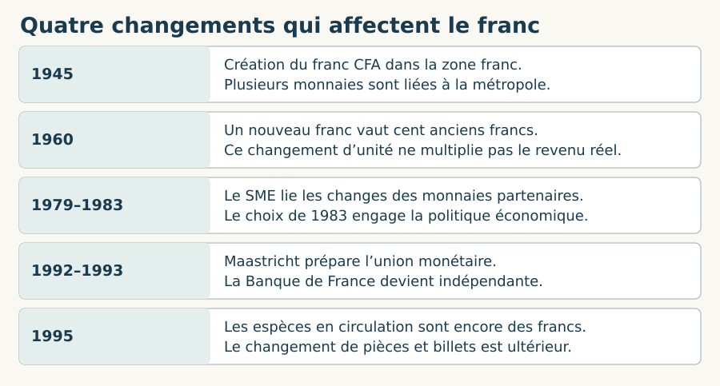
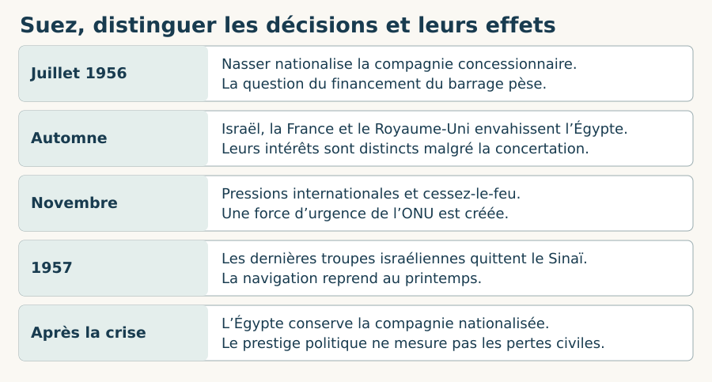

# BEL · AL — Histoire contemporaine (oral tronc commun 30 juin) 2026 · Corrigé guidé

*Corrigé rédigé par IA, non officiel. Signalez toute erreur.*

**Rédaction** · GPT-6.2 Astra Ultra · vitesse non renseignée

**Autocontrôle** · GPT-6.2 Astra Ultra · vitesse non renseignée

## Les onze billets d’Histoire 3

La feuille du 30 juin contient deux pages et onze billets séparés par des pointillés. Les trois derniers commencent respectivement par les armées au Moyen-Orient, le projet d’État juif et le monde du rail. Les périodes sans dates dans l’intitulé renvoient à la France de 1939 à 1995 ou au Moyen-Orient de 1920 à 2011, selon l’objet.

| Billet | Relance sur le premier choix | Relance sur le second choix |
|---|---|---|
| 1 | Pourquoi parler des statuts de nationalité ? L’indépendance de l’Algérie modifie ce que signifie être français pour des personnes attachées au même territoire. | Contrôler une entrée est-il identique à attribuer la citoyenneté ? Le Golfe attire de la main-d’œuvre étrangère sans ouvrir uniformément la résidence durable ni la nationalité. |
| 2 | Moins d’emplois signifie-t-il nécessairement moins de biens produits ? Productivité, sous-traitance et reclassement d’activités changent le rapport entre effectifs et production. | Pourquoi partir de Beyrouth avant 1920 ? Son rôle portuaire et culturel précède son statut de capitale du Grand Liban. |
| 3 | Le propriétaire dirige-t-il toujours l’usine ? Une entreprise publique ou un grand groupe peuvent être dirigés par des cadres sans propriété personnelle du capital. | Quand les Frères égyptiens ont-ils un parti formé sous la nouvelle transition ? Le Parti de la liberté et de la justice se constitue en 2011 après la chute de Moubarak. |
| 4 | Quels documents montrent deux relations divergentes aux États-Unis ? Un traité d’alliance et un tract contre la guerre du Vietnam engagent des publics et des positions différents. | Quels habitants connaissent des issues opposées à la fin d’un même mandat ? La fin du mandat palestinien et la guerre de 1948 donnent naissance à Israël et dispersent les Palestiniens. |
| 5 | Pourquoi comparer la loi et son application ? L’accès réel à la contraception ou à l’IVG dépend aussi des praticiens, de l’information et du financement. | Quel écart subsiste entre déclaration et souveraineté ? La déclaration palestinienne de 1988 ne remet pas à ses auteurs un territoire effectivement gouverné. |
| 6 | Pourquoi comparer 1984 et 1986 ? Une élection européenne et des législatives organisées à la proportionnelle offrent des types distincts de visibilité et de mandats. | Toutes les oppositions de 2011 sont-elles islamistes ? Revendications sociales, associations, syndicats et initiatives sans affiliation participent aussi aux mobilisations. |
| 7 | Pourquoi distinguer cours de justice et chambres civiques ? Elles ne traitent pas les mêmes qualifications et n’infligent pas les mêmes peines. | L’Égypte est-elle un simple relais soviétique ? Nasser négocie des soutiens et revendique le non-alignement, puis Sadate recherche une médiation américaine. |
| 8 | Chaîne privée et salle de cinéma ne sont-elles que concurrentes ? Canal+ contribue au financement des films qu’elle diffuse. | Le trajet le plus rapide mesure-t-il l’accès de tous ? Il faut ajouter la possibilité de rejoindre la gare, le prix et la compatibilité avec les horaires de travail. |
| 9 | Que signifie le renvoi de Glubb en 1956 ? Le souverain jordanien revendique une maîtrise nationale du commandement de son armée. | Pourquoi relier Histadrout et gouvernement provisoire ? Elles représentent deux étapes, organisation d’une communauté sous mandat puis construction d’un État. |
| 10 | Le mandat contient-il une promesse explicite d’État souverain ? Il reconnaît un foyer national juif, formule dont le contenu étatique reste à débattre. | Pourquoi garder un franc après Maastricht ? La ratification d’un traité et l’introduction d’une monnaie dans les portefeuilles sont deux événements séparés. |
| 11 | Une grande ligne à grande vitesse bénéficie-t-elle à chaque gare ? La desserte des agglomérations reliées peut aller de pair avec le recul de certaines liaisons locales. | Quelle est l’issue militaire, puis diplomatique de Suez ? L’invasion atteint l’Égypte, mais les envahisseurs se retirent et la nationalisation demeure acquise. |

## Billet 1

### Les répercussions de la décolonisation en France

Une carte de France où l’Algérie cesse en 1962 d’être représentée par des départements change le territoire de l’État et les définitions pratiques de la nationalité. Bien avant cette date, les guerres d’Indochine et d’Algérie pèsent sur les budgets, les relations internationales et les majorités parlementaires. La défaite de Diên Biên Phu en 1954 accélère une négociation. La guerre d’Algérie divise les partis, engage massivement des appelés et contribue directement à la crise de mai 1958. La Ve République se forme ainsi dans une crise de la souveraineté impériale dont elle ne résout pas immédiatement l’enjeu. En métropole, familles de soldats, adversaires de la torture, organisations indépendantistes et partisans de l’Algérie française investissent l’espace public selon des objectifs opposés.

Les départs du Maghreb et d’Indochine affectent aussi les lieux d’habitation, le travail et les sociabilités. Pieds-noirs installés notamment dans le Midi, harkis et familles reléguées dans des camps, travailleurs algériens et enfants nés en métropole n’ont ni les mêmes droits ni les mêmes récits. Les anciennes circulations impériales se prolongent sous la forme de migrations désormais internationales. La réorientation des échanges vers l’Europe s’accompagne de coopérations économiques, monétaires et culturelles avec des pays devenus indépendants. Les musées, les manuels, les associations et la mémoire des violences constituent d’autres lieux de recomposition. Les controverses sur les dates commémoratives ou sur les mots de la guerre d’Algérie traversent encore la société française en 1995. La décolonisation a donc redéfini ce que recouvrent une frontière, une citoyenneté et une histoire nationale, avec des conséquences différentes selon que l’on suit une institution ou une famille.

### Contrôler les mobilités de population au Moyen-Orient (durant la période au programme)

Le contrôle d’une mobilité peut porter sur le départ, le passage, le séjour, le travail ou le retour. Ces opérations administratives produisent des situations distinctes. Après la chute de l’Empire ottoman, les nouveaux États et les mandats fixent des frontières à travers des routes commerciales, pastorales ou familiales. Registres, nationalités et nouveaux postes de contrôle donnent un autre sens à leur franchissement. L’échange obligatoire de populations entre Grèce et Turquie en 1923, assorti d’exceptions, illustre un déplacement imposé suivant un critère religieux. En Palestine mandataire, les autorités britanniques régulent l’immigration juive, notamment avec les restrictions du Livre blanc de 1939. Le contrôle de l’entrée engage à la fois l’avenir politique de la Palestine et l’accès au refuge pour des personnes menacées par les persécutions européennes.

La formation de populations réfugiées palestiniennes en 1948 puis en 1967 place l’enregistrement, les documents de voyage, l’accès à la résidence et la possibilité du retour au cœur du conflit. Les situations diffèrent entre la Jordanie, le Liban et les territoires occupés. Les camps administrés ou desservis par des institutions distinctes ne sont pas tous des espaces interdits de sortie. Dans le Golfe, l’immigration de travail répond à une forte demande économique, mais des systèmes de parrainage lient le statut de séjour à la relation avec l’employeur, et l’accès durable à la nationalité reste très restreint. Les pèlerinages à La Mecque donnent un autre exemple de circulation autorisée mais organisée par des États et des accords. Un même territoire peut ainsi attirer les travailleurs, encadrer les pèlerins et limiter l’arrivée de réfugiés. La mobilité dépend d’une qualification juridique et sociale de la personne autant que de la distance à parcourir.

## Billet 2

### Le travail industriel en France 1939-1995

Qui travaille, à quelles tâches, pour quel employeur et avec quelle capacité de défendre ses qualifications ? Pendant la guerre, l’industrie doit composer avec l’Occupation, la pénurie, les réquisitions et le travail contraint. Les femmes maintiennent ou prennent des emplois dans des conditions très diverses, tandis que les prisonniers et départs forcés désorganisent la main-d’œuvre. À la Libération, l’appel à reconstruire et la nationalisation de grandes entreprises comme Renault créent des attentes de reconnaissance ouvrière. Grèves de 1947 et conflit minier de 1948 montrent que la priorité productive ne supprime pas les conflits sur les salaires, les cadences et le pouvoir dans l’entreprise.

La croissance des décennies suivantes développe l’automobile, la chimie, l’équipement du foyer et les grandes unités de production. Le travail à la chaîne fragmente des tâches. Ouvrières, ouvriers spécialisés et travailleurs immigrés occupent fréquemment les postes les moins reconnus, tandis que techniciens et agents de maîtrise exercent d’autres formes de contrôle. Mai-juin 1968 met en discussion salaires et autorité patronale. Dans les années 1970, certaines mobilisations rendent visibles l’initiative ouvrière, ainsi à Lip, ou le sort des femmes et des immigrés dans les restructurations. Les fermetures des mines et des usines sidérurgiques bouleversent des territoires entiers. Pourtant le recul de l’emploi industriel n’équivaut pas à la disparition de la production. Automatisation, sous-traitance et classement de certaines activités dans les services changent la relation entre volume produit et effectifs. En 1995, il faut autant regarder les ateliers de haute technologie, les entreprises moyennes et la maintenance que les friches d’anciens bastions. L’histoire du travail associe gestes, hiérarchies et carrières aux décisions d’investissement.

### Une capitale au Moyen-Orient : Beyrouth (durant la période au programme)

Beyrouth n’attend pas sa désignation comme capitale pour devenir un port, une ville d’imprimerie, d’enseignement et de commerce liée aux réseaux de la Méditerranée et de l’arrière-pays syrien. En 1920, la création du Grand Liban sous mandat français donne à cet héritage urbain une fonction nouvelle. Capitale d’un territoire qui rassemble des régions et communautés diverses, elle concentre administrations, représentation et services. L’indépendance en 1943 et le départ des troupes françaises en 1946 renforcent cette centralité. La croissance des universités, des banques et de la presse lui donne ensuite une audience régionale. Des réfugiés arméniens puis palestiniens, des migrants libanais venus des campagnes et des habitants de quartiers anciens participent à des formes d’urbanisation très inégales.

La guerre civile de 1975 à 1990 fragmente les espaces, détruit le centre et modifie les lieux de résidence. La « ligne verte » renvoie à des séparations concrètes mais ne réduit pas toute la géographie politique de la ville à deux communautés. Les interventions étrangères, notamment l’invasion israélienne de 1982, et le déplacement des populations font de la capitale un enjeu régional. Après les accords de Taëf, la reconstruction du centre, notamment par Solidere, met en concurrence restitution de la mémoire, valorisation immobilière et demandes des habitants. Les manifestations après l’assassinat de Rafic Hariri en 2005 réinvestissent les espaces centraux comme lieux de représentation nationale. En 2006, la guerre frappe notamment les banlieues sud. À la borne de 2011, Beyrouth demeure une capitale administrative et symbolique, mais les infrastructures, les mobilités et la distribution des protections dessinent plusieurs expériences de la même ville.

## Billet 3

### Les patrons en France 1939-1995

Le patron d’un atelier employant deux compagnons, le dirigeant salarié d’une grande société et le propriétaire d’un groupe familial exercent tous un pouvoir sur le travail, mais ne disposent ni du même patrimoine ni des mêmes réseaux. Sous l’Occupation, commandes, réquisitions, comités d’organisation et pénurie placent des chefs d’entreprise devant des choix inégaux d’adaptation, de collaboration ou de résistance. L’épuration économique et les nationalisations de la Libération posent la question de leur responsabilité. La nationalisation de Renault revêt par exemple une dimension de sanction et un enjeu industriel, qui doivent être distingués des motifs invoqués pour d’autres nationalisations.

Le patronat se réorganise au niveau national autour du CNPF, mais petites et moyennes entreprises disposent aussi de leurs porte-parole. Les dirigeants négocient conventions, salaire et protection sociale, investissent dans les nouvelles productions et s’inscrivent dans des réseaux publics de crédit et de planification. Dans les grandes entreprises, les cadres passés par les grandes écoles ou les grands corps de l’État occupent régulièrement des fonctions de direction. Dans les entreprises familiales, patrimoine, transmission et ancrage local gardent un autre poids. Les grèves de Mai 68 et les droits syndicaux durables qui en résultent limitent certains aspects du pouvoir patronal et transforment les formes de négociation. À partir des années 1970, restructurations, concurrence internationale, financiarisation et sous-traitance redistribuent les responsabilités entre actionnaires, directions et donneurs d’ordres. Les nationalisations de 1982, puis les privatisations à partir de 1986 modifient encore les relations entre patron et propriétaire. Autour de 1995, la figure publique du chef d’entreprise valorisé comme créateur d’emplois coexiste avec celle du décideur critiqué lors d’une fermeture. Ces images ne dispensent pas d’étudier la réalité des pouvoirs dans chaque entreprise.

### Les partis islamistes au Moyen-Orient (durant la période au programme)

Un parti islamiste vise l’exercice ou l’influence sur le pouvoir en formulant un programme politique fondé sur ses interprétations de l’islam. L’existence d’une organisation, sa légalité et son droit à présenter des candidats ne coïncident pas. Les Frères musulmans égyptiens, fondés en 1928, se structurent longtemps sous forme de mouvement religieux, social et politique, avec des réseaux éducatifs et professionnels. Restrictions et répression les conduisent à diverses formes de participation, notamment des candidatures sous d’autres étiquettes. Après la chute de Moubarak en 2011, la création du Parti de la liberté et de la justice modifie les conditions de leur intervention électorale.

La Turquie donne l’exemple d’organisations qui s’inscrivent dans la compétition d’un État laïque, subissent des dissolutions et se recomposent. La victoire de l’AKP en 2002 relève d’un contexte différent des arrangements confessionnels libanais, où le Hezbollah participe aux élections tout en disposant d’importantes organisations sociales et d’une force armée. Dans les territoires palestiniens, le Hamas remporte les législatives en 2006 dans un contexte d’occupation, de fragmentation territoriale et de concurrence avec le Fatah. L’Iran possède de son côté une constitution islamique qui donne au Guide et aux institutions de contrôle un poids distinct des partis et factions électorales. Il ne faut donc pas confondre un État qui se réclame de l’islam et un parti qui prétend représenter un électorat dans un système donné. Réseaux d’assistance, travail politique local et image de probité peuvent contribuer à l’implantation de certains partis. Leurs trajectoires divergent selon les institutions, les contre-pouvoirs, les résultats électoraux et les divisions internes.

## Billet 4

### Les Français et les États-Unis (durant la période au programme)

En 1939, les États-Unis constituent pour les Français un horizon économique et culturel puissant, mais le gouvernement américain n’entre en guerre qu’en décembre 1941. Les débarquements de 1942 et 1944, les bombardements et la présence de soldats américains donnent des expériences concrètes et ambivalentes de la puissance alliée. Roosevelt entretient des rapports difficiles avec de Gaulle, tandis que beaucoup de civils associent les Américains à la libération ou aux biens nouveaux qu’ils distribuent. Le plan Marshall et l’adhésion française à l’Alliance atlantique en 1949 prolongent une interdépendance économique et stratégique qui suscite aussi des refus, en particulier parmi les communistes.

L’« Amérique » quotidienne circule par le cinéma, le jazz, les produits de marque, les voyages, les méthodes de gestion et les modèles de consommation. Leur appropriation ne dicte pas un vote ni une approbation de la politique étrangère américaine. Sous de Gaulle, Paris soutient Washington pendant la crise de Cuba mais critique l’intervention au Vietnam et quitte en 1966 le commandement intégré de l’OTAN. Une politique d’indépendance diplomatique peut ainsi coexister avec un attrait culturel. Les mouvements antiracistes et les mobilisations pour les droits civiques aux États-Unis inspirent également des militants français, y compris des critiques de Washington. Dans les années 1980-1990, l’audiovisuel, l’informatique et la langue anglaise donnent d’autres objets aux débats sur l’influence américaine, tandis que la guerre du Golfe en 1991 illustre une coopération militaire. Une manifestation contre la guerre, un billet de cinéma et un traité d’alliance éclairent trois niveaux de relation. Ils ne suffisent chacun à définir ni un antiaméricanisme national ni une adoption uniforme du modèle américain.

### Les décolonisations au Moyen-Orient (durant la période au programme)

Le pluriel attire l’attention sur les différences de statut au début de la période. L’Égypte subit l’emprise britannique malgré la déclaration d’indépendance de 1922, la Syrie et le Liban relèvent d’un mandat français, et plusieurs émirats du Golfe sont liés à Londres par des traités de protection. La Turquie obtient à Lausanne un règlement territorial issu de la contestation du traité de Sèvres, puis construit une république souveraine. Les mouvements locaux prennent appui sur partis, presse, congrès et institutions représentatives, et font face à des répressions coloniales. En Irak, l’indépendance juridique de 1932 s’accompagne de traités qui prolongent l’influence britannique. Il ne suffit donc pas de disposer d’une date de fin de mandat pour décrire la nouvelle relation.

La Seconde Guerre mondiale et ses suites recomposent les rapports de force. Le départ des troupes françaises de Syrie et du Liban en 1946 consolide des indépendances déjà proclamées. La fin du mandat britannique en Palestine en 1948 a des conséquences divergentes. Israël se constitue en État, tandis que les Palestiniens connaissent la dispersion et ne se voient pas reconnaître un État effectivement souverain. En Égypte, le départ des dernières troupes britanniques de la zone du canal puis la nationalisation de la compagnie en 1956 traduisent deux dimensions de la décolonisation, militaire et économique. À Aden, la décolonisation en 1967 conduit au Yémen du Sud. Le retrait britannique du Golfe en 1971 ouvre d’autres arrangements, dont la création des Émirats arabes unis. Les nouvelles dépendances économiques, militaires ou financières ne rétablissent pas mécaniquement l’ancien ordre colonial. Elles montrent ce que gagner la capacité de négocier en son nom propre permet, et ce que ce droit ne garantit pas.

## Billet 5

### Défendre les droits des femmes en France (durant la période au programme)

Défendre un droit suppose de le formuler, de le faire reconnaître et de pouvoir effectivement l’exercer. Les associations suffragistes d’avant-guerre, puis les engagements féminins dans la Résistance, contribuent à délégitimer l’exclusion politique. L’ordonnance du 21 avril 1944 accorde aux femmes le vote et l’éligibilité dans les mêmes conditions que les hommes. Les premières électrices votent en 1945 et des femmes entrent à l’Assemblée constituante. Les élues restent toutefois peu nombreuses. Dans l’empire, l’application du suffrage et les statuts civils varient et prolongent de fortes inégalités. Les droits politiques ne changent pas d’un coup la place des femmes mariées dans le droit civil ni la division du travail domestique.

Organisations féminines, syndicats, médecins et avocates portent des revendications distinctes et parfois concurrentes. La réforme de 1965 permet notamment à une femme mariée d’exercer une profession et d’ouvrir un compte bancaire sans l’autorisation de son mari. Le Planning familial, le MLF, le MLAC ou le procès de Bobigny de 1972 rendent publique la question de la maîtrise de la fécondité par des voies différentes. La loi Neuwirth de 1967 autorise la contraception et la loi Veil de 1975 encadre l’accès à l’avortement. Un texte n’assure pas d’emblée médecins disponibles, remboursement ou information accessible. Dans le travail, l’égalité de rémunération inscrite en 1972 et la loi Roudy de 1983 donnent des outils dont l’application dépend de données, de négociations et de recours. Défendre les droits consiste aussi à combattre le viol et les violences conjugales et à questionner la représentation politique. En 1995, les mouvements pour la parité discutent d’un problème encore ouvert. La chronologie des victoires juridiques doit donc être confrontée à celle de l’usage réel des droits.

### Les indépendances au Moyen-Orient (durant la période au programme)

L’indépendance est un changement de statut international qui peut être proclamé, reconnu par d’autres puissances et rendu effectif par étapes. Le royaume d’Irak fondé en 1921 reste sous tutelle avant son admission à la SDN en 1932. La monarchie égyptienne obtient en 1922 une déclaration britannique d’indépendance assortie de réserves qui laissent subsister des moyens de domination. La reconnaissance de la Turquie à Lausanne en 1923 s’inscrit dans un autre parcours de sortie de guerre et de refondation d’un État successeur. L’Iran et la péninsule Arabique ne se laissent pas non plus décrire comme d’anciennes colonies ayant toutes reçu leur indépendance selon le même mécanisme. Les assemblées, partis, souverains et diplomates locaux sont parties prenantes de ces décisions.

Au Levant, la proclamation d’indépendance et la maîtrise de l’appareil d’État précèdent le retrait des derniers soldats français de Syrie et du Liban en 1946. En Transjordanie, l’indépendance de 1946 n’efface pas sur-le-champ l’appui financier et militaire britannique. En Palestine, la déclaration d’indépendance d’Israël en mai 1948 inaugure un État reconnu par d’autres puissances, tandis que les Palestiniens sont dispersés et ne disposent pas d’un gouvernement souverain sur leur territoire. La déclaration palestinienne de 1988 et les institutions d’autonomie créées dans les années 1990 ne résolvent pas cet écart. Dans le Golfe, le Koweït indépendant en 1961 puis Bahreïn, le Qatar et les nouveaux Émirats de 1971 illustrent d’autres calendriers. La reconnaissance juridique peut protéger, comme au Koweït en 1990-1991, sans mettre un État à l’abri de l’invasion ou de la dépendance économique. Il faut donc demander qui proclame, qui reconnaît, sur quel territoire et avec quels moyens de gouvernement.

## Billet 6

### Le Front national en France (durant la période au programme)

Le Front national est fondé en 1972 autour de plusieurs courants d’extrême droite et de la présidence de Jean-Marie Le Pen. L’ancien député poujadiste fait le lien avec des traditions nationalistes et anticommunistes plus anciennes, dont l’Algérie française. Cette généalogie ne signifie pas que le parti existe sous le même nom depuis les années 1940. Ses résultats restent très faibles dans sa première décennie. La recherche d’une façade électorale commune ne supprime ni les rivalités de groupes ni la charge de références autoritaires, racistes ou antisémites de certains de ses cadres. L’histoire du parti doit comparer sa communication publique avec ses pratiques de recrutement et ses thèmes programmatiques.

Dans les années 1980, la crise industrielle, le chômage et les tensions autour de l’immigration forment un contexte. Ils ne transforment pas automatiquement une situation sociale en vote FN. La stratégie médiatique, la concentration de certaines candidatures locales et la concurrence avec les autres droites sont décisives. À Dreux en 1983, l’alliance municipale au second tour avec une liste de droite suscite un débat national. Les européennes de 1984 puis les législatives à la proportionnelle de 1986 donnent au mouvement une visibilité et des élus. Le retour au scrutin majoritaire rend d’autres mandats plus difficiles à obtenir. Les campagnes de Jean-Marie Le Pen en 1988 et 1995 installent ses thèmes dans l’élection présidentielle. Les propos antisémites du dirigeant déclenchent des contestations publiques et judiciaires, tandis que associations antiracistes et mobilisations locales s’opposent au parti. En 1995, les conquêtes municipales de Toulon, Orange et Marignane fournissent des terrains de gouvernement local. La percée électorale se construit donc sur plusieurs arènes, avec une implantation territoriale et des électorats hétérogènes.

### Les contestations islamistes au Moyen-Orient (durant la période au programme)

Une contestation islamiste formule une critique d’un gouvernement ou d’un ordre social en prétendant donner à l’islam une valeur politique structurante. Elle peut porter sur l’injustice, la dépendance étrangère, le droit familial ou la légitimité d’un monarque. Ses modalités vont de la prédication et de l’entraide à la participation électorale, et, pour certaines organisations, au recours à la violence. L’historien doit distinguer ces formes et les controverses qu’elles suscitent parmi les militants eux-mêmes. En Égypte, les Frères musulmans constituent dès 1928 un réseau d’action religieuse et sociale dans un contexte de souveraineté limitée. La répression sous Nasser, puis les possibilités de participation restreinte sous ses successeurs, modifient leur recrutement et leurs stratégies.

En Iran, des religieux qui s’opposent au shah articulent dénonciation de l’autoritarisme, de l’influence américaine et de politiques jugées contraires à l’islam. La révolution de 1979 est cependant portée par une coalition plus large. Le nouvel État islamique réprime à son tour des opposants. En Syrie, les affrontements avec les Frères musulmans et la répression de Hama en 1982 ont un coût massif pour des civils qui ne sauraient tous être assimilés aux organisations en lutte. Au Liban ou dans les territoires palestiniens, des mouvements se réfèrent à l’islam mais agissent aussi par rapport à une occupation, à une guerre civile ou à un système de représentation particulier. En 2011, les revendications de dignité, de travail et de libertés publiques réunissent bien plus que les seules organisations islamistes. La mesure d’une contestation demande donc de préciser la cause qu’elle formule, l’ordre contre lequel elle se dresse et les autres forces avec lesquelles elle agit ou entre en concurrence.

## Billet 7

### La France de l’épuration

L’épuration commence dans l’attente de la libération de certains territoires et se poursuit après la victoire. Elle doit répondre à des actes de collaboration très différents, depuis l’engagement politique et la dénonciation jusqu’au profit économique. La désorganisation des pouvoirs rend possible des sanctions sommaires, mais justice officielle et violences extrajudiciaires coexistent pendant un temps. Les tontes publiques de femmes accusées de relations avec des Allemands donnent au jugement d’infidélité nationale une dimension sexuée. Le degré d’engagement politique ou la preuve d’une faute n’y sont pas évalués comme devant un tribunal. Ces humiliations font aussi apparaître les pouvoirs locaux et la place des spectateurs.

La restauration de l’État républicain passe par des procédures distinctes. Les cours de justice, les chambres civiques chargées de l’indignité nationale et la Haute Cour qui juge des responsables de premier plan ne partagent pas les mêmes compétences. Pétain est jugé en 1945 et voit sa peine de mort commuée, tandis que Laval est exécuté. La presse et l’administration connaissent sanctions, licenciements et réintégrations. Dans le monde économique, les besoins de reconstruction entrent en tension avec les exigences de sanction, et les difficultés de preuve ne sont pas les mêmes pour un contrat d’entreprise ou pour une dénonciation signée. Les politiques de grâce et les amnisties de 1951 et 1953 révisent la portée de nombreuses décisions. Comprendre la France de l’épuration impose enfin de suivre les personnes lésées et les réparations incomplètes. Les catégories de trahison et de collaboration ne rendent pas alors toute leur spécificité aux persécutions et à l’extermination des Juifs. Ce décalage contribue à l’existence de procès et de débats bien plus tardifs.

### La guerre froide dans le Moyen-Orient

La guerre froide transforme la région en espace de concurrence entre Washington et Moscou, mais les États locaux ne sont pas des pièces simplement déplacées par deux capitales. La Turquie confrontée aux pressions soviétiques sur sa sécurité se rapproche des États-Unis et entre dans l’OTAN en 1952. En Iran, les tensions autour du retrait des troupes soviétiques en 1946, puis le renversement de Mossadegh en 1953 avec l’appui britannique et américain, mêlent nationalisme pétrolier et rivalité internationale. Le pacte de Bagdad en 1955 illustre un choix d’alignement qui suscite justement l’hostilité de gouvernements arabes concurrents. Les dimensions régionales et mondiales des décisions se combinent.

L’Égypte de Nasser utilise des fournitures d’armes de l’Est et une aide soviétique pour le haut barrage d’Assouan, tout en se réclamant du non-alignement. À Suez en 1956, les deux Grands s’opposent à l’intervention franco-britannique et israélienne pour des raisons différentes. Après les guerres de 1967 et de 1973, les rapports américains avec Israël et les rapports soviétiques avec plusieurs États arabes se renforcent. La diplomatie de Sadate, Camp David en 1978 et la paix israélo-égyptienne montrent pourtant qu’une alliance peut être renégociée. La révolution iranienne de 1979 déjoue les deux modèles et prive les États-Unis d’un allié majeur. Les guerres du Liban et d’Iran-Irak précèdent ou débordent les logiques de bloc. En 1990-1991, la possibilité d’une large coalition contre l’invasion du Koweït accompagne la fin de la bipolarité sans résoudre les conflits palestinien ou irakien. La chronologie internationale aide à dater certaines inflexions, mais elle n’explique pas à elle seule la carte des alliances et des clivages locaux.

## Billet 8

### Cinéma et télévision en France (durant la période au programme)

Une projection en salle et une émission reçue au foyer n’ont pas le même public ni le même modèle économique. Sous l’Occupation, le cinéma demeure un loisir fréquenté, avec censure, exclusions antisémites et contrôle des productions et diffusions. Après la Libération, les accords Blum-Byrnes et la création du Centre national de la cinématographie en 1946 placent la protection de la production au cœur de débats commerciaux et culturels. La fréquentation massive des salles s’accompagne de pratiques très différentes entre petits cinémas de quartier et salles de prestige. La Nouvelle Vague à la fin des années 1950 représente une rupture esthétique et économique dont le public n’épuise pas celui du cinéma populaire.

La télévision d’abord rare se diffuse dans les foyers à mesure qu’augmentent revenus et couverture du territoire. Journaux télévisés, retransmissions sportives, dramatiques et jeux créent des rendez-vous collectifs. Le pouvoir exécutif cherche à maîtriser un média d’information particulièrement visible, comme l’illustrent les conflits autour de l’ORTF et les grèves de 1968. La disparition de l’Office en 1974, la multiplication des chaînes, l’arrivée de Canal+ en 1984 et la privatisation de TF1 en 1987 déplacent l’équilibre entre service public, publicité et abonnement. L’audiovisuel détourne des spectateurs des salles tout en finançant et en rediffusant les films. Les vedettes et les techniques passent d’un milieu à l’autre. La télécommande, le magnétoscope et les chaînes spécialisées transforment peu à peu la maîtrise domestique du temps de visionnage. En 1995, il faut donc étudier une concurrence pour le temps libre et une interdépendance industrielle, ainsi que les écarts d’âge, de classe et de territoire dans les usages.

### Se déplacer en France 1939-1995

Partir en vacances, prendre le train pour le travail, fuir devant une armée et se rendre au marché sont quatre mobilités qui n’obéissent ni aux mêmes contraintes ni aux mêmes choix. L’exode de 1940, la ligne de démarcation, la pénurie d’essence et les réquisitions montrent la forte réversibilité du droit et de la capacité de circuler. Bicyclettes, marche, réseaux familiaux et chemins de fer prennent une importance essentielle pour ravitailler les ménages, mais les persécutions et la déportation révèlent également un déplacement imposé par des appareils d’État. La Libération ne rétablit pas instantanément tous les ponts ni toutes les lignes.

Au cours des décennies de croissance, l’allongement des congés payés, la diffusion de l’automobile et l’amélioration de routes et autoroutes étendent les destinations accessibles à une partie des ménages. Périurbanisation, éloignement des lieux d’emploi et fermeture de services rendent aussi certains déplacements obligatoires. Les personnes âgées, les jeunes ou les foyers sans voiture restent dépendants d’offres de transport inégales. Les migrations rurales et internationales changent les trajectoires résidentielles, distinctes des navettes quotidiennes. La desserte du RER dans l’agglomération parisienne, le TGV à partir de 1981 et les tramways réintroduits dans plusieurs villes déplacent les arbitrages entre transports collectifs et individuels. La hausse du coût de l’énergie et la prise en compte des accidents routiers rendent visibles des coûts collectifs de la mobilité. En 1995, comparer un horaire de travail de nuit, une carte de desserte rurale et le temps d’un Paris-Lyon fait apparaître le décalage entre vitesse maximale des réseaux et accessibilité réelle pour des individus diversement situés.

## Billet 9

### Les armées et l’Etat au Moyen Orient (durant la période au programme)

La présence d’une armée nationale peut marquer une souveraineté acquise, mais ses cadres, son budget et ses équipements dépendent souvent de ressources extérieures. En Transjordanie, la Légion arabe est une institution décisive de construction de l’autorité de l’émir, puis du roi, tout en restant longtemps appuyée et encadrée par les Britanniques. Le renvoi de Glubb en 1956 devient un acte symbolique de maîtrise du commandement par le royaume jordanien. En Irak, l’armée réunit des personnels d’origines différentes et contribue au développement d’un nationalisme d’État, mais des officiers jouent également un rôle majeur dans le renversement de la monarchie en 1958. Constituer un appareil d’État ne garantit donc pas la survie du régime qui l’a formé.

Le service militaire, les écoles d’officiers et la solde distribuent des rôles sociaux et des possibilités de mobilité. Les officiers égyptiens parvenus au pouvoir en 1952 investissent ensuite les administrations et une partie de l’économie. En Turquie, l’armée revendique périodiquement un droit d’intervention au nom de la sauvegarde de la République, alors même que gouverner et défendre les institutions représentent des compétences différentes. En Israël, la conscription et les carrières d’anciens officiers lient étroitement armée et société, mais l’établissement d’un gouvernement demeure déterminé par des rapports de majorité parlementaire. Au Liban, la guerre civile met en crise le monopole de la contrainte par l’État. La réunification institutionnelle de l’armée après la guerre n’efface pas toute force armée extérieure à son commandement. En 2011, la réaction variable des armées aux contestations rappelle le rôle du recrutement, des hiérarchies et des rapports au chef de l’État. Ces liens s’établissent historiquement et ne forment pas une essence militaire du politique au Moyen-Orient.

### David Ben Gourion (durant la période au programme)

À la borne initiale de 1920, David Ben Gourion est déjà un militant sioniste installé en Palestine ottomane avant la guerre. Son rôle se construit sous le mandat britannique dans les institutions du mouvement travailliste. À la tête de la Histadrout, fondée en 1920, puis comme dirigeant du Mapaï et de l’exécutif de l’Agence juive, il associe travail organisé, immigration, développement économique et représentation politique du Yichouv. Ses choix sont contestés par d’autres sionistes sur le territoire visé ou le rapport à Londres. Pendant la Seconde Guerre mondiale, il défend le soutien à la lutte contre l’Allemagne nazie tout en combattant les restrictions britanniques à l’immigration. La Shoah et la question du refuge donnent à cette tension une portée particulièrement tragique.

Le 14 mai 1948, Ben Gourion lit la déclaration d’indépendance d’Israël et devient le chef du gouvernement provisoire. Les institutions du Yichouv donnent des ressources au nouvel État que la guerre et les migrations transforment profondément. La reconnaissance internationale, la constitution d’une armée d’État et l’intégration d’immigrants venus d’Europe et de pays arabes s’accompagnent de hiérarchies sociales et de conflits politiques. La Nakba, l’exode ou l’expulsion de nombreux Palestiniens et la question du retour occupent une place déterminante dans les conséquences du gouvernement de guerre. Premier ministre de 1948 à 1954 puis de 1955 à 1963, Ben Gourion recherche alliances, développement et sécurité, prend part à la crise de Suez de 1956 et soutient une conception fortement étatique de la politique israélienne. Les désaccords au sein du mouvement travailliste marquent sa fin de carrière. Mort en 1973, il reste une figure de fondation dont la mémoire varie selon que l’on retient la souveraineté israélienne, les conflits internes ou la dépossession palestinienne.

## Billet 10

### Imaginer un Etat juif 1920-1948

Imaginer un État implique de définir une population politique, un territoire, des institutions et un rapport aux habitants qui ne se reconnaissent pas dans le projet. Vers 1920, le sionisme organisé existe déjà, mais il ne constitue ni l’unique réponse juive à l’antisémitisme ni un programme unanimement partagé. La déclaration Balfour de 1917 puis le mandat britannique de la SDN parlent d’un « foyer national » juif en Palestine, formulation qui ne garantit pas en elle-même la création d’un État souverain. Des courants travaillistes organisent colonies agricoles, syndicats et institutions propres, tandis que des révisionnistes défendent une autre stratégie territoriale et politique. D’autres groupes imaginent des arrangements binationaux. Dans la diaspora, des Juifs restent attachés à des projets sociaux, religieux ou civiques différents.

L’Agence juive, la Histadrout, l’enseignement en hébreu et les organes représentatifs font passer la discussion de la théorie à l’administration dans le cadre du Yichouv. L’immigration transforme la démographie et les villes. Les revendications arabes palestiniennes portent sur la terre et sur une souveraineté politique que les projets sionistes mettent en question. La révolte de 1936-1939, les propositions de partage et le Livre blanc britannique de 1939 resserrent les choix possibles. Après la Shoah, les survivants et les personnes déplacées rendent l’accès au refuge particulièrement urgent, sans faire de 1948 un résultat prédéterminé. En novembre 1947, l’Assemblée générale de l’ONU recommande un partage. La guerre, la déclaration d’indépendance lue en mai 1948 et la dispersion de la population palestinienne donnent au projet étatique une réalité et des conséquences différentes des cartes envisagées. Il faut donc expliquer comment certaines possibilités deviennent institutions, et pourquoi d’autres projets et les droits de populations concurrentes restent sans traduction souveraine.

### La monnaie française 1939-1995

La monnaie est à la fois un objet de paiement quotidien, une unité de compte et un instrument de politique économique. Pendant la guerre, les frais d’occupation, les pénuries et les marchés parallèles désorganisent les prix. Disposer de francs ne suffit pas toujours à obtenir un bien rationné. À la Libération, l’inflation, la dette et la nécessité d’importer pour reconstruire imposent des arbitrages entre stabilité des prix, financement de l’économie et valeur extérieure du franc. Les dévaluations changent le coût des importations, les possibilités d’exportation et la confiance dans l’épargne. La création du franc CFA en 1945 illustre l’existence d’une zone monétaire liée à la France sans que tous les utilisateurs disposent des mêmes décisions ni des mêmes trajectoires institutionnelles.

Les mesures de stabilisation de 1958 et l’introduction du nouveau franc en 1960, valant cent anciens francs, cherchent à rétablir confiance et lisibilité. Le changement nominal ne crée pas par lui-même du pouvoir d’achat. Il laisse durablement des habitudes de compter en anciens francs. La dévaluation de 1969 puis la fin du cadre monétaire de Bretton Woods modifient les contraintes extérieures. Le Système monétaire européen à partir de 1979 lie la politique du franc à des marges de change avec les monnaies partenaires. Les dévaluations du début des années 1980 et le choix de rester dans le système en 1983 montrent comment une décision monétaire engage inflation, emploi et intégration européenne. Le traité de Maastricht ratifié en 1992 prépare l’union monétaire et la Banque de France reçoit un statut d’indépendance en 1993. En 1995, le franc reste la monnaie en circulation. Parler déjà de pièces en euros effacerait l’intervalle entre décision politique, calendrier institutionnel et changement concret de portefeuille.

## Billet 11

### Le monde du rail en France 1939-1995

La SNCF, créée à la veille de la période, rassemble des réseaux auparavant exploités par plusieurs compagnies. Le « monde du rail » comprend les cheminots, leurs familles et leurs syndicats, les ingénieurs, les usagers, les villes de dépôt et les quartiers de gare. Sous l’Occupation, les transports ferroviaires servent les intérêts allemands et sont impliqués dans les convois de déportation. Des cheminots s’engagent dans la Résistance et subissent la répression. Leurs engagements ne doivent pas effacer le rôle institutionnel du réseau sous contrainte ni faire de tout cheminot un résistant. Les destructions de ponts et de triages transforment ensuite la remise en état du chemin de fer en enjeu de reconstruction nationale.

Électrification, signalisation et remplacement de la vapeur modifient les qualifications et l’organisation des dépôts. L’essor de la voiture et du camion concurrence les lignes secondaires et une partie du fret. Fermetures de gares et transfert vers la route sont vécus comme une perte de service dans certains territoires. Le RER restructure les mobilités de l’agglomération parisienne, tandis que l’ouverture du TGV Paris-Lyon en 1981 soutient une image de modernité industrielle et de vitesse. Le tunnel sous la Manche en 1994 élargit encore la géographie des liaisons. Les gains sont sélectifs entre usagers quotidiens, grandes villes et espaces contournés. Le statut des cheminots, les métiers de conduite et la densité syndicale produisent de puissantes mobilisations, notamment en 1986 et en 1995. Elles portent sur les carrières et les droits sociaux tout en interrogeant la place du service public. Une histoire du rail doit donc lire un horaire, un bilan d’exploitation et une revendication syndicale comme trois documents sur une même transformation.

### La crise de 1956 dans le Moyen-Orient

La crise de Suez se comprend à partir d’une souveraineté égyptienne encore discutée sur le plan militaire et économique. Le retrait des troupes britanniques de la zone du canal s’achève en 1956. Nasser veut financer le haut barrage d’Assouan et renforcer l’indépendance économique du pays. Après le retrait du soutien financier anglo-américain au projet, il annonce le 26 juillet la nationalisation de la Compagnie du canal. La compagnie concessionnaire, le territoire égyptien et le principe d’une navigation internationale sont trois objets juridiquement différents. Les usagers européens redoutent cependant une remise en cause de leurs intérêts commerciaux et de leur prestige. Le gouvernement français lie aussi son hostilité à Nasser au soutien que celui-ci apporte à l’indépendance algérienne.

À l’automne, Israël, la France et la Grande-Bretagne s’entendent secrètement avant l’invasion de l’Égypte. Israël poursuit des objectifs de sécurité et de liberté de navigation distincts de ceux de ses partenaires européens. La condamnation internationale, les pressions américaines, les interventions soviétiques et l’action de l’ONU conduisent au cessez-le-feu et au retrait. La Force d’urgence des Nations unies intervient avec l’accord égyptien. Le départ des forces israéliennes du Sinaï et la reprise de la navigation se prolongent en 1957. Militairement éprouvée, l’Égypte conserve le contrôle de la compagnie et Nasser gagne un prestige anticolonial et panarabe considérable. La crise révèle les limites de l’action franco-britannique sans l’appui de Washington et ouvre un espace diplomatique nouveau à l’URSS dans la région. Les habitants déplacés, les destructions à Port-Saïd et les départs de membres de minorités d’Égypte rappellent enfin que 1956 est aussi une crise sociale, dont les conséquences dépassent le bilan des gouvernements.

[Fascicule officiel](https://www.ens.psl.eu/sites/default/files/sujet_oraux_histoire_al.pdf) · [Index des sujets du jury](https://www.ens.psl.eu/rapports-et-sujets-du-concours-2026-section-des-lettres-groupe-al)
