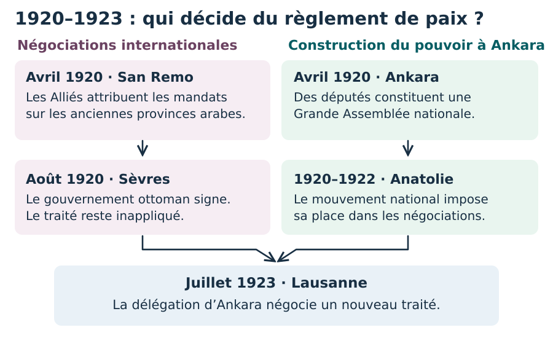
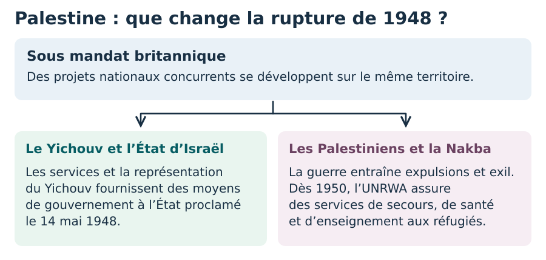
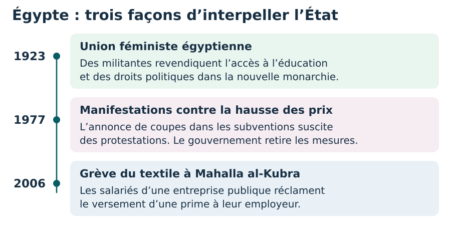

# BEL AL — Histoire contemporaine 2026 · Corrigé guidé

*Corrigé rédigé par IA, non officiel. Signalez toute erreur.*

**Rédaction** · Claude Opus 4.8 · effort non renseigné · vitesse non renseignée

**Révision (tour 1)** · GPT-6 · effort non renseigné · vitesse non renseignée

**Révision (tour 2)** · modèle exact non renseigné (famille GPT-6) · effort non renseigné · vitesse non renseignée

**Lecture du rapport du jury** · GPT-6.2 Astra Ultra · vitesse non renseignée

**Révision** · GPT-6.2 Astra Ultra · vitesse non renseignée

**Révision (tour 4)** · GPT-6.2 Astra Ultra · vitesse non renseignée

## Présentation du sujet

La composition commune d’histoire dure six heures. L’énoncé, intégralement publié sur une page, propose un unique sujet sur la construction étatique et les transformations des sociétés au Moyen-Orient de 1920 à 2011. [Sujet de la session](https://www.ens.psl.eu/sites/default/files/al_commun_hist.pdf)

Les deux infinitifs invitent à suivre des actions. Qui élabore une réforme, qui la met en œuvre et quels groupes peuvent en changer les effets ? La réponse peut partir d’une institution précise, telle une coopérative paysanne ou une école. Elle doit ensuite montrer ce que cette institution a changé dans les relations de pouvoir.

Le principal choix à faire en six heures est celui des comparaisons. Consacrez par exemple 1 h 15 à délimiter le sujet, choisir des cas contrastés et établir le plan, 4 h 30 à rédiger et 15 min à relire. Une progression chronologique ou thématique se justifie par la question que l’on veut résoudre.

> [!JURY]
> Le jury de 2026 valorise l’étude de l’action concrète des administrations et celle de l’initiative des habitants. Il relève des lacunes sur le Yichouv, Israël, la Palestine et plusieurs pays arabes. Il invite aussi à préciser comment une même réforme affecte des groupes différents, notamment les femmes et les hommes. Plusieurs formes de plan ont été admises. [Rapport de l’écrit commun, p. 2–6](https://www.ens-lyon.fr/sites/default/files/2026-10/Histoire%202026.pdf)

## Partie 1 — Analyser le sujet et délimiter le champ

Cette partie fait le travail préparatoire : lire les deux verbes du sujet, puis borner l'espace et le temps avant toute problématique.

### Étape 1 — Interroger les deux verbes du sujet

> [!INDICATION]
> Demandez-vous ce que présuppose l'ordre des deux verbes : le sujet affirme-t-il que l'État précède la société, ou l'inverse ?

> [!INDICATION]
> Appuyez-vous sur une définition savante de l'État et voyez si elle éclaire le cas moyen-oriental.

> [!INDICATION]
> « Transformer les sociétés » : quelles mutations visées — juridiques, économiques, scolaires, de genre ?

#### Solution

Construire un État suppose de disposer d’agents, de recettes et de règles applicables sur un territoire. Pour interroger les effets du pouvoir, distinguez les groupes concernés par une même mesure. Un plafonnement de la propriété foncière ne touche pas de la même façon propriétaire, locataire et ouvrier sans terre. Réciproquement, certains groupes créent leurs propres institutions ou font modifier les décisions prises en leur nom.

### Étape 2 — Délimiter l'espace et le temps

> [!INDICATION]
> Quels États faut-il retenir pour que le sujet reste traitable en 6 heures ?

> [!INDICATION]
> Justifiez chaque borne chronologique par un événement fondateur, pas par un siècle rond.

#### Solution

La lettre de cadrage inclut l’Égypte, la Turquie, l’Iran, le Levant, l’Irak et les pays de la péninsule Arabique. Elle fait aussi place aux revendications kurdes et palestiniennes ainsi qu’au passage du Yichouv à l’État d’Israël. La Tunisie peut situer le départ de la vague de 2010–2011. Le terrain sur lequel on l’étudie ici reste moyen-oriental. En 1920, comparez deux lieux de décision, San Remo et Ankara. En 2011, séparez la contestation d’un régime du devenir des services et des institutions. [Lettre de cadrage 2026](https://www.ens-lyon.fr/sites/default/files/2025-05/Lettre%20de%20cadrage%20programme%20commun%20Histoire%20session%202026.pdf)

Inscrire sous chaque traité le pouvoir qui s’y engage. Puis placer l’abolition du sultanat entre les deux dates. Cette opération explique pourquoi le règlement de paix dépend aussi des transformations du pouvoir en Anatolie.

> [!PIEGE]
> Deux dérives à éviter : réduire le Moyen-Orient au seul monde arabe en oubliant la Turquie et l'Iran, pourtant exemplaires d'une construction étatique volontaire ; et traiter 2011 comme un épilogue plaqué au lieu d'en faire la conclusion logique de la problématique.

## Partie 2 — Problématiser et construire le plan

### Étape 3 — Mettre le sujet en tension

> [!INDICATION]
> L’ordre des deux verbes suggère une relation à examiner. Cherchez un exemple où un groupe social agit avant la constitution de l’État, puis un cas où il infléchit une de ses décisions.

> [!INDICATION]
> Formulez la tension en une question unique, qui permette de mobiliser à la fois la sociologie de l'État et l'histoire des sociétés.

#### Solution

**Problématique retenue.** Comment les pouvoirs qui ont entrepris de transformer les sociétés du Moyen-Orient ont-ils construit leurs moyens d’action, et comment les groupes concernés ont-ils infléchi à leur tour les institutions, de 1920 à 2011 ? L’enjeu est de suivre les deux sens de l’action à partir d’institutions identifiables. Ainsi, une association peut exercer certaines fonctions collectives avant la souveraineté. Une administration constituée peut aussi devoir modifier une politique sous la pression de ses administrés.

> [!PIEGE]
> Ne recopiez pas l'intitulé sous forme de question (« Faut-il construire l'État... ? ») : la problématique doit reformuler le sujet après définition des termes.

### Étape 4 — Construire un plan démonstratif

> [!INDICATION]
> Un plan chronologique suit l'ordre du sujet : est-ce le plus démonstratif ici ?

> [!INDICATION]
> Faites passer la dialectique État/société dans chaque partie, pas seulement dans la conclusion.

#### Solution

Une progression chronologique possible articule les ruptures politiques aux moyens concrets d’action.

- **I. Hériter et construire (1920–1945).** Suivre l’Assemblée d’Ankara et les projets mandataires, puis les initiatives des associations et des mouvements nationaux.
- **II. Gouverner après les indépendances (1945–années 1970).** Comparer la formation d’Israël et la situation des réfugiés palestiniens, puis la réforme agraire et l’accès aux services publics en Égypte et en Iran.
- **III. Redistribuer et contester (années 1970–2011).** Examiner des écarts entre nationaux et migrants, des revendications économiques et électorales et leurs effets contrastés sur les institutions.

> [!METHODE]
> Faites terminer chaque étape par un effet observable. L’annonce d’une réforme ne dit pas encore qui en bénéficie ni comment elle transforme les administrations.

## Partie 3 — Rédiger le devoir

### Étape 5 — Rédiger l'introduction

> [!INDICATION]
> L'amorce doit être datée et localisée ; elle doit conduire naturellement aux définitions.

> [!INDICATION]
> Annoncez le plan en trois temps sans le détailler ligne à ligne.

#### Solution

En avril 1920, les Alliés réunis à San Remo attribuent à la France et à la Grande-Bretagne des mandats sur d’anciennes provinces arabes de l’Empire ottoman. Le même mois, une assemblée se réunit à Ankara et revendique le droit de gouverner au nom de la nation. Qui, des puissances victorieuses, du gouvernement ottoman à Istanbul ou des représentants réunis en Anatolie, pourra lever l’impôt, recruter des agents et faire appliquer la loi ? La question ne se résout pas à la table des négociations. Le projet de paix signé à Sèvres en août 1920 reste inappliqué. À Lausanne, en 1923, la délégation d’Ankara obtient une révision décisive du règlement territorial en Anatolie.

Construire l’État, au sens concret, suppose de réunir des ressources, de fixer des compétences et de disposer de personnes capables de les exercer. Le renouvellement d’un régime peut modifier la distribution de ces pouvoirs tout en conservant ses administrations. Les sociétés que ces institutions engagent sont elles-mêmes diverses. Les effets d’une réforme foncière, par exemple, diffèrent selon que l’on est propriétaire, fermier ou ouvrier sans terre. Le champ s’étend de l’Égypte à l’Iran, en incluant la Turquie, le Levant, l’Irak et les pays de la péninsule Arabique. Il comprend aussi des populations, en particulier kurdes et palestiniennes, dont les aspirations nationales se heurtent au partage des territoires.

Les réformateurs de 1920 ont hérité des administrations ottomanes et, en Iran, des institutions qadjars déjà contestées et réformées par le mouvement constitutionnaliste du début du siècle. Quand des manifestants, en 2011, demandent des comptes à leurs dirigeants, ils s’adressent à des États qui ont étendu de façon très inégale leur présence dans la vie quotidienne. Entre ces deux moments, des groupes sociaux ont soutenu des réformes, en ont contesté le bénéfice ou ont construit eux-mêmes des institutions.

Dans l’entre-deux-guerres se confrontent plusieurs façons de construire l’autorité publique à partir d’héritages impériaux. Puis les indépendances ouvrent une période de politiques ambitieuses de développement et d’intégration. Enfin les divergences entre modèles économiques, particulièrement visibles à partir des années 1970, renouvellent les attentes et les motifs de contestation.

### Étape 6 — Assembler le devoir complet

> [!INDICATION]
> Rédigez les transitions entre parties : chacune doit faire le bilan de la partie achevée et annoncer la suivante.

> [!INDICATION]
> La conclusion doit d'abord répondre à la problématique, puis élargir — sans annoncer de nouvelle partie.

#### Solution

Le devoir complet est le suivant (texte du corrigé brut) :

**Problématique** — Comment les pouvoirs qui ont entrepris de transformer les sociétés du Moyen-Orient ont-ils construit leurs moyens d’action, et comment les groupes concernés ont-ils infléchi à leur tour les institutions, de 1920 à 2011 ?

* * *

En avril 1920, les Alliés réunis à San Remo attribuent à la France et à la Grande-Bretagne des mandats sur d’anciennes provinces arabes de l’Empire ottoman. Le même mois, une assemblée se réunit à Ankara et revendique le droit de gouverner au nom de la nation. Qui, des puissances victorieuses, du gouvernement ottoman à Istanbul ou des représentants réunis en Anatolie, pourra lever l’impôt, recruter des agents et faire appliquer la loi ? La question ne se résout pas à la table des négociations. Le projet de paix signé à Sèvres en août 1920 reste inappliqué. À Lausanne, en 1923, la délégation d’Ankara obtient une révision décisive du règlement territorial en Anatolie.

Construire l’État, au sens concret, suppose de réunir des ressources, de fixer des compétences et de disposer de personnes capables de les exercer. Le renouvellement d’un régime peut modifier la distribution de ces pouvoirs tout en conservant ses administrations. Les sociétés que ces institutions engagent sont elles-mêmes diverses. Les effets d’une réforme foncière, par exemple, diffèrent selon que l’on est propriétaire, fermier ou ouvrier sans terre. Le champ s’étend de l’Égypte à l’Iran, en incluant la Turquie, le Levant, l’Irak et les pays de la péninsule Arabique. Il comprend aussi des populations, en particulier kurdes et palestiniennes, dont les aspirations nationales se heurtent au partage des territoires.

Les réformateurs de 1920 ont hérité des administrations ottomanes et, en Iran, des institutions qadjars déjà contestées et réformées par le mouvement constitutionnaliste du début du siècle. Quand des manifestants, en 2011, demandent des comptes à leurs dirigeants, ils s’adressent à des États qui ont étendu de façon très inégale leur présence dans la vie quotidienne. Entre ces deux moments, des groupes sociaux ont soutenu des réformes, en ont contesté le bénéfice ou ont construit eux-mêmes des institutions.

Dans l’entre-deux-guerres se confrontent plusieurs façons de construire l’autorité publique à partir d’héritages impériaux. Puis les indépendances ouvrent une période de politiques ambitieuses de développement et d’intégration. Enfin les divergences entre modèles économiques, particulièrement visibles à partir des années 1970, renouvellent les attentes et les motifs de contestation.

* * *

Dans les anciennes provinces arabes de l’Empire ottoman, les frontières et les administrations résultent de projets concurrents. Les accords secrets Sykes-Picot de 1916 esquissaient des zones d’influence. Ils ne fournissent pas une carte toute faite des futurs États. À Damas, un congrès proclame en mars 1920 un royaume arabe avec Fayçal pour souverain. La France met fin à cette expérience en juillet et proclame le Grand Liban en septembre. En Irak, la Grande-Bretagne installe Fayçal comme roi en 1921. L’appartenance de Mossoul reste discutée jusqu’au règlement des années 1925–1926. La circulation des hommes et les négociations autour des frontières prolongent ainsi le temps de la fondation bien au-delà de San Remo.

Sous mandat britannique, la Palestine offre une autre configuration. Londres s’est engagé en 1917 à favoriser un foyer national juif. Le Yichouv, la communauté juive de Palestine, se dote de moyens d’organisation propres. La Histadrout, fondée en 1920, réunit des travailleurs juifs et organise des services de santé et d’emploi. L’Agence juive représente le mouvement sioniste auprès des autorités mandataires. Ces institutions contribuent à établir des capacités de gouvernement avant la souveraineté. Dans la société arabe palestinienne, journaux, associations et comités politiques défendent une autre représentation nationale. La grève générale de 1936 exprime des revendications d’indépendance et une opposition à la politique migratoire et foncière du mandat. Un même territoire voit ainsi se développer des projets d’avenir politiquement inégaux.

Ailleurs, les dirigeants emploient la législation pour faire entrer l’État dans des domaines jusqu’alors administrés autrement. En Turquie, l’Assemblée abolit le sultanat en 1922. La République est proclamée en 1923, puis le califat aboli en 1924. Le code civil adopté en 1926 réforme notamment le mariage. Le changement d’alphabet, en 1928, oblige les enseignants, les administrations et la presse à apprendre et diffuser une nouvelle écriture. En Iran, Reza Khan, acteur du coup de 1921, devient chef du gouvernement en 1923 et shah en 1925. L’État central élargit son administration et impose la sédentarisation à des groupes nomades. En Arabie, Ibn Saoud s’appuie sur les autorités religieuses wahhabites et construit un royaume proclamé en 1932. Ces cas mettent en jeu des instruments différents de légitimation, de la redéfinition du droit civil à l’alliance avec les autorités religieuses.

Les habitantes et habitants contribuent à définir la portée de ces changements. En Égypte, la déclaration britannique de 1922 reconnaît une indépendance assortie de réserves et la Constitution de 1923 instaure une monarchie parlementaire. Des femmes ont participé au mouvement national de 1919, mais restent exclues du suffrage. En fondant l’Union féministe égyptienne en 1923, Hoda Charaoui et ses compagnes portent des revendications d’éducation et de droits politiques sur la scène publique. Le contraste entre le rôle tenu dans le mouvement national et la citoyenneté effectivement accordée alimente une organisation durable. En Syrie, la grande révolte de 1925–1927 met à l’épreuve la tutelle française. Au Liban, au contraire, des notables participent à la négociation des institutions politiques. En 1943, le Pacte national lie leur accès aux plus hautes fonctions à un partage confessionnel. L’indépendance porte donc aussi la marque de compromis locaux.

Après la Seconde Guerre mondiale, l’affaiblissement des puissances mandataires donne à ces expériences d’organisation des débouchés très différents.

* * *

Le Liban accède à l’indépendance en 1943 et les dernières troupes françaises quittent le pays en 1946, année également de l’évacuation de la Syrie et de l’indépendance de la Transjordanie. En Palestine, les dirigeants du Yichouv mobilisent ses institutions pour faire fonctionner l’État d’Israël, proclamé le 14 mai 1948. La guerre de 1947–1949 entraîne pour les Palestiniens la Nakba, marquée par l’expulsion ou la fuite de centaines de milliers de personnes et la perte de leurs foyers. À partir de 1950, les écoles et les services de l’UNRWA assurent une part de la prise en charge des réfugiés. Une famille réfugiée en Cisjordanie après 1948 peut voir ses enfants instruits dans une école de l’UNRWA et relever, après l’annexion de 1950, de l’administration jordanienne. La nationalité jordanienne accordée à de nombreux Palestiniens ne leur restitue pas leur maison perdue et peut coexister avec le recours aux services de l’Office. Dans la bande de Gaza, l’Égypte administre le territoire sans l’annexer. Le séjour n’emporte pas, à lui seul, acquisition de la nationalité égyptienne. Une même expérience de l’exil aboutit ainsi à des rapports différents aux papiers d’identité, à l’école et aux droits politiques. Dans les États arabes voisins, la défaite militaire contribue au discrédit des gouvernants. En Égypte, les Officiers libres contraignent Farouk à abdiquer en juillet 1952. La République est proclamée en juin 1953. En Irak, des officiers mettent fin à la monarchie en 1958.

La réforme agraire égyptienne de septembre 1952 plafonne la superficie qu’une personne peut posséder. Des familles paysannes reçoivent des parcelles, tandis que de nombreux ouvriers agricoles demeurent sans terre. Les coopératives encadrent l’accès des bénéficiaires aux intrants et au crédit. Elles donnent à la bureaucratie des moyens d’action dans les campagnes et font émerger de nouvelles demandes à son égard. La nationalisation du canal de Suez en juillet 1956 et le haut barrage d’Assouan associent à leur tour souveraineté économique et développement. L’élargissement de la scolarisation et de l’emploi public donne à des familles urbaines l’espoir d’une promotion par le diplôme. En Iran, la Révolution blanche de Mohammad Reza Shah, engagée en 1963, combine notamment réforme foncière et droit de vote des femmes. Des monarchies aussi se réclament donc de la transformation sociale pour légitimer leur pouvoir.

L’extension des services publics s’accompagne souvent d’un encadrement du pluralisme. À l’échelle régionale, la République arabe unie, fondée par l’Égypte et la Syrie en 1958, illustre la difficulté de donner un cadre institutionnel à l’idéal panarabe. Le poids du centre égyptien nourrit en Syrie les résistances à l’union, qui se défait en 1961. La victoire israélienne de juin 1967 ébranle le prestige des dirigeants arabes. Pour les habitants de la Cisjordanie, de Jérusalem-Est et de Gaza, elle entraîne aussi l’occupation israélienne. Le contrôle du territoire se traduit dans les possibilités de circuler, de travailler et d’accéder à la terre. La guerre agit donc sur les conditions quotidiennes d’existence, même là où elle ne débouche pas sur une souveraineté nouvelle.

À partir des années 1970, les gouvernements ne disposent plus des mêmes ressources pour répondre aux attentes de sociétés plus urbaines et plus scolarisées.

* * *

L’envolée des prix du pétrole en 1973–1974 accroît les revenus des États exportateurs. Dans les monarchies du Golfe, ces recettes financent infrastructures, emplois publics et prestations. Elles diminuent la dépendance du gouvernement à l’égard de l’impôt direct des citoyens, mécanisme qu’ont étudié Hazem Beblawi et Giacomo Luciani. Mais distribuer des revenus suppose de définir qui peut en bénéficier. Le développement rapide des villes attire des travailleurs étrangers qui participent à la construction du pays sans accéder aux mêmes droits que les nationaux. Le statut de nationalité devient ainsi un instrument de répartition des ressources. Le retournement des prix dans les années 1980 montre aussi les limites de cette capacité distributive.

En Égypte, l’ouverture économique de Sadate, l’*infitah*, favorise à partir de 1974 des investissements privés. En janvier 1977, l’annonce d’une réduction des subventions à des biens de première nécessité provoque des manifestations. Le gouvernement retire les mesures. Une politique budgétaire prend ici la forme d’un conflit sur le prix que les ménages modestes peuvent payer pour se nourrir. L’obtention du retrait rappelle que le gouvernement, malgré la répression, ne détermine pas seul les termes de l’échange social.

En Iran, la monarchie est renversée en 1979 par une mobilisation à laquelle participent des religieux, des commerçants du bazar, des étudiants et des travailleurs. Au sein de cette coalition, les projets de régime divergent. La République islamique qui s’impose associe des institutions électives à la tutelle du juriste-théologien. La révolution illustre donc à la fois la capacité de groupes sociaux divers à mettre fin à un régime et l’inégale capacité de ces groupes à traduire ensuite leurs revendications dans la loi. En Irak, le renversement de Saddam Hussein par l’invasion conduite par les États-Unis en 2003 suit une autre trajectoire. La débaassification et la dissolution de l’armée privent de nombreux agents de leur position. Le recrutement dans les nouvelles institutions devient un enjeu de compétition politique, qui contribue à la fragmentation de l’autorité publique.

Dans l’Égypte des années 2000, des ouvrières et ouvriers du textile de Mahalla al-Kubra se mobilisent notamment en 2006 pour une prime. L’usine appartient au secteur public. En réclamant le paiement, ces salariés interpellent l’État employeur et rendent visible l’écart entre les garanties promises et les rémunérations perçues. De même, en Iran, le Mouvement vert de 2009 conteste le résultat de l’élection présidentielle par des revendications exprimées au nom du vote. Ces deux mobilisations ont des objets propres. Elles aident à comprendre pourquoi des revendications aussi diverses que l’emploi, la représentation et les libertés publiques se rencontrent dans les manifestations arabes de 2011. En Égypte, la démission de Moubarak le 11 février laisse l’armée en position de diriger la transition. À Bahreïn, la monarchie se maintient. La contestation d’un régime ne signifie donc pas la disparition de l’État.

* * *

De San Remo à la place Tahrir, bâtir des États a supposé de recruter des agents, de répartir des ressources et de déterminer qui pouvait se prévaloir de quels droits. Une école de réfugiés palestiniens, une coopérative égyptienne et un service public réservé aux nationaux du Golfe donnent ainsi des contours très différents aux rapports entre pouvoir et société.

Les organisations du Yichouv ont fourni des institutions au futur État d’Israël. Les militantes égyptiennes ont fait de l’inégalité de citoyenneté une question politique, et les ménages mobilisés en 1977 ont obtenu le retrait d’une mesure économique. Ces actions éclairent le double mouvement du siècle. Les administrations ont profondément modifié les chances sociales des habitants, qui ont pu à leur tour soutenir, empêcher ou réorienter des projets d’État. En 2011, ces relations restent en jeu jusque dans les pays où le dirigeant a quitté le pouvoir.

> [!PIEGE]
> Une chronologie de changements de dirigeants laisse échapper le fonctionnement des institutions. Pour chaque rupture majeure, identifiez un effet sur la vie des habitants.

> [!PIEGE]
> Gardez 2011 comme borne. Comparez les résultats observables dans l’année, sans attribuer aux contemporains la connaissance des étapes ultérieures des conflits.

## Bilan

Pour réutiliser la méthode, partez d’une décision précise et nommez à chaque fois les institutions, les groupes concernés et les effets observables. Variez les espaces et les échelles pour mettre à l’épreuve une explication.

Repères à revoir : administrations impériales et mandats, réformes foncières, institutions du Yichouv et services aux réfugiés palestiniens, rente et nationalité, mobilisation collective, distinction entre État et régime.

Sujets voisins transposables : « L'État et la société dans le monde arabe au XXe siècle » ; « La violence légitime et la construction de l'État » ; « Rente pétrolière et pouvoir politique au Moyen-Orient ».
