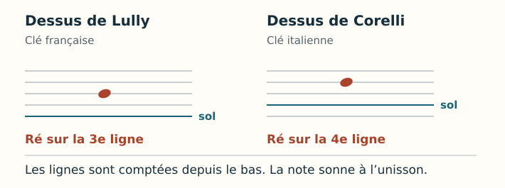
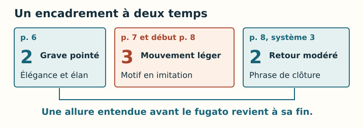
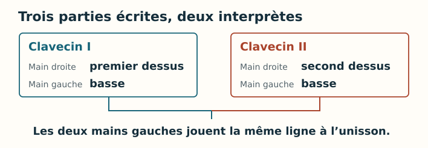

# BEL A/L — Histoire de la musique 2026 · Corrigé brut

*Corrigé rédigé par IA, non officiel. Signalez toute erreur.*

**Lecture du rapport du jury** · GPT-6.2 Astra Ultra · vitesse non renseignée

**Rédaction** · GPT-6.2 Astra Ultra · vitesse non renseignée

**Révision** · GPT-6.2 Astra Ultra · vitesse non renseignée

**Retouches** · GPT-6.2 Astra Ultra · vitesse non renseignée

**Sujet** — Rousseau, le style national et l’*Essai en forme d’ouverture* de Couperin

**Problématique** — À quelles conditions peut-on reconnaître un goût national à l’oreille, si des musiciens formés à des usages différents peuvent écrire et jouer ensemble la même phrase ?

Au début de l’*Essai en forme d’ouverture*, un lecteur pressé croirait voir deux mélodies superposées. L’une appartient à Lully et aux Muses françaises, l’autre à Corelli et aux Muses italiennes. Les premières notes occupent en effet des places différentes sur les deux portées. Qu’on les lise chacune dans sa clé, et les deux groupes font entendre la même mélodie. Où donc est passée la différence des nations ? En 1725, François Couperin rend cette question sensible dans son *Apothéose de Lully*. Une quarantaine d’années plus tard, dans l’article « Style » de son *Dictionnaire de musique* (1767), Jean-Jacques Rousseau semble la résoudre par avance. Il entend d’emblée ce que la musique française a de monotone, ce que l’italienne a d’énergique, ce que l’allemande a de découpé. Pourtant sa propre définition accorde au compositeur, à l’exécutant, au lieu, au sujet et au temps le pouvoir de faire varier le style. Comment passer de cette multiplicité au ton de certitude d’un portrait national ? Les adjectifs de Rousseau portent la trace d’une lutte pour imposer des critères d’écoute. L’ouverture de Couperin permet de dégager ce que ces portraits supposent de conventions partagées et d’examiner ce que les musiciens font de ces conventions lorsqu’ils les transportent.

* * *

Rousseau ouvre sa définition sur une opération de distinction. Un style permet de reconnaître quelque chose ou quelqu’un. Encore faut-il savoir à quelle échelle on croit reconnaître un caractère. On peut identifier une manière d’accentuer une note sans pouvoir attribuer à un pays la personne qui la joue. Rousseau lui-même sépare la composition de l’exécution, puis fait intervenir les sujets traités. Ainsi la même compositrice ou le même compositeur peut changer de style à l’intérieur d’une œuvre, et deux interprétations de la même page peuvent différer de caractère. Or, dans les trois phrases consacrées aux nations, le singulier générique transforme des habitudes particulières en dispositions durables de tout un répertoire. La construction des jugements est révélatrice. Pour les Allemands, le qualificatif favorable « harmonieux » corrige par un « mais » la première impression de discontinuité. À l’Italie revient une série de qualités entre lesquelles Rousseau ne marque aucune réserve. Le style français, lui, peut paraître aussi bien « fade » que « dur » aux oreilles de Rousseau. Ce que ces deux reproches opposés ont en commun est le déplaisir de celui qui écoute. On comprend mieux le texte en demandant ce qui a formé cette oreille.

Dans la querelle des Bouffons, ouverte à Paris en 1752 autour de l’opéra italien, Rousseau avait mis à l’épreuve les prétentions de la déclamation française. Sa *Lettre sur la musique française* (1753) attaque précisément le monologue d’Armide composé par Lully sur le livret de Quinault. À l’acte II, scène 5 de cette tragédie créée en 1686, Armide tient Renaud endormi à sa merci. Deux moments éclairent le jugement de Rousseau. Quand l’héroïne se rappelle que son ennemi a délivré ses captifs, le philosophe regrette que l’orchestre ait laissé vide le silence qui précède ce rappel. Il voudrait y entendre la pitié naissante qu’Armide tente d’étouffer. Plus loin, au mot « Frappons », la question devient celle du phrasé de l’actrice. Doit-elle détacher l’ordre de la question sur la pitié qui le précède, comme si elle se ressaisissait brusquement, ou les lancer d’une seule haleine en levant le poignard ? Rousseau préfère le second geste et trouve que l’écriture de Lully ne le décide pas assez. La même marge laissée à l’interprète peut aussi se comprendre comme une ressource du récitatif. Le différend porte donc sur ce que le compositeur devrait confier à l’orchestre et sur ce qu’il peut laisser à celle qui incarne le rôle. Il donne une portée précise à la préférence de Rousseau, tout en montrant combien il est périlleux de l’étendre du théâtre chanté à une pièce instrumentale de chambre.

Couperin admet lui aussi que des auditeurs puissent reconnaître des pratiques. Les premiers rythmes pointés de son *Essai*, la noblesse du mouvement mesuré à deux et les notes brèves qui relancent les temps longs sollicitent la mémoire de l’ouverture à la française. Cette manière est liée au théâtre de Lully et à son usage d’une entrée solennelle. Sa reconnaissance suppose une familiarité avec un genre et ses occasions d’exécution. Elle ne va pas jusqu’à décider si cette gravité est pesante. Dès le premier système, Couperin demande de jouer élégamment et sans lenteur. La dignité du mouvement est compatible avec un élan. Le choix des mots de l’auteur récuse déjà l’assimilation de la tenue française à un défaut d’énergie.

* * *

Pourtant le rapprochement des deux goûts ne consiste pas à répartir la pièce entre un Lully lent et un Corelli vif. La première page de musique (p. 6 du livret) en fournit une vérification. Sur la portée supérieure, la clé de sol place le sol sur la première ligne. Sur celle du dessous, elle le place sur la deuxième. La différence de hauteur graphique au début correspond exactement au changement de clé. Les deux dessus attaquent donc à l’unisson tandis que la basse chiffrée leur donne une assise commune. De surcroît, à des hauteurs concordantes, des signes d’agrément diffèrent d’une portée à l’autre. La planche s’adresse à deux habitudes de lecture et attire l’attention sur ce que chacune peut faire d’une même note. La petite inflexion de l’ornement, son appui, l’instant auquel il se résout relèvent du geste. Le lecteur peut distinguer deux écritures là où l’auditeur entend une ligne. Les personnages restent nommés au moment même où la musique leur prête une seule voix.

Le début de la page 7 apporte une seconde surprise. À l’indication « légèrement », la mesure à trois et le dessin de notes brèves changent la qualité du mouvement. Les deux dessus lancent ensemble le dessin initial, la basse se tait d’abord puis s’empare du motif. On entend naître le mouvement fugué dans la relation entre dessus et basse. Attribuer d’office l’entrée suivante à la « voix italienne » ferait manquer ce passage. Plus bas, au quatrième système de cette page, les deux dessus ont effectivement des profils différents. Dans la première mesure de ce système, les attaques des croches restent communes mais les hauteurs se séparent. Deux parties peuvent donc s’individualiser sans que l’une doive attendre l’autre pour entrer. L’écriture ouvre et resserre l’intervalle entre les parties au lieu de les tenir à distance fixe. La disposition en deux dessus et basse acquiert alors l’indépendance des voix qui caractérise tant de sonates en trio de Corelli. La basse elle-même sait conduire une imitation aussi bien que soutenir les dessus. Chacune de ses fonctions se dégage par comparaison avec les autres parties.

Le fugato rappelle aussi la section animée d’une ouverture française. Le même procédé appartient donc à deux raisonnements musicaux. À l’échelle de la phrase il permet de faire dialoguer les parties du trio. À l’échelle de l’ensemble il anime le milieu d’une forme encadrée par la gravité. Le troisième système de la page 8 réintroduit le chiffre 2 et l’indication de douceur et de modération déjà rencontrée à la fin de la page 6. Le geste conclusif réentendu donne à l’auditeur une mesure du chemin parcouru. La pièce se clôt par le retour d’une manière de phraser et d’un mouvement, sans reprendre intégralement son commencement. Ainsi l’oreille peut reconnaître un cadre lullyste tout en ayant appris à écouter, à l’intérieur de ce cadre, une tout autre mobilité des voix. La réunion imaginée par Couperin est une opération précise sur la mémoire.

* * *

La double compétence que requiert cette musique s’acquiert. Lully lui-même, né à Florence et devenu le musicien de Louis XIV, rappelle qu’un nom de goût désigne aussi une carrière dans des institutions, une langue pratiquée et des gestes appris. Dans le concert de 1725, le nom de Lully prend place auprès de celui de Corelli sous l’autorité d’Apollon. En choisissant deux maîtres déjà disparus, Couperin peut leur faire désirer ensemble ce que son public entend. Le titre de l’épisode prête au dieu l’ambition de persuader. Il faut en effet convaincre des auditeurs que la réunion de deux goûts participe à la perfection musicale. En ce sens Couperin intervient lui aussi dans un débat. Ses Muses conservent leurs noms et leurs clés, condition pour que leur accord prenne valeur d’événement.

Cette réunion se réalise jusque dans l’effectif choisi. Deux violons peuvent tenir les dessus au-dessus d’une basse soutenue par un instrument d’archet et réalisée harmoniquement au clavecin. Dans l’avertissement de l’édition, Couperin envisage également deux clavecins et décrit une pratique familière à ses élèves. Chacun joue un dessus et les deux mains gauches partagent la même basse, à l’unisson. Une écriture à trois parties n’impose donc ni trois personnes ni trois instruments. Aux violons, la longueur d’archet peut soutenir la note qui organise le rythme pointé. Aux clavecins, l’attaque et l’articulation des notes brèves peuvent marquer la même hiérarchie dans le temps. Ce que les partenaires doivent conserver pour se reconnaître est une relation de durées, de départs et d’appuis. La sonorité concrète peut changer entre deux exécutions sans dissoudre cette relation.

Bach va plus loin encore dans le déplacement de l’effectif. En 1735, la deuxième partie de sa *Clavier-Übung* présente au même claveciniste un concerto dans le goût italien (BWV 971) et une ouverture à la manière française (BWV 831). Dans le concerto, les oppositions de *forte* et de *piano* exploitent les deux claviers pour suggérer la différence de plan entre l’ensemble et le soliste. Les retours du matériau initial dans le premier mouvement donnent à ces contrastes une fonction de ritournelle. Dans l’ouverture qui introduit la suite BWV 831, les longues valeurs pointées et la section animée en imitation sollicitent chez le même exécutant d’autres gestes d’attaque et d’articulation. Le musicien formé dans les pays germaniques n’aurait, à suivre littéralement la typologie de Rousseau, que le partage du « sautillant » et de l’« harmonieux ». Or le même auteur, le même instrument, le même recueil suffisent ici à produire deux physionomies qu’un lecteur peut apprendre à distinguer. L’édition s’adresse justement à celui qui désire les pratiquer. Chez Couperin les goûts jouent ensemble, chez Bach on les passe successivement sous ses doigts. Les noms des nations désignent dans les deux cas des savoirs transmissibles.

* * *

Le portrait national a une efficacité historique. Un auditeur qui a appris à reconnaître une ouverture, un jeu d’agréments ou une alternance de ritournelles saisit mieux ce que Couperin ou Bach lui font entendre. Mais l’histoire de cette reconnaissance empêche d’en faire une propriété d’origine. Une clé change sans que le son change. Les deux dessus, entendus d’abord à l’unisson, se séparent pour former trois parties avec la basse. Un même claveciniste peut faire parler plusieurs goûts. Rousseau donne lui-même la meilleure raison de discuter son palmarès lorsqu’il distingue l’exécution de la composition et fait intervenir le lieu, le sujet et le temps. À ces conditions on peut revenir aux mots de l’écoute, y compris à ses préférences, en sachant quels gestes ils désignent et de quelle histoire ils procèdent.
