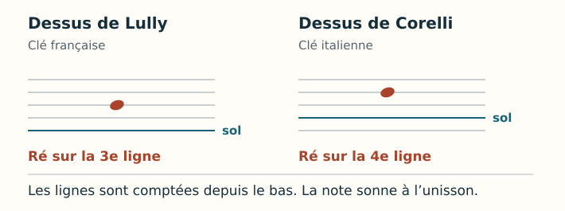
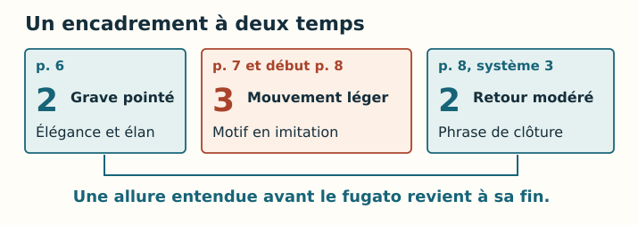
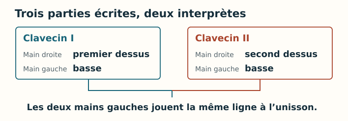

# BEL A/L — Histoire de la musique 2026 · Corrigé guidé

*Corrigé rédigé par IA, non officiel. Signalez toute erreur.*

**Lecture du rapport du jury** · GPT-6.2 Astra Ultra · vitesse non renseignée

**Rédaction** · GPT-6.2 Astra Ultra · vitesse non renseignée

**Révision** · GPT-6.2 Astra Ultra · vitesse non renseignée

**Retouches** · GPT-6.2 Astra Ultra · vitesse non renseignée

## Présentation du sujet

Cette composition de six heures porte sur les nations musicales dans l’Europe baroque. Deux sources sollicitent des opérations différentes. L’article « Style » du *Dictionnaire de musique* de Rousseau (1767) avance une définition puis évalue trois répertoires. Le fac-similé reproduit l’*Essai en forme d’ouverture* de François Couperin dans son *Apothéose de Lully* (1725). La consigne demande également des exemples au choix. Les trois pages de partition, numérotées ici selon le livret du concours, peuvent être annotées et jointes à la copie. [Sujet et fac-similé, p. 5 à 8](https://www.ens.psl.eu/sites/default/files/al_spe_arts.pdf#page=5)

Sur le brouillon, placer en regard un adjectif de Rousseau, un passage que l’on sait lire et une objection. Garder quelques minutes pour vérifier que les trois familles de styles ont été interrogées et que la copie fait réellement entendre la fin de la pièce.

## Analyse du sujet

> [!INDICATION]
> Repérer les noms que Rousseau donne aux causes du style. Lesquels disparaissent quand il en vient aux portraits nationaux ?

> [!INDICATION]
> Comparer l’effet produit par « mais » dans le portrait allemand et l’absence de réserve dans le portrait italien. Demander ensuite ce qui permettrait de soumettre « monotone » à une épreuve musicale.

#### Solution

Une particularité d’écriture peut se transcrire (deux temps, un rythme pointé), une habitude d’exécution s’apprend (appuyer puis détacher) et un jugement suppose une attente (trouver cette gravité pesante ou majestueuse). Rousseau inclut d’abord la composition et l’exécution dans une même définition ouverte aux lieux, aux époques, aux sujets et aux auteurs. Il resserre ensuite l’échelle d’observation jusqu’à attribuer un caractère à toutes les compositions d’un pays. « Piquant » fait éprouver son plaisir au lecteur ; le mot ne fixe aucun critère d’identification aussi net qu’une clé de sol ou un chiffre de mesure. Dans le contexte de son engagement pour l’opéra italien, ce glissement mérite d’être interrogé dès l’introduction.

## Problématique

> [!INDICATION]
> Lire les deux clés des premiers dessus, puis imaginer l’effet de la première attaque pour quelqu’un qui fermerait les yeux.

#### Solution

**À quelles conditions peut-on reconnaître un goût national à l’oreille, si des musiciens formés à des usages différents peuvent écrire et jouer ensemble la même phrase ?** La question accorde aux conventions assez de consistance pour que leur réunion ait un sens et demande à l’analyse ce qui peut passer d’un usage à l’autre. Une autre entrée consisterait à demander comment le jugement de goût d’un auditeur devient un jugement sur un peuple.

## Plan détaillé

Le premier moment précise ce que Rousseau entend et valorise. Le second vérifie, dans la partition, à quelle échelle deux styles se distinguent. Le dernier prend au sérieux une conséquence de cette lecture : les manières sont assez nettement définies pour être enseignées, échangées et transformées.

### Partie I — Une préférence esthétique prend la forme d’un classement

> [!INDICATION]
> À l’acte II d’*Armide*, prononcer la question sur la pitié, puis « Frappons », une première fois en séparant nettement les deux et une seconde en les enchaînant. Que devient l’intention de la magicienne ?

#### Solution

- **I.1 — Disséquer la phrase.** « Caractère distinctif » demande de comparer des œuvres ou des interprètes. Quand Rousseau attribue des caractères aux Allemands, aux Français et aux Italiens, il conserve le pouvoir de distinction mais réduit le nombre des causes. Le couple de reproches opposés, fadeur et dureté, dit beaucoup de son échelle de valeur et peu de la régularité d’un trait technique.
- **I.2 — Retrouver un litige concret.** Dans sa *Lettre sur la musique française* de 1753, Rousseau discute l’*Armide* de Lully (1686). Rousseau regrette que l’orchestre reste muet dans le silence qui précède le rappel, par Armide, de ses captifs délivrés. Plus tard vient une autre objection, au mot « Frappons ». Rousseau propose de lier l’impératif à la question précédente sur la pitié et de lever le poignard dans un même élan. La déclamation change le sens du mouvement. Le jugement sur la musique engage ici une idée du théâtre.
- **I.3 — Reconnaître un genre.** Au premier système de l’*Essai*, mesure à deux, pointés et profil cérémoniel renvoient à une ouverture à la française. L’injonction initiale d’élégance et d’absence de lenteur dirige l’attaque. L’écoute peut donc identifier une convention tout en contestant l’impression de monotonie suggérée par Rousseau.

*Transition.* Ces indices sont assez précis pour guider un interprète. Que font-ils lorsque deux musiciens se réclament de goûts différents dans la même pièce ?

### Partie II — La réunion des goûts s’entend à plusieurs échelles

> [!INDICATION]
> Sur le premier système de la p. 6, repérer la ligne où chaque clé fixe le sol. Reporter mentalement chaque note sur une même portée. Faire ensuite la même opération au quatrième système de la p. 7.

> [!INDICATION]
> Au premier système de la p. 7, suivre la basse pendant la première présentation du motif. Sur la p. 8, repérer l’endroit exact où le nombre de temps change de nouveau.

#### Solution

- **II.1 — Au début, deux lectures mènent aux mêmes hauteurs.** La clé française est une clé de sol première ligne et l’italienne une clé de sol deuxième ligne. Le dessin mélodique initial se superpose à l’unisson. Comparer également les signes placés au-dessus des notes concordantes sur les deux portées. Le code graphique et la réalisation des agréments donnent à penser l’articulation de la lecture et du geste.

- **II.2 — Dans la partie vive, l’indépendance des voix est variable.** En tête de la p. 7, les deux dessus lancent le motif ensemble. La basse attend puis reprend sa figure. Si l’on suit seulement les entrées des dessus, on manque le début de l’imitation. Au quatrième système de la même page, les deux dessus avancent d’abord ensemble en croches mais jouent des hauteurs différentes. Le contrepoint s’entend même quand les attaques coïncident. Cette écriture à trois parties éveille le souvenir du trio corellien. Elle anime en même temps la section vive d’une ouverture française.
- **II.3 — À la fin, retour d’une métrique et d’une allure.** Après la section ternaire allante, le 2 revient au troisième système de la p. 8. La douceur et la modération, déjà indiquées à la p. 6, se retrouvent avec une phrase reconnaissable. Il serait inexact de parler d’une reprise intégrale de l’ouverture. Il s’agit d’un retour ciblé qui fait cadre.

*Transition.* La partition fait voir ce qu’il faut avoir appris pour former ensemble un unisson ou une imitation. Reste à examiner comment on peut apprendre et transporter ces conventions.

### Partie III — Un goût national peut se jouer ailleurs et autrement

> [!INDICATION]
> Comparer deux distributions de la même basse dans l’avertissement de Couperin et un changement de clavier dans le concerto de Bach. Qu’est-ce que le nombre de parties permet ou empêche de déduire du nombre d’instruments ?

#### Solution

- **III.1 — Apollon donne une tâche aux exécutants.** Les noms de Lully et de Corelli restent visibles pendant leur accord. Lully, Florentin de naissance, a construit sa carrière à la cour de France. Un « goût » se constitue par des usages tenus en commun. Le concert de Couperin imagine que deux figures tutélaires consentent à les partager.
- **III.2 — Une même page accepte plusieurs effectifs.** Deux violons et une basse continue donnent une réalisation plausible du trio. Une basse d’archet peut soutenir la partie grave, le claveciniste en réaliser les chiffres. L’avertissement permet également de répartir les deux dessus entre deux clavecinistes jouant tous deux la même basse. La durée d’un son tenu dépend de l’instrument, tandis que le dessin des entrées qui organise le fugato demeure reconnaissable.
- **III.3 — Bach déplace le concerto sur le clavier.** En 1735, la deuxième partie de la *Clavier-Übung* rapproche le *Concerto italien* BWV 971 et l’*Ouverture à la française* BWV 831. Dans le premier, les deux claviers contribuent à rendre audible un contraste entre ensemble et soliste. Dans la seconde, le même instrument restitue la gravité des pointés et le mouvement fugué. Un auteur et un interprète peuvent ainsi faire reconnaître plusieurs traditions.

## Références et exemples

| Passage à retrouver | Opération d’écoute | Fonction dans le plan |
|---|---|---|
| Lully et Quinault, *Armide* (1686), II, 5 ; Rousseau, *Lettre* (1753) | Distinguer le silence critiqué et le phrasé proposé pour l’impératif | Identifier le critère d’expression de Rousseau, I |
| Couperin, p. 6, premier et dernier systèmes | Comparer les clés et les indications de caractère | Distinguer style écrit et style réalisé, I–II |
| Couperin, p. 7, premier et quatrième systèmes | Suivre l’entrée de la basse, puis comparer les deux dessus | Décrire une texture changeante, II |
| Couperin, p. 8, troisième système | Retrouver le 2 et une allure déjà entendue | Reconstituer l’encadrement du fugato, II |
| Bach, *Clavier-Übung* II (1735) | Comparer le contraste des plans du concerto et les sections de l’ouverture | Faire intervenir le cas allemand, III |

L’avertissement de l’édition complète permet d’étayer la discussion de l’effectif. La *Lettre* donne accès au jugement de Rousseau sur Armide. [Édition de Couperin](https://gallica.bnf.fr/ark:/12148/btv1b525026456) · [Rousseau, *Lettre sur la musique française*](https://www.rousseauonline.ch/pdf/rousseauonline-0061.pdf) · [Bach, BWV 971](https://www.bachvereniging.nl/en/bwv/bwv-971)

## Introduction et conclusion rédigées

#### Solution

**Introduction.** Dans la partition de Couperin, Lully et Corelli entrent ensemble. Leurs deux lignes, distinctes à l’œil, commencent à l’unisson. L’expérience jette un doute sur une évidence que semble partager le lecteur du *Dictionnaire de musique* de Rousseau. S’il suffisait d’entendre une phrase pour lui attribuer une nation, à laquelle appartiendrait celle-ci ? L’article « Style » fait lui-même varier le caractère musical selon le compositeur, l’exécutant et la circonstance avant de lier trois caractères à trois peuples. On peut chercher ce que cette certitude doit à un parti pris dans les controverses du XVIIIe siècle, puis éprouver les distinctions nationales à la lecture de l’*Essai*. Il restera à comprendre comment un auteur ou un interprète peuvent s’approprier plusieurs goûts.

**Conclusion.** Le grave pointé, les imitations et la conduite en trio sont reconnaissables parce que les musiciens les ont appris et que le public s’y est familiarisé. Rien n’oblige les personnes qui les emploient à demeurer dans un seul de ces idiomes. Couperin les fait travailler ensemble à plusieurs échelles de la même page, Bach en fait l’objet d’un apprentissage sur un seul instrument. On peut ainsi garder la précision historique d’un nom de goût tout en rapportant à son auditeur le jugement de valeur qui l’accompagne.

## Pièges à éviter

> [!PIEGE]
> Donner au premier dessus toutes les entrées « françaises » et au second toutes les « italiennes » sur la seule foi des noms imprimés. Vérifier les intervalles réels avec les clés et écouter aussi la basse. Autre raccourci : appeler toute imitation « fugue » sans examiner la fonction locale du fugato.

> [!JURY]
> Le rapport 2026, partie écrite, p. 2–3, distingue les représentations des pratiques musicales. Il relève l’insuffisante attention portée aux instruments possibles, à l’alternance entre unisson et indépendance des dessus et au retour final du grave. [Rapport de la composition](https://www.ens-lyon.fr/sites/default/files/2026-10/Arts-%20Musique%202026.pdf)

## Bilan

Pour éprouver un adjectif de critique musicale, désigner d’abord un geste que deux interprètes pourraient montrer différemment. Pour établir une parenté de style, croiser au moins deux échelles, par exemple l’articulation d’une phrase et sa place dans l’ensemble. En masquant les noms des Muses tout en gardant les clés visibles, quels caractères de l’ouverture resterait-il possible de décrire ? Cette expérience permet de mesurer ce qu’ajoute le programme allégorique de Couperin à l’écoute.
