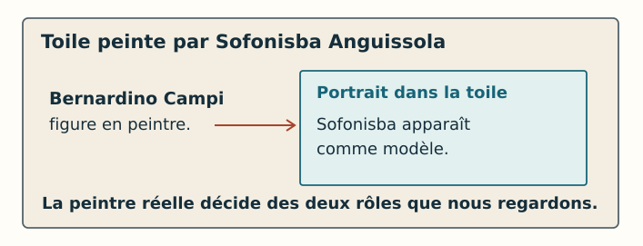
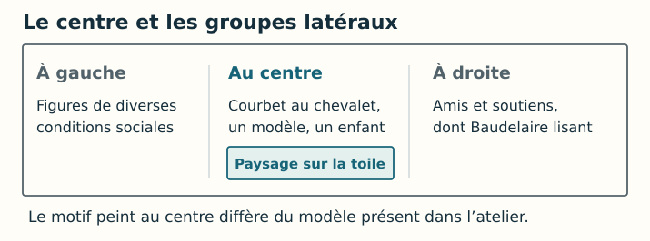
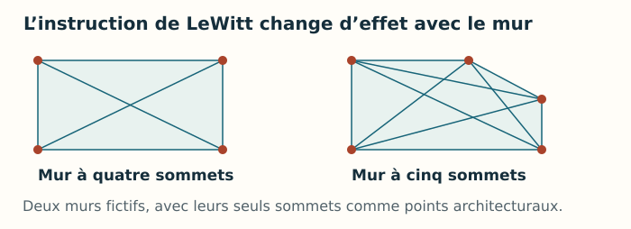

# BEL A/L — Histoire et théorie des arts 2026 · Corrigé brut

*Corrigé rédigé par IA, non officiel. Signalez toute erreur.*

**Lecture du rapport du jury** · GPT-6.2 Astra Ultra · vitesse non renseignée

**Rédaction** · GPT-6.2 Astra Ultra · vitesse non renseignée

**Révision** · GPT-6.2 Astra Ultra · vitesse non renseignée

**Retouches** · GPT-6.2 Astra Ultra · vitesse non renseignée

**Sujet** — L’artiste est-il indissociable de son atelier ?

**Problématique** — Quand l’atelier permet de faire une œuvre, par quelles opérations devient-il aussi le lieu où l’on reconnaît son auteur, parfois jusque longtemps après sa mort ?

En 1998, des archéologues, des conservateurs et des restaurateurs ont entrepris d’enlever de Londres l’atelier de Francis Bacon. Chaque emplacement était relevé, la poussière elle-même recueillie. À Dublin, en 2001, le public a pu découvrir l’atelier ainsi reconstitué. Une pièce détachée de son adresse, privée depuis 1992 de celui qui y peignait, pouvait donc donner accès à une présence singulière. Ce déménagement pose presque matériellement la question du concours. Une salle demeure quand l’artiste s’en va. Une équipe continue parfois quand son maître meurt. Une œuvre voyage seule. Pourtant, devant le désordre de Bacon conservé avec un tel soin, nous sommes tentés d’y reconnaître l’équivalent d’un portrait. Comment passe-t-on de l’espace où quelqu’un travaille à l’espace où le public l’identifie ? Du Moyen Âge aux pratiques contemporaines, le possessif « son » engage successivement, et souvent en même temps, la maîtrise d’un travail, la disposition d’un lieu et le droit de le faire entrer dans l’histoire sous son nom. Il faudra examiner comment l’atelier forme la main qui y travaille, comment l’artiste donne forme à l’image de ce lieu, enfin ce que deviennent leurs rapports quand le travail ou sa mémoire changent d’adresse.

* * *

Avant de demander si l’atelier ressemble à celui qui y travaille, il faut demander à qui il permet de travailler. Les *Belles Heures* de Jean de Berry, enluminées au début du XVe siècle par les trois frères de Limbourg, appartiennent au duc dans un sens où elles n’appartiennent à aucun des trois enlumineurs. C’est son livre de dévotion, sa commande et sa dépense. Or ce que nous identifions comme l’œuvre des Limbourg est aussi le fruit d’une organisation collective. Pour qu’une image se détache sur le parchemin, il a fallu préparer les peaux, régler la page, copier le texte, coordonner la place laissée au décor et celle des miniatures. Dans ce manuscrit, les frères peignent les miniatures, tandis que d’autres mains participent notamment aux bordures. Ouvrir le livre sur deux pages suffit pour comprendre cet ajustement. La même surface réunit des opérations de nature et de durée différentes, sans nous livrer le plan des pièces où elles ont eu lieu. « Atelier des Limbourg » nomme alors une compétence commune et une continuité de travail sous patronage princier. L’expression ne garantit à aucun des trois artistes la possession d’un local personnel.

Dans la Florence des années 1470, le *Baptême du Christ* issu de l’atelier de Verrocchio offre l’épreuve inverse. L’ange agenouillé à gauche, qui tourne son visage vers le Christ, est attribué au jeune Léonard de Vinci. Son corps vu de dos et sa tête de profil invitent l’œil à franchir la surface du panneau. La douceur des passages entre ombre et lumière retient l’attention sur cette figure située en marge de l’action. Pour un regard informé, la particularité d’une main apparaît au sein de la cohérence exigée par une commande unique. Un élève a pu préparer et exécuter une partie visible de l’ensemble précisément parce qu’un maître répondait de ce dernier. Au siècle suivant, Vasari tire de cette collaboration le récit d’une rivalité où l’élève surpasse son maître. L’historien transforme la comparaison de deux mains en scène d’origine d’un grand artiste. L’atelier fournit donc aussi bien la condition d’apprentissage de Léonard que le récit qui permet de l’en détacher. Il faut distinguer ici la personne qui manie le pinceau, celle qui organise le travail et celle dont la postérité choisit de retenir le nom.

L’accès à une telle formation suppose des ressources. À Crémone, au XVIe siècle, Sofonisba Anguissola et sa sœur Elena sont placées par leur père auprès de Bernardino Campi. Cette démarche d’une famille noble ouvre aux jeunes femmes un enseignement professionnel. Elle permet aussi de lire plus finement le tableau de Sofonisba qui montre Campi en train de peindre son portrait, aujourd’hui à Sienne. Le spectateur voit le maître au travail devant l’image de son élève. Or celle qui a effectivement peint la toile a construit à la fois la figure du peintre, la sienne et la relation d’apprentissage qui les unit. Le féminin du modèle à l’intérieur du tableau et celui de l’auteur du tableau entier ne désignent pas le même rôle. L’élève se donne une généalogie d’artiste tout en faisant de son propre maître un personnage de son œuvre. L’atelier apparaît déjà comme une forme que l’artiste peut mettre à distance et retourner. L’apprentissage collectif n’est donc pas une étape primitive, destinée à s’effacer lorsque s’affirme l’individu. Il lui fournit les moyens matériels et symboliques de cette affirmation.

* * *

Que gagne alors un artiste à faire le portrait de son atelier ? Il peut en régler les admissions, déterminer la place accordée aux différents acteurs et produire pour le public une image de sa manière d’agir. *L’Atelier du peintre* de Courbet, présenté à Paris en 1855 dans son Pavillon du réalisme, donne à une activité ordinaire les dimensions d’une peinture d’histoire. Au milieu de la toile, le peintre assis travaille à un paysage. Le modèle nu, debout derrière lui, n’est donc pas le motif posé sur le chevalet. Un jeune garçon lève la tête vers le peintre et son œuvre. Le circuit des regards met en rapport l’acte de peindre et ses différents témoins. Le titre promet un intérieur professionnel ; au centre même de cet intérieur s’ouvre une vue de paysage qui étend le territoire dont le peintre revendique l’expérience.

Le grand format rend sensible un second déplacement. À droite figurent notamment Champfleury, assis, et Baudelaire qui lit. À gauche, des figures de conditions sociales diverses semblent avoir franchi le seuil de l’atelier. Le tableau assemble à l’échelle d’une salle des personnes dont le rapprochement relève de l’« allégorie réelle » annoncée dans le titre développé. En déduire que Courbet les a toutes réunies pendant une séance ferait perdre le sens de cet assemblage. Le peintre se donne la capacité de porter leurs différences sur une même surface. La présentation au Pavillon du réalisme redouble ce geste. À côté de l’Exposition universelle, Courbet organise les conditions dans lesquelles il entend être vu et jugé. Au dehors, les visiteurs viennent à son exposition ; au dedans, le tableau ordonne un public autour de sa personne. La singularité du peintre se lit ici dans ses relations, jusqu’à l’attitude du lecteur qui lui refuse son regard. Elle excède l’analogie commode d’un intérieur qui refléterait directement un caractère.

Le cas de Bacon permet de reprendre l’hypothèse du portrait par le bout opposé. À Londres, au 7 Reece Mews, où il s’est installé en 1961, l’accumulation des photographies, des reproductions, des outils et des matériaux faisait partie des conditions de son travail. Un document froissé peut demeurer une réserve de formes pour un tableau futur. À son ouverture à Dublin, la reconstitution donnait à voir des objets dont la position avait été mesurée. Ce qui manifestait un usage quotidien devient un indice offert à l’interprétation. La fidélité du musée dépend du labeur d’une seconde équipe, dont le relevé transforme un désordre en une organisation reproductible. La poussière, qui pouvait changer de place du vivant du peintre, acquiert une valeur patrimoniale du fait même qu’elle est conservée. L’artiste est absent mais son nom se lit dans la pièce avec une intensité nouvelle. Ce lien peut ainsi être plus visible après la mort, alors que sa fonction productive a disparu. Que l’atelier fasse portrait est un fait d’histoire, auquel participent aussi les institutions qui l’exposent.

* * *

Reste la possibilité qu’un artiste se passe d’atelier. Lui donner par avance le monde entier pour atelier rendrait l’affirmation de leur indissociabilité irréfutable et vide. Il faut donc spécifier ce qui se transporte, ce qui se délègue et ce qui demeure attaché à un site. En 1970, à Rozel Point, dans l’Utah, Robert Smithson construit *Spiral Jetty* en faisant déplacer de la roche basaltique et de la terre pour former une spirale qui avance dans le Grand Lac Salé. La vue d’en haut rend le tracé intelligible d’un seul regard. À pied, la succession des courbes oblige le visiteur à changer continuellement de point de vue, et le niveau de l’eau affecte l’apparition de l’ouvrage. Ce sont des propriétés du site. Aucune salle, fût-elle celle de l’artiste, ne pourrait les produire à l’identique. En revanche le chantier conserve des fonctions que remplissait l’atelier, dont la mobilisation d’ouvriers, d’engins et de savoir-faire. Le film homonyme, également réalisé en 1970, organise encore un autre accès à l’œuvre. Les vues aériennes y rendent possible une expérience qu’un marcheur au sol ne saurait avoir. Répartir la construction, le parcours et les images entre leurs lieux respectifs permet de mesurer l’étendue de l’intervention de Smithson. Sa responsabilité d’auteur se maintient à travers ces déplacements sans faire du lac sa propriété ou son atelier permanent.

En juin 1970, deux lieux de Turin présentent simultanément le *Wall Drawing 51* de Sol LeWitt, la galerie Sperone et le Museo di Torino. Il y a donc, dès la première présentation, deux réalisations distinctes. Une instruction demande de relier par des lignes droites tous les points architecturaux du mur. Les dessinateurs tendent un cordeau à tracer qui dépose une ligne de craie bleue quand ils le font claquer. Un angle, le bord d’une ouverture, la rencontre de deux éléments fournissent aux dessinateurs des points à déterminer sur place. Transposée sur un autre mur, la règle demeure, le réseau de lignes change. L’espace d’exposition assume donc une part de la production, et l’exécutant doit prendre des décisions que le seul énoncé ne fixe pas. La permanence de l’œuvre tient à la règle qui autorise des réalisations distinctes. Ici encore, le partage entre concevoir et faire ne suffit pas à effacer l’auteur. Il rend saisissable ce qui lui revient. LeWitt répond d’une relation possible entre des points, des personnes et une architecture dont il n’a pas besoin de disposer en propre.

On pourrait être tenté de voir dans cette délégation le retour à la *bottega*. La comparaison en fait aussi ressortir la différence. Le panneau du *Baptême du Christ* exigeait que les interventions du maître et des collaborateurs se rejoignent sur un support unique destiné à un lieu précis. L’instruction de LeWitt prévoit que la réalisation puisse recommencer sur un support différent. Chez Verrocchio, distinguer les mains permet d’écrire l’histoire d’un objet persistant. Chez LeWitt, reconnaître un auteur au-delà des différentes mains permet d’identifier une œuvre susceptible de varier. Entre ces deux modèles, l’atelier change de durée aussi bien que d’adresse. L’objet, le protocole et le nom propre n’assurent pas de la même façon la continuité du travail.

* * *

On peut donc séparer un artiste de la pièce qui lui appartenait, et même concevoir des œuvres dont la réalisation exige cette séparation. Ce qui résiste à l’opération, c’est l’histoire précise des moyens par lesquels quelqu’un a pu apprendre, faire faire, agir sur un matériau et se donner à voir. Selon les cas, ces moyens se condensent dans les murs d’un atelier, se partagent entre plusieurs sites ou se recomposent après la mort. Les visiteurs qui ont vu le studio de Bacon à Dublin y ont retrouvé quelque chose du peintre. Cette rencontre a été rendue possible par une intervention collective qui a changé le statut de chacune des choses exposées. L’atelier est indissociable de l’artiste quand on peut établir la nature de cette relation. Ce n’est ni une propriété universelle des lieux ni le privilège naturel d’un nom.
