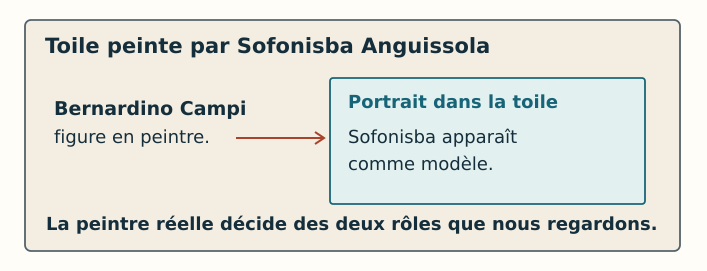
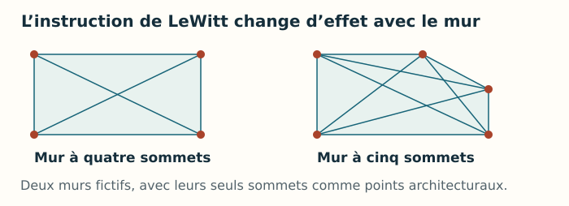

# BEL A/L — Histoire et théorie des arts 2026 · Corrigé guidé

*Corrigé rédigé par IA, non officiel. Signalez toute erreur.*

**Lecture du rapport du jury** · GPT-6.2 Astra Ultra · vitesse non renseignée

**Rédaction** · GPT-6.2 Astra Ultra · vitesse non renseignée

**Révision** · GPT-6.2 Astra Ultra · vitesse non renseignée

**Retouches** · GPT-6.2 Astra Ultra · vitesse non renseignée

## Présentation du sujet

« L’artiste est-il indissociable de son atelier ? » La composition dure six heures et s’inscrit dans le programme « L’atelier, du Moyen Âge à nos jours ». Le livret ne comporte pas d’image pour cette option. Il faut donc choisir et décrire des œuvres avec assez de précision pour qu’un lecteur puisse suivre le raisonnement sans reproduction. [Sujet officiel, p. 4](https://www.ens.psl.eu/sites/default/files/al_spe_arts.pdf#page=4)

Au brouillon, prendre une feuille en deux colonnes. À gauche, écrire ce qui dépend effectivement d’un atelier dans le cas étudié. À droite, noter ce que l’artiste ou le musée fait croire ou comprendre en montrant cet atelier. Une troisième question départage les exemples : que devient ce lien quand l’artiste part, meurt ou délègue l’exécution ?

## Analyse du sujet

> [!INDICATION]
> Essayer de remplacer « son » par « qui lui appartient », « où il apprend », « dont il règle le travail » et « où nous le reconnaissons ». Ces expressions conviennent-elles toutes à un apprenti ?

> [!INDICATION]
> Un enlumineur transmet son travail à un autre, un musée déménage une salle, un dessin mural est exécuté deux fois. Dans chaque situation, identifier exactement ce que l’on sépare.

#### Solution

Le singulier « l’artiste » ne renvoie pas à une condition sociale stable sur six siècles. Maître, apprenti, peintre de cour ou auteur d’un protocole peuvent avoir des rapports très différents aux locaux et aux personnes nécessaires à l’œuvre. « Atelier » peut désigner une pièce, l’équipe qui y travaille, un lieu de transmission ou l’image publique de l’artiste. « Indissociable » engage une nécessité, une durée et une réciprocité. Un artiste peut dépendre d’un atelier dont le travail se poursuit après son départ. À l’inverse, une pièce retirée de l’usage peut conserver le nom d’un peintre. Le problème porte aussi sur l’attribution d’une œuvre et sur la mémoire construite à partir d’un lieu.

## Problématique

> [!INDICATION]
> Comment le musée peut-il donner à voir un atelier plus fortement associé à une personne qu’au temps où elle l’utilisait ?

#### Solution

**Quand l’atelier permet de faire une œuvre, par quelles opérations devient-il aussi le lieu où l’on reconnaît son auteur, parfois jusque longtemps après sa mort ?** La première relation est productive, la seconde est une relation d’identification. Leur coïncidence doit être démontrée. Autre formulation défendable : quand l’artiste sort de son atelier, quelles fonctions peut-il transférer, et qu’est-ce qui demeure irréductiblement lié à un site ?

## Plan détaillé

Chaque partie déplace la question de la dépendance. La première examine qui peut faire et signer. La deuxième étudie qui donne à voir l’atelier et à qui. La troisième met le lien à l’épreuve en transférant ou en supprimant le local propre à l’artiste.

### Partie I — Un atelier distribue les compétences avant de désigner un nom propre

> [!INDICATION]
> Prendre un objet unique, livre ou panneau, et faire apparaître deux opérations distinctes que l’œil y rencontre simultanément. Qui répond de l’unité de l’objet ?

#### Solution

- **I.1 — Les frères de Limbourg, début du XVe siècle.** Dans les *Belles Heures* de Jean de Berry, le format des pages lie copie du texte, bordure et miniature. Les trois frères peignent les miniatures, d’autres collaborateurs interviennent dans le livre. « De Jean de Berry » dit à qui est destiné le manuscrit et qui l’a commandé. Nommer les frères dit à qui revient l’essentiel de l’enluminure. Ces réponses portent sur des opérations différentes.
- **I.2 — Verrocchio et Léonard, Florence, années 1470.** L’ange agenouillé à gauche dans le *Baptême du Christ* attribue une présence reconnaissable à la main du jeune Léonard. Un détail local autorise ainsi une attribution distincte dans un ouvrage dirigé par le maître. Vasari donne plus tard à l’épisode le sens d’un dépassement du maître par l’élève. Ce récit témoigne de la construction d’une carrière exemplaire.
- **I.3 — Qui a accès à l’atelier ?** À Crémone, Sofonisba et Elena Anguissola bénéficient d’un apprentissage chez Bernardino Campi grâce à l’intervention de leur père. Dans la toile où Sofonisba représente Campi peignant son portrait, la personne figurée en modèle est aussi celle qui peint l’ensemble. L’œuvre donne à voir la formation professionnelle d’une femme et lui permet de revendiquer la maîtrise de l’image par laquelle cette formation sera connue.

*Transition.* Une fois qu’il représente l’atelier, l’artiste peut ordonner lui-même le récit qui sera fait de ses conditions de travail.

### Partie II — Montrer l’atelier produit une certaine figure de l’artiste

> [!INDICATION]
> Dans le tableau de Courbet, isoler le motif sur le chevalet, le modèle qui se tient derrière le peintre et un spectateur qui détourne les yeux. Que nous apprennent leurs orientations ?

#### Solution

- **II.1 — Courbet choisit un centre.** Au milieu de *L’Atelier du peintre* (1854–1855), le chevalet porte un paysage. Un modèle nu et un enfant se tiennent près de Courbet. Cette disposition empêche de réduire la scène à la reproduction d’un corps posé devant le peintre. L’œuvre en train de se faire ouvre, au cœur de l’atelier peint, une fenêtre sur une autre expérience du réel.
- **II.2 — Le peintre compose sa société.** À gauche, Courbet rassemble des figures de conditions diverses. À droite se reconnaissent des proches et des soutiens dont Baudelaire, absorbé dans sa lecture. La mise en scène comprend même la possibilité de ne pas regarder l’artiste. Au Pavillon du réalisme de 1855, le tableau propose au public une représentation à grande échelle du monde que le peintre entend prendre en charge. Ses voisins de toile ne constituent pas la liste des personnes présentes à une séance réelle.

- **II.3 — Un musée peut recomposer ce portrait.** Le studio londonien de Francis Bacon, occupé depuis 1961, est relevé et démonté en 1998 puis ouvert au public à Dublin en 2001. Durant la vie de Bacon, un papier déplacé pouvait entrer dans la fabrication d’une œuvre. Une fois inventorié, il renseigne sur les pratiques ou les ressources visuelles du peintre. La différence tient à l’usage, même quand l’objet conserve exactement sa place relative.

*Transition.* Le cas Bacon dissocie clairement persistance de l’image et poursuite de l’activité. Peut-on faire le mouvement inverse et poursuivre l’activité quand le local de l’artiste disparaît ?

### Partie III — Déplacer le travail en révèle les lieux et les agents

> [!INDICATION]
> Quel élément de *Spiral Jetty* serait perdu si l’on reconstruisait la même spirale dans un musée ? À l’inverse, quelle part d’un dessin mural de LeWitt peut demeurer la même d’une salle à l’autre ?

#### Solution

- **III.1 — Smithson, *Spiral Jetty* (1970).** Roche basaltique, terre, variation du niveau de l’eau, longueur du parcours et vue aérienne rattachent l’ouvrage au Grand Lac Salé. Les engins et les ouvriers déplacent une fonction de production sur le site. Le film de 1970 prolonge et modifie les points de vue possibles. Le site construit et ses images dépendent de moyens de travail distincts.
- **III.2 — LeWitt, *Wall Drawing 51* (1970).** Dès juin 1970, la galerie Sperone et le Museo di Torino présentent simultanément deux réalisations de ce protocole. Les dessinateurs relient par des droites tracées au cordeau bleu les points architecturaux du mur. Le dessinateur doit identifier ces points face au lieu avant de pouvoir les relier. Le dessin varie d’un site à l’autre tout en continuant d’être attribué à LeWitt.
- **III.3 — Revenir à l’exemple de la première partie.** Chez Verrocchio, plusieurs mains s’accordent pour achever un panneau. Chez LeWitt, une instruction permet plusieurs réalisations. L’unité matérielle du premier objet et l’identité conceptuelle du second donnent des contenus différents au mot « auteur ». Ce rapprochement fait travailler la longue durée et évite une histoire simplifiée de l’émancipation individuelle.

## Références et exemples

| Référence | Détail à analyser | Fonction |
|---|---|---|
| Frères de Limbourg, *Belles Heures de Jean de Berry*, début du XVe siècle, New York, Metropolitan Museum | Articulation de la miniature, du texte et des bordures | Distinguer commande et travail partagé |
| Verrocchio et Léonard, *Baptême du Christ*, années 1470, Florence, Offices | Ange de gauche | Distinguer attribution locale et responsabilité d’ensemble |
| Sofonisba Anguissola, *Bernardino Campi peignant Sofonisba Anguissola*, XVIe siècle, Sienne | Tableau contenant un autre portrait | Distinguer l’auteur réel du peintre représenté |
| Courbet, *L’Atelier du peintre*, 1854–1855, Paris, Orsay | Paysage au chevalet, groupes latéraux, Baudelaire lisant | Étudier la représentation publique de l’artiste |
| Studio de Bacon, Londres puis Dublin, Hugh Lane Gallery | Relevé et transfert des objets | Distinguer l’usage de la conservation |
| Smithson, *Spiral Jetty*, Utah, 1970 ; LeWitt, *Wall Drawing 51*, 1970 | Courbe parcourue sur place ; traits redéfinis sur chaque mur | Opposer l’attachement au site et la possibilité de réexécution |

Les notices des collections permettent de vérifier les détails d’attribution, la disposition du tableau de Courbet et l’exécution du dessin mural. [Les *Belles Heures*](https://blog.metmuseum.org/artofillumination/the-artists-herman-paul-and-jean-de-limbourg/) · [Le *Baptême du Christ*](https://www.uffizi.it/en/artworks/verrocchio-leonardo-baptism-of-christ) · [*L’Atelier du peintre*](https://www.musee-orsay.fr/fr/oeuvres/latelier-du-peintre-927) · [Le studio de Bacon](https://hughlane.ie/arts_artists/francis-bacons-studio/) · [*Wall Drawing 51*](https://massmoca.org/event/walldrawing51/)

## Introduction et conclusion rédigées

#### Solution

**Introduction.** L’atelier londonien de Francis Bacon a été transporté et reconstitué à Dublin après la mort du peintre. Les visiteurs qui y ont reconnu la présence du peintre devaient cette rencontre au travail d’archéologues et de conservateurs. Ce cas singulier invite à interroger ce que le possessif « son » désigne. Il peut renvoyer à un espace privé, à une entreprise collective placée sous l’autorité d’un maître, ou au lieu qu’une institution a choisi d’associer à un nom. Comment passe-t-on de la dépendance pratique d’un artiste envers son atelier à l’identification publique de l’un par l’autre ? La formation et la distribution du travail permettront de comprendre leur premier rapport. Il faudra ensuite examiner la représentation de l’atelier, avant de mettre cette association à l’épreuve du travail hors les murs.

**Conclusion.** Un artiste peut quitter sa pièce de travail et l’œuvre subsister, ou même ne prendre forme qu’ailleurs. La dépendance est forte chaque fois que l’on précise l’opération qui lie un auteur à des personnes, à des matériaux et à un site donné. Elle l’est encore, en un autre sens, lorsque le public rapporte à un nom les traces d’un travail passé. Le studio de Bacon a pu être séparé de son occupant et de son adresse précisément parce que ceux qui le conservaient savaient les liens qu’il leur faudrait rendre visibles.

## Pièges à éviter

> [!PIEGE]
> Passer d’une vue d’atelier à une affirmation biographique sans analyser la représentation. Chez Courbet, il faudrait démontrer que les personnages étaient présents le même jour avant de traiter la toile comme un compte rendu de séance. L’hypothèse de l’allégorie explique leur réunion et le choix du format.

> [!PIEGE]
> Appeler « atelier » tout endroit touché par l’art. Si le mot s’applique indifféremment à un atelier privé, au site d’une œuvre et à la salle de musée, la question devient impossible à discuter. Pour chaque déplacement, nommer la fonction conservée et la contrainte nouvelle.

> [!JURY]
> Le rapport écrit 2026, p. 2–4, insiste sur le possessif, sur la variété des fonctions de l’atelier et sur les représentations à soumettre à l’analyse. Il apprécie une réflexion historique sur le travail collectif, les conditions d’accès à la formation, les pratiques hors atelier et la patrimonialisation. [Rapport de la composition](https://www.ens-lyon.fr/sites/default/files/2026-10/Arts%20-%20Histoire%20des%20arts%202026.pdf)

## Bilan

Pour éprouver la portée d’un exemple, lui appliquer trois verbes : **faire**, **montrer**, **conserver**. Quelqu’un peut avoir fait l’œuvre, quelqu’un d’autre organisé la vue de l’atelier, une institution conservé la salle. Si ces verbes renvoient à plusieurs agents ou à des périodes différentes, la copie tient déjà un argument sur la façon dont se construit l’association entre un artiste et un lieu.
