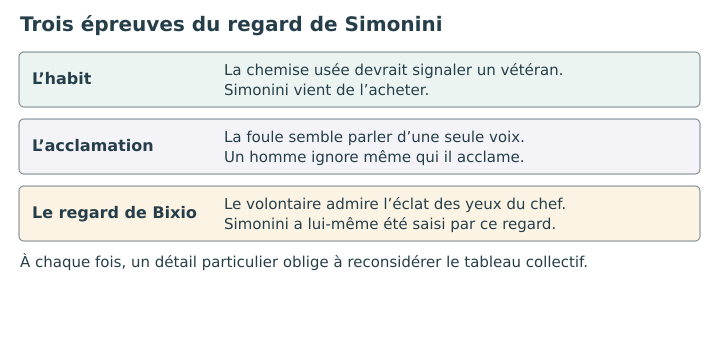

# BEL A/L — Italien, commentaire et traduction 2026 · Corrigé guidé

*Corrigé rédigé par IA, non officiel. Signalez toute erreur.*

**Rédaction** · GPT-6.2 Astra Ultra · vitesse non renseignée

## Présentation du sujet

L’épreuve commune porte sur les 58 lignes de l’extrait d’*Il cimitero di Praga* (2010) d’Umberto Eco. Le chapeau présente Simonini comme un Piémontais fictif tenant un journal. À Palerme, en juin 1860, il observe Dumas et Garibaldi pendant l’expédition des Mille, un épisode du Risorgimento. Le commentaire se rédige en italien et porte sur les deux pages. La version française commence au milieu de la ligne 17, après le constat de théâtralité, et s’arrête à la fin de la ligne 34. [Sujet officiel, p. 12 et 13](https://www.ens.psl.eu/sites/default/files/al_lve_commun_commentaire_traduction_2026.pdf#page=12)

## I. Commentaire en italien

### Mettre à l’épreuve une impression du diariste

> [!INDICATION]
> Pourquoi choisir une chemise qui a déjà perdu une partie de sa couleur ? Comment le raisonnement de l’acheteur modifie-t-il l’image inaugurale du champ de coquelicots ?

#### Solution

La première comparaison, saisie à l’échelle de la rue, produit un groupe héroïque d’un seul tenant. Mais la rareté du tissu donne aux aristocrates locaux un avantage sur les premiers combattants. La marque du temps que Simonini achète pour effacer l’apparence d’un nouveau venu est précisément du rose, soit du rouge passé. Ce détail rapproche ce qu’il a compris de ce qu’il fait. Le journal dénonce les apparences tout en expliquant comment son auteur en fabrique une.

Un commentaire peut alors tester la même question à deux autres échelles. Lors de la réception, que savent les gens qui crient le nom de Dumas ? Lors du second passage de Bixio, qui a déjà éprouvé la puissance de son regard ? Le retour de *fulminare* fait communiquer le propos du volontaire admiratif et la peur du témoin qui se veut lucide. On peut en tirer une étude de l’autorité du diariste qui s’appuie sur des faits de langue précis.

### Délimiter le savoir du personnage

Le discours officiel parle des renforts annoncés. Simonini suppose que Garibaldi a suscité la manifestation pour s’assurer les fusils promis. Un homme dans la foule rapporte encore une autre version en faisant de Dumas un prince. Une copie qui fond ces trois voix en un récit unique transforme une suspicion et une rumeur en événements avérés. À la fin, les premières batailles, antérieures à l’arrivée de Simonini, sont reconstruites par les récits d’Abba et de Bandi. La dernière phrase confirme ainsi la dépendance du témoin envers les voix qu’il recueille.

Le mot *Male* rend visible un autre choix du diariste. Le danger que présente pour lui le prestige de Garibaldi vient de ses « maîtres » de Turin et de leur crainte d’une contagion républicaine. L’insulte sur les dialectes appartient aussi à ce regard piémontais. L’interprétation caractérise ainsi le narrateur fictif à partir de sa propre voix.

> [!JURY]
> Le jury demande d’articuler la petite histoire à l’expédition des Mille, et souligne le risque de confondre Eco et le narrateur qu’il a inventé. L’identité précise d’agent secret n’était pas un préalable attendu des candidats. Le déguisement, la double identité déclarée dans l’extrait et le lien avec Turin suffisent à l’analyse. [Rapport du jury, p. 2 à 4](https://www.ens-lyon.fr/sites/default/files/2026-10/Italien%202026.pdf#page=2)

### Commentaire rédigé

#### Solution

**Chi può riconoscere una camicia rossa?**

Nel giugno del 1860, a Palermo, basta una camicia per essere scambiato per uno dei volontari di Garibaldi. Nel *Cimitero di Praga* (2010), Umberto Eco affida il racconto di quei giorni al diario di Simone Simonini, piemontese di sua invenzione, che assiste all’incontro fra Garibaldi e Alexandre Dumas. Il testimone si vanta di vedere dietro le apparenze. Ma la camicia che indossa, i prezzi che registra e le parole che sorprende nella folla mettono alla prova anche la sua autorità di cronista. Come riesce Eco a far vedere la nascita di una leggenda politica attraverso gli occhi di un uomo che vorrebbe soffocarla?

All’inizio l’impressione di unità è immediata. Il movimento delle camicie trasforma Palermo in un «campo di papaveri» (r. 2), quasi che la spedizione dei Mille fosse fiorita spontaneamente nelle strade della città. Basta avvicinarsi per scorgere abiti civili, cappelli malandati, uniformi improvvisate. Soprattutto, il rosso ha un prezzo. Può permetterselo più facilmente un giovane nobile siciliano, arrivato dopo le battaglie più sanguinose, che un reduce partito da Genova. Portare i colori della spedizione e averne condiviso i rischi sono due cose che la folla, da lontano, può facilmente confondere. Simonini sa sfruttare lo scarto. Compra una camicia già scolorita per sembrare un veterano. Proprio il rosa, che guasta la bellezza del quadro, deve garantire ai suoi occhi la credibilità del travestimento.

La contabilità del diario ha una funzione simile. Simonini confronta i quindici franchi di quella camicia con le quattro che avrebbe comprato a Torino. Annota poi il prezzo delle uova, del pane, della carne. L’esattezza delle cifre sembra autorizzarlo a spiegare il rincaro, ma la frase si apre su un dubbio. Sono gli occupanti a divorare le risorse dell’isola o i palermitani a spolpare i volontari? Nei due verbi la fame cambia soggetto. La stessa impresa può apparire una liberazione, un’occupazione o un’occasione di guadagno, secondo chi debba pagare il conto.

Al palazzo l’acclamazione si costruisce davanti al lettore. Dumas paragona la scena a un episodio parigino del 1830, come se riconoscesse una rivoluzione da un’altra. Garibaldi rimanda le congratulazioni ai suoi uomini e subito dopo ricompensa il messaggero. Le grandezze misurabili tornano, questa volta nella voce del generale, che enumera uomini, fucili e navi annunciati dalle lettere. Più tardi, fra la folla, il proclama lascia posto a una domanda a mezza voce. Un uomo sta già acclamando Dumas prima di sapere chi sia. L’altro lo fa passare per un principe circasso ricchissimo. Il grido patriottico può quindi essere unanime anche quando chi grida gli attribuisce tutt’altro significato. Che Garibaldi abbia organizzato la scena rimane però un sospetto del diarista. Il lettore ha accesso al sospetto, non ai retroscena.

Anche i corpi danno luogo a versioni concorrenti. All’Apollo descritto da Dumas Simonini oppone le gambe arcuate e la difficoltà di montare a cavallo. A indicargli come guardare è già intervenuta, per sua ammissione, la morte di suo padre. L’uomo che ridimensiona un eroe è a sua volta intimidito dallo sguardo di Bixio. Poco dopo, passando a cavallo, il luogotenente accende l’immaginazione di un volontario, che sente persino nel suo nome il guizzo di un fulmine. Il verbo *fulminare*, già usato da Simonini per il proprio sgomento, ritorna sulle labbra dell’ammiratore. Il presunto osservatore disincantato riconosce negli altri una fascinazione che ha appena subìto egli stesso.

Il brusco «Male» (r. 47) interrompe il piacere con cui il diario aveva fatto ascoltare quella voce. Ai padroni torinesi di Simonini importa che il fascino personale di Garibaldi non porti i sudditi del Nord a volere la repubblica. La fatica del narratore a capire il dialetto, che egli paragona sprezzantemente al parlare di un intero continente, misura la distanza fra la sua idea del popolo e le persone che ascolta. Alla data del 15 giugno il racconto torna tuttavia a tavola. Fra un boccone e un bicchiere Simonini conosce Abba e Bandi. Dalle parole di altri dovrà ricostruire ciò che non ha visto, lo sbarco e le prime battaglie. Neppure l’occhio dell’informatore basta a se stesso.

La leggenda nasce così da un vestito, da un applauso, dal suono di un nome, ma nessuno dei presenti ne possiede da solo il significato. Con due identità di copertura, garibaldino per i siciliani e cronista per i volontari, Simonini sa meglio di chiunque quanto un segno possa mentire. Nel suo desiderio di spegnere l’entusiasmo per Garibaldi, lascia però sulla pagina la prova più viva della sua forza, la voce di chi ha imparato a vedere un eroe.

## II. Version française

### Identifier ceux qui voient, parlent et agissent

> [!INDICATION]
> Dans *Dumas me lo aveva descritto*, retrouver le sujet, le destinataire et la personne décrite. Qui monte à cheval dans la phrase qui suit ?

#### Solution

Dumas est le sujet du verbe. *Me* désigne le diariste qui a entendu la description, *lo* reprend le héros, Garibaldi. Simonini compare donc l’Apollon que Dumas lui avait décrit à l’homme qu’il regarde monter à cheval. C’est la lecture du sujet et elle est explicitement confirmée par l’analyse grammaticale du jury en page 6. Une remarque de la page 3 du rapport intervertit les deux hommes.

Dans la scène d’accueil, *sua* appartient au tour de politesse. Le général dit que Dumas lui a manqué et il parle ensuite à ses propres hommes, *ai suoi*. Les éloges qu’il décline sont ceux que lui adressait son ami. Quand la scène change de lieu, *ne* dans la phrase sur la satisfaction de l’écrivain reprend la manifestation de la foule. Enfin, dans *fosse stata fatta organizzare*, la manifestation est le sujet grammatical du passif. En faisant de Garibaldi le sujet en français, « avait fait organiser » lui attribue l’initiative, et « j’ai l’impression » laisse à Simonini la responsabilité de l’hypothèse.

### Garder l’incertitude et la vivacité du journal

| Point de langue | Solution |
|---|---|
| *chi fosse* | L’interrogative indirecte italienne admet le subjonctif. Dans la question que le diariste se pose sur les deux acteurs et dans celle que pose le spectateur sur Dumas, le français emploie l’imparfait de l’indicatif. |
| *biondiccio* | Le suffixe affaiblit la blondeur et fait entendre le regard dépréciatif. Un « blond douteux » répond ironiquement à l’Apollon. |
| *stava gridando* | La question est posée en pleine acclamation. « Était en train de » permet de restituer ce décalage comique. |
| *piroscafi* | Il s’agit de bateaux à vapeur. Les deux mille cinq cents hommes, les dix mille fusils et les deux navires sont annoncés par les lettres. Leur arrivée reste à venir au moment du discours. |

### Version rédigée

#### Solution

Des deux, je ne sais lequel était le meilleur cabotin.

« Mon cher Dumas, vous me manquiez ! » s’est écrié le général. Et comme Dumas le félicitait, il a repris. « Ce n’est pas moi, ce n’est pas moi qu’il faut féliciter, mais ces hommes. Ils ont été des géants ! » Puis il s’est adressé aux siens. « Donnez sur-le-champ à monsieur Dumas le plus bel appartement du palais. Rien ne sera trop beau pour l’homme qui m’a apporté des lettres annonçant l’arrivée de deux mille cinq cents hommes, de dix mille fusils et de deux bateaux à vapeur ! »

Moi, je regardais le héros avec cette défiance que m’inspiraient les héros depuis la mort de mon père. Dumas m’en avait fait un Apollon. Il me semblait, à moi, plutôt petit, d’un blond douteux plutôt que franchement blond, court sur ses jambes arquées et, à en juger par sa démarche, atteint de rhumatismes. Je l’ai vu se mettre en selle non sans peine, avec l’aide de deux de ses hommes.

Sur la fin de l’après-midi, une foule s’est rassemblée au pied du palais royal en criant « Vive Dumas ! Vive l’Italie ! » L’écrivain en était visiblement flatté, mais j’ai l’impression que Garibaldi avait fait organiser la chose. Il connaît la vanité de son ami et il a besoin des fusils promis. Je me suis mêlé à la foule et j’ai tâché de saisir ce que ces gens se disaient dans leur dialecte, aussi incompréhensible que le parler des Africains. J’ai pourtant surpris un court dialogue. L’un demandait à l’autre qui était ce Dumas qu’il était en train d’acclamer, et l’autre lui répondait que c’était un prince circassien qui roulait sur l’or et venait mettre son argent à la disposition de Garibaldi.
