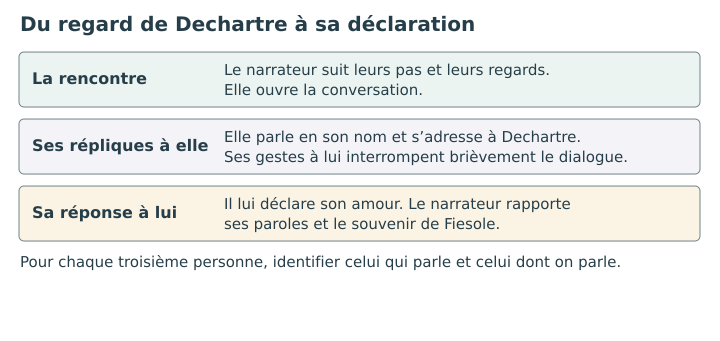

# BEL A/L — Italien, thème Lyon 2026 · Corrigé brut

*Corrigé rédigé par IA, non officiel. Signalez toute erreur.*

**Rédaction** · GPT-6.2 Astra Ultra · vitesse non renseignée

**Révision (tour 1)** · GPT-6.2 Astra Ultra · vitesse non renseignée

## Thème

Quando, avvolta nel suo mantello color saio, arrivò sul lungarno Acciaioli, verso le sei e mezzo, Dechartre l’accolse con uno sguardo umile e radioso che le andò al cuore. Il sole al tramonto tingeva di porpora le acque gonfie dell’Arno. Per qualche istante rimasero in silenzio. Mentre camminavano verso Ponte Vecchio seguendo la fila monotona dei palazzi, fu lei la prima a rivolgergli la parola.

«Come vede, sono venuta. Ho creduto di dover venire. Non mi sento senza colpa per quanto è accaduto. So bene di aver fatto quel che ci voleva perché Lei fosse con me come è ora. Il mio modo di comportarmi Le ha messo in mente pensieri che altrimenti non avrebbe avuto.»

Lui pareva non capire. Lei riprese.

«Ero egoista, ero incauta. Lei mi piaceva, mi piaceva il suo ingegno, non sapevo più fare a meno di Lei. Ho fatto quel che potevo per attirarla a me, per trattenerla. Ho fatto la civetta… Non lo facevo con freddezza né con perfidia, ma lo facevo.»

Egli scosse la testa, negando di essersene mai accorto.

«Sì, ho fatto la civetta! Eppure non è mia abitudine. Ma con Lei l’ho fatto. Non dico che abbia cercato di approfittarne, come del resto ne aveva il diritto, né che se ne sia inorgoglito. Non ho avuto l’impressione che fosse presuntuoso. Può darsi che non si sia accorto di nulla. Agli uomini superiori manca talvolta la finezza. Ma so bene di non essere stata quella che avrei dovuto essere. E gliene chiedo perdono. Ecco perché sono venuta. Restiamo buoni amici, dato che siamo ancora in tempo.»

Egli le disse, con una dolcezza cupa, che l’amava. Le prime ore di quell’amore erano state lievi e deliziose. Non desiderava che vederla e poi vederla ancora. Ma ben presto lei lo aveva sconvolto, strappato a se stesso, lacerato. Un giorno, sulla terrazza di Fiesole, il male era esploso improvviso e violento. E ora gli mancava il coraggio di soffrire e tacere. Il suo grido si levava verso di lei. Non era venuto con un disegno prestabilito. Se le aveva rivelato la sua passione, era stato per una forza più grande di lui, contro la sua volontà […].

Tratto da Anatole France, *Le Lys rouge* (1894).

