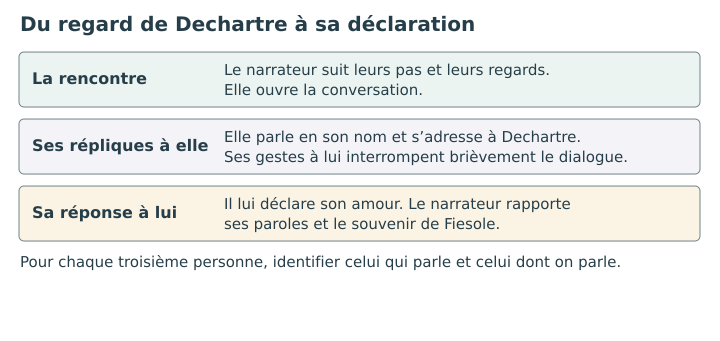

# BEL A/L — Italien, thème Lyon 2026 · Corrigé guidé

*Corrigé rédigé par IA, non officiel. Signalez toute erreur.*

**Rédaction** · GPT-6.2 Astra Ultra · vitesse non renseignée

**Révision (tour 1)** · GPT-6.2 Astra Ultra · vitesse non renseignée

## Présentation du sujet

L’ENS de Lyon demande de traduire en italien, en quatre heures et sans dictionnaire, un extrait du *Lys rouge* d’Anatole France (1894). Deux personnages se retrouvent à Florence. La femme prend la parole en premier pour s’expliquer. À la fin de l’extrait, le narrateur rapporte la déclaration de Dechartre. [Sujet officiel, p. 15](https://www.ens-lyon.fr/sites/default/files/2026-04/Epreuve%20de%20sp%C3%A9cialit%C3%A9%202026.pdf#page=15)

## Thème

### Distribuer les voix et les pronoms

> [!INDICATION]
> Qui croit devoir venir ? Qui ne semble pas comprendre ? Qui reprend la parole ? Placer d’abord les sujets en italien à ces endroits, puis relire le dialogue.

#### Solution

Dans la bouche de la femme, l’italien peut facilement laisser le « je » sous-entendu. En revanche, aux deux phrases qui séparent ses premières répliques, la troisième personne du singulier désigne successivement Dechartre et la femme. Les sujets exprimés *Lui pareva … Lei riprese* permettent de suivre le bref échange de regards avant la reprise de parole. Après le dernier discours direct, *egli le disse* opère le passage à la voix de l’homme, rapportée par le narrateur. Son cri se dirige vers elle et exprime la nécessité de lui dire son amour. Un cri « contre elle » lui donnerait une hostilité étrangère à la scène.

Cette traduction choisit *Lei* pour la forme de politesse. À l’intérieur d’une réplique, « vous attirer » devient *attirarla*, tandis que « je vous en demande pardon » donne *gliene chiedo perdono*. Dans le premier cas, la personne est complément direct. Dans le second, *glie-* désigne la personne à laquelle on demande pardon et *-ne* la conduite dont la femme s’excuse. La forme de politesse désigne un homme, d’où le masculin dans *si sia accorto*.

### Maintenir les temps malgré les changements de construction

| Mouvement | Décision de traduction |
|---|---|
| Une action passée produit un effet présent | Dans *perché Lei fosse con me come è ora*, *fosse* se rattache à ce qu’elle a fait, *è* à ce qu’il est à présent en sa présence. |
| Elle refuse de lui prêter deux intentions | Les deux verbes après *non dico che … né che* désignent des actes antérieurs. Le passé du subjonctif maintient les deux propositions sur le même plan, même si elles sont séparées par une incise. |
| Un seul personnage juge sa propre action | Dans *ho creduto di dover venire*, celle qui pense est celle qui vient. Dans *negando di essersene mai accorto*, celui qui secoue la tête est aussi celui qui nie avoir remarqué sa coquetterie. L’infinitif passé marque ici l’antériorité. |
| Il revient sur la naissance de l’amour | Le plus-que-parfait *lo aveva sconvolto* rétablit l’histoire de son trouble avant le moment où il lui parle. Trois participes gardent le rythme ascendant du passage. |

### Choisir un mot dans la scène

Le manteau « carmélite » doit son nom à une teinte. *Color saio* évoque le brun d’une bure sans faire de la femme une religieuse. Le regard de Dechartre éclaire la rencontre, puis la couleur passe aux eaux de l’Arno. Pour celles-ci, *tingeva di porpora* conserve à la fois la couleur et l’action exercée par le soleil. Le nom florentin du pont est *Ponte Vecchio*. La raison qu’elle donne ensuite pour rester amis demande une conjonction causale. Dans *dato che siamo ancora in tempo*, la possibilité encore ouverte justifie la proposition qu’elle fait maintenant.

À la fin, *una dolcezza cupa* conserve l’association de deux qualités apparemment incompatibles. Dans *se le aveva rivelato la sua passione*, le verbe donne à « dire » sa valeur d’aveu. La subordonnée énonce un fait déjà accompli dont la proposition principale explique la cause.

> [!JURY]
> Le jury accepte *Lei* et *voi* comme formes de politesse. Il distingue trois moments de style dans cet extrait, de la description ample aux phrases nerveuses de la femme puis à la réponse rapportée de Dechartre. Il relève en particulier la nécessité de rendre en italien le nom de Ponte Vecchio. [Rapport du jury, p. 9 à 13](https://www.ens-lyon.fr/sites/default/files/2026-10/Italien%202026.pdf#page=9)

### Traduction rédigée

#### Solution

Quando, avvolta nel suo mantello color saio, arrivò sul lungarno Acciaioli, verso le sei e mezzo, Dechartre l’accolse con uno sguardo umile e radioso che le andò al cuore. Il sole al tramonto tingeva di porpora le acque gonfie dell’Arno. Per qualche istante rimasero in silenzio. Mentre camminavano verso Ponte Vecchio seguendo la fila monotona dei palazzi, fu lei la prima a rivolgergli la parola.

«Come vede, sono venuta. Ho creduto di dover venire. Non mi sento senza colpa per quanto è accaduto. So bene di aver fatto quel che ci voleva perché Lei fosse con me come è ora. Il mio modo di comportarmi Le ha messo in mente pensieri che altrimenti non avrebbe avuto.»

Lui pareva non capire. Lei riprese.

«Ero egoista, ero incauta. Lei mi piaceva, mi piaceva il suo ingegno, non sapevo più fare a meno di Lei. Ho fatto quel che potevo per attirarla a me, per trattenerla. Ho fatto la civetta… Non lo facevo con freddezza né con perfidia, ma lo facevo.»

Egli scosse la testa, negando di essersene mai accorto.

«Sì, ho fatto la civetta! Eppure non è mia abitudine. Ma con Lei l’ho fatto. Non dico che abbia cercato di approfittarne, come del resto ne aveva il diritto, né che se ne sia inorgoglito. Non ho avuto l’impressione che fosse presuntuoso. Può darsi che non si sia accorto di nulla. Agli uomini superiori manca talvolta la finezza. Ma so bene di non essere stata quella che avrei dovuto essere. E gliene chiedo perdono. Ecco perché sono venuta. Restiamo buoni amici, dato che siamo ancora in tempo.»

Egli le disse, con una dolcezza cupa, che l’amava. Le prime ore di quell’amore erano state lievi e deliziose. Non desiderava che vederla e poi vederla ancora. Ma ben presto lei lo aveva sconvolto, strappato a se stesso, lacerato. Un giorno, sulla terrazza di Fiesole, il male era esploso improvviso e violento. E ora gli mancava il coraggio di soffrire e tacere. Il suo grido si levava verso di lei. Non era venuto con un disegno prestabilito. Se le aveva rivelato la sua passione, era stato per una forza più grande di lui, contro la sua volontà […].

Tratto da Anatole France, *Le Lys rouge* (1894).
