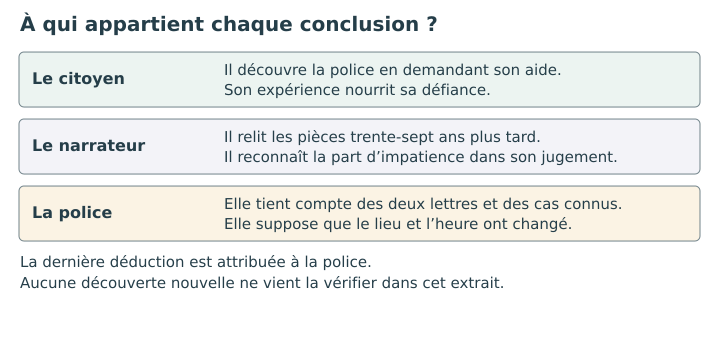

# BEL A/L — Italien, version et thème Ulm 2026 · Corrigé guidé

*Corrigé rédigé par IA, non officiel. Signalez toute erreur.*

**Rédaction** · GPT-6.2 Astra Ultra · vitesse non renseignée

## Présentation du sujet

L’épreuve d’option d’italien d’Ulm dure six heures. La version, tirée de *La scomparsa di Majorana* de Leonardo Sciascia (1975), commence à la page 10 et s’achève au haut de la page 11. Le thème, extrait de *L’Abbesse de Castro* de Stendhal (1839), occupe le reste de la page 11. [Sujet officiel, p. 10 et 11](https://www.ens.psl.eu/sites/default/files/al_opt_lve_vers-theme_261109.pdf#page=10)

## I. Version

### Attribuer les phrases à celui qui raisonne

> [!INDICATION]
> À quel moment du texte l’enquêteur qui relit les pièces commence-t-il à exposer le point de vue de la police ? À qui attribuer la certitude formulée dans la dernière partie ?

#### Solution

Dans l’ouverture, le citoyen se défie de la police quand il a pour la première fois besoin de ses services. Sciascia reprend « le citoyen », fait attendre le verbe, puis donne pour sujet à ce verbe un sentiment qui saisit l’homme. En français, l’attaque détachée « Le citoyen qui… », relancée par « et le voilà saisi », permet de conserver cette longue suspension.

Le « nous » se compte ensuite parmi ceux que l’attente peut rendre injustes. La famille cherchait Majorana au moment de sa disparition. Trente-sept ans plus tard, le narrateur et ceux qu’il associe à sa démarche cherchent à le « retrouver » à partir d’un dossier presque vide. Maintenir les guillemets rend sensible la distance entre les deux recherches. Le dernier paragraphe change de perspective. Pour la police, l’absence de résultat au lieu et à l’heure annoncés déplace l’événement présumé. La conclusion « plus tard et ailleurs » appartient à son raisonnement. Le texte ne la présente pas comme un résultat de l’enquête.

### Résoudre les reprises

| Forme italienne | Reprise et effet en français |
|---|---|
| *avervi a che fare*, puis *averne bisogno* | Les deux pronoms renvoient à la police. « Avoir affaire à elle » puis « avoir besoin d’elle » rend le passage du simple contact à la dépendance. |
| *anzi* | Le narrateur vient de qualifier la manière dont la police a mené les recherches. Il se reprend et retire aux policiers l’initiative même de l’enquête. Il faut laisser à la famille le rôle actif dans la phrase qui suit. |
| *E lo siamo* | Le pronom attribut reprend *ingiusti*. « Et nous le sommes nous aussi, injustes » garde l’insistance de l’aveu. |
| *in oggetto* et *oggettivamente* | La rubrique « objet » d’un dossier administratif devient la prétendue mesure de l’objectivité. Conserver en français l’écho entre ces deux mots laisse entendre l’ironie sans la commenter dans la version. |
| *sarebbe stato attuato* | Dans le contenu rapporté de la seconde lettre, le conditionnel composé italien situe l’acte après l’annonce écrite. Le français emploie un futur dans le passé, « serait mise à exécution ». Plus bas, *sarebbe stata una pura perdita* envisage au contraire ce que la recherche aurait représenté aux yeux de la police. |

### Version rédigée

#### Solution

Le citoyen qui n’a jamais rien fait contre les lois ni subi du fait d’autrui de tort qui l’ait obligé à les invoquer, le citoyen qui vit comme si la police n’existait que pour des formalités telles que la délivrance d’un passeport ou d’un permis de port d’armes (pour la chasse), que les hasards de la vie l’amènent soudain à avoir affaire à elle, à avoir besoin d’elle dans l’exercice de sa véritable fonction, et le voilà saisi d’un sentiment de désarroi, d’impatience, de fureur, où s’enracine la conviction que la sécurité publique […] repose davantage sur le penchant somme toute assez faible et sporadique des hommes pour le crime que sur le zèle, l’efficacité et la perspicacité de ladite police. Conviction qui a sa part d’objectivité, plus ou moins grande selon les époques, plus ou moins grande selon les pays. Mais lorsqu’une personne a disparu, dans l’anxiété et l’impatience de ceux qui veulent la retrouver, cette conviction peut aussi être toute subjective, et donc injuste. Et nous reconnaissons sans difficulté que nous aussi sommes injustes envers la police italienne, envers la manière, qui nous paraît nonchalante et sans finesse, dont la police italienne mena l’enquête sur la disparition d’Ettore Majorana. À vrai dire, elle ne la mena pas du tout. Elle laissa la famille la mener, se bornant, ainsi qu’il ressort de la « note », à « collaborer » (et, à partir d’un certain moment, on l’imagine aisément, à faire semblant de collaborer). Et nous le sommes nous aussi, injustes, parce que nous aussi, après trente-sept ans, nous voulons « retrouver » Majorana, et que pour le « retrouver » nous ne disposons que de rares documents, rarissimes dans le dossier ouvert à son nom à la Direction générale de la Sûreté publique.

À travers ces quelques feuillets, nous revivons l’anxiété, l’impatience, la déception, le jugement porté sur le manque d’intelligence et d’efficacité de la police, tout ce que les proches d’Ettore Majorana ont certainement vécu alors, et plus douloureusement, et plus dramatiquement.

Mais les autres, eux aussi, ont leurs raisons, la police a les siennes. L’affaire, telle que la définissait la bureaucratie à la rubrique « objet », et donc objectivement, était celle d’une disparition avec intention de suicide. Il y avait deux lettres, l’une à la famille, l’autre à un ami, qui exprimaient clairement cette intention. Celle à l’ami précisait même de quelle façon et à quelle heure elle serait mise à exécution. Que cette intention n’ait finalement pas été mise à exécution le 25 mars 1938, à onze heures du soir, dans le golfe de Naples, cela voulait simplement dire pour la police, forte de son expérience et de ses statistiques, qu’elle l’avait été plus tard et ailleurs. S’employer à découvrir où et quand aurait été pure perte de temps. Il n’y avait rien à prévenir ni à punir. Il s’agissait seulement de trouver un cadavre.

## II. Thème

### Redonner à la comparaison ses deux termes

> [!INDICATION]
> Dans le premier paragraphe, la femme a-t-elle effectivement aimé le capitaine ? Dans le deuxième, qui se venge et qui obtient la faveur de la population ?

#### Solution

La femme aime le savant. Le guerrier est le terme hypothétique d’une comparaison. L’imparfait *amava* donne le premier amour comme un trait de l’époque, tandis que *avrebbe amato* conserve la valeur conditionnelle de « n’eût aimé ». Le premier « ne » français n’en fait pas une négation. Les noms de peintres au pluriel précèdent la longue relative qui ramène la gloire des militaires au nombre de leurs victimes. Laisser celle-ci à la fin de la phrase italienne conserve la pointe.

Dans la phrase suivante, les vengeances sont celles des tyrans. Ce sont pourtant les brigands qui en recueillent le bénéfice affectif. L’ordre italien *conquistarono ai briganti il cuore delle popolazioni* fait apparaître à la fois l’agent, le bénéficiaire et ce qui lui est acquis. Quand les gens subissent un vol, ils détestent les brigands. Quand ils apprennent que ceux-ci sont châtiés, les mêmes gens les plaignent. Les deux propositions temporelle et conditionnelle permettent de maintenir ce double mouvement.

### Garder les inflexions du narrateur

*Si pensi al Petrarca* rend le geste de celui qui invite le lecteur à prendre un exemple. *Ecco … ecco perché* conserve la double relance qui l’entraîne ensuite dans la comparaison entre pays. L’expression italienne *andar alla macchia*, déjà présente dans le français, est aussitôt expliquée par Stendhal. Dans le thème, on garde l’expression comme sa glose, qui éclaire l’expérience particulière du garçon du village.

Dans le dernier paragraphe, l’inversion française « subissent-ils des châtiments » ouvre une hypothèse. Une proposition avec *se* en fait entendre la valeur en italien. Les « maîtres » sont ceux qui censurent les écrits, tandis que les petits poèmes plaisent comme lecture familière. Le complément « en ce genre » ramène les derniers mots aux éloges. *In fatto di elogi* précise ce renvoi avant la clausule affective *gli va dritto al cuore*.

### Thème rédigé

#### Solution

In Italia un uomo si distingueva per meriti d’ogni sorta, tanto per i gran colpi di spada quanto per le scoperte negli antichi manoscritti. Si pensi al Petrarca, l’idolo del suo tempo. E una donna del Cinquecento amava un uomo dotto in greco almeno quanto, anzi più di quanto avrebbe amato un uomo celebre per il suo valore in guerra. Allora si videro passioni, non la consuetudine della galanteria. Ecco la grande differenza fra l’Italia e la Francia, ecco perché l’Italia vide nascere i Raffaello, i Giorgione, i Tiziano, i Correggio, mentre la Francia dava i natali a tutti quei valorosi capitani del Cinquecento, oggi così poco noti, ciascuno dei quali aveva ucciso tanti nemici.

Chiedo perdono per queste dure verità. Comunque sia, le vendette atroci e necessarie dei piccoli tiranni italiani del Medioevo conquistarono ai briganti il cuore delle popolazioni. Si odiavano i briganti quando rubavano cavalli, grano, denaro, insomma tutto ciò di cui avevano bisogno per vivere. In fondo, però, il cuore delle popolazioni era dalla parte dei briganti. E le ragazze del villaggio preferivano a ogni altro il giovane che, una volta in vita sua, era stato costretto ad *andar alla macchia*, vale a dire a fuggire nei boschi e a cercare rifugio presso i briganti in seguito a qualche azione troppo avventata.

Ancor oggi, certo, tutti temono d’imbattersi nei briganti, ma se questi vengono puniti ciascuno li compiange. Il fatto è che questo popolo così acuto, così incline al motteggio, che ride di tutti gli scritti pubblicati sotto la censura dei suoi padroni, ha per lettura abituale brevi poemi che narrano con calore la vita dei briganti più famosi. Quel che trova di eroico in queste storie incanta la vena artistica sempre viva nei ceti più umili. E poi è a tal punto stanco degli elogi ufficiali tributati a certa gente che, in fatto di elogi, tutto ciò che non è ufficiale gli va dritto al cuore.
