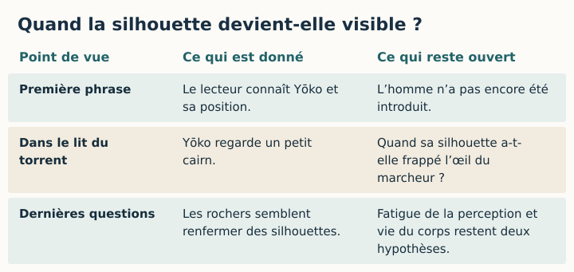

# BEL A/L — Japonais, commentaire et traduction 2026 · Corrigé brut

*Corrigé rédigé par IA, non officiel. Signalez toute erreur.*

**Rédaction** · GPT-6.2 Astra Ultra · vitesse non renseignée

## Commentaire en japonais

最初の一文で、読者にはもう杳子が見えている。谷底にいるのが誰なのか、その人が何をしているのかという問いには、十三行目を待たずに答えが与えられている。ところが男には、ずっと前から視野に入っていたはずの姿が、すぐには一人の女として見えてこない。古井由吉の『杳子』のこの場面で、出会いは二人が顔を合わせる瞬間としてではなく、一人の姿を他のものから見分けるまでの時間として書かれている。その時間を、読者はいかにして男とともに過ごすことになるのだろうか。

杳子を名指した次の行から、語りは彼女をいったん置き去りにする。十月半ばの雪の近さ、午後一時ごろの黒雲、尾根から谷へ、それから沢沿いにたどる道。男が頂上から何を見たかはすぐ示されるが、杳子の姿をいつ認めたのかはついに特定されない。山頂と沢とは頭文字で示され、ルートは地図にたどれそうなほど明確である。だが沢に沿うところでは「下るともなく」と、下っていること自体が感じにくくなる。時刻を知り道筋を説明できることと、そこにいるものが目に入ることとは、すでに同じではない。

谷底につくと、叙述は歩く速度を失い、しばらく空と斜面と河原の間にとどまる。二つの沢が近くで出合うため、谷には水音が重く響く。そのすぐあとで、河原の石は「静まりかえり」と形容される。音がやんだのではない。動かずに横たわる石へと注意が移り、水音の中にも別の静けさが見つかったのである。光にも同じことが起こる。頭上は低い雲に覆われ、両側の斜面が迫る。木の葉の紅は鮮やかな輪郭を描かず、燃え残って暗がりへにじむ。明るさを残すのは、すばらしい眺望でも晴れ間でもなく、谷の底に沈んだ石の灰色である。明るいところを探すうちに、読む視線は高い山から少しずつ下がり、ようやく人の坐っている高さまで来る。

その灰色の中に杳子の名が再び現れる。はじめの「一人坐っていた」という輪郭だけの文が、ここでは縮こまった体、平たい岩、すぐ前の低いケルンという細部を得る。彼女は何も見ずにいるわけではない。男が彼女を見つけるのに手間取るあいだ、彼女自身の目は、小石を誰かが積んでいった小さな形に注がれている。ケルンには、姿のない誰かが手を動かした跡がある。一方、実際にそこにいる杳子の姿は、まだ男の目にそれとは映らない。彼女の心の内を説明せずとも、一つの谷に異なる二つの視線があることだけは確かになる。

後半は「あの時、彼は彼女を見た」と出来事の空白を埋めてくれない。代わりに、すでに見えていた「はずだった」と、起こって当然のことを、事が過ぎてから考え直す。五時間近く人を見ていない目なら、女の姿が向こうからまっすぐ飛びこんできてもよさそうなものだ。この「よさそうだった」には、そうはならなかったという驚きが残る。三日間一人で歩いてきた体の疲労なら、その遅れを説明できそうだが、疲労が働く向きは一つではない。疲れた目には岩がただの岩でなくなり、内側に人の姿を宿し始める。疲れが深まるほど、その見えない人間がなまなましく現れかける。生身の人間だけが見えにくくなるのは、何も見えなくなるからではなく、あたりにあまりに多くの人の形が見え始めるからかもしれない。

結びの二つの疑問は、この「かもしれない」を二方向に開く。一つでは男が見た無数の姿のほうに、もう一つでは杳子自身の体に、その理由が探られる。後者を彼女についての確定した診断として読めば、文末の問いかけを消すことになる。物語は、名をもつ人がすでにそこにいるという確かさから出発して、その人がそこにどう見えたのかという解き切れない問いに至る。最後まで互いの目は合わない。だからこそ読者は、杳子の名を初めから知っていても、彼女に出会うためにはこの暗がりを歩き、いくつもの見え方を通り抜けなければならない。

### Version rédigée — lignes 1 à 21

Yōko était assise seule au fond d’une vallée profonde.

On approchait de la mi-octobre. Sur les cimes, la neige pouvait tomber dès le lendemain.

Vers une heure de l’après-midi, du sommet du mont K, il avait vu des nuages noirs s’étendre à l’ouest. Comme s’il se sentait talonné, il avait descendu la crête puis, à mi-chemin, s’était engagé dans la vallée. Le sentier plongeait d’abord tout droit vers le torrent O, puis en suivait le cours entre de sombres arbustes, sur une pente si douce qu’on descendait sans s’en rendre compte. C’est au bout d’une heure et demie environ qu’il avait enfin atteint le fond. Le confluent avec le torrent N était tout proche et la vallée retentissait du grondement sourd des eaux.

Vu d’en bas, le ciel était déjà couvert de nuages bas. Sur les deux versants qui se pressaient de part et d’autre, des arbustes poussaient serrés. Du milieu des feuilles qui commençaient à se dessécher en noircissant, quelques restes de rouge, comme après un feu, diffusaient leur teinte trouble dans l’espace clos et obscur de la vallée. Sur la grève, les débris de roche gisaient amoncelés au fil du courant, dans une immobilité silencieuse. Au fond de ces ténèbres pesantes, ils faisaient flotter une clarté grise. Dans cette clarté, Yōko, toute ramassée sur elle-même, était assise sur une pierre plate. Elle fixait un petit cairn que quelqu’un avait dressé là par jeu, juste devant elle.

Tandis qu’il descendait lentement la grève toute en rochers, la silhouette de Yōko devait déjà se trouver dans son champ de vision depuis quelque temps. À un homme qui n’avait vu figure humaine depuis près de cinq heures, cette femme assise seule sur un rocher aurait dû sauter aux yeux de fort loin. C’était la dernière descente de trois jours de marche en solitaire. Lui aussi était bien fatigué. À force de traîner seul son corps las sur le fond d’une vallée profonde, il arrive qu’on croie voir les rochers d’alentour renfermer toutes sortes de silhouettes humaines. Et plus la fatigue se fait lourde, plus ces formes se dégagent de l’emprise des pierres et commencent à en surgir de l’intérieur, avec une présence presque charnelle. La silhouette de Yōko s’était-elle perdue parmi elles ? Son corps à elle avait-il donc si peu de vie ?

[Sujet officiel, pages 14 et 15](https://www.ens.psl.eu/sites/default/files/al_lve_commun_commentaire_traduction_2026.pdf#page=14)

