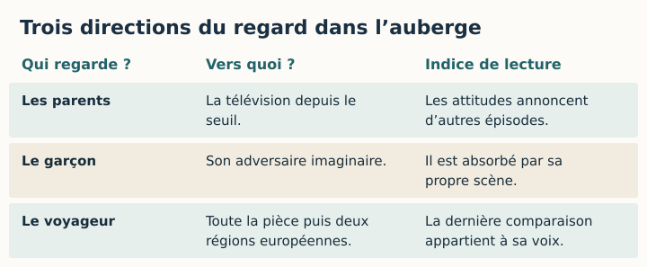

# BEL A/L — Japonais, thème Lyon 2026 · Corrigé brut

*Corrigé rédigé par IA, non officiel. Signalez toute erreur.*

**Rédaction** · GPT-6.2 Astra Ultra · vitesse non renseignée

## Thème rédigé

様似の南で

夜の九時、乗客は私一人きりというバスが、この終点で私を降ろした。どこにも灯はない。神様にも見捨てられたような小さな港に、たたきつけるような雨が降っている。宿で木の雨戸を閉めてしまう前にと、私は駆け込んだ。間一髪だった。先客が二人寝ている部屋に、私のためにわらの寝床を一つ敷いてくれた。

台所の入口から、宿の主人とおかみさんがテレビを見ている。連続物の恋愛ドラマだ。うなだれた首筋や、こわばった顔つきを見れば、恋人同士がまた会えるまでには、まだずいぶん涙も流れ、波乱もあるだろうとわかる。部屋の片隅では、こんなたわいもない話には興味のない十三歳の息子がシャドーボクシングをしている。目に見えない相手に繰り出す空手の一撃は、少なくともその半分は当たれば命取りになりそうだ。裸足で頭を丸刈りにし、黒い学生服にきっちりと身を包んだ少年は、その動きにすっかり夢中で、荒い息を立てている。小鼻をきゅっとすぼめた顔、急に動いてはぴたりと止まる肘、体をさっと伸ばすたびに漏れるくぐもった掛け声。見ていると、何やら落ち着かなくなる光景だ。プロヴァンスやスイスのヴォー州の農家で、こんな場面はちょっと想像できない。けれどここでは、日本には武を重んじる文化があるということを、そう長いこと忘れたままではいさせてくれないのだ。

[Sujet officiel, page 16](https://www.ens-lyon.fr/sites/default/files/2026-04/Epreuve%20de%20sp%C3%A9cialit%C3%A9%202026.pdf#page=16)

