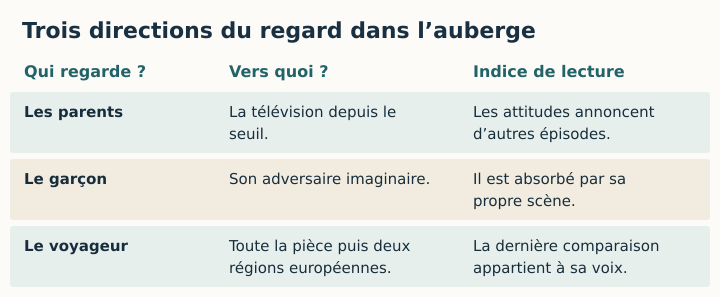

# BEL A/L — Japonais, thème Lyon 2026 · Corrigé guidé

*Corrigé rédigé par IA, non officiel. Signalez toute erreur.*

**Rédaction** · GPT-6.2 Astra Ultra · vitesse non renseignée

## Présentation du sujet

Le thème de Lyon donne quatre heures sans dictionnaire. Le titre et les deux paragraphes du passage de Bouvier placent un voyageur dans un port puis dans une auberge au sud de Samani.

[Sujet officiel, page 16](https://www.ens-lyon.fr/sites/default/files/2026-04/Epreuve%20de%20sp%C3%A9cialit%C3%A9%202026.pdf#page=16)

## Passer du voyageur aux deux spectacles

> [!INDICATION]
> Le voyageur se trouve dans une seule auberge. Comment la narration réussit-elle à faire coexister deux scènes dans la même pièce ?

#### Solution

Le patron et sa femme, au seuil de la cuisine, ont les yeux sur l’écran. Le lecteur devine la suite du feuilleton à travers les gestes des acteurs. Pendant ce temps, dans l’angle de la pièce, leur fils ne regarde pas du tout l’écran. Il s’imagine un partenaire absent. Traduire la localisation de chacun permet de laisser coexister les deux spectacles sans expliquer la scène à la place du voyageur.

**Respecter le passé et le présent.** Le bus a déposé le voyageur avant le moment où il décrit le port. Il a fallu se hâter pour trouver sa place avant la fermeture des volets. L’abrupte phrase « Juste à temps » peut rester autonome. Puis le présent porte l’observation des parents et du garçon.

**Traduire le contexte, puis les images.** *様似* est le toponyme du titre, que l’on traduit également. La pluie « des hallebardes » appelle une image de pluie battante. Pour « traverses », le contexte sentimental du feuilleton désigne les obstacles qui retardent les retrouvailles et appelle un mot du registre du récit.

**Marquer l’incertitude du spectateur.** Le conditionnel sur les coups exprime une estimation du voyageur devant un adversaire imaginaire. La phrase sur la culture martiale expose aussi son regard. Les deux comparaisons européennes distinguent la Provence du canton suisse de Vaud. Il importe de préserver le parallélisme, puis le retour à « ici ».

## Thème rédigé

様似の南で

夜の九時、乗客は私一人きりというバスが、この終点で私を降ろした。どこにも灯はない。神様にも見捨てられたような小さな港に、たたきつけるような雨が降っている。宿で木の雨戸を閉めてしまう前にと、私は駆け込んだ。間一髪だった。先客が二人寝ている部屋に、私のためにわらの寝床を一つ敷いてくれた。

台所の入口から、宿の主人とおかみさんがテレビを見ている。連続物の恋愛ドラマだ。うなだれた首筋や、こわばった顔つきを見れば、恋人同士がまた会えるまでには、まだずいぶん涙も流れ、波乱もあるだろうとわかる。部屋の片隅では、こんなたわいもない話には興味のない十三歳の息子がシャドーボクシングをしている。目に見えない相手に繰り出す空手の一撃は、少なくともその半分は当たれば命取りになりそうだ。裸足で頭を丸刈りにし、黒い学生服にきっちりと身を包んだ少年は、その動きにすっかり夢中で、荒い息を立てている。小鼻をきゅっとすぼめた顔、急に動いてはぴたりと止まる肘、体をさっと伸ばすたびに漏れるくぐもった掛け声。見ていると、何やら落ち着かなくなる光景だ。プロヴァンスやスイスのヴォー州の農家で、こんな場面はちょっと想像できない。けれどここでは、日本には武を重んじる文化があるということを、そう長いこと忘れたままではいさせてくれないのだ。
