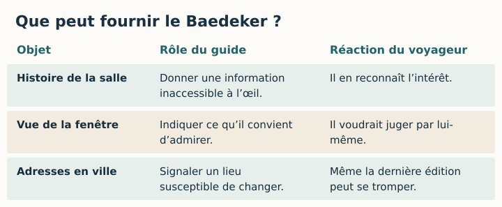

# BEL A/L — Japonais, version et thème Ulm 2026 · Corrigé brut

*Corrigé rédigé par IA, non officiel. Signalez toute erreur.*

**Rédaction** · GPT-6.2 Astra Ultra · vitesse non renseignée

### Version rédigée

Il y a longtemps, je visitais en Angleterre, avec deux ou trois compagnons, je ne sais plus quelle résidence royale. L’un d’eux ne lâchait pas un instant le Baedeker qu’il tenait ouvert d’une main. De pièce en pièce, il comparait ce qu’il voyait aux indications du guide et examinait tout en détail. Il avait d’ailleurs pris soin de l’étudier au préalable et en avait soigneusement souligné certains passages au crayon rouge. Arrivés dans une salle, il nous rassembla devant l’une des fenêtres et, le doigt sur une ligne de son Baedeker, nous expliqua : « Il est écrit que, de cette fenêtre, la vue est belle. » Ah bon, nous dîmes-nous. Et nous pûmes admirer tout à loisir ce spectacle à ne pas manquer.

Tout en admirant la méthode de cet homme, si scrupuleusement savante, si digne d’un universitaire, je ne pouvais m’empêcher d’éprouver un sentiment difficile à nommer. Il me manquait quelque chose, ou bien était-ce une sorte d’impression de vanité ? J’avais un peu le sentiment d’être devenu le rédacteur du Baedeker en personne, occupé à en corriger les épreuves. Et cette fenêtre commençait à me sembler jeter par-dessus ma tête un étrange filet de contraintes. De l’histoire de la salle et des traditions qui s’y attachaient, je n’aurais évidemment rien su sans le Baedeker. Mais, pour décider de ce que valait la vue d’une fenêtre, j’aurais tout de même aimé qu’on me laisse la liberté de découvrir et de choisir avec mes propres yeux.

On a sans doute peine à imaginer l’embarras de ceux qui voyageaient avant qu’existe le Baedeker. Et pourtant, il n’est pas absolument exclu de se laisser induire en erreur, à l’occasion, même par l’édition la plus récente. Il m’est arrivé dans une capitale d’aller voir l’université et d’y trouver, à la place, quelque bureau administratif, ou encore de mettre enfin la main sur un restaurant renommé pour découvrir un écriteau « À louer ». Avec un guide fait sans soin, de telles déconvenues seraient bien entendu encore plus fréquentes. Mais au fond, exiger un guide parfait à cet égard doit être déraisonnable dès le départ. C’est sans doute à croire qu’il en existe un qu’on s’attire des ennuis.

En fin de compte, on est donc bien embarrassé sans guide, mais il n’est pas dit qu’en avoir un ne puisse jamais vous embarrasser.

### Thème rédigé

ローラン警部は書類綴じを閉じ、満足げに左手の山に載せる。これで一件落着。彼自身としては、この事件には少しも関わりたくない。

これまでに命じた捜査からは、何ひとつ成果が上がっていない。まるでわざとあちこちに残したかのような、鮮明な指紋がいくつも採取された。犯人のものにちがいないが、警察の膨大な記録を調べても、一致するものは一つもない。そのほかに集まった証拠も、どの線を追えばよいか何の手がかりにもならなかった。情報屋たちからも何ひとつ知らせは得られなかった。これでは、どこを捜せというのか。犯人がこの町や港の怪しげな連中の仲間だとはまず考えられない。警察の記録はあまりによく整い、情報屋の数もあまりに多い。悪党がすっかりその網をくぐり抜けてしまえるとは思えない。ローランは長年の経験でそのことを知っている。普通なら、今ごろはもう何かわかっているはずなのだ。では、何だろう。単独で動いた新米か。素人か。正気を失った者か。そんな例はめったにない。それに、素人ならすぐに足取りがつかめる。もちろん、一つ考えられるのは、ただこの人殺しをするためだけに遠くからやって来て、すぐさま立ち去った人間だということだ。もっとも、かなりの下準備もなしにやったにしては、いささか手際がよすぎるようだが……。

[Sujet officiel, pages 12 et 13](https://www.ens.psl.eu/sites/default/files/al_opt_lve_vers-theme_261109.pdf#page=12)

