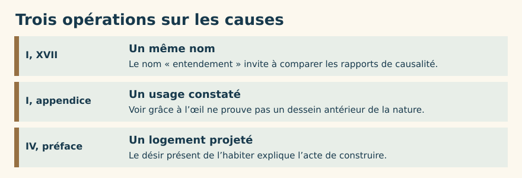

# BEL · AL — Philosophie (oral option 16 juin) 2026 · Corrigé brut

*Corrigé rédigé par IA, non officiel. Signalez toute erreur.*

**Rédaction** · GPT-6.2 Astra Ultra · vitesse non renseignée

**Autocontrôle** · GPT-6.2 Astra Ultra · vitesse non renseignée

Les dix explications suivent la numérotation de la feuille du 16 juin. Les pages et les coupures sont celles de la traduction de Bernard Pautrat indiquées par le jury. Le développement a été confronté aux mêmes passages de l’*Éthique* dans la traduction de Charles Appuhn (Garnier, 1929). Les exemples pédagogiques et les questions de relance sont proposés pour la préparation.

## 1. I, XVII, premier extrait du scolie, p. 49–51. Une puissance qui ne s’épuise pas

La difficulté initiale porte sur la liberté de Dieu. L’adversaire de Spinoza mesure sa puissance à ce qu’il pourrait s’abstenir de produire. Il se représente un entendement qui contiendrait un ensemble de possibles, puis une volonté qui en choisirait certains. S’il produisait tout, que lui resterait-il à pouvoir ? La comparaison avec le triangle met cette question à l’épreuve. Dans le cadre géométrique du texte, les propriétés qui suivent de sa nature n’attendent pas que l’on décide s’il est opportun de les lui accorder. Dire qu’elles en suivent nécessairement n’introduit pas une contrainte extérieure.

Spinoza déplace le sens de puissance. La nature divine est infiniment productive en acte. Lui attribuer des possibilités qu’elle devrait précisément ne jamais réaliser pour garder sa perfection revient à introduire une impuissance dans la définition même de sa puissance. La réfutation finale retourne donc l’intention de l’adversaire contre son argument. L’éternité de cet acte ne signifie pas qu’un inventaire d’objets ait été achevé il y a très longtemps. Le rapport de conséquence ne se comprend pas comme un avant et un après. **Relance.** Dieu perd-il toute liberté lorsque ses effets suivent avec nécessité ? Il agit par la seule nécessité de sa nature. Chez Spinoza, le contraire de cette liberté est la détermination par autre chose.

## 2. I, XVII, second extrait du scolie, p. 51–53. Deux choses nommées entendement

Le mouvement est conditionnel. À supposer que l’entendement et la volonté constituent l’essence divine, que pourraient bien signifier ces termes ? Le chien qui aboie et la constellation du Chien ont un nom en commun sans posséder une nature commune. Ainsi, agrandir à l’infini une faculté humaine ne donne pas ipso facto une notion de l’entendement divin.

L’argument décisif porte sur le rapport de la cause et de l’effet. Un entendement humain rencontre des choses dont il n’est pas la cause. L’entendement conçu comme constituant l’essence de Dieu serait au contraire cause de l’essence et de l’existence des choses. Spinoza distingue à cet égard le parent de l’enfant. Le premier contribue à faire exister le second sans produire ce qui fait qu’un humain est humain. Ils peuvent convenir quant à l’essence et demeurer distincts quant à l’existence. Lorsque l’effet tient de sa cause l’un et l’autre, on ne peut transporter à la cause la définition de l’effet. La dernière phrase étend à la volonté la démarche établie sur l’entendement. **Relance.** Spinoza vient-il de reconnaître à Dieu une faculté humaine de réflexion ? Il examine une attribution adverse pour montrer en quel sens le même mot changerait radicalement de portée.

## 3. I, appendice, p. 83–85. Comment les moyens deviennent des fins de la nature

Deux conditions suffisent pour commencer, l’ignorance des causes et la conscience de chercher ce qui nous est utile. De la seconde sans la première explication, chacun conclut aisément qu’il est libre parce qu’il éprouve son propre désir. Puis il transporte sur les autres la manière dont il explique sa conduite. Chercher en vue de quoi une personne a marché a l’air de donner la clef de ce qu’elle a fait. Cette habitude devient une manière générale de rencontrer les choses.

Les yeux servent à voir et le soleil à nous éclairer. L’expérience de cette utilité ne prouve pas qu’un agent ait fabriqué l’œil ou le soleil dans cette intention. Le raisonnement prêté aux hommes passe pourtant du moyen dont ils disposent au dispensateur qui l’aurait disposé pour eux. Comme chacun conçoit cette puissance à l’image de sa propre conduite, le culte tend à devenir une manière de s’en assurer la préférence. La fin du billet retourne l’accusation de désordre. En croyant démontrer une nature raisonnablement organisée pour eux, les hommes n’y retrouvent que la projection de leurs attentes. **Relance.** L’usage de l’œil est-il nié ? C’est l’inférence qui mène de l’usage constaté à une intention antérieure de la nature qui est contestée.

## 4. II, XIII, corollaire et scolie, p. 123–125. Pourquoi il faut apprendre ce qu’est un corps

Le corollaire reprend la proposition selon laquelle le corps humain existant est l’objet de l’idée qui constitue l’esprit humain. Sentir son corps établit ainsi une unité. Mais nommer cette unité ne suffit pas encore à savoir de quoi elle est capable. L’esprit n’est pas un passager qu’il faudrait ensuite rattacher à une machine corporelle. La relation entre une idée et son objet rend pensable l’union elle-même.

Le scolie introduit un critère de distinction. Le rapport établi entre idée et corps a une portée qui dépasse l’être humain. On ne peut donc identifier la singularité de l’esprit humain en affirmant simplement que son corps a une idée. Il faut comparer les aptitudes de son objet. Plus un corps peut agir ou être affecté de plusieurs manières à la fois, plus son esprit est apte à percevoir plusieurs choses. Plus ses actions dépendent de son organisation propre, plus son esprit est apte à comprendre distinctement. Cette correspondance donne une raison précise d’introduire ensuite une étude des corps. La feuille s’arrête avant le développement de la physique. **Relance.** Faut-il d’abord croire que l’esprit humain est supérieur pour expliquer le corps ? Le scolie demande au contraire que la différence des aptitudes soit fondée sur ce dont les corps sont capables.

## 5. II, XLIII, scolie, p. 181–183. Comment la vérité peut être sa propre norme

Si savoir exigeait de posséder un certificat extérieur de mon savoir, comment garantir à son tour la valeur du certificat ? Spinoza refuse d’entendre par idée une image muette sur un tableau. Connaître une propriété par ses raisons est un acte de l’esprit. Dès lors, savoir que l’on sait ne commence pas par la rencontre d’un signe qui viendrait authentifier une représentation intérieure. Il suppose d’abord qu’on ait effectivement compris. La comparaison de la lumière qui manifeste à la fois elle-même et l’obscurité explicite la dissymétrie. L’erreur ne fournit pas à égalité le principe permettant de reconnaître le vrai.

Le propos ne signifie nullement que le sentiment d’évidence accompagne toujours une croyance correcte. Une affirmation peut s’imposer avec force à qui ignore ce qui la détermine. Il lui manque précisément la connaissance adéquate qui ferait comprendre pourquoi la chose est ainsi. Spinoza répond enfin à l’objection tirée de l’accord avec l’objet. En tant qu’il perçoit adéquatement, l’esprit humain s’inscrit dans l’entendement infini. La vérité de l’idée ne lui échoit pas comme une faveur mystérieusement accordée à un esprit isolé. **Relance.** Pourquoi la question « comment savoir que je sais ? » ne conduit-elle pas à une régression ? L’acte premier de connaissance porte déjà sa réflexivité.

## 6. III, II, scolie, p. 221–223. Ce que nous apprend un regret

Si nous disposions de la parole par le seul décret d’une volonté souveraine, nous pourrions toujours nous taire au moment où nous jugeons bon de le faire. Les regrets de celui qui a parlé sous le coup d’une émotion offrent un contre-exemple quotidien. Spinoza ne nie pas que nous éprouvions vivement le sentiment d’avoir voulu parler. Il examine ce que prouve cette conscience. L’enfant éprouve son appétit de lait sans connaître les causes qui le disposent à désirer. De même, celui que des affects contraires divisent peut voir le meilleur sans le suivre.

La répétition de ces exemples a une fonction argumentative. La conscience de l’action et du désir est réelle. C’est le passage de cette conscience à une indépendance absolue qui n’est pas justifié. Les décrets changent avec les dispositions corporelles. La conclusion va plus loin qu’une corrélation ou qu’une causalité du corps sur l’esprit. Une seule et même détermination s’explique comme décret sous l’attribut de la pensée, comme détermination corporelle sous celui de l’étendue. L’alternative entre l’esprit commandant au corps et le corps commandant à l’esprit est mal posée. **Relance.** Le déterminisme rend-il inutile l’examen des raisons ? Examiner une raison est lui-même un acte déterminé de pensée, susceptible de transformer ce dont on est capable.

## 7. IV, préface, p. 353–355. La nature peut-elle manquer son modèle ?

Nous savons reconnaître une maison inachevée si nous connaissons le dessein du constructeur. Mais transposer cette opération à une chose naturelle suppose qu’un modèle ait précédé sa production. Or les hommes constituent eux-mêmes des modèles généraux et jugent les êtres particuliers en les comparant à ces constructions. Dire que la nature a commis une faute revient à présenter un écart entre un individu réel et une norme forgée comme un défaut de sa production.

Le passage corrige ensuite la notion de cause finale en revenant précisément à la maison. Habiter la maison est bien le but que son constructeur se représente. Pour expliquer la construction, il faut cependant examiner le désir présent suscité par la représentation des avantages du logement. Une prétendue cause finale devient ainsi intelligible comme cause efficiente, l’appétit actuel d’un être singulier. La nature entière ne peut être jugée sur le modèle de cet appétit humain. Elle agit selon la nécessité par laquelle elle existe. Spinoza distingue enfin la perfection identifiée à la réalité et l’évaluation comparative de ce qui nous affecte différemment. **Relance.** Tout jugement pratique devient-il absurde ? On peut comparer un individu à un modèle explicitement construit pour nous orienter. Ce qui est exclu est d’imputer à la nature l’intention manquée de le réaliser.

## 8. IV, XVIII, scolie, p. 385–387. De l’utile propre à l’utilité commune

Le premier mouvement surprend si l’on attend de la morale qu’elle s’oppose par principe à l’intérêt. La raison ne commande rien de contraire à la nature. L’effort pour persévérer dans son être fournit par conséquent le principe de la vertu. Il ne s’agit pas de suivre tout ce qui paraît avantageux au premier regard. Est réellement utile ce qui augmente notre capacité d’agir suivant les lois de notre propre nature. La vertu est désirée pour elle-même, puisqu’on ne peut chercher une fin supérieure à cette puissance d’agir.

Une objection subsiste. Si chacun recherche son utile, pourquoi ne pas tenir autrui pour un rival ? Aucun humain ne se suffit pour conserver son être ou développer son intelligence. L’accord de puissances compatibles accroît chacune. Des personnes qui raisonnent peuvent désirer pour autrui la connaissance ou la coopération qu’elles souhaitent pour elles-mêmes. Le modèle d’un seul esprit et d’un seul corps exprime la composition des puissances sans exiger la disparition physique des individus. La condition « sous la conduite de la raison » importe, puisque les passions opposent effectivement souvent les hommes. **Relance.** Le commun représente-t-il un sacrifice extérieur de l’intérêt privé ? Il en constitue ici une forme plus adéquatement comprise, ce qui rend intelligibles la justice et la bonne foi.

## 9. V, IV, scolie, p. 509. Comprendre un affect change ce que nous en pâtissons

Le passage part d’une limitation précise. Chacun peut former une connaissance au moins partielle de ses affects. Il ne reçoit pas le pouvoir de commander à volonté leur disparition. Une colère que je rapporte exclusivement à l’image d’un autre reste entretenue par tout ce qui me rappelle cet autre. En comprenant davantage les causes de ce que j’éprouve, je peux détacher l’affect de cette association exclusive et le rapporter à des idées que je comprends. Ce qui change est l’agencement causal de l’appétit.

Spinoza donne un exemple qui évite la fausse opposition entre les bons et les mauvais désirs distingués seulement par leur objet apparent. Vouloir que les autres adoptent une conduite proche de la nôtre peut prendre chez l’homme dominé par ses passions la forme de l’ambition. Le désir de communiquer ce dont on comprend réellement l’utilité commune procède autrement. Une même fin décrite de l’extérieur ne révèle pas encore si l’on agit ou si l’on pâtit. Le texte conclut sur la puissance propre à l’esprit, former des idées adéquates. **Relance.** Suffit-il de nommer une émotion pour la transformer ? Lui donner un nom n’établit pas ses causes. La transformation visée demande d’en former une connaissance plus adéquate.

## 10. V, XLI, proposition, démonstration et scolie, p. 557–559. Si l’éternité de l’esprit nous était inconnue

L’hypothèse porte sur notre savoir. Spinoza demande ce qui resterait de sa doctrine pratique même si nous ne connaissions pas l’éternité de l’esprit. La démonstration procède par l’ordre de l’ouvrage. Bien avant les propositions de la cinquième partie portant sur l’éternité, la quatrième avait fondé la conduite raisonnable sur la recherche de l’utile véritable. Ce fondement suffit donc toujours. Une croyance relative à l’après-vie n’est pas la prémisse secrète de la fermeté ni de la générosité.

Le scolie oppose à cet ordre des raisons un calcul ordinaire. Si la règle morale est tenue pour un fardeau, on en attend le salaire futur ou l’on craint une sanction. La suppression imaginée de cet avenir paraît alors rendre la règle inutile. Mais la conduite raisonnable constitue déjà une manière plus puissante de vivre. Le caractère fini d’un avantage ne lui ôte pas sa valeur présente. La fin du passage rend sensible l’absurdité d’un raisonnement qui renoncerait à un bien disponible sous prétexte qu’il n’est pas garanti pour toujours. **Relance.** Le passage nie-t-il l’éternité ? Il établit l’indépendance logique du fondement pratique à l’égard de notre connaissance de l’éternité.

[Feuille publiée par le jury](https://www.ens.psl.eu/sites/default/files/sujets_specialite_philosophie_du_16_juin_20261.pdf) · [Spinoza, Éthique, trad. Charles Appuhn](https://hyperspinoza.caute.lautre.net/IMG/pdf/THIQUE_APPUHN.pdf)
