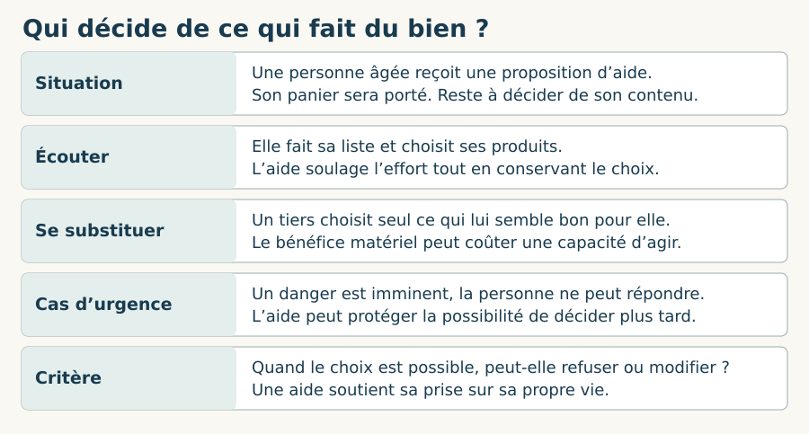
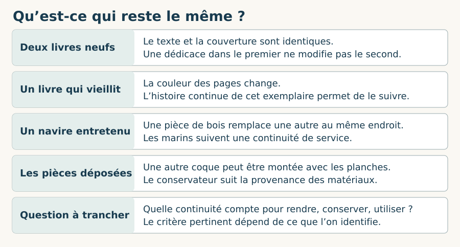

# BEL · AL — Philosophie (oral tronc commun 16 juin) 2026 · Corrigé brut

*Corrigé rédigé par IA, non officiel. Signalez toute erreur.*

**Rédaction** · GPT-6.2 Astra Ultra · vitesse non renseignée

**Autocontrôle** · GPT-6.2 Astra Ultra · vitesse non renseignée

**Révision** · GPT-6.2 Astra Ultra · vitesse non renseignée

Les 12 billets du [16 juin](https://www.ens.psl.eu/sites/default/files/sujet_oraux_philosophie_tc_1al.pdf) figurent ici dans l’ordre du feuillet. Le premier sujet de chaque paire a été choisi. Les deux sont traités. Le [rapport du jury](https://www.ens.psl.eu/sites/default/files/2026_al_rapport_oral_philosophie_tc.pdf) précise les modalités. Lisez les deux sujets devant le jury, puis annoncez votre choix après 1 h 30 de préparation. L’oral, de coefficient 3, comprend 20 minutes d’exposé et 10 minutes d’entretien. Seul le dictionnaire de langue française est autorisé, à l’exclusion des dictionnaires de noms propres.

## 1. Peut-on faire le bien d’autrui ?

Deux voisins proposent de faire les courses d’une personne âgée. L’un prend sa liste, l’autre remplit le panier de ce qu’il juge bon pour elle. Tous deux lui épargnent un effort. Seul le premier lui laisse encore le choix de ce qu’elle mangera. L’expression « le bien d’autrui » porte donc une difficulté dans son possessif. Un bien reçu peut être le sien sans qu’elle en ait elle-même produit les conditions. Mais qui reconnaît ce qui vaut pour elle ?

Le secours urgent montre la limite d’une réponse qui laisserait chacun entièrement livré à ses propres forces. Prévenir d’un danger dont quelqu’un ignore l’existence augmente ses possibilités de décision. À l’inverse, s’autoriser à régler la vie d’une personne compétente au motif qu’on connaît ses intérêts lui enlève précisément un bien, sa capacité de conduire cette vie. Le principe de liberté de Mill, dans *De la liberté*, permet de mesurer cette différence pour les adultes capables de décider. On peut effectivement faire du bien à quelqu’un, jusque dans des circonstances où il ne peut encore parler. L’aide réussit pleinement lorsqu’elle lui rend prise sur ce qui lui arrive et accepte, autant que possible, son refus.

### Technique et vivant

Une prothèse ne se confond ni avec un organisme entier ni avec un objet que l’on poserait simplement à côté de lui. À quoi tient son efficacité ? Une pièce peut être fabriquée selon un plan et évaluée en atelier. Son usage exige ensuite des ajustements à une morphologie, à une fatigue, à des apprentissages. Une mécanique réparable par remplacement n’épuise donc pas le vivant, capable de modifier ses relations avec son milieu. Dans *La Connaissance de la vie*, Canguilhem demande aussi que l’on éclaire la machine par l’activité du vivant qui l’invente. Le technicien isole une fonction que l’organisme coordonne avec beaucoup d’autres. Une technique féconde travaille avec cette faculté de réorganisation. En retour, elle transforme ce que « pouvoir marcher » signifie concrètement pour la personne appareillée.

## 2. Le devoir d’aimer

Une injonction adressée à un sentiment rencontre un obstacle étrange. Punir quelqu’un de ne pas éprouver d’affection risque de lui apprendre à la feindre. Pourtant, le devoir de prendre soin d’un proche ne s’éteint pas le jour où l’on se sent las. Que retient alors le verbe aimer ?

Dans la *Doctrine de la vertu*, Kant distingue l’amour comme inclination et la bienveillance pratique. Je puis me rendre disponible, tenir ma promesse de visite, m’intéresser à un récit qui m’est d’abord étranger. Ces actes dépendent de moi à un degré auquel ne dépend pas de moi la chaleur que j’éprouve. Le sentiment garde cependant une place. Tenir compagnie en regardant constamment l’heure donne une autre qualité à la visite que de laisser surgir une question de l’autre. L’exigence morale peut porter sur cette éducation de l’attention, sans garantir l’affection comme résultat. Elle oblige à agir pour des personnes envers lesquelles manque parfois la sympathie. Elle ne donne à personne le pouvoir d’exiger d’être aimé intimement en retour.

### Y a-t-il des inégalités acceptables ?

Deux élèves reçoivent des durées différentes pour composer parce qu’un handicap ralentit la lecture de l’un. Une différence de traitement peut ainsi corriger l’inégalité qui rendait le temps identique injuste. Cette réponse n’autorise pourtant pas tous les écarts présentés comme utiles. Une hausse de salaire au sommet peut accroître la production totale sans améliorer la vie des moins favorisés. Chez Rawls, les libertés de base égales et la juste égalité des chances encadrent le principe de différence, qui exige que les inégalités sociales et économiques bénéficient le plus aux moins avantagés. Le critère oblige à comparer les arrangements effectivement possibles. Une inégalité est acceptable sous des raisons publiquement défendables devant ceux qui en supportent le prix. L’habitude de la voir passer pour normale ne fournit aucune de ces raisons.

## 3. Pourquoi donne-t-on ?

Après un déménagement, les amis qui ont aidé sont invités à dîner. Si le repas était le salaire convenu, l’opération relèverait de l’échange marchand. Pourtant, l’invitation fait aussi attendre une autre rencontre. Le caractère gratuit d’un geste exclut-il qu’il engage celui qui reçoit ?

L’*Essai sur le don* de Mauss étudie, dans des sociétés déterminées, l’enchaînement des obligations de donner, de recevoir et de rendre. Le retour manifeste que le lien se poursuit. Une chose exactement équivalente rendue aussitôt peut au contraire signifier que l’on souhaite en rester là. L’analyse du lien rencontre néanmoins une limite avec le don anonyme à un bénéficiaire que l’on ne connaîtra jamais. L’effet recherché peut être précisément qu’il dispose librement de la chose, sans dépendance personnelle envers le donateur. Il existe donc plusieurs raisons de donner. Certaines visent le lien, d’autres le desserrent. Le critère décisif pour le destinataire est la latitude qui lui reste. Un bien dont le « bienfaiteur » continue de régler tous les usages ressemble encore à un moyen de gouverner.

### Voir

Un radiologue et son patient regardent le même cliché. Les yeux reçoivent des variations de contraste comparables. Pourtant, un détail est immédiatement visible pour l’un et presque indiscernable pour l’autre. Voir engage des habitudes d’attention et des possibilités de vérification apprises. Cela ne permet pas de conclure que chacun crée librement ce qu’il voit. La zone désignée sur l’image résiste à certaines descriptions, et une vue prise sous un autre angle peut contraindre le spécialiste à changer d’avis. On gagne donc à distinguer l’apparition, la reconnaissance et le jugement déclaré. Le patient peut voir la forme qu’on lui indique tout en ignorant ce dont elle est le signe. Le regard instruit élargit le visible lorsqu’il sait aussi revenir à ce qui contrarie son attente.

## 4. Réforme et révolution

Quand les mêmes institutions corrigent peu à peu leurs règles, on parle de réforme. Une révolution change l’autorité habilitée à les faire. La durée ne suffit pourtant pas à tracer la frontière. En France, la loi du 21 mars 1884 reconnaît les syndicats professionnels dans le cadre parlementaire existant. Son effet dépasse la correction d’un détail puisqu’elle étend la capacité des travailleurs à organiser une parole collective. À l’inverse, le remplacement très rapide des dirigeants peut conserver les hiérarchies dont ils vivaient.

La différence se précise si l’on sépare la procédure, les transformations sociales et le principe de légitimité. Il y a réforme sous l’angle de la procédure lorsque l’ancienne règle rend son propre changement possible. Il y a révolution dans le principe lorsqu’une société fait dépendre l’autorité d’une source nouvelle, comme le passage de la souveraineté dynastique à la souveraineté nationale. Une même séquence mérite donc des qualifications distinctes selon ce que l’on suit. La question politique qui demeure est celle des institutions capables de faire durer, y compris contre leurs nouveaux détenteurs, les possibilités d’agir ainsi conquises.

### Qui peut dire ce qui est beau ?

Dire qu’un tableau me plaît informe autrui de mon état. L’appeler beau invite quelqu’un qui ne l’aime pas à regarder de nouveau. Dans la *Critique de la faculté de juger*, Kant prend au sérieux cette prétention de partage qui ne dispose pourtant pas d’une preuve contraignante comme celle d’un théorème. Le regard du restaurateur peut attirer l’attention sur une relation de couleurs devenue difficile à voir. Son savoir lui donne des raisons d’être écouté, sans lui permettre de goûter à notre place. Une personne sans titre peut découvrir une justesse que le spécialiste avait négligée. Chacun peut donc porter un jugement de goût. Son autorité grandit par la précision de ce qu’il rend sensible à d’autres et par sa capacité à supporter leur désaccord.

## 5. La laideur

Une façade délabrée heurte un promeneur qui attend une rue uniforme. Un photographe, au même endroit, compose une image dont les fissures font la force. Suffit-il de modifier le regard pour faire disparaître la laideur ? Le jugement négatif peut d’abord signaler une forme qui contrarie l’attente éprouvée dans une situation. Une chaussure élégante et une chaussure orthopédique ne se mesurent déjà pas au même usage. Mais réduire le laid à l’inefficace échoue devant un objet parfaitement fonctionnel que l’on trouve disgracieux.

La distinction que fait Kant entre la beauté d’une chose et la belle représentation d’une chose permet de revenir à la photographie. La précision de la composition rend les dommages visibles au lieu de les réparer. Il serait alors abusif de décréter que la misère devient désirable parce que sa représentation est réussie. La laideur désigne une expérience sensible de contrariété dont on peut examiner les critères. Elle se transforme en préjugé quand le déplaisir devant une apparence sert à dévaluer la personne à qui elle appartient.

### Les générations futures ont-elles des droits ?

Un dépôt de déchets impose des frais pendant une durée supérieure à la vie des personnes qui en décident. Les destinataires futurs ne peuvent ni voter ni renoncer aujourd’hui au bénéfice d’une protection. Faut-il en conclure qu’il n’existe aucune obligation de justice à leur égard ? Avoir un droit et pouvoir l’exercer soi-même sont déjà distincts pour un enfant actuel. La difficulté supplémentaire est ici l’identité incertaine des personnes à venir. Nos décisions contribuent à déterminer qui naîtra, comme le montre le problème de la non-identité chez Parfit. Pourtant, on peut formuler un seuil de protection dû à quiconque habitera ce lieu. Garantir l’eau potable et transmettre les données nécessaires au suivi imposent des devoirs dès maintenant. Des représentants présents peuvent défendre ces conditions, même s’ils ne connaissent ni les goûts ni les noms des bénéficiaires.

## 6. Foi et superstition

Une personne ouvre chaque jour le même livre religieux. Son voisin garde dans sa poche le billet d’un voyage heureux. L’apparence répétitive du geste révèle-t-elle assez ce qu’ils croient ? Dans la préface du *Traité théologico-politique*, Spinoza éclaire la superstition par les fluctuations de l’espoir et de la crainte. Incertain d’un résultat auquel il tient, le sujet prend une coïncidence favorable pour le signe d’un ordre qu’un rite pourrait infléchir. Cette structure peut apparaître jusque chez un esprit qui se dit sans religion.

La foi peut elle aussi se nourrir d’une angoisse. Ce qui la distingue alors ne peut être la seule intensité de l’adhésion. Une promesse de rester auprès d’une personne malade engage encore lorsque la guérison espérée ne vient pas. La confiance oriente une conduite au lieu de faire du geste une assurance de résultat. Des pratiques de foi deviennent donc superstitieuses lorsqu’elles assimilent fidélité et maîtrise des événements. Pour juger du passage entre les deux, il faut demander ce que l’échec fait à la croyance et ce que la croyance fait faire aux hommes.

### Que raconte l’histoire de l’art ?

Une salle de musée aligne des tableaux selon leur date. La succession est exacte, mais que faut-il raconter pour expliquer pourquoi le portrait d’un marchand a pu devenir un sujet de peinture ? Une histoire des commandes, des modèles de représentation et des usages domestiques éclaire une possibilité nouvelle. Une histoire de la forme demande comment l’orientation du regard ou le cadrage changent le rapport du spectateur au modèle. Les deux enquêtes peuvent porter sur le même objet sans se remplacer. Il faut également interroger les œuvres conservées, les pièces perdues et les sélections du musée. L’histoire de l’art construit ainsi des récits contrôlables à partir de traces. Elle échoue lorsqu’elle transforme l’ordre des dates en marche nécessaire vers le goût de celui qui raconte.

## 7. Vivre et exister

On dit d’une ville qu’elle existe et d’une graine qu’elle vit. Le couple ne se laisse donc pas ordonner par un simple degré d’intensité. Exister, au sens le plus large, c’est être effectivement. Vivre implique une activité propre de maintien et de transformation. Pourtant, celui qui dit « j’ai longtemps vécu sans vraiment exister » renverse apparemment cet ordre. Il déclare avoir mené une vie dans laquelle il peinait à reconnaître ses propres choix.

Ce deuxième sens engage le temps. Un engagement pris aujourd’hui détermine comment je reprendrai demain une possibilité donnée par mon histoire. La formule de Sartre sur l’existence et l’essence éclaire la responsabilité d’une personne qui ne peut déduire toute sa conduite d’une définition préalable de ce qu’elle est. Il serait toutefois injuste de faire de l’autonomie disponible une mesure de l’existence des personnes. Avoir besoin d’aide pour choisir n’abolit ni la réalité ni la dignité d’une vie. Exister humainement comprend à la fois la présence qui nous est donnée et les manières inégalement accessibles de lui donner une direction.

### Y a-t-il plus dans la volonté que dans le désir ?

Je désire parler une autre langue et je le désire peut-être davantage le soir d’un beau film que le lendemain au bureau. Vouloir l’apprendre implique de choisir un cours, d’accepter l’exercice et de reprendre après une interruption. L’écart ne se mesure donc pas à l’intensité de l’affect. La volonté ajoute une organisation temporelle, une évaluation des moyens et la faculté de maintenir une raison d’agir malgré la fluctuation de l’envie. Reste qu’une volonté absolument privée de désir serait difficile à reconnaître comme un mouvement vers quelque chose. Même tenir une promesse à contrecœur suppose que la fidélité à l’engagement compte pour moi. La volonté est « plus » que le désir spontané par sa structure. Elle ne s’en sépare pas au point de commander depuis un lieu sans motifs.

## 8. Les cinq sens

Dans le noir, je reconnais une orange à sa peau puis à son parfum. Au jour, sa couleur paraît appartenir d’emblée au même fruit. D’où vient l’unité de ce que des sens différents appréhendent ? Le livre II du *De l’âme* d’Aristote distingue les sensibles propres, comme la couleur pour la vue, et les sensibles communs, comme la figure ou le mouvement. La distinction aide à comprendre que des voies différentes puissent nous renseigner sur le même objet. Elle n’assure pas que les découpages coïncident instantanément.

Dans le problème de Molyneux, repris par Locke dans l’*Essai sur l’entendement humain*, on demande si une personne devenue voyante reconnaîtrait par la seule vue le cube et le globe jusque-là distingués par le toucher. La question fait apparaître le travail d’association que masque une perception devenue familière. Même le nombre traditionnel de cinq a une limite. La perception de la position de nos membres demeure possible les yeux fermés, sans contact avec un autre objet. Les « cinq sens » nomment un découpage commode. Analyser l’expérience exige aussi de suivre les coordinations et les apprentissages du corps.

### Le bonheur est-il une affaire de volonté ?

Qui attend d’être heureux seulement une fois tous les imprévus supprimés remet son bonheur à une date impossible. La discipline stoïcienne, chez Épictète, commence par examiner ce qui dépend de nous. Réviser l’exigence d’être admiré peut délivrer d’une dépendance au jugement d’autrui. Toutefois, demander à une personne isolée de « vouloir » une amitié ne produit pas la présence d’un ami. Chez Aristote, l’activité d’une vie accomplie suppose aussi des relations et certains biens extérieurs. La volonté compte donc par l’orientation qu’elle donne aux pratiques et aux jugements. Elle échoue à garantir le bonheur comme un résultat dû au mérite, et attribuer tout malheur à son insuffisance serait ajouter un reproche à une épreuve.

## 9. La ressemblance et l’identité

Deux exemplaires neufs du même roman présentent le même texte et la même couverture. Une dédicace inscrite sur l’un ne paraît pourtant pas sur l’autre. Ils sont qualitativement semblables et numériquement distincts. Inversement, je reconnais comme mien un livre que le temps a jauni au point que sa couleur diffère de celle dont je me souviens. La ressemblance aide donc à identifier, mais ni sa présence ni sa disparition ne tranche à elle seule la question du même.

Le bateau de Thésée rend le critère positif difficile à fixer. Si l’on remplace successivement ses planches, la continuité d’usage autorise les marins à parler du même navire. Si l’on réassemble ailleurs les pièces anciennes, le conservateur pourra préférer une autre réponse, au nom de la matière d’origine. Ce désaccord devient intelligible lorsqu’on demande ce dont il faut suivre la persistance. Deux descriptions compatibles peuvent alors donner lieu à des décisions pratiques différentes, par exemple conserver la coque d’origine ou prolonger une traversée. Il faut énoncer le critère qui justifie l’identification, puis l’appliquer de façon cohérente jusque dans les cas où l’œil hésite.

### L’amour a-t-il à voir avec la morale ?

Aimer cet ami en particulier explique que je lui garde du temps au lieu de le répartir également entre tous mes voisins. Cette préférence a une valeur morale lorsque la relation fonde une promesse ou rend quelqu’un attentif à une détresse que personne n’avait remarquée. Elle devient pourtant injuste si un examinateur relève la note de son ami pour lui témoigner son affection. L’amour fait donc connaître certaines raisons d’agir sans conférer par lui-même le pouvoir de toutes les justifier. La morale impose à la préférence une épreuve de situation. Est-ce mon temps que je donne, ou la part d’un tiers dont j’ai reçu la garde ? Inversement, la morale s’appauvrit si son impartialité rend invisible ce que des relations singulières nous engagent à faire.

## 10. L’homme est-il le sujet de son histoire ?

Une population renverse un gouvernement, puis voit s’installer des institutions que personne n’avait conçues sous cette forme. Peut-on dire qu’elle a fait son histoire si elle n’en a pas voulu l’issue ? Le mot sujet désigne tantôt l’agent d’une action, tantôt un centre de décision qui en connaîtrait et en maîtriserait tous les effets. Passer sans argument du premier au second sens rend l’alternative insoluble.

Dans *Le 18 Brumaire de Louis Bonaparte*, Marx soutient que les hommes font leur histoire dans des circonstances qu’ils trouvent déjà données. La formule permet de comprendre pourquoi appeler à une élection modifie effectivement les rapports politiques sans fixer d’avance l’usage que les électeurs feront de ce droit. Les acteurs héritent d’institutions, de mots et de ressources distribués inégalement. Leurs initiatives rencontrent celles d’autres acteurs, et les conséquences s’accumulent. On peut donc leur imputer des décisions sans faire de « l’homme » un personnage unique qui écrirait tout le récit. La connaissance historique accroît leur capacité d’agir lorsqu’elle identifie les circonstances transformables et les conséquences du passé que nul n’a choisies seul.

### L’artisan et l’ingénieur

Réparer une charpente ancienne exige un calcul de charge et une épreuve des pièces une à une. Opposer immédiatement la main de l’artisan à l’esprit de l’ingénieur rendrait les deux opérations incompréhensibles. Le charpentier qui reconnaît un fil du bois raisonne à partir de signes. L’ingénieur qui mesure la flèche d’une poutre expose son calcul à une résistance sensible. La distinction porte davantage sur la portée et la transmission du jugement. Le modèle rend comparables des cas éloignés et permet à une équipe de discuter des hypothèses. Le savoir de métier ajuste une règle à ce matériau-ci, y compris lorsqu’il présente une singularité que le modèle négligeait. La réussite commune exige de pouvoir justifier l’écart entre le chantier et la prévision, puis de modifier chacun à la lumière de l’autre.

## 11. L’art s’adresse-t-il à la sensibilité ?

Une fugue se donne à entendre. Pour en reconnaître le sujet lorsqu’il revient dans une autre voix, il faut cependant avoir gardé en mémoire le début tandis que se poursuit une autre ligne. La sensibilité désigne-t-elle une simple réception des sons ou cette attention capable d’en construire les rapports ? Dans le premier sens, il paraît nécessaire mais insuffisant d’entendre. Une personne attentive pourra suivre des entrées qu’une personne distraite, présente à la même place, n’aura jamais remarquées.

Un objet ordinaire exposé dans un musée rend l’objection plus forte. Sa ressemblance parfaite avec un objet resté dans un atelier ne dit pas encore ce que fait sa présentation dans ce lieu. Il faut prendre en compte une intention, un titre, un contexte. Ces indications ont cependant pour effet de faire regarder autrement sa forme, ses traces d’usage ou sa place parmi les autres œuvres. L’art peut ainsi passer par des concepts pour transformer ce qu’un regard distingue, comme il peut passer par l’écoute pour faire éprouver une construction intellectuelle. Il s’adresse à une sensibilité dont l’exercice inclut mémoire, attention et possibilités de partage.

### Changer le monde

Déplacer une chaise suffit à rendre le monde physiquement différent. Pourtant, celui qui promet de « changer le monde » annonce une modification des conditions sous lesquelles d’autres pourront agir. Une bibliothèque qui étend ses horaires change le jour d’un lecteur. La permanence d’un accès public transforme, au-delà du bénéfice individuel, ce qui est ordinairement possible dans un quartier. L’ampleur de l’intention ne garantit toutefois ni la durée ni la valeur de ses effets. Une réforme ambitieuse peut rendre un service inaccessible à ceux qui le fréquentaient. Il faut donc identifier ce que le projet prétend ouvrir, qui peut en éprouver les conséquences et comment il peut être corrigé. Changer le monde au sens politique engage un monde commun dont les autres demeurent aussi les auteurs.

## 12. Faut-il cultiver le naturel ?

On admire le naturel d’une comédienne dont le geste a été répété pendant des semaines. Si le naturel était le simple défaut de culture, l’éloge serait incohérent. On distingue en réalité ce qui se fait sans intervention humaine, ce qui se produit sans effort apparent et ce qui exprime une personne sans affectation. Un travail peut détruire le premier naturel tout en rendant le deuxième possible.

Reste à savoir si l’on doit rechercher le troisième. L’élève qui imite les hésitations ou l’accent de son milieu pour « faire vrai » découvre qu’une sincérité prescrite peut devenir une convention de plus. Et baptiser « naturel » le ton de ceux que l’on entend le plus souvent masque parfois le long apprentissage social qui leur permet d’être à l’aise. Il vaut donc la peine de cultiver les capacités par lesquelles chacun peut parler et agir avec justesse, y compris au prix d’exercices très conscients. Faire du naturel une norme à laquelle toutes les apparences devraient se conformer reviendrait en revanche à confondre une liberté acquise avec un style social obligatoire.

### Traiter autrui comme on veut qu’il nous traite

La réciprocité décentre mon jugement. Avant de répandre une information sur un ami, je peux me demander ce que j’éprouverais si l’on disposait de mes confidences. La règle perd cependant sa force si j’impose à autrui le détail de mes goûts. J’aime recevoir des visites sans prévenir, mon voisin a besoin de solitude. Lui rendre exactement ce que je souhaite pour moi peut le gêner. Ce que la permutation des places permet de dégager est une exigence valable pour chacun, par exemple pouvoir décider qui entre chez soi. L’application morale demande ensuite de s’informer des raisons et des circonstances de la personne réelle. Le passage par soi est ainsi une occasion de sortir de sa place, à condition d’accepter que l’autre nous apprenne en quoi la sienne diffère.
