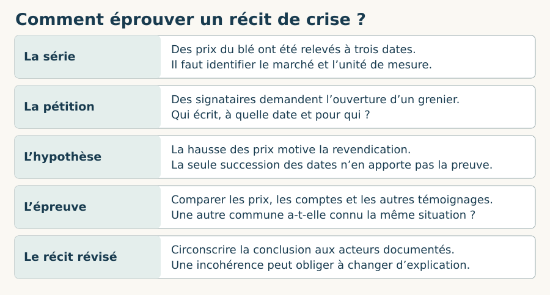
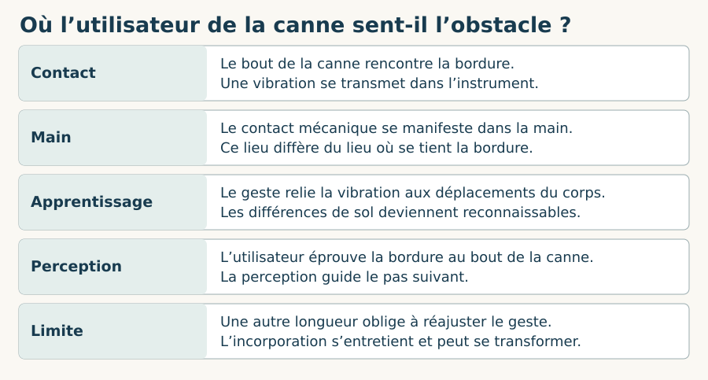

# BEL · AL — Philosophie (oral tronc commun 17 juin) 2026 · Corrigé brut

*Corrigé rédigé par IA, non officiel. Signalez toute erreur.*

**Rédaction** · GPT-6.2 Astra Ultra · vitesse non renseignée

**Autocontrôle** · GPT-6.2 Astra Ultra · vitesse non renseignée

**Révision** · GPT-6.2 Astra Ultra · vitesse non renseignée

Le jury publie 11 billets pour le 17 juin. Pour chacun, le premier intitulé est celui qui a été choisi. Le second était proposé au choix. Les deux reçoivent ici des réponses distinctes. Les exemples et arguments proposés servent à préparer une leçon personnelle.

Le billet porte deux sujets à lire devant le jury. Vous choisissez pendant les 90 minutes de préparation et annoncez votre choix au début des 20 minutes d’exposé. L’entretien dure ensuite 10 minutes. L’épreuve est de coefficient 3. Seul un dictionnaire de langue française est autorisé, à l’exclusion des dictionnaires de noms propres.

## 1. Y a-t-il des progrès en art ?

Un peintre apprend à donner l’illusion d’une profondeur régulière sur une surface plane. Une fois cette construction maîtrisée, il peut représenter avec précision un carrelage fuyant sous plusieurs personnages. On comprend en quel sens il a progressé, puisqu’une difficulté définie a reçu une solution que d’autres pourront reprendre. Mais il faudrait un critère supplémentaire pour établir qu’une Annonciation construite en perspective vaut davantage qu’une icône sur fond d’or. L’icône ne cherche pas nécessairement à ouvrir un espace que le spectateur pourrait parcourir.

La comparaison oblige donc à séparer l’histoire des moyens de celle des fins. Une innovation étend le répertoire disponible, quitte à ce qu’un artiste choisisse de s’en passer. Même dans un art doté d’une tradition technique cumulative, chaque œuvre redéfinit en partie ce que serait sa réussite. Des progrès existent relativement à un problème établi. Affirmer un progrès de l’art entier supposerait une échelle commune qui ferait de toutes les œuvres les étapes d’une seule entreprise. Le pluriel du sujet invite à garder ensemble la possibilité des avancées et la pluralité des valeurs.

### Le racisme

Pourquoi une croyance fausse sur l’existence de groupes humains naturellement hiérarchisés peut-elle avoir des effets si durables ? La catégorie est construite, mais les traitements fondés sur elle modifient réellement des trajectoires. Un employeur qui écarte une candidature en lui assignant une origine convertit un trait supposé en obstacle professionnel. La répétition de telles décisions produit ensuite des écarts que l’on peut prendre à tort pour leur justification. Une institution peut même perpétuer une inégalité de ce type en reconduisant ses habitudes de recrutement sans que chaque nouvel agent formule une doctrine raciste. Critiquer le racisme exige ainsi de distinguer la classification, la hiérarchisation et les pratiques qui les rendent opérantes. Rectifier une croyance individuelle et vérifier les conditions réelles d’accès à un bien répondent à deux moments de ce processus.

## 2. Qu’est-ce qui est commun à toutes les langues ?

Un enfant peut apprendre le français par l’oreille et une langue des signes par la vue. On ne saurait donc mettre le son à l’origine de tout ce que les langues ont en commun. Chercher une liste de mots ou une même distribution des temps grammaticaux rencontrerait une difficulté analogue. Des langues qui permettent à leurs locuteurs de parler de demain le font avec des moyens très différents.

Ce qui se retrouve est d’abord une pratique sociale de signes que l’on peut apprendre, reprendre, combiner, comprendre et corriger. Une collection de signaux qui auraient chacun un déclencheur fixe ne permettrait pas de dire à quelqu’un ce qui aurait pu arriver hier dans une ville absente. Une langue peut le faire avec une phrase que personne n’avait encore prononcée. La traduction confirme ce caractère commun tout en lui donnant sa limite. Il faut parfois une périphrase pour rendre une distinction que l’autre langue fait en un mot. Le commun est la possibilité d’élaborer et de négocier du sens dans une pratique partagée, sans garantie que chaque expression dispose partout d’un équivalent immédiat.

### Les conflits sociaux

Un désaccord entre deux collègues devient-il un conflit social dès qu’il se déroule au travail ? Il faut encore que soit en jeu une relation entre positions qui dépasse les caractères individuels. Une discussion sur les horaires devient collective quand un ensemble de salariés conteste la distribution durable du pouvoir de fixer leurs heures. Même ce conflit d’intérêts suppose quelque chose de commun, ici le travail à organiser et la possibilité d’adresser une revendication. Chez Simmel, le conflit lui-même peut constituer une forme de relation et réorganiser les groupes qu’il oppose. Sa seule présence n’indique pourtant ni justice ni progrès. On peut apprécier ce qu’un conflit rend publiquement discutable, qui a désormais voix dans la décision et quels désaccords la solution obtenue laisse subsister.

## 3. Se faire justice

Une personne à qui son vélo a été pris le retrouve attaché devant un commerce. Le vélo n’a pas cessé de lui appartenir. Pourquoi le droit impose-t-il néanmoins de distinguer la reconnaissance de son bien, la preuve de cette propriété et la décision sur une éventuelle sanction ? Être effectivement lésé et être habilité à déterminer seul la réparation sont deux choses distinctes. Le possesseur présent l’a peut-être acheté de bonne foi. Le premier tort ne renseigne pas à lui seul sur l’ensemble du litige.

L’institution d’un tiers oblige à rendre les raisons accessibles aux deux parties et ouvre une voie de recours. Elle peut pourtant devenir une coquille vide quand son coût ou son délai rend un droit inexerçable. Exiger la médiation suppose donc aussi de créer les moyens réels d’y accéder. « Se faire justice » exprime une exigence légitime si l’on entend par là faire reconnaître un tort subi. S’attribuer à la fois la qualité de partie et le dernier mot sur le litige met en danger cette même exigence, car on prive l’autre du droit de faire examiner ses raisons.

### Qu’est-ce qu’une bonne définition ?

« Un carré est un quadrilatère dont les quatre côtés sont égaux » paraît précis, mais la définition admet aussi des losanges dépourvus d’angle droit. L’objection oblige à choisir des propriétés qui saisissent toutes et seulement les figures recherchées. L’épreuve du contre-exemple corrige ici une extension trop large. En revanche, une définition lexicale du « jeu » se heurte à la variété des sports, des jeux de hasard et des jeux solitaires. Wittgenstein invite, dans les *Recherches philosophiques*, à examiner leurs ressemblances de famille. Une bonne définition doit donc répondre à son travail précis, identifier sans ambiguïté un objet construit, expliquer un usage ou fixer une règle de discussion. Il faut annoncer cet usage, examiner les cas limites et rendre la définition révisable lorsqu’elle exclut ce qu’elle devait expliquer.

## 4. La nature est-elle une invention de l’homme ?

Un séisme qui précède l’apparition des êtres humains ne dépend d’aucun de leurs projets. Cependant, distinguer dans un paysage une forêt « naturelle » et une plantation suppose des catégories, des traces d’usage et une durée de référence. Ce qui existe indépendamment de nous et la manière dont nous le regroupons sous un même nom n’ont pas le même statut. Comment reconnaître la seconde activité sans faire dépendre de notre langage le mouvement des plaques ?

Dans *Par-delà nature et culture*, Descola examine la particularité historique d’une manière de distribuer les continuités et les différences entre humains et non-humains. L’enquête ne fait pas disparaître les arbres. Elle met en question l’universalité d’une frontière qui fait d’eux les membres d’un ordre séparé. Il faut encore distinguer ce travail de classement de la transformation matérielle des milieux par la culture, les espèces introduites ou les aménagements. L’homme invente des concepts de nature et produit des paysages tenus pour naturels. Leur résistance à ses prévisions témoigne aussi de processus dont il n’est ni l’inventeur ni le maître.

### Musique et émotion

Une marche funèbre peut paraître triste à quelqu’un qui l’écoute avec plaisir. L’émotion exprimée, celle qu’éprouve l’interprète et celle qui advient à l’auditeur ne se confondent donc pas. Un mouvement descendant, un ralentissement et un silence peuvent faire reconnaître un geste de retombée sans que l’auditeur soit lui-même accablé. Inversement, une mélodie enjouée peut provoquer un chagrin personnel parce qu’elle rappelle quelqu’un. Il faut alors distinguer ce que l’écoute repère dans la forme et ce que la biographie y associe. L’émotion musicale naît souvent de leur rencontre. Rejouer une phrase avec une tout autre articulation constitue un test simple de ce que l’expression doit à la structure que l’on entend.

## 5. Le progrès technique

Une nouvelle machine permet de fabriquer deux fois plus de pièces par heure. L’amélioration se mesure nettement si la tâche est de produire ces pièces à qualité constante. Pourtant, la cadence peut déplacer le travail pénible vers la maintenance, accroître la consommation de matière ou rendre l’atelier plus dépendant d’un fournisseur. Le mot « progrès » contient déjà un jugement dont il faut nommer le critère et le bénéficiaire.

On ne résout pas la difficulté en mettant toutes les inventions sur le même plan. La possibilité de réparer plus facilement une pompe, à production égale, constitue un gain réel pour les personnes chargées d’approvisionner un village. Ce gain apparaît lorsqu’on choisit de suivre la durée d’usage et l’autonomie de l’équipe locale. Il doit encore pouvoir être discuté par ceux qui subiront les coûts. Un progrès technique est donc une augmentation de puissance sous une description déterminée. Le convertir en progrès humain exige une enquête sur la répartition de cette puissance, sur ses autres effets et sur la possibilité de revenir sur une décision malheureuse.

### À quoi servent les cérémonies ?

La remise d’un diplôme attribue parfois publiquement une qualification déjà acquise. Si seules comptaient les informations nouvelles, la réunion semblerait superflue. Pourtant, voir les autres témoigner du changement de statut lui confère une forme commune, le rend mémorable et peut engager le groupe à en reconnaître les effets. Dans d’autres cas, une parole prononcée dans les formes autorisées accomplit elle-même un changement institutionnel. Austin distingue de tels actes des phrases qui se contentent de constater un fait. Une cérémonie peut aussi exclure ceux qui n’en connaissent pas les codes ou masquer sous l’unanimité apparente un désaccord. Son efficacité tient ainsi à ce qu’elle fait faire ensemble, sous des règles qu’il faut pouvoir interroger, et ne se réduit ni à un décor ni à une garantie de consentement.

## 6. L’hypocrisie

Un collègue dit bonjour à quelqu’un qu’il apprécie peu. Faut-il y voir un exemple d’hypocrisie ? Le salut public n’a jamais promis une affection intime. Il devient trompeur lorsque le collègue se donne pour un ami dévoué afin de tirer de l’autre une confidence. L’écart entre l’état intérieur et le comportement visible ne suffit donc pas. Encore faut-il qu’une personne cherche à se faire attribuer une disposition ou une vertu sur laquelle autrui est conduit à compter.

Dans *Tartuffe*, la dévotion exhibée acquiert une efficacité parce qu’Orgon accorde à ses signes un crédit presque illimité. La critique doit examiner aussi cette organisation de la confiance. Une communauté qui juge uniquement sur les marques les plus visibles de vertu encourage leur fabrication. Pourtant, exiger la transparence intégrale des sentiments rendrait impossible la réserve nécessaire à la vie commune. On peut combattre l’hypocrisie par l’examen des engagements réellement pris et de la conduite qui les confirme ou les dément. On évite ainsi de confondre sincérité et obligation de tout montrer.

### Peut-on lutter contre le destin ?

Si le destin signifie que l’issue arrivera quoi que nous fassions, lutter semble inutile. Or cette définition confond parfois une issue nécessaire avec une issue indépendante de nos actions. Dans la réponse stoïcienne à l’argument paresseux, l’intervention du médecin et la guérison peuvent être liées dans le même enchaînement. Savoir que tout événement aurait ses causes n’autorise donc pas à supprimer les délibérations et les efforts qui figurent parmi elles. Le destin tragique pose une autre difficulté lorsque le personnage concourt à ce qu’il voulait éviter, en agissant sous une description incomplète. On peut y lutter au sens fort d’exercer son jugement et de répondre de ses choix, même sans disposer de toute la suite de leurs effets. Cela distingue l’action raisonnable de la prétention à tout prévoir.

## 7. Le récit historique

Un registre porte trois prix du blé à trois dates successives. Les aligner précisément ne suffit pas à raconter comment une population a vécu une crise. Le récit suppose un choix de durée, des relations entre les événements et l’identification de ce qui change pour des acteurs. En ce sens, l’historien construit un objet qui ne lui est donné dans aucun document. Pourquoi cette construction demeure-t-elle une connaissance ?

Imaginons que l’historien rapproche la hausse des prix d’une pétition demandant l’ouverture d’un grenier municipal. Il vient de faire apparaître un lien que la seule série ne prouvait pas. Il doit dater la pétition, en identifier les signataires, comparer avec les comptes et envisager que le texte défende un intérêt très local. Des traces discordantes peuvent lui imposer un autre récit. *Apologie pour l’histoire* de Marc Bloch montre ce qu’une source, interrogée avec méthode, permet d’apprendre, y compris au-delà de ce que son auteur voulait transmettre. Le récit historique explique une suite temporelle sous des exigences de preuve. Sa forme rend le passé intelligible, sa révision reste possible quand une trace ou une meilleure question résiste à la première intrigue.

### Une société sans droit est-elle possible ?

Un groupe peut s’ordonner longtemps sans code écrit, tribunal spécialisé ni État distinct. Cette observation n’établit pourtant pas l’absence de toute règle qui oblige. Un usage partagé sur l’accès à un puits peut reconnaître une prétention, prévoir une procédure en cas de désaccord et charger certains membres de trancher. Il commence alors à présenter des caractères juridiques. À l’inverse, appeler droit toute habitude dissoudrait la question, puisque se saluer de la même manière ne crée pas nécessairement une demande susceptible d’être jugée. Il faut donc préciser ce qu’on retire dans l’hypothèse. Une société sans droit étatique codifié est concevable. Une société durable sans aucune règle d’attribution, de contestation ou de réparation devrait expliquer comment elle traite, autrement que par un rapport de force, les litiges que sa propre coopération produit.

## 8. Technique et liberté

Un fauteuil roulant motorisé ouvre à son utilisateur un trajet jusque-là inaccessible. Le trajet redevient impraticable si les bâtiments ignorent les rampes, si la recharge est indisponible ou si la réparation dépend d’un atelier inaccessible. La technique libère-t-elle celui qui dépend d’elle ? Poser la question en termes de dépendance absolue ferait oublier que marcher suppose également un corps et un milieu aux propriétés déterminées.

L’exemple conduit à examiner deux libertés. L’une tient à l’éventail des actions réellement possibles. L’autre tient au contrôle que l’on peut exercer sur les conditions de ces possibilités. Une ville gagne sur la première en s’équipant de transports accessibles. Elle peut cependant échouer sur la seconde si les personnes concernées ne disposent d’aucun recours quand le service s’interrompt. La technique donne une forme matérielle à des choix sociaux, parfois révisables par ceux qui en font usage, parfois imposés. Sa contribution à la liberté se mesure donc autant à ce qu’elle ouvre qu’à la capacité de quitter, discuter ou modifier la dépendance qu’elle institue.

### Peut-on penser la mort ?

Je peux penser la fin de ma vie comme un événement possible et en comprendre les conséquences pour mes proches. Mais puis-je me représenter le fait même de ne plus éprouver quoi que ce soit ? Me figurer une salle vide où je contemplerais ma propre absence me maintient encore en position de spectateur. Dans la *Lettre à Ménécée*, Épicure distingue le moment où nous sommes là de celui où la mort est là et retire ainsi à la mort le statut d’une expérience future que nous aurions à subir comme présente. Reste pourtant à penser la mortalité comme limite actuelle de nos projets et la mort d’autrui comme perte effective d’une relation. L’impossibilité de faire l’expérience de ma propre absence détermine les conditions sous lesquelles je peux la penser, sans vider le concept de tout contenu.

## 9. Qui es-tu ?

Au guichet, je réponds en indiquant mon nom et ma date de naissance. Retrouvé après vingt ans, un ami qui me demande qui je suis devenu attendrait en vain une réponse sur ma carte d’identité. Le premier demande une identification qui exclut la substitution d’une autre personne. Le second s’interroge sur ce qui rend une vie reconnaissable à travers le changement. Le « tu » ajoute encore un élément. La personne interrogée peut répondre et corriger l’image qu’on lui tend.

Dans *Soi-même comme un autre*, Ricœur distingue l’identité de ce qui demeure semblable et celle qui se manifeste quand quelqu’un tient parole malgré ses propres changements. Ce fil évite d’enfermer autrui dans une somme de traits tout en exigeant qu’il puisse répondre d’engagements pris. Pourtant, il n’est pas seul auteur de tout ce qui l’identifie. D’autres détiennent des souvenirs, des preuves et parfois des griefs qu’une présentation de soi ne peut effacer. À « qui es-tu ? » répondent donc une existence identifiable et une parole responsable, appelée à se reprendre dans une relation avec celui qui interroge.

### Technique et nature

Une greffe horticole est préparée par le jardinier, mais l’union des tissus dépend d’une activité du végétal qu’aucun lien extérieur ne remplace. L’exemple donne un sens précis à l’idée aristotélicienne selon laquelle la technique peut achever ce que la nature ne mène pas seule à terme et imiter ses opérations. Il importe de distinguer la source d’un processus et les conditions de sa mise en œuvre. Une opération volontaire agence les conditions de croissance et poursuit une fin, par exemple produire tel fruit. Le vivant conserve ses propres exigences. L’opposition entre naturel et artificiel sert à identifier la part d’intervention, mais juge mal les résultats lorsqu’elle attribue d’avance une valeur à l’un des termes. On peut alors comparer des interventions selon les capacités du milieu qu’elles soutiennent ou épuisent.

## 10. Existe-t-il des devoirs envers soi-même ?

Si un devoir dépend du droit de celui qui en bénéficie, pourquoi ne pourrais-je pas me délier aussitôt d’une obligation dont je suis à la fois débiteur et créancier ? La difficulté disparaît pour une simple préférence personnelle. Je peux renoncer au voyage que j’avais prévu. Elle revient quand une personne, pour obtenir un avantage, se contraint à faire une déclaration qu’elle sait mensongère sur ses propres convictions. Elle porte alors atteinte à la capacité dont elle use pour prendre des engagements.

La *Doctrine de la vertu* de Kant éclaire cette différence en distinguant le sujet de ses inclinations de la personne capable de se donner une règle morale. Prendre soin de sa faculté de juger, s’instruire ou refuser une humiliation ne se ramène pas à maximiser sa satisfaction. Mais l’exigence ne saurait transformer tout choix imprudent ou tout repos en faute. Il faut montrer quel respect est dû à la personne même qui choisit et ce qu’une pratique compromet durablement. Des devoirs envers soi se comprennent dès lors comme envers sa propre qualité d’agent, qui ne devient pas disponible à discrétion du seul fait qu’on en est le porteur.

### Guerre et paix

Une trêve fait cesser les combats pour un temps. Pourtant, deux sociétés peuvent y demeurer en état d’hostilité et se savoir exposées à la reprise du conflit. La simple absence actuelle de combats ne suffit donc pas à définir la paix. Kant, dans *Vers la paix perpétuelle*, demande à quelles conditions juridiques les rapports entre États cesseraient de dépendre de la seule prudence des gouvernants. Des engagements publics et des institutions de règlement des différends rendent prévisible la conduite d’autrui et donnent des raisons de préserver l’accord. La paix n’abolit pas la pluralité des intérêts, car les désaccords subsistent jusque dans des relations pacifiques. Elle transforme la manière de les régler et la qualité de confiance que peuvent raisonnablement avoir les populations. Une trêve peut en constituer le début si ce changement institutionnel devient possible.

## 11. La technique et le corps

Un menuisier débutant regarde sans cesse sa main et son outil. À mesure qu’il apprend, son attention se déplace vers le trait sur la planche et la réaction du bois. L’instrument paraît prolonger le corps, mais comment quelque chose d’étranger est-il devenu le moyen d’une perception ? Dans la *Phénoménologie de la perception*, Merleau-Ponty analyse la canne de l’aveugle devenu habile à en user. Le contact avec un obstacle se localise au bout de la canne, au-delà de la main qui la tient.

On comprend ainsi que le corps ne se définit pas uniquement par sa limite anatomique. Ses habitudes réorganisent l’espace de ce qu’il peut atteindre et sentir. Inversement, les « techniques du corps » étudiées par Mauss montrent que marcher, nager ou porter peuvent s’apprendre différemment selon les sociétés. L’outil incorpore des gestes et le corps est déjà formé par des pratiques transmissibles. Cela ne le rend pas indéfiniment disponible. La fatigue d’un geste répétitif signale qu’un dispositif peut méconnaître les possibilités vécues du corps qui l’utilise. L’apprentissage technique doit donc être jugé aussi depuis ce que le corps éprouve et peut durablement accomplir.

### Peut-on changer le passé ?

Une nouvelle archive peut établir qu’un fait invoqué depuis longtemps n’a jamais eu lieu. On a modifié une proposition sur le passé, sans avoir supprimé un événement réel. Mais l’action présente fait parfois davantage que rectifier la connaissance. Présenter aujourd’hui des excuses publiques transforme la relation née d’une offense ancienne et la place qu’elle occupe dans une histoire commune. L’offense demeure. Ce sont ses suites, sa signification publique et certaines possibilités de réparation qui changent. La distinction évite deux erreurs pratiques, croire qu’un récit efface le tort ou croire que l’irréversibilité condamne toute réparation à être vaine. Nous ne pouvons faire que ce qui est advenu ne soit pas advenu. Nous pouvons encore modifier ce qu’il sera possible d’en dire, d’en transmettre et d’en faire.

[Index officiel, lien du 17 juin](https://www.ens.psl.eu/rapports-et-sujets-du-concours-2026-section-des-lettres-groupe-al) · [Feuille officielle du 17 juin](https://www.ens.psl.eu/sites/default/files/philosophie_tronc_commun_1.pdf) · [Rapport du jury, modalités et annexe des sujets](https://www.ens.psl.eu/sites/default/files/2026_al_rapport_oral_philosophie_tc.pdf)
