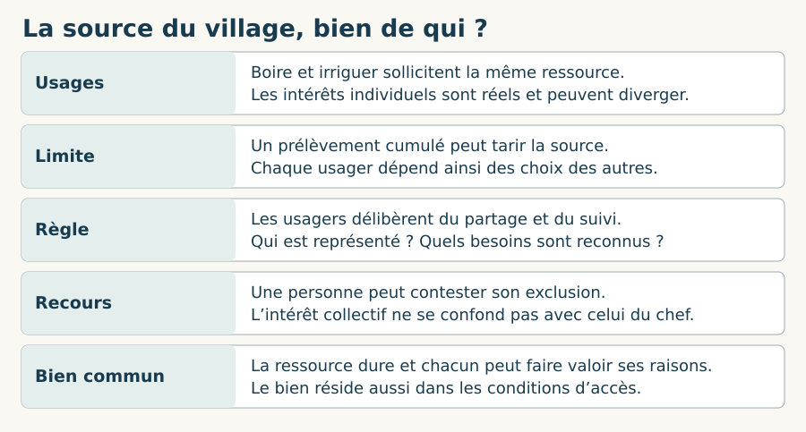
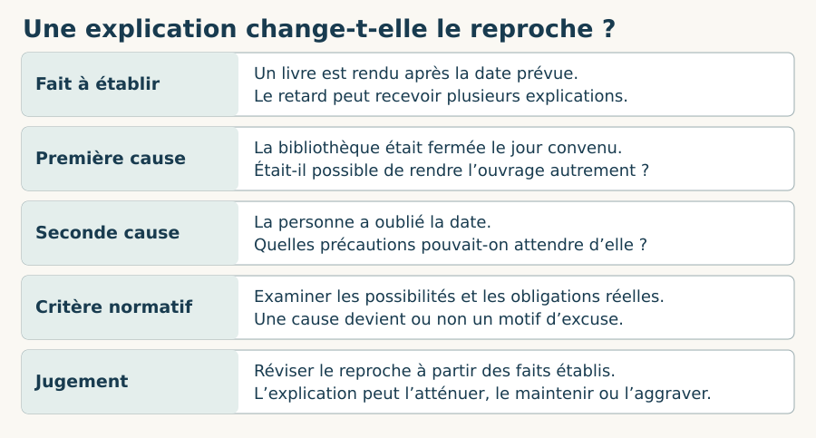

# BEL · AL — Philosophie (oral tronc commun 18 juin) 2026 · Corrigé guidé

*Corrigé rédigé par IA, non officiel. Signalez toute erreur.*

**Rédaction** · GPT-6.2 Astra Ultra · vitesse non renseignée

**Autocontrôle** · GPT-6.2 Astra Ultra · vitesse non renseignée

**Révision** · GPT-6.2 Astra Ultra · vitesse non renseignée

Le jury publie 12 billets pour le 18 juin. Pour chacun, le premier intitulé est celui qui a été choisi. Le second était proposé au choix. Les deux reçoivent ici des réponses distinctes. Les exemples et arguments proposés servent à préparer une leçon personnelle.

Lisez les deux intitulés devant le jury et annoncez au début de l’exposé le sujet retenu pendant la préparation. Seul un dictionnaire de langue française est autorisé, à l’exclusion des dictionnaires de noms propres. Chaque alternative comporte ci-dessous une question d’entretien assortie d’une piste de réponse.

## Préparer la leçon et les reprises

Le jury prévoit 1 h 30 de préparation, vingt minutes de leçon et dix minutes d’entretien. L’annexe du rapport, page 6, désigne par le gras les douze sujets choisis. Chacun est le premier de sa paire. Deux questions proches sur le monde y figurent réellement, aux billets 1 et 7. Pour les travailler, changer le point de départ, les limites d’une connaissance de la totalité au billet 1, l’autorité d’un sujet situé au billet 7. Les douze relances suivantes sont proposées pour s’entraîner.

1. **Des usagers qui respectent tous le même plafond reçoivent-ils toujours leur juste part ?** Une famille et un exploitant n’ont ni les mêmes besoins ni les mêmes options. Le plafond commun doit encore pouvoir être discuté avec ceux auxquels il s’applique. Pour la totalité du monde, distinguer une hypothèse cosmologique contrôlée d’une affirmation sans expérience possible.
2. **Pourquoi l’attente imposée compte-t-elle autrement qu’une pause ?** La même durée laisse d’inégales possibilités de choisir et de reprendre une activité. Le temps apparemment libre de celui qui risque de perdre sa place est immobilisé. Pour le corps-machine, préciser la fonction pour laquelle la comparaison avec une pompe est efficace.
3. **Un jugement désapprouvé par beaucoup peut-il être rendu au nom du peuple ?** Oui, si le juge a reçu compétence, respecte le droit et motive une décision contestable dans les voies prévues. La popularité du verdict n’est pas sa source de validité. Pour l’éducation sentimentale, demander ce qui permet de réviser une habitude affective injuste.
4. **Un mot intraduisible prouve-t-il l’incommunicabilité ?** Expliquer le problème à un interlocuteur étranger est déjà traduire une part de son sens, parfois au prix d’un détour. Sur la réparation, séparer le prix d’un objet de la restauration d’un droit ou d’une confiance.
5. **Pourquoi une faveur peut-elle être despotique ?** Le bénéficiaire dépend du bon vouloir d’un détenteur qui peut retirer son avantage sans rendre de comptes. Pour le point de vue, confronter deux photos d’un même lieu avant de conclure à une contradiction.
6. **Comment protéger la vie privée tout en y reconnaissant des questions de justice ?** Un droit au recours et des protections du temps de travail peuvent être publics sans imposer le dévoilement de toute relation intime. Sur l’identité, jouer une mélodie transposée puis examiner ce qui reste effectivement reconnaissable.
7. **Puis-je rapporter une découverte scientifique que je n’ai pas faite ?** Je peux nommer le résultat, sa source et son mode de contrôle, en indiquant la différence avec mon propre témoignage. Pour la peur, reprendre le moment où l’impression de menace devient une hypothèse qui peut être vérifiée.
8. **Une personne qui n’éprouve pas de pitié est-elle dispensée d’aider ?** Un besoin reconnu fournit déjà une raison d’agir. La pitié peut l’avoir rendu visible, mais son absence n’abolit pas l’égale considération. Devant un tableau, retrouver dans le cadrage le détail qui permet de contrôler l’interprétation.
9. **Un oubli excuse-t-il toujours ?** Il faut établir ce que la personne pouvait raisonnablement prévoir et faire pour se souvenir. La simple existence d’une cause ne tranche pas ce point. Pour l’écrit, expliquer pourquoi la possibilité d’une relecture mot à mot modifie le règlement d’un désaccord.
10. **La pile utile à un chercheur est-elle forcément bien organisée pour tous ?** Un classement qui fonctionne pour retrouver ses documents peut échouer si l’enjeu est de les transmettre à un collègue. Sur l’histoire des femmes, demander comment les règles du registre déterminent qui y devient visible.
11. **Pourquoi un opposant demeure-t-il membre du corps politique ?** Sa qualité se manifeste par son droit de contester la décision, de demander sa révision et de participer au scrutin suivant. En esthétique, préciser le principe de classement avant de discuter le cas limite d’une installation sonore.
12. **Une chanson peu diffusée peut-elle être populaire ?** Oui, si l’on étudie sa transmission et son usage dans un groupe déterminé. Le nombre de téléchargements mesure autre chose. Sur le droit, expliquer pourquoi la protection d’une personne blessée ne dépend pas d’une décision préalable sur la légitimité du conflit.

## 1. Le bien commun

Une commune dispose d’une source dont chaque habitant peut tirer de l’eau. Additionner les volumes que chacun souhaiterait emporter risque précisément de tarir la source. Le bien commun donnerait-il alors le droit de sacrifier les préférences de tous à une entité appelée « la commune » ? Cette seconde solution fait disparaître les personnes pour lesquelles l’eau compte et permet aux détenteurs du pouvoir d’identifier leur intérêt au bien de tous.

La source fait apparaître une troisième possibilité. Sont communs la permanence d’une ressource, les conditions équitables d’accès et le pouvoir partagé de discuter les usages. La recherche d’Elinor Ostrom sur les ressources communes montre comment les intéressés peuvent élaborer et modifier des règles locales de prélèvement. Il ne suffit donc pas qu’une chose soit ouverte à tous pour que son bien soit garanti. Il faut pouvoir demander qui fixe la limite, qui supporte l’effort et comment un usager conteste une exclusion. L’intérêt commun se reconnaît ici à des conditions que chacun peut invoquer face aux autres et face au pouvoir organisé en leur nom.

### Que peut-on dire sur le monde ?

Nous savons affirmer qu’une éclipse aura lieu à telle date et dans telle région. Peut-on étendre ce type de connaissance au monde pris absolument comme totalité ? Prévoir l’éclipse consiste à établir des relations entre phénomènes déterminés, dans des conditions que d’autres observateurs peuvent contrôler. Parler de l’ensemble de tout ce qui est comme d’un objet posé devant nous suppose une position extérieure difficile même à définir. Les antinomies de Kant montrent les difficultés où s’engage la raison quand elle traite la totalité du monde comme un objet d’expérience intégralement donné. Nous pouvons énoncer des savoirs sur des régions du réel, discuter des modèles cosmologiques et interroger leurs limites. La visée du tout oriente l’enquête, sans fournir à elle seule le point d’observation qui la clorait.

**À l’entretien. Pourquoi la connaissance de chaque région de l’univers ne donnerait-elle pas automatiquement celle du tout ?** Distinguer l’addition d’observations locales et la justification d’une proposition portant sur leur totalité. Indiquer ce qu’une mesure permet d’affirmer, puis où commence l’extrapolation.

## 2. Quand perd-on son temps ?

Une heure d’attente au guichet disparaît de mon programme. Pourtant l’heure passée sur un banc à observer un enfant jouer, sans tâche accomplie, peut me sembler bien employée. Si l’absence de production suffisait, les deux heures seraient également perdues. Le possessif suggère un meilleur départ. Perdre son temps, c’est se voir privé de l’usage que l’on pouvait raisonnablement faire de cette durée, ou s’apercevoir qu’on l’a soi-même consacré à une fin à laquelle on ne tenait guère.

Cette réponse reste trop dépendante d’un plan préalable. Une conversation imprévue peut me faire découvrir que la fin que je poursuivais demandait à être changée. Sénèque, dans *De la brièveté de la vie*, attaque l’occupation qui livre nos jours à des sollicitations dont nous ne faisons jamais l’examen. L’activité la plus intense peut alors être une manière de perdre son temps. L’enjeu porte sur la possibilité de disposer de sa durée et de réviser ses fins. Il est aussi politique lorsque certains attendent sans cesse parce que d’autres disposent des horaires et de la priorité.

### Corps et machine

La comparaison du cœur à une pompe permet d’isoler une différence de pression et la direction d’un flux. L’analogie a une force explicative parce qu’elle précise une fonction contrôlable. Elle devient trompeuse si le succès local oblige à supposer que le corps entier est un assemblage de pièces ayant chacune reçu sa fin d’un constructeur extérieur. Dans la *Critique de la faculté de juger*, Kant observe que les parties d’un être organisé sont réciproquement moyens et fins. Le vivant se développe et entretient ses constituants dans un rapport au tout. Enfin, mon corps est aussi ce depuis quoi je sens et j’agis. Comparer éclaire une opération. Étendre la comparaison à la totalité exige d’expliquer l’organisation et l’expérience que le premier modèle avait laissées de côté.

**À l’entretien. Un cœur artificiel justifie-t-il de dire que le corps entier est une machine ?** Déterminer la fonction que l’appareil assure et les échanges dont dépend son fonctionnement dans l’organisme. Le succès d’un remplacement partiel appuie une explication locale. Reste à établir jusqu’où l’analogie s’étend.

## 3. « Au nom du peuple »

Une décision de justice rendue « au nom du peuple français » peut déplaire à la majorité des personnes interrogées à la sortie du tribunal. La formule serait absurde si elle prétendait rapporter leur avis instantané. Elle désigne un titre d’autorité et oblige celui qui l’emploie à respecter la procédure qui le lui confère. Un juge motive sa décision en droit, il ne reçoit pas un mandat pour sonder les préférences du jour.

Le risque d’usurpation demeure considérable. Celui qui prétend incarner seul le peuple peut traiter ses contradicteurs comme s’ils lui étaient étrangers. Rousseau distingue dans *Du contrat social* la volonté générale et la somme des volontés particulières. Cette distinction invite à examiner l’intérêt commun mais n’autorise aucun porte-parole à se déclarer infaillible. La formule est défendable là où l’attribution de compétence, la publicité des raisons et les voies de recours peuvent être établies. Parler au nom du peuple devrait ouvrir un droit à demander des comptes, y compris à ceux des citoyens qui désapprouvent la décision.

### L’éducation peut-elle être sentimentale ?

L’enfant qui rit de la chute d’un camarade peut être invité à remarquer son embarras et à attendre sa réponse avant de plaisanter. Une leçon énonce une règle. L’attention répétée à ce que l’autre traverse transforme aussi ce qui devient spontanément drôle ou pénible au témoin. L’approche d’Aristote dans l’*Éthique à Nicomaque* rend intelligible une éducation du plaisir et de la peine par l’habitude. La difficulté est que l’on peut tout aussi bien habituer à des dégoûts injustes. L’éducation sentimentale doit donc inclure la possibilité de comparer les situations et de réviser un affect, au lieu de distribuer des émotions obligatoires. Elle travaille les conditions de la sensibilité et du jugement, sans garantir l’apparition d’un sentiment à la commande.

**À l’entretien. Peut-on enseigner la compassion sans exiger qu’elle se manifeste sur commande ?** Faire varier l’exercice. Apprendre à remarquer l’embarras d’un camarade ouvre une possibilité de réponse. Récompenser systématiquement un signe visible de compassion risque surtout de faire apprendre ce signe.

## 4. La pluralité des langues

Deux personnes peuvent désigner le même parent à l’aide de mots dont les extensions diffèrent. Une langue rassemble sous un nom des relations familiales qu’une autre marque séparément. Ce décalage est un coût pour l’interprète, qui doit parfois ajouter une précision. Il est aussi une découverte, puisqu’il conduit à remarquer une distinction que l’on pouvait concevoir sans avoir l’habitude de la faire.

De là ne suit pas que deux langues enferment leurs locuteurs dans des mondes imperméables. Une périphrase, un exemple ou un apprentissage commun ouvrent une voie entre des découpages différents. Inversement, imaginer un lexique universel dans lequel chaque terme trouverait son équivalent omet les usages sociaux, l’ironie et les souvenirs attachés aux mots. La pluralité des langues est ainsi une pluralité de pratiques historiques de signification. Elle enrichit les manières d’interroger une situation et expose à des pertes dans la traduction. La possibilité de discuter ces pertes est déjà une preuve de communication, précisément parce qu’on a pu faire apparaître ce qui résiste.

### Peut-on réparer ses fautes ?

Réparer la vitre brisée rétablit une fonction et compense une dépense. Si j’ai volontairement menti sur l’auteur du dégât, le remplacement de la vitre ne répare pas encore l’injustice faite à la personne accusée. Une faute atteint des biens de natures différentes, parfois la confiance ou la possibilité même de prendre une décision informée. Une réparation doit donc reconnaître le tort, restituer quand c’est possible et modifier les conditions qui en prolongent les effets. Elle ne rend pas le fait passé réversible. Demander pardon peut ouvrir une relation nouvelle, mais le pardon ne se réclame pas comme le prix automatiquement acquis de l’indemnisation. On peut réparer quelque chose de sa faute sans redevenir auteur d’une histoire dans laquelle elle n’aurait pas eu lieu.

**À l’entretien. Si la victime refuse de me pardonner, puis-je tout de même réparer ma faute ?** Distinguer les gestes qui dépendent de moi, comme restituer et reconnaître le tort, de la reprise de la relation qui requiert son consentement. Préciser aussi que c’est à la victime que l’auteur demande pardon.

## 5. Le despotisme

Un pouvoir peut gouverner durement en appliquant des règles sévères, ou décider avec douceur tout en gardant la faculté de retirer demain ce qu’il accorde. Où commence le despotisme ? La distinction de Montesquieu, dans *De l’esprit des lois*, met l’accent sur le gouvernement selon la seule volonté et les caprices d’un seul, qui se soutient par la crainte. L’imprévisibilité de la faveur apprend aux sujets à anticiper le désir du chef, même lorsqu’aucune menace explicite ne s’exprime.

L’exemple d’un gouvernant bienveillant éprouve cette définition. S’il conserve le droit de changer la règle pour un individu sans en répondre devant aucune instance, les bénéficiaires de sa bienveillance restent dépendants. Il faut donc juger la structure des garanties en plus des dispositions du détenteur du pouvoir. Des lois prévisibles, des instances indépendantes et la possibilité de contester une décision créent une distance entre la volonté d’un chef et le sort d’une personne. La suppression de cette distance rend intelligible l’obéissance par crainte et permet de distinguer le despotisme d’une simple fermeté de gouvernement.

### Qu’est-ce qu’un point de vue ?

Deux photographies d’une place montrent des façades différentes selon l’endroit où se tenait l’appareil. Leur désaccord apparent disparaît en reconstituant les positions. Dans la discussion morale ou historique, l’expression prend un sens plus large. Le témoin d’une grève et l’historien qui compare des archives n’interrogent pas les faits avec la même distance ni la même question. Cette situation n’autorise pourtant pas toutes les affirmations. Une photo peut être mal datée et un témoin se tromper de lieu. Rendre explicite le point de vue permet de préciser ce qu’il fait voir, ce qu’il cache et comment un autre observateur peut le corriger. L’objectivité se travaille par de telles confrontations. Se déclarer « sans point de vue » ne les remplace pas.

**À l’entretien. Faut-il adopter tous les points de vue pour atteindre une conclusion objective ?** Deux plans d’une place peuvent être confrontés par leurs repères communs. Une contradiction sur la position d’un bâtiment appelle une vérification. Identifier les conditions d’un point de vue permet d’en apprécier la portée.

## 6. La sphère privée échappe-t-elle au politique ?

Le secret de ma correspondance me protège contre l’ingérence de puissances publiques ou privées. Il serait pourtant paradoxal d’y voir une zone qui a toujours existé hors de toute institution. Des lois définissent ce qui compte comme correspondance protégée, habilitent un juge à intervenir sous conditions et sanctionnent certaines intrusions. La limite qui abrite la vie personnelle a donc une histoire politique.

Inversement, décréter que tout y est politique pourrait livrer l’intimité sans réserve à une majorité curieuse. Il faut distinguer la question commune des règles d’une relation et le droit de s’immiscer dans chaque choix personnel. La répartition inégale des tâches domestiques peut être étudiée comme problème public, par exemple lorsqu’elle réduit durablement le temps professionnel d’un groupe. Cette observation justifie l’examen des horaires, des congés ou des services collectifs, sans donner à l’État le droit de tenir un registre de chaque conversation familiale. La sphère privée échappe à certaines interventions parce qu’un ordre politique organise et protège cette latitude. Cette protection doit elle-même rester discutable lorsqu’elle sert à soustraire une injustice au recours.

### Identité et changement

Une mélodie demeure reconnaissable lorsqu’elle est transposée dans une autre tonalité. Toutes les hauteurs ont changé, tandis que des relations entre elles se maintiennent. Demander si une chose peut rester la même en changeant oblige donc à dire sous quelle description et selon quel critère. Pour une mélodie, la répétition du dessin rythmique et des intervalles peut suffire au musicien. Pour un tableau original, une reproduction fidèle ne possède pas l’histoire matérielle de la toile. La forme de continuité requise dépend de l’objet et de la question posée. Le changement ne détruit pas toujours l’identité, il rend visible ce que l’on juge essentiel à sa persistance. À l’inverse, un objet apparemment immobile peut être remplacé par un double auquel manque cette continuité.

**À l’entretien. Une mélodie transposée et une mélodie déformée changent toutes les deux. Comment les distinguer ?** Comparer la hauteur absolue des notes et les rapports entre elles. Le choix de ce que l’on suit fournit ici un critère d’identité. Il faudra le justifier de nouveau si l’on parle d’une personne ou d’un objet.

## 7. Que puis-je dire sur le monde ?

Au retour d’un voyage, je décris une place déserte à une heure précise. De quel droit passerais-je de « je n’y ai vu personne » à « personne ne fréquente cette place » ? Le « je » de ce billet modifie le problème rencontré au billet 1. La question porte ici sur l’autorité, les ressources et les limites d’un sujet situé. Mon expérience m’autorise à témoigner de ce que j’ai vu. Elle m’oblige aussi à déterminer ce que mon emplacement et les circonstances m’ont caché.

Pourtant, me limiter au témoignage immédiat exclurait une grande partie de ce que je peux affirmer légitimement. Je sais qu’un autre fuseau horaire connaît le jour lorsque je vois la nuit, grâce à des instruments, des savoirs transmis et des vérifications que je n’ai pas toutes réalisées. À quelles conditions puis-je en répondre ? En distinguant observation propre, inférence, témoignage reçu et incertitude, puis en indiquant les moyens d’un contrôle. Parler sur le monde à la première personne ne condamne ni à la confession ni à l’omniscience. Cela oblige à rendre visible comment une voix particulière prend part à une connaissance commune.

### La peur

Un marcheur entend un craquement et s’arrête. Avant d’avoir reconnu sa cause, son corps s’oriente déjà vers un danger possible. La peur manifeste une évaluation de ce qui menace, dans laquelle la possibilité et l’importance du mal comptent davantage que sa présence certaine. Un examen de la situation peut ensuite dissiper cette peur ou lui donner un objet mieux déterminé. Il serait toutefois injuste de prendre toute peur persistante pour une erreur volontaire. L’expérience vécue et les habitudes du corps modifient ce qui devient alarmant. La peur informe l’action si elle ouvre un temps d’attention et de vérification. Elle devient un mauvais juge lorsqu’une impression suffit à condamner une personne ou à justifier une décision sans autre examen.

**À l’entretien. L’absence de peur garantit-elle un jugement plus juste ?** Comparer le marcheur prudent, celui qui refuse de tenir compte d’un signal et celui qui voit dans tout bruit la preuve du danger. Expliquer ce que la peur révèle, puis ce qui permet de vérifier l’alerte.

## 8. La pitié est-elle un sentiment moral ?

Devant un voisin tombé sur le trottoir, je m’arrête avant même de réfléchir à une règle. Cette répugnance à voir souffrir autrui évoque la pitié naturelle décrite dans le *Discours sur l’origine et les fondements de l’inégalité parmi les hommes* de Rousseau. Elle peut interrompre un mouvement d’indifférence et amorcer un secours. Qu’est-ce qui fait toutefois de cet élan un sentiment moral ? L’émotion pourrait seulement viser à éloigner de moi un spectacle pénible.

Le voisin a peut-être besoin que quelqu’un appelle une personne de confiance ou s’asseye un moment à ses côtés. Lui imposer une aide dont il ne veut pas afin de soulager mon malaise reviendrait à oublier la personne même qui a suscité la pitié. L’épreuve morale consiste à lui rendre une voix et à proportionner l’action à ses raisons. Elle comporte aussi une exigence d’égalité, puisque les souffrances éloignées ou peu spectaculaires touchent moins spontanément. La pitié devient moralement féconde lorsqu’elle porte au-delà de sa propre satisfaction et accepte d’être instruite par le jugement, l’écoute et le souci de ceux que l’on ne voit pas.

### Regarder un tableau

Au premier regard, je reconnais une femme à une fenêtre. Au second, je remarque que le cadre peint coupe une partie de son bras et que la lumière qui dessine son visage demeure elle-même hors champ. Le sujet reconnu continuait jusque-là de masquer certaines décisions du peintre. Regarder engage un va-et-vient entre ce qui est représenté et la manière dont la surface nous le fait voir. Une information sur la date ou la destination du tableau peut rendre une particularité intelligible, mais réciter cette information devant une toile indifférenciée ne remplace pas l’observation. Il faut pouvoir ramener l’interprétation à des rapports visibles de taille, de couleur, de distance ou de cadrage. Le regard apprend ainsi à formuler des hypothèses que la même surface peut encore démentir.

**À l’entretien. Deux visiteurs qui reconnaissent le même objet ont-ils terminé leur lecture du tableau ?** Leur faire décrire le cadrage et les relations de couleur avant de quitter l’œuvre. Une divergence sur l’effet d’une ombre peut être discutée en revenant au détail visible qui la motive.

## 9. Expliquer, est-ce excuser ?

Une élève n’a pas rendu à temps un livre emprunté. Elle avait oublié le délai ou bien la bibliothèque était fermée le jour convenu. Les deux explications identifient une cause du retard. Elles n’ont pas la même portée sur le reproche. La fermeture rendait la restitution matériellement impossible à cet instant, alors qu’un oubli peut encore engager une responsabilité, selon les précautions raisonnablement exigibles et les autres circonstances.

Expliquer répond donc à la demande de comprendre comment un fait s’est produit. Excuser répond à un jugement normatif sur ce qu’on pouvait attendre de quelqu’un. On ne franchit la distance entre les deux qu’en ajoutant un critère, par exemple la connaissance de l’obligation ou la possibilité d’agir autrement. Toutefois, il serait tout aussi faux de séparer absolument les opérations. Une explication nouvelle peut révéler une impossibilité réelle et modifier le jugement. Elle peut également établir une responsabilité plus étendue, si elle montre un choix délibéré que l’on prenait pour un accident. Expliquer accroît ainsi notre capacité de juger avec justesse sans commander d’avance ni l’indulgence ni la condamnation.

### L’oral et l’écrit

Une consigne orale autorise une question immédiate. Sa formulation peut être adaptée au visage perplexe de celui qui l’écoute. Une consigne écrite peut voyager jusqu’à une personne absente, être relue mot à mot et invoquée plus tard en cas de désaccord. Dans le *Phèdre*, Platon fait remarquer qu’un écrit interrogé ne peut choisir sa réponse comme le ferait son auteur présent. Cette limite est l’envers d’une puissance, puisque le texte demeure disponible au-delà de l’intention et de la situation premières. L’opposition ne recouvre pas celle de l’éphémère et du durable dans tous les cas. Une tradition orale peut se transmettre longtemps, et un message écrit disparaître aussitôt. Les deux modes distribuent différemment présence, mémoire, contrôle de la formulation et possibilité de réponse.

**À l’entretien. Une voix enregistrée appartient-elle simplement à l’oral ?** L’enregistrement conserve les inflexions et permet la réécoute. Il prive toutefois le locuteur de la possibilité de répondre ici et maintenant. Comparer les supports selon ces deux critères indépendants.

## 10. L’ordre et le désordre

Sur le bureau d’une chercheuse, plusieurs piles de documents semblent désordonnées au visiteur. Elle retrouve pourtant la lettre dont elle a besoin, tandis qu’un classement alphabétique briserait les voisinages utiles à sa recherche. L’ordre dépend ici d’une relation et d’une fin. Le même arrangement peut la remplir pour elle sans la rendre lisible à un collègue. Le désordre serait-il donc toujours affaire de point de vue ?

Une feuille qui tombe dans un endroit inconnu compromet aussi un ordre réel pour la chercheuse elle-même. Il faut distinguer une organisation non reconnue d’une perturbation qui détruit une possibilité déterminée. En physique, la description statistique d’un système donne encore un sens technique distinct à l’entropie, associé au nombre de configurations microscopiques compatibles avec des conditions macroscopiques. L’impression visuelle de désordre ne suffit pas à la mesurer. On ne peut donc identifier indistinctement ordre à valeur et désordre à défaut. Demander de quelles relations ils sont les propriétés et comment un changement les affecte permet de distinguer la perte d’une règle, la coexistence de plusieurs règles et la naissance d’une forme nouvelle.

### Pourquoi faire l’histoire des femmes ?

Un registre d’atelier ne mentionne que le chef de ménage alors que d’autres membres travaillent également. Raconter le métier à partir de la seule colonne des titulaires peut effacer ce travail. Faire l’histoire des femmes demande alors des sources complémentaires, des procès, des correspondances ou des enquêtes sur l’organisation du foyer. Ajouter quelques biographies célèbres laisserait intact le problème de constitution de la série. Les recherches de Michelle Perrot montrent l’intérêt de se demander comment des silences sont produits et conservés. La catégorie « femmes » ne désigne d’ailleurs pas une expérience homogène à toutes dates ou dans toutes les classes. Étudier les différences et les relations de pouvoir transforme la connaissance du travail et de la société entière, tout en restituant à des personnes leur capacité d’agir.

**À l’entretien. Que peut conclure l’historienne quand une travailleuse ne figure pas sur un registre ?** Le silence du document atteste d’abord une manière d’enregistrer. Il faut le croiser avec d’autres traces avant de conclure à l’absence ou à la présence de son travail. Expliquer comment cette enquête transforme la définition même du travail.

## 11. Le lien politique désigne-t-il ce qui nous unit ?

Deux citoyens votent en sens opposé au sujet d’un nouvel impôt. Ils sont unis en un sens précis, puisque la même procédure les autorise à prendre part à la décision et les soumet à un résultat commun. Ce lien ne suppose ni la similitude de leurs intérêts ni leur affection réciproque. Il organise jusqu’à leur désaccord. Réduire le politique au sentiment chaleureux d’appartenir au même groupe rendrait incompréhensible la loyauté d’une opposition.

À l’inverse, le seul fait d’être soumis aux mêmes ordres ne garantit pas la qualité d’une union. Un pouvoir peut contraindre plusieurs populations à partager une frontière en leur retirant toute voix sur ce qui les concerne. Le politique est donc aussi ce qui distribue des positions et peut séparer gouvernants et gouvernés, inclus et exclus. Le lien politique désigne une interdépendance instituée autour de règles et de décisions qui engagent plusieurs personnes. Il devient un lien d’union au sens fort lorsque les personnes soumises à ces décisions peuvent participer, demander des justifications et rester en désaccord sans perdre leur qualité de membres.

### La classification des arts

Classer la peinture parmi les arts de l’espace et la musique parmi ceux du temps éclaire la différence entre la disposition simultanée des figures et la succession des sons. Lessing en a tiré, dans le *Laocoon*, une réflexion sur les moyens propres à la peinture et à la poésie. Une peinture est pourtant parcourue dans le temps, et une installation sonore peut faire éprouver la disposition d’un lieu. Les critères choisis rendent donc visibles certains problèmes et deviennent des entraves si on les transforme en frontières obligatoires. On peut aussi classer les arts par matériaux, par pratiques ou par institutions, avec d’autres résultats. Une classification est féconde lorsqu’elle explique ce que fait une œuvre et peut être révisée par les expériences hybrides qu’elle avait laissées en marge.

**À l’entretien. Où classer une installation que le public parcourt en écoutant des voix ?** Comparer ce que le classement par matériau et le classement par expérience du spectateur font ressortir. Une catégorie sert l’analyse quand elle attire l’attention sur une propriété que l’on peut ensuite vérifier dans l’œuvre.

## 12. Peut-on parler de culture populaire ?

Une chanson chantée dans un stade vient parfois d’un enregistrement composé et distribué pour un vaste marché. Son public en modifie pourtant les paroles à l’occasion d’une rencontre locale. Est-elle populaire par son origine, par son audience ou par ses usages ? L’adjectif recouvre des critères différents. Une tradition transmise dans un quartier par peu de personnes reste populaire en un sens que ne garantit pas le succès chiffré d’un produit.

Il faut aussi demander qui applique le nom. Un observateur peut reconnaître la compétence collective qui permet de transformer la chanson ou, au contraire, assigner ses amateurs à un goût supposé inférieur et uniforme. Dans *L’Invention du quotidien*, Michel de Certeau examine l’activité des usagers au sein même de pratiques de consommation. La réception a ses inventions et ses contraintes, qu’il convient d’observer concrètement. Parler de cultures populaires reste légitime si l’on précise les groupes, les conditions de transmission et les appropriations en cause. L’expression perd sa valeur explicative lorsqu’elle présume que tout un « peuple » pense, produit et aime d’une seule manière.

### Le droit de la guerre

Une guerre peut-elle être illégale et donner pourtant naissance à des obligations ? La Charte des Nations unies encadre le recours à la force entre États. Cette question relève du *jus ad bellum*. Le *jus in bello* règle la conduite des parties lorsqu’un conflit existe. Les conventions de Genève obligent ainsi à soigner les blessés, y compris ceux du camp adverse. Si cette protection dépendait du bien-fondé que chaque État attribue à sa cause, chacun pourrait en priver l’autre. Reconnaître des droits aux victimes du conflit laisse donc entière la question de savoir qui était en droit de recourir à la force.

**À l’entretien. Une cause jugée juste autorise-t-elle à faire tout ce qui paraît utile pour gagner ?** Distinguer les raisons invoquées pour entrer en guerre des règles qui obligent les parties pendant le conflit. La protection des personnes civiles ne dépend pas de l’idée que leur gouvernement se fait de la justice de sa cause.

[Feuille officielle du 18 juin](https://www.ens.psl.eu/sites/default/files/sujet_oraux_philosophie_tc_al.pdf) · [Rapport du jury, modalités et annexe des sujets](https://www.ens.psl.eu/sites/default/files/2026_al_rapport_oral_philosophie_tc.pdf)
