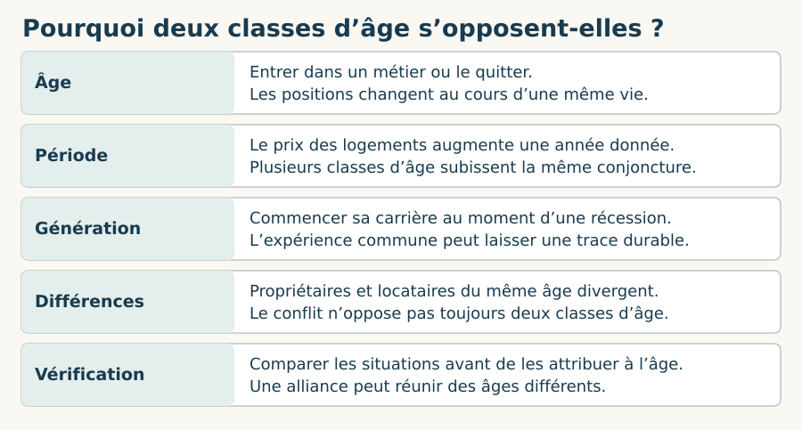
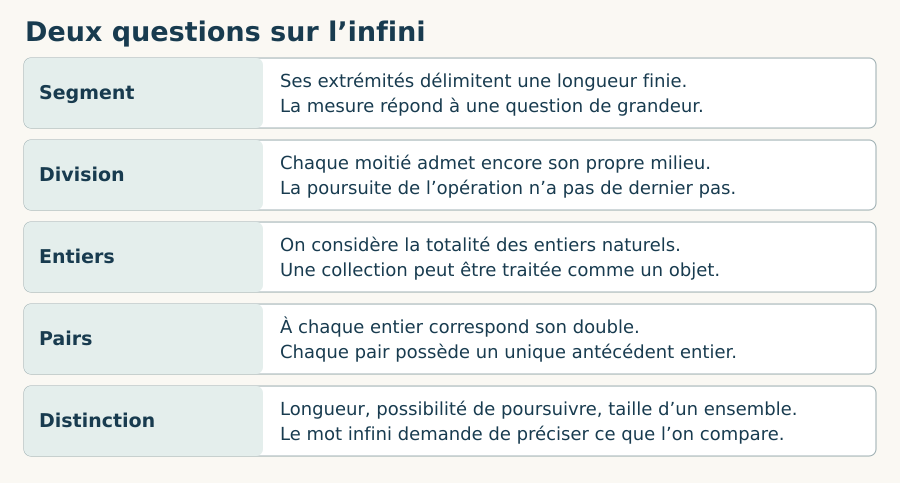

# BEL · AL — Philosophie (oral tronc commun 19 juin) 2026 · Corrigé guidé

*Corrigé rédigé par IA, non officiel. Signalez toute erreur.*

**Rédaction** · GPT-6.2 Astra Ultra · vitesse non renseignée

**Autocontrôle** · GPT-6.2 Astra Ultra · vitesse non renseignée

**Révision** · GPT-6.2 Astra Ultra · vitesse non renseignée

Le [feuillet du 19 juin](https://www.ens.psl.eu/sites/default/files/sujet_oraux_philosophie_19_juin.pdf) contient 11 billets de deux sujets. Les développements suivent leur ordre. Le premier sujet a été choisi sur chacun des 11 billets. Le [rapport du jury](https://www.ens.psl.eu/sites/default/files/2026_al_rapport_oral_philosophie_tc.pdf#page=6) permet de vérifier les choix. Au billet 1, le rapport corrige « encyclopéies » en « encyclopédies ».

Lisez à haute voix les deux sujets du billet puis annoncez votre choix au début de l’exposé. Seul un dictionnaire de langue française est autorisé, à l’exclusion des dictionnaires de noms propres. Pour essayer l’autre sujet, utilisez la question d’entretien et la piste de réponse placées après son développement.

## Préparer les reprises

L’épreuve prévoit 1 h 30 de préparation, une leçon de vingt minutes et un entretien de dix minutes. La feuille du 19 juin numérote onze paires et désigne le premier sujet comme celui choisi. L’annexe du rapport (p. 6–7) confirme les choix en gras et rétablit « encyclopédies » dans la première entrée. Les relances suivantes sont des exercices d’entraînement.

1. **Qu’apporte une encyclopédie de plus qu’une liste alphabétique ?** Une planche d’outils fait saisir les rapports entre les étapes d’un métier et des gestes autrefois peu publiés. Un renvoi permet de rejoindre un autre métier. En travaillant le féminisme, choisir de même une institution concrète dont l’accès a été transformé.
2. **Une prédiction qui se révèle fausse était-elle un mensonge ?** Il faut établir ce que la personne croyait et cherchait à faire croire au moment où elle parlait. L’échec seul ne renseigne pas sur son intention. Pour les animaux, distinguer l’affection réciproque dont on a des signes et les devoirs envers les espèces que l’on ne fréquente pas.
3. **Tous les nouveaux retraités forment-ils une génération politique ?** L’âge commun n’assure ni les mêmes ressources ni l’expérience commune d’un événement formateur. Pour le matérialisme, demander si une dépendance vérifiée entre états du corps et attention suffit à identifier les deux descriptions.
4. **Une limite d’âge arbitraire est-elle nécessairement injuste ?** Une règle de protection peut exiger un seuil public. Il faut en examiner les raisons et les effets, surtout lorsque le seuil donne ou retire une voix. Sur l’État, distinguer la fin de sécurité des moyens juridiquement admissibles pour l’assurer.
5. **En quoi l’assuré a-t-il un droit différent du bénéficiaire d’une faveur ?** La prestation relève de conditions publiques et devient réclamable. Pour le mensonge, décider à qui et dans quelle durée il serait censé ne causer aucune conséquence.
6. **Une pratique ancienne peut-elle être actuelle ?** Oui, si sa reprise éclaire un problème présent qu’une mode récente masque. L’appartenance historique ne dépend pas de la date seule. Pour la religion, repérer ceux que la cérémonie solidarise et ceux pour qui elle signale une séparation.
7. **L’absence de livre est-elle quelque chose qui se trouve sur la table ?** La vérification porte sur l’ensemble des objets présents et leur description. Aucun objet supplémentaire appelé « absence » n’est nécessaire. Pour l’histoire religieuse, distinguer les preuves relatives à une transmission et l’évaluation d’une croyance.
8. **Mon choix est-il libre du seul fait que j’ai prononcé « oui » ?** Il faut encore que le refus soit possible et que je comprenne les conséquences. Pour la mémoire familiale, identifier dans le récit oral le fait qu’une archive collective permet de préciser sans décider à la place du témoin.
9. **Une décision définitive peut-elle rester moralement discutable ?** Sa force juridique règle le litige à un moment donné. La discussion publique peut encore porter sur la règle, ses raisons et son éventuelle réforme. Pour l’infini, distinguer une division que l’on peut poursuivre d’un ensemble infini envisagé comme un tout.
10. **Pourquoi la garantie des droits doit-elle valoir aussi contre l’institution chargée de les protéger ?** Le pouvoir confié à une institution possède des effets réels sur les personnes. Sa finalité publique suppose donc des décisions contrôlables et des recours. Sur le jeu de mots, faire deux phrases distinctes avec « grève » puis montrer l’effet produit par leur rapprochement.
11. **Renoncer à une option équivaut-il à perdre la faculté de choisir ?** Une promesse libre peut retirer une option et permettre une coopération que rien d’autre n’assurait. Examiner sa portée et les possibilités restantes. Sur la poésie, dire ce que la coupe d’un vers fait percevoir qu’un résumé informatif aurait perdu.

## 1. À quoi servent les encyclopédies ?

Chercher le nom d’un instrument et suivre un renvoi vers le métier qui l’utilise sont deux manières très différentes de se servir d’une encyclopédie. Dans le premier cas, l’ouvrage répond à une question que le lecteur savait poser. Dans le second, il lui fait découvrir une relation dont il ignorait jusqu’à l’intérêt. L’*Encyclopédie* dirigée par Diderot et d’Alembert associe ainsi articles, renvois et planches de métiers. Mettre ces pratiques sous les yeux du lecteur change aussi ce qu’une société tient pour un savoir digne d’être transmis.

L’ordre alphabétique rend l’accès commode, mais le simple voisinage des mots ne compose pas une science. Une encyclopédie doit multiplier les chemins et permettre d’identifier l’origine et les limites d’un article. Les choix d’entrée et les lacunes trahissent par ailleurs les hiérarchies de son époque. L’outil sert à s’orienter dans des savoirs que nul ne possède seul et à les soumettre à l’examen commun. Sa valeur se reconnaît autant à la possibilité de corriger et de prolonger une notice qu’au nombre d’informations qu’elle contient.

### Le féminisme

Revendiquer l’égalité suppose-t-il que toutes les femmes vivent une même situation ? L’histoire des droits politiques fait voir un obstacle commun, comme l’exclusion des femmes du suffrage dans la France du début du XXe siècle. Son abolition en 1944 change la qualité de citoyenne, sans supprimer des inégalités de ressources, d’accès aux responsabilités ou de répartition du travail domestique. Le féminisme articule ainsi une exigence d’égale liberté et une enquête sur les mécanismes qui la contrarient. Les différences de classe, d’origine ou de condition familiale transforment la manière de subir ces mécanismes et les moyens disponibles pour les contester. Reconnaître cette pluralité affine l’exigence commune en obligeant à demander de quelle liberté concrète il s’agit, pour qui et à quelles conditions.

**À l’entretien. À quoi sert de proclamer l’égalité si les usages restent les mêmes ?** Comparer l’accès légal à un métier et l’organisation effective du recrutement ou des horaires. Le droit fournit de quoi contester une exclusion. L’enquête sur les pratiques montre quelles conditions manquent encore pour exercer ce droit.

## 2. Mentir

Un enfant décrit une baleine dans la rivière où il vient de voir un bateau. Il peut s’être trompé, jouer avec son interlocuteur ou chercher sérieusement à lui faire croire au passage de l’animal. La fausseté de la phrase est la même dans les trois cas. Mentir se distingue par un rapport à ce que le locuteur tient pour vrai et par une intention de tromper une personne qui peut raisonnablement attendre la sincérité. Une réplique de théâtre ne réclame pas cette confiance de la même façon.

Ce pouvoir de la parole a une dimension morale particulière. Le menteur s’appuie sur une pratique commune de confiance en se réservant le bénéfice d’y faire exception. Kant souligne ce que cette exception ferait perdre à la valeur d’une déclaration si elle devenait la règle. Une difficulté demeure devant une demande intrusive ou injuste. Le droit de garder un secret ne donne pas nécessairement à celui qui interroge un droit à recevoir la vérité. Distinguer se taire, refuser de répondre et affirmer à dessein le faux permet d’examiner les obligations en jeu avant de juger chaque conduite.

### Les animaux sont-ils nos amis ?

Une personne retrouve chaque soir son chien, qui la reconnaît, cherche sa compagnie et modifie sa conduite selon son état. Appeler cette relation « amitié » rend justice à une histoire partagée et à une attention réciproque. Elle demeure néanmoins asymétrique. L’humain décide des conditions de vie de l’animal et peut projeter ses attentes sur des comportements dont il méconnaît le sens. La formule devient plus difficile encore à l’échelle de tous les animaux. Une espèce sauvage n’a pas à entrer dans une relation familière pour mériter une protection. L’amitié nomme donc justement certaines relations singulières si l’on tient compte des besoins propres de l’autre vivant. Elle fournit un motif de sollicitude, sans constituer la condition de toutes nos obligations envers les animaux.

**À l’entretien. La gentillesse d’un animal suffit-elle à en faire un ami ?** Deux animaux peuvent rechercher la même nourriture sans manifester de préférence l’un pour l’autre. Chercher un signe de reconnaissance durable entre individus. Demander ensuite quelle réciprocité est possible entre un animal et la personne qui dépend de sa compagnie.

## 3. Pourquoi des conflits de générations ?

Deux personnes séparées par quarante ans discutent du prix des loyers. Si l’on répond qu’elles s’opposent parce que l’une est jeune et l’autre âgée, on répète le constat. Il faut distinguer l’effet de l’âge, celui de l’époque et celui d’une position historique commune. On commence et on termine une vie professionnelle avec des intérêts susceptibles de différer. Une même hausse des loyers touche pourtant aussi les personnes âgées qui ne possèdent pas leur logement.

Dans *Le Problème des générations*, Mannheim distingue la situation liée à une année de naissance de la participation effective à une expérience historique partagée. Une crise économique, une réforme scolaire ou un nouveau média n’atteignent pas tout le monde de la même façon. Les différences d’époque peuvent néanmoins produire des désaccords durables lorsque les institutions et les ressources auxquelles les uns ont eu accès deviennent hors d’atteinte des autres. On comprend les conflits de générations en examinant ces expériences et ces distributions concrètes. L’explication reste incomplète si elle fait disparaître les alliances entre âges et les oppositions à l’intérieur d’une même génération.

### Le matérialisme

Le mot dénonce parfois un goût excessif pour l’acquisition de biens. Le matérialisme philosophique pose une question différente, celle de savoir si des réalités matérielles suffisent à rendre compte de ce qui existe. Un changement de l’attention après une nuit sans sommeil atteste une dépendance entre une capacité mentale et des conditions corporelles. Cette dépendance ne suffit pourtant pas à prouver que tout énoncé sur une raison d’agir puisse être remplacé par une description de l’état cérébral. Les explications peuvent porter sur des niveaux différents sans postuler deux substances indépendantes. Un matérialisme défendable doit exposer le passage entre ses observations et sa thèse générale. Il doit aussi expliquer comment la pensée, l’expérience et le jugement trouvent place dans la nature dont il soutient l’unité.

**À l’entretien. Peser un livre revient-il à en expliquer le sens ?** Les mêmes phrases imprimées sur deux papiers de poids différent gardent leur sens. Le matérialiste doit expliquer comment une organisation matérielle peut porter une signification, au-delà de la seule mesure de masse.

## 4. La jeunesse

Une limite d’âge décide de l’accès à une prestation. Celle qui vient de la franchir ne s’est pas soudain transformée pendant la nuit. La jeunesse est-elle donc une fiction administrative ? Il existe bien des transformations du corps, des expériences nouvelles et une dépendance économique plus fréquente à certains âges. Mais aucune ne définit à elle seule un groupe homogène. Un adolescent déjà au travail et un étudiant plus âgé peuvent porter des responsabilités très différentes.

Dans « La jeunesse n’est qu’un mot », Bourdieu interroge la construction sociale des frontières entre les âges et les luttes qui en déterminent les effets. Le mot peut offrir une protection et un temps d’apprentissage. Il peut également servir à différer la prise de parole de personnes déclarées insuffisamment mûres. On gagne donc à traiter la jeunesse comme une position dans un parcours dont les seuils dépendent d’institutions et d’histoires particulières. Reconnaître cette construction n’efface pas l’expérience vécue de grandir. Cela empêche de lui attribuer d’avance un tempérament politique ou moral commun.

### L’État se contente-t-il d’assurer la sécurité ?

Le risque que les conventions soient sans effet en l’absence d’un pouvoir commun aide à comprendre la place de la sécurité dans le *Léviathan* de Hobbes. Sans sûreté prévisible, personne ne peut aisément investir dans une entreprise ou compter sur une promesse. Assurer cette condition exige déjà des règles publiques, des tribunaux et des garanties contre l’arbitraire. Un ordre qui supprimerait les libertés au nom de la tranquillité pourrait protéger contre certains risques tout en en créant d’autres. Les citoyens demandent aussi que le pouvoir rende possibles l’éducation, la participation aux décisions ou la protection sociale. On peut discuter l’étendue de ces attributions. La sécurité explique l’une des raisons de constituer un État et ne tranche pas, à elle seule, ce qu’un pouvoir commun a le droit ou le devoir d’entreprendre.

**À l’entretien. Un État qui protège chacun contre les agressions a-t-il accompli toute sa tâche ?** Imaginer une ville parfaitement sûre où certains habitants sont exclus du vote. La sécurité rend possible une vie commune. La situation laisse ouverte la question de savoir qui participe à la définition de ses règles.

## 5. La solidarité

Dans une caisse d’assurance, certaines personnes reçoivent aujourd’hui beaucoup plus qu’elles n’ont versé, d’autres ne retirent presque rien durant des années. On ne comprendrait guère l’institution comme une série de cadeaux personnels. Une règle durable met en commun un risque et crée des droits même entre des gens qui ne se rencontreront jamais. La solidarité se distingue ici de la générosité ponctuelle par la manière dont elle distribue des obligations.

Pourtant, toute dépendance mutuelle n’est pas solidaire au sens moral. Deux travailleurs peuvent dépendre l’un de l’autre tout en étant opposés par une répartition profondément injuste des gains. La distinction de Durkheim entre solidarités mécanique et organique éclaire les liens que produisent respectivement similitudes et division des tâches. Elle laisse ouverte la question de la justice des institutions qui règlent ces liens. La solidarité consiste alors à reconnaître une interdépendance et à lui donner une forme dans laquelle chacun peut compter sur le concours des autres. Elle se juge à l’étendue des garanties, à leur mode de financement et à ceux qui restent exclus.

### Y a-t-il des mensonges sans conséquences ?

Un rendez-vous annoncé à tort est rectifié avant que quiconque ait pris la route. La conséquence redoutée n’a pas eu lieu. En conclure que le mensonge n’a eu aucun effet demande de déterminer un domaine et une durée d’observation. La personne qui l’a reçu a pu dépenser du temps à vérifier, ou n’avoir effectivement jamais ouvert le message. Pour le menteur lui-même, le choix d’abuser de la confiance a eu lieu même si la tentative échoue. La distinction entre résultat, tentative et disposition morale permet de poser la bonne question. Certains mensonges ne causent aucun dommage repérable à leur destinataire. Cela ne suffit pas à garantir qu’ils soient sans toute conséquence possible ni à juger la décision de tromper uniquement d’après la chance qu’elle a eue de rester sans effet visible.

**À l’entretien. Si personne ne découvre le mensonge, qu’a-t-il changé ?** Une excuse inventée peut être oubliée tout en ayant privé son destinataire d’un choix éclairé. Distinguer le dommage visible, la modification de la décision et l’habitude que prend celui qui ment.

## 6. Qu’est-ce qu’être de son temps ?

Tout individu est le contemporain des événements qui ont lieu durant sa vie. Pourtant, on dit d’une œuvre qu’elle est « de son temps » lorsqu’elle rend sensible une expérience jusque-là mal nommée. L’expression dépasse donc la datation. Elle peut recommander d’adopter une nouveauté et reprocher à quelqu’un un prétendu retard. Mais suivre la pratique majoritaire du moment suffit-il à comprendre sa propre époque ?

Une romancière qui refuse une convention en vogue peut rendre plus visibles les attentes que cette convention imposait aux lecteurs. L’écart lui-même devient alors une façon d’appartenir activement à son temps. Dans la deuxième *Considération inactuelle*, Nietzsche se demande à quelles conditions le rapport à l’histoire sert ou encombre la vie présente. Se décaler par rapport aux habitudes de son époque peut aider à isoler ce qui les fait passer pour nécessaires. Être de son temps au sens fort revient à répondre de possibilités et de problèmes historiquement situés. Cette réponse inclut parfois la reprise d’une forme ancienne ou la contestation d’une mode actuelle.

### Religion et lien social

Lors d’une fête religieuse, un groupe se rassemble dans un calendrier commun et reconnaît publiquement certains engagements. Durkheim, dans *Les Formes élémentaires de la vie religieuse*, rend intelligible l’importance des pratiques qui font éprouver au groupe sa propre existence. Cette analyse explique une dimension de la religion sans épuiser ce que croit chaque participant ni régler la vérité des croyances. La même institution peut aussi marquer une frontière, exclure un membre ou devenir l’objet d’une controverse. Inversement, des personnes de religions différentes peuvent partager des institutions civiles et des solidarités ordinaires. La religion organise donc certains liens, selon des formes à décrire. Elle ne se confond pas avec tout ce qui unit une société et ne produit pas nécessairement la même intégration pour chacun.

**À l’entretien. Une fête religieuse rassemble-t-elle tout le monde de la même façon ?** Comparer l’accueil du voisin venu en visite et les obligations du membre de la communauté. Un rite peut produire une solidarité interne tout en marquant une frontière. Nommer à chaque fois ceux que le lien réunit.

## 7. Le non-être

« Il n’y a pas de livre sur la table » semble parler avec précision de ce qui n’est pas. Si le non-être n’est rien, comment le discours peut-il le viser ? Et si l’on en fait une chose logée quelque part, ne lui a-t-on pas déjà accordé l’être que le terme refuse ? Le problème se desserre dès que l’on distingue l’absence d’un objet attendu, la négation d’un prédicat et l’idée d’un néant absolu.

Dans le *Sophiste* de Platon, l’Étranger examine la possibilité de penser le non-être comme autre. Dire qu’une ligne n’est pas rouge attribue une différence par rapport à la couleur rouge, sans enlever à la ligne toute réalité. Dire qu’il n’y a aucun livre sur la table demande d’examiner une situation dans laquelle aucun objet ne répond à la description. Dans aucun des deux cas il n’est nécessaire de rencontrer une chose qui serait le non-être. Il reste possible de poser la question métaphysique d’une absence de tout. L’analyse des négations ordinaires montre pourquoi l’on ne peut tirer cette idée de la seule grammaire du mot « rien ».

### Que nous apprend l’histoire des religions ?

Un édifice change d’usage, un calendrier s’impose à un territoire, une formule rituelle se traduit dans une langue nouvelle. Ces traces enseignent comment des croyances sont transmises, instituées et transformées, parfois par des conflits ou des emprunts que la mémoire de la communauté a simplifiés. Elles permettent aussi de corriger la projection de nos catégories. Une séparation contemporaine entre « religieux » et « politique » ne se retrouve pas à l’identique à toute époque. Quelqu’un qui croit peut apprendre cette historicité de sa propre tradition, comme celui qui ne croit pas peut apprendre ce que les pratiques ont signifié pour leurs participants. Le passage d’une explication historique de la transmission à un jugement sur la vérité d’une croyance réclamerait toutefois un argument supplémentaire.

**À l’entretien. Une explication historique d’une croyance réfute-t-elle cette croyance ?** La datation d’un rite explique sa transmission et ses transformations. Elle fournit parfois une objection à un récit sur son origine. Elle ne tranche pas à elle seule toutes les affirmations auxquelles ce rite donne un sens.

## 8. Puis-je faire ce que je veux de mon corps ?

Je peux choisir de porter mes cheveux autrement. Il y a là une possibilité physique et une liberté de décider de mon apparence. Le même sujet pose une difficulté plus profonde si « mon corps » désigne une propriété analogue à un livre dont je pourrais me séparer. C’est avec ce corps que je parle, pense, travaille et formule la volonté que le possessif semble autoriser à commander. Mon rapport à lui n’est donc pas un rapport extérieur de propriétaire à chose.

Cette différence fonde une forte exigence de consentement. Nul ne peut, pour son confort ou pour une préférence esthétique, prendre ma décision à ma place. Elle fait aussi apparaître les conditions d’une volonté libre. La pression d’un employeur, une information insuffisante ou la difficulté de faire respecter un refus modifie le jugement que l’on peut porter sur une prétendue autorisation. Enfin, des gestes corporels ordinaires ont parfois des effets sur les droits d’autrui. Le sujet conduit ainsi à distinguer pouvoir agir, être titulaire d’un droit et pouvoir décider sans contrainte. L’autonomie corporelle s’exerce avec des protections qui la rendent effective.

### Histoire personnelle et histoire collective

Dans un récit familial, un changement de ville peut apparaître comme la décision soudaine d’un parent. Les archives d’un bassin industriel révèlent que plusieurs ateliers fermaient à la même date. Ce rapprochement replace la décision dans un ensemble de possibilités sans déduire la destination choisie de la seule conjoncture. Réciproquement, la lettre de la famille donne à voir une expérience du déplacement que les statistiques de l’emploi ne conservent pas. Halbwachs montre dans ses travaux sur la mémoire collective que les groupes fournissent aussi les cadres dans lesquels un souvenir personnel se reconstruit. On gagne à confronter témoignages et archives dans les deux sens. Le mouvement collectif n’est pas la somme de souvenirs privés, et l’existence singulière ne se réduit pas à l’illustration d’une force générale.

**À l’entretien. Un souvenir de famille constitue-t-il une source d’histoire collective ?** Une photographie peut attester un lieu de travail et orienter vers des archives. La mémoire de son propriétaire éclaire l’expérience vécue. Il faut comparer d’autres traces avant d’étendre cette expérience à toute une génération.

## 9. Qui dit le juste ?

Un tribunal décide à qui revient un bien disputé. La décision s’impose dans les conditions prévues par le droit. Faut-il en conclure que le jugement a rendu juste ce qu’il a déclaré ou que la justice était accessible avant et indépendamment de toute décision ? La première réponse empêche de reconnaître un jugement injuste. La seconde minimise le travail nécessaire pour établir les faits, interpréter une règle et rendre des prétentions incompatibles effectivement arbitrables.

Aristote, au livre V de l’*Éthique à Nicomaque*, examine l’équitable comme une correction de ce que la généralité de la loi peut manquer dans un cas singulier. Dire le juste exige donc des raisons susceptibles d’être exposées à ceux qu’elles engagent. Un juge reçoit l’autorité de trancher et de motiver publiquement. Un citoyen lésé, un législateur ou une association peuvent aussi faire reconnaître qu’une règle ignore une situation pertinente. La compétence de décider et la capacité de formuler une raison de justice ne sont pas identiques. Une institution devient plus juste quand elle les articule et qu’elle permet de reprendre, par des voies définies, une décision contestable.

### Le fini et l’infini

Un segment possède deux extrémités et une longueur déterminée. On peut toutefois y choisir un milieu, puis le milieu de l’une des moitiés, sans rencontrer une dernière division prescrite par la géométrie. Le fini selon la longueur peut ainsi être indéfiniment divisible. Aristote éclaire ce type de cas par l’idée d’un infini en puissance, la possibilité de poursuivre une opération. Il faut le distinguer de la considération d’un ensemble infini comme totalité, par exemple celui des entiers naturels en mathématiques. Associer à chaque entier son double établit une correspondance terme à terme avec les entiers pairs, bien que ceux-ci ne remplissent qu’une partie du premier ensemble. Ces exemples précisent sous quel rapport une grandeur est bornée et en quel sens une opération ou une collection peut être dite infinie.

**À l’entretien. Ajouter toujours une unité produit-il un nombre qui serait le dernier ?** Partir de n’importe quel entier et montrer qu’on peut en former le suivant. On établit ainsi l’absence de dernier terme. Demander ensuite ce qu’ajoute l’idée de considérer la suite entière comme un objet.

## 10. À quoi sert la police ?

Répondre « à faire respecter les règles » laisse ouverte la question principale. Pourquoi la collectivité confie-t-elle ce pouvoir à une institution, et à quelles conditions sert-il effectivement le public ? Une personne qui signale une disparition doit pouvoir s’adresser à un service chargé de recueillir les faits et de protéger les personnes. Le bénéfice dépend de la continuité du service et de l’égalité avec laquelle il traite les demandes, y compris celles de personnes sans influence.

L’article 12 de la Déclaration des droits de l’homme et du citoyen de 1789 rattache la force publique à la garantie des droits et à l’avantage de tous. Un pouvoir organisé à cette fin peut cependant être détourné au profit de ses détenteurs. Apprécier sa fonction requiert donc de distinguer les missions, leurs résultats et les règles qui permettent d’en répondre devant la loi. La protection des droits comprend des garanties pour les personnes qui sollicitent le service et pour celles que son intervention concerne. La finalité publique se vérifie dans la possibilité pour toutes de demander compte des décisions qui les touchent.

### Le jeu de mots

« La grève s’étend sur la grève » réunit dans la même phrase un mouvement de cessation du travail et une étendue de rivage. Le lecteur doit momentanément maintenir deux sens du même son, puis les distribuer selon le contexte. Une telle surprise montre comment l’usage ordinaire sélectionne le sens si vite que nous oublions son ambiguïté possible. Un jeu de mots peut éclairer une question en rapprochant deux expressions ou montrer que deux interlocuteurs emploient un terme selon des règles différentes. Il peut également faire croire abusivement que deux réalités partagent une propriété parce qu’elles sont désignées de la même manière. Sa fécondité philosophique commence avec la surprise et dépend ensuite de la capacité à reconstruire, au-delà de la sonorité, une relation que des raisons peuvent soutenir.

**À l’entretien. Pourquoi un jeu de mots se traduit-il parfois si mal ?** Faire varier le son tout en conservant le sens littéral. Si le second sens disparaît, le rapprochement phonétique faisait partie de ce qui était dit. Une traduction inventive cherchera éventuellement un autre rapprochement.

## 11. Peut-on perdre sa liberté ?

Un contrat de travail m’engage pour certaines heures. Je ne peux plus les employer exactement comme auparavant, mais le revenu obtenu peut élargir le reste de mes choix. Toute limitation n’est donc pas une perte de liberté au même sens. Il faut distinguer l’option particulière que l’on abandonne, la possibilité de revenir sur un engagement et le statut qui permet encore de décider ou de contester.

Une captivité prive effectivement de la liberté d’aller et venir. Lui opposer trop vite une liberté intérieure invulnérable ferait disparaître la gravité de cette privation. On peut néanmoins conserver ou recouvrer des facultés de juger et de se déterminer dans des conditions très contraintes. Lorsque Rousseau examine au livre I du *Contrat social* l’idée d’une renonciation totale à la liberté, il met au jour une difficulté de principe. Comment une décision pourrait-elle encore obliger comme consentement si elle supprime pour toujours le sujet capable d’approuver ? On peut donc perdre des libertés réelles, parfois d’une manière radicale. Leur défense suppose des droits et des institutions autant que le travail personnel du jugement.

### L’utilité de la poésie

Un poème qu’on se rappelle plusieurs années après sa lecture n’a peut-être transmis aucune information que l’on aurait pu relever dans un manuel. Pourtant, sa coupe ou la reprise d’un son a rendu perceptible une hésitation qu’une description abstraite nommait mal. La poésie peut transformer notre attention aux mots et aux expériences qu’ils permettent de partager. Elle peut aussi constituer une mémoire commune ou changer la manière de prendre la parole dans une circonstance publique. Lui demander de justifier chaque vers par un bénéfice décidé à l’avance menacerait toutefois cette puissance d’invention. La poésie a des usages réels, parfois imprévus. L’un d’eux consiste précisément à suspendre pour un moment la demande d’efficacité immédiate qui organise d’autres emplois du langage.

**À l’entretien. Un poème sans message pratique peut-il transformer une situation ?** Une élégie peut donner une forme partageable à un deuil sans le résoudre. Préciser le critère employé pour juger de son utilité et demander ce que la diction apporte qu’un avis pratique ne procurerait pas.
