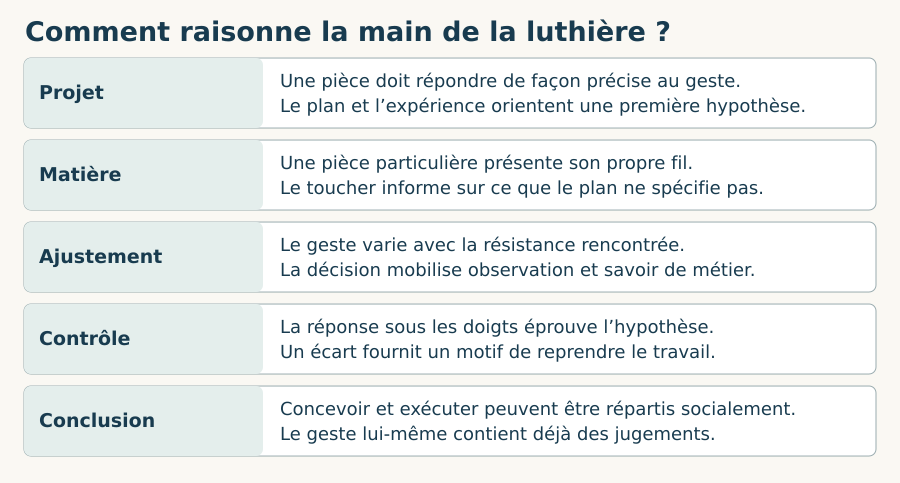
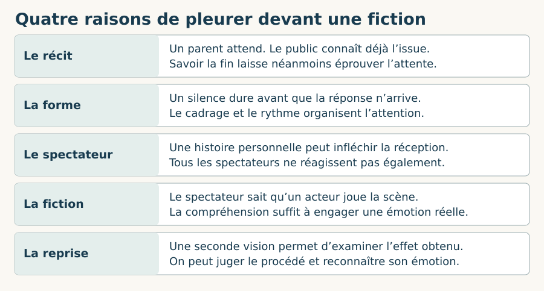

# BEL · AL — Philosophie (oral tronc commun 20 juin) 2026 · Corrigé guidé

*Corrigé rédigé par IA, non officiel. Signalez toute erreur.*

**Rédaction** · GPT-6.2 Astra Ultra · vitesse non renseignée

**Autocontrôle** · GPT-6.2 Astra Ultra · vitesse non renseignée

**Révision** · GPT-6.2 Astra Ultra · vitesse non renseignée

Le [feuillet du 20 juin](https://www.ens.psl.eu/sites/default/files/philosophie_20_juin_tronc_commun.pdf) contient 12 billets de deux sujets. Les développements suivent leur ordre. Le premier sujet a été choisi sur chacun des 12 billets. Le [rapport du jury](https://www.ens.psl.eu/sites/default/files/2026_al_rapport_oral_philosophie_tc.pdf#page=7) permet de vérifier les choix.

Lisez à haute voix les deux sujets du billet puis annoncez votre choix au début de l’exposé. Seul un dictionnaire de langue française est autorisé, à l’exclusion des dictionnaires de noms propres. Pour essayer l’autre sujet, utilisez la question d’entretien et la piste de réponse placées après son développement.

## S’exercer aux dix minutes d’entretien

Le feuillet énumère douze paires sans désigner leur terme retenu. La page 7 du rapport place chaque premier intitulé en gras, selon sa convention pour les sujets choisis. Le jury prévoit 1 h 30 de préparation et vingt minutes d’exposé, suivies de dix minutes de dialogue. Les relances proposées dans ce guide exercent à reprendre une distinction avec un exemple.

1. **Peut-on tirer profit d’une critique dont on refuse le verdict ?** Oui, si sa description rend visible un rapport qu’on peut apprécier autrement. Pour le second sujet, distinguer la souffrance et l’hypothèse métaphysique d’une substance du mal.
2. **Où une opération de pensée entre-t-elle dans le travail de la luthière ?** Le geste éprouve une hypothèse sur l’épaisseur et la réponse du matériau. Sur les animaux, indiquer qui subirait le dommage même en l’absence de tout observateur humain.
3. **Pourquoi ne pas se fier immédiatement à une colère juste ?** L’atteinte qui l’a suscitée peut être réelle et l’accusation se tromper de destinataire. Pour l’anarchie, différencier absence de chef permanent et absence de procédure pour traiter les désaccords.
4. **La contestation a-t-elle une place dans une morale civique ?** Oui, si elle réclame des raisons et traite les autres comme des membres égaux du corps politique. Pour le roman, faire remarquer comment un changement de narrateur modifie la compréhension d’un silence.
5. **Le rire de tous rend-il une plaisanterie légitime ?** La personne visée peut rire pour éviter l’exclusion. Demander qui pouvait réellement refuser le jeu. Pour la critique sociale, faire apparaître la norme de justice ajoutée au constat statistique.
6. **Faut-il un adversaire pour faire du sport ?** Une épreuve de progression corporelle peut se régler sur ses propres performances. Pour l’inconscient collectif, mettre en regard une interprétation par la transmission sociale et l’hypothèse plus forte d’un archétype.
7. **À quoi sert de connaître la destination première d’un retable ?** Elle explique la relation d’échelle entre des panneaux que le musée a pu disperser. Pour l’abolition du travail, vérifier si la tâche a disparu ou si elle a simplement été déplacée sur une autre personne.
8. **Les larmes n’impliquent-elles pas que le spectateur croit à l’histoire ?** Il comprend la situation et y prête attention sans croire à l’existence actuelle du personnage. Pour la loi, distinguer une égalité de règle d’une possibilité égale d’en faire usage.
9. **Une origine religieuse de ma conviction empêche-t-elle d’en donner une raison commune ?** L’histoire d’un motif et la justification d’un jugement sont distinctes. Pour l’œuvre ratée, demander comment une seconde écoute pourrait transformer un défaut supposé en choix intelligible.
10. **Peut-on constater une domination un jour où personne ne subit une contrainte visible ?** Oui, en examinant le pouvoir durable d’imposer les conditions d’action et l’absence de recours. Pour le corps propre, partir d’un geste familier que la fatigue rend soudain perceptible.
11. **Pourquoi imiter peut-il déjà demander d’inventer ?** Rendre une cadence reconnaissable sur un autre instrument oblige à reconstruire certains rapports. Pour l’histoire, nommer la règle jadis différente dont on peut rouvrir la discussion aujourd’hui.
12. **Une œuvre sans opinion politique déclarée peut-elle agir politiquement ?** Le choix de confier une voix à une personne jusque-là réduite au silence transforme les conditions du visible et de l’audible. Pour l’oubli, distinguer l’abandon d’une répétition stérile du refus de reconnaître des effets qui durent.

## 1. La critique d’art

Une critique écrit que le personnage placé tout au bord d’un tableau fait basculer le regard vers un espace que le cadre coupe. Même un lecteur qui ne partage pas son enthousiasme peut revenir à l’œuvre et éprouver cette description. Si elle s’était contentée d’annoncer une note sur dix, il aurait appris son verdict sans disposer du chemin qui y conduit. Critiquer n’est donc pas seulement classer. L’activité associe une description réglée, une interprétation et une prise de position dont quelqu’un d’autre peut discuter les raisons.

Dans ses *Salons*, Diderot doit rendre présentes à des lecteurs éloignés des œuvres qu’ils n’ont pas devant eux. Cette situation souligne la puissance et la limite de la critique. Les mots orientent l’attention vers une relation visible, mais ils peuvent aussi substituer leur propre récit à l’expérience du tableau. Une bonne critique ouvre un trajet de vérification, précise sous quel rapport l’œuvre réussit ou échoue et laisse la rencontre avec elle modifier le verdict initial. Son autorité est ainsi toujours remise en jeu par l’objet qu’elle donne à regarder.

### Le mal existe-t-il ?

Il suffit de rappeler une douleur injustement infligée pour sentir combien une réponse négative risquerait de paraître indifférente aux victimes. Mais reconnaître la réalité de la souffrance oblige-t-il à faire du mal une substance qui existerait comme un objet ? Augustin analyse le mal comme privation d’un bien dû. Une promesse trahie a des effets fort réels, sans qu’il faille supposer qu’une « chose mauvaise » s’est ajoutée à une relation. C’est la fidélité légitimement attendue qui lui fait défaut. Cette analyse éclaire la différence entre le fait d’une atteinte et la manière de concevoir son existence. Il reste à distinguer une souffrance naturelle et un tort moral, qui engage un jugement sur une conduite. Parler du mal a un sens déterminé lorsqu’on peut dire quel bien a été atteint et quelle responsabilité est en jeu.

**À l’entretien. Peut-on montrer le mal comme on montre un objet ?** Comparer une blessure, que l’on peut examiner, et la trahison dont elle est la conséquence. L’évaluation porte sur une action et une relation. L’absence d’un objet appelé « le mal » ne fait pas disparaître le tort.

## 2. Travail manuel, travail intellectuel

Une luthière ajuste l’épaisseur d’une pièce de bois et vérifie sa réponse sous les doigts. L’étudiant qui produit une démonstration pose des signes sur une page, rature un essai et déplace une figure. L’un pense dans un geste, l’autre raisonne grâce à des inscriptions matérielles. La différence entre travail manuel et intellectuel n’est donc pas une séparation entre mouvements sans pensée et pensée sans corps.

Elle peut désigner avec précision des exigences distinctes d’un travail, puis une division sociale des tâches. Sur un chantier, confier la conception d’un plan à une équipe et son exécution à une autre distribue la décision, la responsabilité et souvent le prestige. L’ouvrier qui repère une incompatibilité voit alors quelque chose que le dessinateur ne pouvait apercevoir sur la feuille. La hiérarchie des titres peut faciliter la coordination ou disqualifier à tort cette connaissance. Distinguer les travaux garde son intérêt si l’on suit leurs opérations effectives. En faire une hiérarchie de capacités humaines méconnaît le travail mental du geste autant que les conditions matérielles de la pensée.

### Avons-nous des devoirs envers les animaux ?

Un chien confié à quelqu’un a besoin d’eau même si aucun humain ne verra ce qui se passe. L’obligation semble tenir à ce qui peut arriver à l’animal lui-même. Bentham demande de considérer la capacité de souffrir lorsqu’on détermine qui compte moralement. Cette considération n’attribue pas à toutes les espèces les mêmes besoins. Elle exige justement de connaître leurs manières de vivre et les dépendances que les humains ont créées. S’abstenir de faire souffrir, soigner un animal sous sa garde et préserver un milieu sont des obligations de portée différente. Elles peuvent être discutées lorsque des intérêts s’opposent. Leur raison ne se réduit pourtant pas à protéger les sentiments des observateurs ou la valeur marchande d’une propriété.

**À l’entretien. Une obligation envers un animal dépend-elle de ce que son propriétaire ressent ?** Imaginer un animal sans propriétaire en détresse. Si sa souffrance compte encore dans la décision, le devoir possède un destinataire différent de l’entourage humain. Reste à préciser quelles capacités et quels besoins nous obligent.

## 3. Que faire de nos passions ?

Une colère me fait remarquer une injustice dont je supportais la répétition. La même colère peut m’amener à accuser à tort la première personne disponible. Comment en conserver le discernement possible sans lui laisser fixer le verdict ? La question demande ce que nous pouvons faire d’un mouvement que nous ne choisissons pas de subir à son apparition.

Dans les *Passions de l’âme*, Descartes examine comment les représentations et les habitudes peuvent modifier indirectement le cours des passions. Un ordre adressé à la colère ne la dissipe pas toujours. Reconstituer les faits, entendre une autre version et retarder une décision transforment en revanche la situation à laquelle elle répond. Une passion comporte par ailleurs une évaluation, explicite ou confuse, de ce qui importe. La réduire d’avance à un bruit qu’il faudrait supprimer ferait perdre une information sur nos attachements. On peut apprendre à l’interpréter, à lui donner une expression compatible avec l’examen et à changer les habitudes qui l’exacerbent. La maîtrise visée est cette capacité de reprise, non la prétention à n’être jamais affecté.

### L’anarchie

Une bibliothèque autogérée peut décider collectivement des horaires et confier les comptes à des responsables révocables. L’absence de chef permanent n’y équivaut pas à l’absence de règles. L’anarchie comme thèse politique examine la possibilité d’une coopération sans pouvoir souverain imposé d’en haut. Son problème propre commence lorsque les décisions engagent durablement des personnes en désaccord. Comment répartir les tâches, limiter les emprises informelles et organiser un recours sans rétablir une autorité incontrôlable ? Le sens ordinaire de désordre général décrit l’échec possible d’une coordination. Il ne suffit pas pour réfuter l’hypothèse. On la juge en examinant les formes concrètes d’association, leur capacité à faire respecter des garanties et la place qu’elles laissent à la dissidence.

**À l’entretien. La disparition d’un chef suffit-elle à établir l’anarchie ?** Observer une association qui décide en assemblée. Elle peut se passer d’un chef permanent tout en ayant des règles et des procédures exigeantes. Distinguer la contestation de la domination et l’effondrement de toute coordination.

## 4. La morale du citoyen

Une déclaration fiscale sincère et une voix donnée à un candidat honnête peuvent toutes deux relever d’une morale civique. Obéir à la loi et contribuer à déterminer quelles lois doivent exister sont pourtant deux actes distincts. Le citoyen est à la fois soumis aux règles communes et, dans une démocratie, membre du corps qui peut les modifier. Que lui demande cette double position lorsqu’il estime qu’une règle est injuste ?

Se croire dispensé de toute obligation dès qu’on se sait en désaccord détruirait la réciprocité dont dépendent les droits des autres. Mais une docilité absolue réduirait la citoyenneté à la seule qualité de sujet obéissant. La morale civique comporte donc un devoir de s’informer, de motiver ses choix par des raisons discutables publiquement et de reconnaître les droits de ses contradicteurs. Elle permet aussi de contester une institution selon des voies qui rendent la revendication intelligible à ceux qu’elle touche. On ne mesure pas la vertu du citoyen à la fréquence de son accord avec les gouvernants, mais à la manière dont il répond, avec d’autres, des conditions d’une vie politique commune.

### Pourquoi lire des romans ?

Le récit peut faire percevoir la même conversation depuis deux consciences pour lesquelles un silence n’a pas du tout la même signification. Cette expérience ne rend pas le lecteur omniscient dans la vie réelle. Elle lui fait éprouver la fragilité des attributions d’intention dont il use ordinairement. On lit aussi pour les plaisirs d’une voix, pour la construction d’un monde et parfois pour s’évader. Ces fins ne se ramènent pas à une leçon morale obligatoire. Un roman peut conforter des préjugés tout comme il peut les déranger. Il apprend quelque chose de singulier quand sa forme conduit à suivre les conséquences d’une perspective et à la reprendre autrement, sans réduire les personnages à des exemples déjà expliqués d’avance.

**À l’entretien. Pourquoi relire un roman dont on connaît la fin ?** À la seconde lecture, un détail banal devient l’indice d’une décision future. La valeur de l’expérience tient aussi à une manière de suivre des raisons, des attentes et des voix, même quand la surprise a disparu.

## 5. L’humour

Un conférencier dont les notes tombent en désordre annonce qu’il vient de modifier l’ordre des parties. Le public connaît la cause de l’incident et comprend que personne ne cherche à la lui dissimuler. Une seconde description, manifestement décalée, transforme le rapport à la gêne. L’humour demande cette coopération de l’auditeur, qui entend à la fois ce qui est dit et le sérieux que l’on suspend.

Il ne suffit cependant pas d’avoir fait rire pour qu’un propos échappe au jugement moral. Le conférencier assume lui-même le coût de la plaisanterie. Un orateur pourrait obtenir le même éclat de rire en assignant quelqu’un d’autre à une position humiliante dont il ne pourrait sortir. Il faut donc examiner qui parle, qui est autorisé à répondre et ce que la distance comique permet de voir. L’humour peut rendre habitable un échec ou dégonfler une prétention en invitant quelqu’un à partager un changement d’échelle. Son emploi devient contestable lorsque la demande de rire empêche justement de nommer un tort.

### Connaissance de la société et critique de la société vont-elles de pair ?

Comparer deux taux de réussite scolaire selon l’origine sociale révèle un écart que les trajectoires individuelles isolées peuvent masquer. La connaissance sociologique rend ici une critique possible. Elle n’en établit pas seule toutes les prémisses. Il faut encore dire à quel titre l’écart est injuste et examiner les mécanismes qui le produisent au lieu de prendre une corrélation pour une explication complète. Inversement, l’expérience d’une injustice peut conduire un enquêteur vers un phénomène négligé. Sa conviction ne l’autorise pas à écarter un résultat contraire à son attente. Connaître et critiquer se fécondent donc lorsque question normative, construction des données et épreuve des hypothèses restent distinctes et publiquement discutables. Leur alliance ne se réalise pas de façon automatique.

**À l’entretien. Un chiffre sur une inégalité constitue-t-il déjà une critique ?** Décrire un écart de revenu, en chercher les mécanismes, puis dire en vertu de quelle exigence on le juge injuste. La critique a besoin de connaissances et rend explicite une norme que la mesure ne contient pas à elle seule.

## 6. Le sport

Deux personnes courent le même kilomètre. La première veut prendre son train, la seconde s’entraîne pour une course. Le mouvement du corps ne suffit pas à faire du second trajet un exercice sportif. Un but réglé oriente l’effort, rend une performance comparable et permet d’en reprendre la progression. La gymnastique de loisir ou l’escalade pratiquée sans compétition officielle montrent aussi que le classement public n’est pas indispensable.

La règle fait apparaître des habiletés qui n’existeraient pas de la même façon hors d’elle. Couvrir cent mètres au départ d’un signal donne sens au chronomètre et aux conditions comparables. Ces règles distribuent aussi des possibilités de participer. Dans le sport en fauteuil, classes de compétition, matériel et apprentissages transforment ce qui compte comme performance comparable. Une victoire mesure une réussite dans une épreuve définie, elle ne mesure pas la valeur générale des personnes. Le sport est ainsi une pratique organisée de mise à l’épreuve de capacités corporelles, dont les formes de plaisir, de coopération et d’égalité dépendent des institutions et règles qui la rendent possible.

### Y a-t-il un inconscient collectif ?

Plusieurs personnes reproduisent une règle de distance ou de politesse sans savoir en énoncer l’histoire. On tient là une influence collective qui échappe en partie à la conscience individuelle. A-t-on pour autant découvert une seule psyché commune à tous les membres du groupe ? Jung donne à l’inconscient collectif un sens plus fort en postulant des formes psychiques universelles, les archétypes. Constater des rites ou des motifs semblables dans plusieurs sociétés ne prouve pas à soi seul cette hypothèse. Des transmissions, des apprentissages et des problèmes analogues peuvent aussi rendre compte des ressemblances. On peut donc établir des dimensions sociales non conscientes dans nos conduites tout en laissant ouverte la thèse d’une structure psychique universelle. Les deux propositions n’exigent pas les mêmes preuves.

**À l’entretien. Une habitude partagée prouve-t-elle l’existence d’un inconscient collectif ?** Des élèves reproduisent le même geste appris sans pouvoir en expliquer l’origine. Une transmission sociale implicite suffit ici à rendre compte de la ressemblance. Indiquer l’observation supplémentaire qui justifierait une hypothèse plus forte.

## 7. La culture artistique

Savoir dater un tableau et reconnaître un changement de rythme dans une phrase musicale relèvent tous deux d’une culture artistique. Pourtant le premier savoir peut rester extérieur à la rencontre avec l’œuvre et le second s’acquérir sans connaissance de toutes les dates. Être cultivé désigne-t-il une quantité de références ou une capacité à faire de ces références les moyens d’une perception plus fine ?

Les deux aspects se soutiennent à certaines conditions. Connaître la destination première d’un retable explique des dimensions et des rapports entre les panneaux que leur dispersion dans un musée a rendus obscurs. En retour, regarder les traces matérielles oblige parfois à réviser l’idée générale que l’on se faisait d’une période. Bourdieu, dans *La Distinction*, montre comment la familiarité avec les œuvres peut également fonctionner comme signe social et faire passer un apprentissage inégalement distribué pour un don naturel. La culture artistique vaut comme capacité d’attention, de comparaison et de jugement qu’on peut transmettre. L’utiliser pour mesurer la valeur des personnes transforme une ressource éducative en barrière.

### Un monde sans travail est-il souhaitable ?

Si toutes les tâches pénibles étaient supprimées, des personnes aujourd’hui épuisées disposeraient de temps pour se reposer, apprendre ou prendre leurs propres initiatives. Mais le travail peut désigner des réalités différentes, l’emploi rémunéré, l’entretien des conditions de la vie, la fabrication durable ou une activité choisie exigeant de l’effort. Supprimer un emploi n’abolit pas nécessairement la tâche, qui peut retomber sans rémunération sur un proche. La distinction d’Arendt entre travail, œuvre et action aide à interroger ce que l’on souhaite soustraire à la nécessité et ce que l’on voudrait préserver comme pouvoir de faire. Un monde moins soumis au travail contraint est désirable dans cette mesure. La disparition de tout effort productif et de toute coopération n’en est ni une condition claire ni un idéal suffisamment défini.

**À l’entretien. Si des machines produisaient tous nos biens, qui prendrait encore soin des personnes ?** Distinguer l’emploi rémunéré, les activités nécessaires à la vie et l’activité choisie pour elle-même. La disparition d’une catégorie statistique de travail ne garantit ni la disparition des tâches ni leur juste répartition.

## 8. Pourquoi pleurons-nous au cinéma ?

Une scène montre un père qui attend un enfant dont le public sait qu’il est rentré chez lui. Le spectateur connaît l’issue heureuse et sait que l’acteur pourra recommencer la scène. Ses larmes sont pourtant réelles. L’explication ne peut donc pas être qu’il prend simplement la fiction pour un fait actuel. Le film règle l’accès aux pensées et aux événements, nous fait durer dans l’attente du personnage et donne, par le jeu, la lumière ou le silence, une forme perceptible à l’inquiétude.

L’émotion suppose alors moins une croyance en l’existence actuelle du personnage qu’une attention à une situation comprise et imaginée. Une musique ajoutée peut accentuer l’effet jusqu’à nous faire juger que le film le sollicite trop facilement. Ce jugement lui-même devient possible parce que le spectateur demeure capable de reprendre une distance devant ce qui le touche. Enfin, le souvenir personnel et les conditions d’une séance collective transforment le résultat. Nos larmes attestent la puissance réelle d’une expérience de fiction, avec des causes formelles et biographiques que l’on peut distinguer sans en annuler l’intensité.

### L’égalité devant la loi

Exiger que deux personnes placées dans la même situation relèvent d’une même règle interdit le privilège attaché au nom ou au rang. Mais comment savoir sous quel rapport les situations sont les mêmes ? Un bâtiment public dont tous doivent emprunter le même escalier offre formellement la même entrée et prive certaines personnes d’un accès réel. La différence de traitement qui prévoit une rampe ou une assistance peut donc servir une égalité de droit. Le principe n’autorise pas pour autant toute distinction présentée comme bienveillante. Le critère doit avoir un rapport défendable avec l’objet de la règle et pouvoir être contesté. L’égalité devant la loi concerne sa formulation, ses procédures d’application et la possibilité effective pour chacun de faire valoir son droit devant une instance commune.

**À l’entretien. Une amende du même montant traite-t-elle également tous les citoyens ?** Comparer l’identité de la règle et le poids de la sanction selon les ressources. Défendre l’un des critères exige d’expliquer quelle égalité doit être garantie, notamment dans l’accès au recours.

## 9. Une morale sans Dieu

Une personne sans croyance religieuse rend un portefeuille qu’elle aurait pu garder. Le fait montre qu’une conduite honnête se rencontre sans foi, mais ne répond pas encore à la question du fondement. Il faut séparer l’origine historique d’une norme, le motif qui anime un sujet et la raison pour laquelle tous devraient pouvoir juger une conduite juste ou injuste. Une tradition religieuse peut jouer un rôle considérable dans les deux premiers domaines sans être l’unique source concevable du troisième.

Dans l’*Euthyphron* de Platon, la question de savoir si le pieux est aimé des dieux parce qu’il est pieux ou s’il est pieux parce qu’ils l’aiment fait apparaître cette difficulté. Un ordre ne suffit pas à rendre intelligible sa propre justice. On peut chercher des raisons partageables dans le respect des personnes, l’universalité d’une règle ou les intérêts de ceux que l’action affecte. Ces voies doivent encore défendre leurs critères et arbitrer leurs conflits. Une morale sans Dieu est ainsi pensable et praticable. Elle ne dispense pas d’examiner les obligations et peut partager, avec des morales religieuses, des arguments accessibles à ceux qui ne les ont pas reçus de la même histoire.

### Quand peut-on dire qu’une œuvre est ratée ?

Un comédien oublie une réplique qui préparait une révélation. Le public ne comprend plus un changement de personnage. Le critère d’échec est ici identifiable dans la construction même de la scène. À l’inverse, une dissonance qui heurte un auditeur peut constituer exactement l’effet recherché et provoquer un nouvel apprentissage de l’écoute. Faut-il alors s’en remettre à l’intention déclarée de l’artiste ? Une œuvre peut échouer malgré une intention défendable ou réussir par des effets qu’elle ne prévoyait pas. On peut dire avec raison qu’une œuvre est ratée lorsque l’on précise le problème qu’elle affronte, l’effet que ses moyens produisent et l’incompatibilité que l’on décèle. Le verdict reste exposé à une autre lecture qui ferait apparaître, dans la difficulté perçue, une cohérence négligée.

**À l’entretien. Une œuvre peut-elle échouer selon le projet de son auteur et réussir autrement ?** Imaginer une pièce écrite pour faire rire qui bouleverse son public. Comparer l’intention, l’effet produit et la cohérence de la forme. Le jugement doit dire sur lequel de ces plans il porte.

## 10. Domination et violence

Une direction peut imposer un rythme injuste sans qu’aucun coup soit porté, si les salariés qui protestent risquent une perte immédiate de revenu et ne disposent d’aucune voie de recours. La domination désigne une relation durable dans laquelle les uns peuvent déterminer les conditions d’action des autres sans contrôle suffisant. La violence peut la soutenir, la révéler ou la produire. Toutefois, définir la première uniquement par les actes violents visibles rendrait invisible une dépendance qui dure même les jours sans incident.

Inversement, un acte violent isolé ne constitue pas à lui seul un ordre de domination. Il faut encore examiner l’asymétrie des institutions, des ressources et de la possibilité de répondre. La notion de violence symbolique chez Bourdieu désigne des rapports de hiérarchie qui se perpétuent aussi à travers des catégories perçues comme naturelles. Elle ne dispense pas de montrer les effets ni les conditions de cette reconnaissance. Distinguer domination et violence permet donc d’identifier les atteintes ponctuelles et les structures qui distribuent durablement le pouvoir. Leur critique vise des garanties et des recours capables de transformer les rapports vécus.

### Ai-je un corps ou suis-je un corps ?

On dit « j’ai mal à la main » et « je tends la main » avec une égale justesse. Dans le premier cas, je peux considérer ma main comme une partie localisable et susceptible d’être examinée. Dans le second, le corps est le sujet d’une action vers le monde, sans qu’une conscience extérieure ait d’abord à pousser une machine. Merleau-Ponty décrit ce corps propre comme un pouvoir de percevoir et d’habiter un milieu. Une blessure peut faire passer au premier plan l’organe jusqu’alors engagé silencieusement dans mes gestes. Les deux formules correspondent donc à des perspectives réelles, à condition que la possession ne transforme pas le corps en objet étranger et que l’identité corporelle ne fasse pas disparaître la possibilité de réfléchir sur son état et de demander des soins.

**À l’entretien. Que change l’expression « j’ai mal » par rapport à la description d’une lésion ?** La lésion peut être examinée par quelqu’un d’autre. La douleur se présente à celui qui l’éprouve et modifie son pouvoir d’agir. Les deux descriptions éclairent le même corps depuis des rapports distincts.

## 11. Imitation et création

Une musicienne reproduit la cadence de son professeur. Lorsqu’elle la transpose, en déplace l’accent et la poursuit d’une autre phrase, à quel moment est-elle devenue créatrice ? Poser une frontière sur la première note nouvelle serait artificiel. Choisir un modèle, y reconnaître une structure et la rendre perceptible sur un autre instrument demande déjà une activité interprétative.

Dans la *Poétique*, Aristote analyse une imitation qui porte sur des actions et qui en agence les possibles. Le poète ne copie pas simplement une chronique. Il compose une suite où des événements acquièrent un rapport intelligible. Pour autant, toute copie n’invente pas au même degré. Une reproduction peut viser la fidélité maximale, ou dissimuler un emprunt que l’on voudrait faire passer pour sien. On peut donc apprécier la création en demandant ce que le déplacement du modèle rend possible, comment il organise les matériaux reçus et quel effet il donne à éprouver. L’originalité se situe dans ce travail de transformation autant que dans l’apparition d’éléments sans précédent.

### La connaissance de l’histoire nous rend-elle plus libres ?

Découvrir qu’un calendrier de travail a changé plusieurs fois libère d’une illusion de nécessité. Une organisation présentée comme naturelle est le résultat de décisions qui auraient pu être différentes. Le savoir historique élargit ainsi les possibilités que nous pouvons concevoir. Il peut aussi enfermer si l’on prétend déduire d’un précédent une loi qui dicterait toute conduite présente ou si le poids des injustices anciennes sert à déclarer toute initiative vaine. Il faut comparer les situations, identifier les héritages qui agissent encore et examiner les marges de décision réellement ouvertes. La connaissance ne distribue pas d’elle-même les moyens d’agir. Elle accroît la liberté lorsqu’une enquête plus juste sur les conditions reçues peut entrer dans la délibération présente.

**À l’entretien. Savoir d’où vient une institution donne-t-il le pouvoir de la changer ?** Sa genèse montre qu’elle aurait pu prendre une autre forme. Son fonctionnement présent peut néanmoins dépendre de ressources ou de droits difficiles à transformer. Relier le gain de compréhension aux moyens effectifs d’agir.

## 12. Littérature et politique

Un roman qui confie le récit à une domestique peut faire entendre comme parole réfléchie ce qui ne passait, dans l’ordre social décrit, que pour un bruit d’arrière-plan. Il produit un effet politique sans nécessairement défendre un programme. Une affiche électorale en vers, à l’inverse, affiche directement une orientation politique sans suffire pour autant à définir l’ensemble des rapports entre littérature et politique. Il faut distinguer l’opinion d’un auteur, les conditions de publication et ce que fait la forme de son texte.

Dans les réflexions de Rancière sur le partage du sensible, la distribution des voix et des possibilités d’apparaître éclaire cette troisième dimension. Qui devient personnage, qui parle longuement, quelle expérience reçoit un nom ou reste hors cadre ? Une œuvre peut modifier ces rapports et être interprétée autrement selon les lecteurs et les institutions. Sa portée politique ne garantit ni son mérite artistique ni une conséquence électorale précise. Elle se laisse étudier en suivant comment un travail de langage reconfigure ce qu’un public peut percevoir, dire et discuter en commun.

### Faut-il oublier le passé pour se donner un avenir ?

Une communauté accablée par une vieille querelle ne peut bâtir aucun projet si chaque incident doit rejouer toutes les offenses anciennes. Il existe une capacité de laisser au passé sa place pour agir maintenant. Elle ne se confond pas avec l’effacement volontaire des archives ou le refus de reconnaître un tort qui se prolonge. Oublier une discrimination peut condamner ses victimes à la subir de nouveau et priver la collectivité des moyens de comprendre une inégalité présente. Avec Nietzsche, on peut demander à quelle mesure le rapport à l’histoire soutient ou entrave la vie. Se donner un avenir exige de pouvoir reprendre et déplacer un héritage. Selon les cas, c’est une mémoire reconnue et discutée, plutôt qu’une injonction à l’oubli, qui rend ce déplacement possible.

**À l’entretien. Toute fidélité à la mémoire empêche-t-elle de commencer quelque chose ?** Un quartier peut conserver l’archive d’une injustice et modifier les règles qui la reproduisaient. Distinguer la remémoration qui enferme dans la répétition et celle qui rend possible une décision nouvelle.
