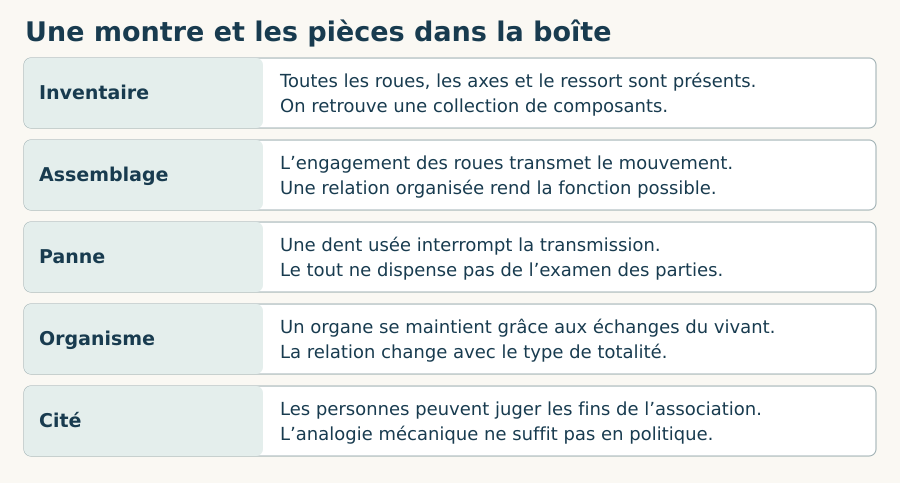
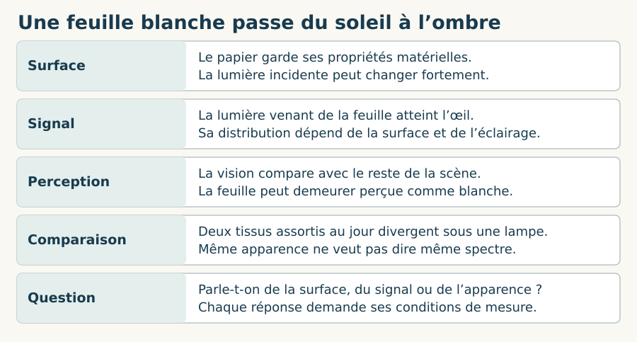

# BEL · AL — Philosophie (oral tronc commun 22 juin commission 1) 2026 · Corrigé brut

*Corrigé rédigé par IA, non officiel. Signalez toute erreur.*

**Rédaction** · GPT-6.2 Astra Ultra · vitesse non renseignée

**Autocontrôle** · GPT-6.2 Astra Ultra · vitesse non renseignée

**Révision** · GPT-6.2 Astra Ultra · vitesse non renseignée

Le [feuillet du 22 juin, commission 1](https://www.ens.psl.eu/sites/default/files/sujet_oraux_philosophie_1_al_22_juin.pdf) contient 6 billets de deux sujets. Les développements suivent leur ordre. Le premier sujet a été choisi sur chacun des 6 billets. Le [rapport du jury](https://www.ens.psl.eu/sites/default/files/2026_al_rapport_oral_philosophie_tc.pdf#page=7) permet de vérifier les choix.

Lisez à haute voix les deux sujets du billet, choisissez pendant les 90 minutes de préparation et annoncez votre choix au début des 20 minutes d’exposé. L’entretien dure ensuite 10 minutes. Le coefficient est de 3. Seul un dictionnaire de langue française est autorisé, à l’exclusion des dictionnaires de noms propres.

## 1. La partie et le tout

Une montre démontée garde toutes ses pièces dans la boîte. Il manque pourtant quelque chose pour qu’elle indique l’heure. Ce qui a disparu n’est pas une pièce de plus. C’est une organisation qui fait que l’engrenage de l’une transmet son mouvement à l’autre. La relation entre partie et tout dépend donc de ce qu’on appelle un tout. Un tas de pièces peut conserver son identité de collection tandis que la montre, comme objet fonctionnel, a cessé de fonctionner.

Faut-il alors faire du tout un principe souverain qui suffirait à expliquer toute partie ? Dans la montre, remonter les pièces usées sans en réparer les dents ne rétablit aucun mouvement. Dans un organisme, la notion de partie change encore, car l’organe se développe et se maintient par les échanges auxquels il contribue. En politique enfin, conclure du fonctionnement d’une montre au droit de sacrifier n’importe quel individu à l’État serait une analogie abusive. Une partie sociale est aussi une personne qui peut évaluer les fins communes. Le passage du tout à ses constituants, puis le trajet inverse, exigent donc que l’on nomme le type de relation et la propriété que l’on veut expliquer.

### La grammaire contraint-elle la pensée ?

Pour dire en français « il pleut », il faut un sujet grammatical auquel il serait vain de chercher un personnage responsable de la pluie. Nietzsche a souvent attiré l’attention sur la tentation de projeter les habitudes de la grammaire dans la structure de la réalité. La contrainte existe au niveau de la formulation, puisque je dois choisir des formes déterminées pour parler intelligiblement. Elle ne rend pas pour autant inévitable une croyance métaphysique au sujet caché derrière tout phénomène. Je peux analyser la différence entre le pronom impersonnel et le nom d’un agent, précisément en me servant du langage. La grammaire offre donc des habitudes de découpage qui facilitent certaines pensées et en obscurcissent d’autres. La comparaison entre langues et la réflexion sur les usages permettent de reprendre ces habitudes.

## 2. Faut-il maîtriser ses émotions ?

Une témoin voit sa colère monter lorsqu’un élève est accusé à tort. L’émotion manifeste qu’une injustice possible vient de se détacher pour elle sur le fond des occupations ordinaires. L’exigence de maîtrise signifierait-elle qu’elle devrait cesser d’être affectée avant d’agir ? Un tel idéal risque de détruire la sensibilité aux situations qui nous donnent justement des raisons d’intervenir.

Reste que la colère ne garantit ni l’innocence de l’élève ni la culpabilité de son accusateur. La maîtriser peut signifier retenir le verdict assez longtemps pour écouter les personnes et examiner les preuves. Cela se travaille par des habitudes d’attention et par des formes publiques d’échange, pas seulement par un ordre intime de retrouver son calme. Il faut aussi refuser de disqualifier une personne au seul motif qu’elle exprime son désaccord avec émotion. L’exigence légitime de maîtrise porte sur le passage de l’émotion à la décision et sur la responsabilité de ses effets. Elle laisse ouverte la possibilité de montrer ce qui nous émeut et d’apprendre pourquoi.

### « Libres et égaux en droits »

La formule de l’article premier de la Déclaration de 1789 appartient à une proposition selon laquelle les hommes naissent et demeurent libres et égaux en droits. Elle ne décrit pas des fortunes ou des capacités identiques à la naissance. Elle pose une norme susceptible de rendre les différences de statut injustifiables, notamment lorsqu’un rang hérité prétend donner un privilège de droit. Que vaut cependant la formule pour la personne qui possède formellement un recours sans pouvoir matériellement l’exercer ? L’égalité des titres réclame des procédures qui les rendent effectifs. Le défi est de corriger des obstacles inégaux sans recréer des privilèges arbitraires. La liberté de chacun et l’égalité des droits s’éclairent alors mutuellement, parce que personne ne devrait dépendre du bon vouloir d’un autre pour faire reconnaître la sienne.

## 3. L’expression des émotions

Le visage d’une amie se défait en pleine conversation. Je ne déduis pas nécessairement sa tristesse comme on déduirait une fuite d’eau d’une tache au plafond. Le chagrin semble déjà présent dans la façon dont elle pâlit, se détourne et suspend sa parole. L’expression n’est donc pas seulement un code ajouté après coup à un état intérieur entièrement achevé. Elle donne un corps et une forme partageable à ce qui est éprouvé.

Cette continuité n’annule pas la possibilité du malentendu. Un sourire peut témoigner de joie, de politesse ou d’une tentative pour épargner quelqu’un. Les usages sociaux modifient ce que l’on s’autorise à manifester et ce que l’observateur pense reconnaître. Dans ses réflexions sur le langage de la douleur, Wittgenstein montre comment les mots peuvent prendre place dans la vie des expressions au lieu de fonctionner comme des étiquettes secrètement apposées à une sensation privée. Il faut donc écouter la personne et replacer le signe dans son contexte. Une émotion exprimée devient compréhensible pour autrui sans devenir un objet qu’il pourrait connaître mieux que celui qui l’éprouve dans tous les cas.

### Qu’est-ce qu’un travail bien fait ?

Une étagère satisfait au plan et supporte le poids prévu, mais ses fixations sont impossibles à inspecter et les livres du dernier rayon inaccessibles aux utilisateurs. La conformité à la consigne est une condition et parfois une protection pour le travailleur. Elle ne règle pas seule la qualité de la destination réelle du travail. Le jugement doit associer règles du métier, finalité de l’ouvrage et possibilité pour d’autres de s’en servir ou de le reprendre après nous. Il reste un conflit possible entre rapidité mesurée et soin durable. Le trancher exige que la personne qui réalise l’objet puisse faire entendre les difficultés du matériau et l’expérience des usagers. Un travail bien fait comporte ainsi une responsabilité sur l’usage et une part de jugement que l’exécution littérale peut manquer.

## 4. Qu’est-ce qu’une couleur ?

Une feuille de papier blanc demeure pour nous blanche à l’ombre, alors même que la lumière qu’elle nous renvoie a changé. La couleur n’est donc ni la simple quantité de lumière atteignant l’œil ni une étiquette collée à l’objet sans rapport avec la vision. Le physicien étudie notamment le spectre de la lumière et les propriétés de réflexion d’une surface. Le physiologiste étudie les systèmes sensibles qui répondent aux stimulations. Le peintre peut, lui, faire paraître une même plage de gris plus claire ou plus sombre en modifiant son entourage.

Ces explications ne s’excluent pas. Elles ne mesurent pas exactement la même chose. Deux distributions spectrales différentes peuvent susciter, dans certaines conditions, une même impression colorée. Inversement, déplacer une étoffe d’une lumière à une autre peut défaire une égalité apparente avec une autre étoffe. La couleur est une propriété perceptible dont l’identification ordinaire suit une certaine constance à travers des variations de situation. Il faut donc préciser à quelle question on répond lorsqu’on attribue une couleur à une chose, qu’on la mesure ou qu’on décrit son apparence à cet instant.

### La douleur

Une infirmière observe un visage contracté et demande à la patiente si elle a mal. Même une grande expérience professionnelle ne lui donne pas la sensation de l’autre. Pour autant, conclure à l’incommunicabilité absolue de la douleur rendrait l’échange et le soin incompréhensibles. Les mots, les gestes, la localisation et l’histoire de la sensation permettent d’en faire comprendre quelque chose. La première personne garde une autorité particulière sur le fait qu’elle souffre. Cette autorité n’est pas la connaissance infaillible de la cause, qu’une enquête médicale peut préciser. La douleur révèle ainsi la double condition du corps, immédiatement éprouvé par quelqu’un et ouvert à une relation où d’autres peuvent croire son témoignage, répondre et agir.

## 5. Histoire et géographie

Une voie ferrée désaffectée semble, sur une carte actuelle, éviter plusieurs bourgs importants. L’historien établit qu’au moment de sa construction, un port et des ateliers aujourd’hui disparus concentraient le trafic. La carte prend un autre sens quand on rétablit le temps des lieux. Inversement, le récit d’une décision ministérielle reste lacunaire s’il ignore la pente, les franchissements possibles et les réseaux commerciaux déjà implantés. Le temps et l’espace ne sont donc pas deux classeurs autonomes entre lesquels on distribuerait les phénomènes.

Braudel, dans *La Méditerranée et le monde méditerranéen à l’époque de Philippe II*, différencie les rythmes d’évolution et donne à des structures géographiques une importance historique. Cela n’oblige pas à transformer les lieux en causes qui dicteraient un destin. Un col peut séparer ou relier selon les techniques et les institutions qui organisent le passage. Les deux disciplines construisent leurs objets à des échelles propres. Leur rencontre devient explicative lorsqu’on peut montrer comment une configuration spatiale ouvre ou ferme des possibilités dans le temps, et comment des décisions passées continuent de s’inscrire dans un paysage.

### Peut-on être content de soi ?

Une élève qui respecte son engagement au prix d’un effort a des raisons d’éprouver une satisfaction. Lui interdire ce sentiment en toutes circonstances risquerait de faire de la morale une dépréciation permanente de soi. Mais se réjouir d’un acte précis et s’accorder un jugement définitif d’excellence sont deux choses distinctes. La seconde attitude peut empêcher d’entendre la personne que l’acte a concernée et qui en juge autrement. L’enjeu est de préciser de quoi l’on est content, sous quel critère et en restant ouvert à quelle correction. Une satisfaction mesurée peut soutenir l’action future en reconnaissant un effort réel. La complaisance commence lorsque l’approbation de soi se dispense des raisons et des réponses qu’elle aurait dû accueillir.

## 6. Savoir ce qui nous détermine

Une personne achète chaque semaine le même produit en se croyant entièrement guidée par son goût. Une enquête lui révèle la place du prix, de la mise en rayon et de l’habitude familiale. Cette connaissance invalide-t-elle son choix ou lui rend-elle quelque pouvoir sur lui ? Si un motif n’exerçait aucune influence, savoir qu’il existe ne changerait presque rien. Si l’influence était un destin irrévocable, comment le savoir pourrait-il transformer la conduite ?

Chez Spinoza, penser la liberté demande de comprendre les causes dont nous nous croyons trop facilement exempts. Cette compréhension n’ajoute pas un choix sans cause au monde. Elle peut devenir l’une des causes d’un comportement nouveau, par exemple changer de rayon, comparer des prix ou décider que le goût transmis compte pour de bonnes raisons. Elle ne suffit toutefois pas à rendre toutes les alternatives accessibles. Apprendre que le revenu restreint le choix ne fait pas augmenter le revenu. Savoir ce qui nous détermine libère dans la mesure où cette connaissance précise à la fois les marges d’action et les conditions collectives qu’il faudrait transformer pour les étendre.

### Peut-on s’aimer soi-même ?

Se préserver, se juger digne d’attention et ne supporter aucune comparaison défavorable ne décrivent pas le même rapport à soi. Dans le *Discours sur l’inégalité*, Rousseau distingue l’amour de soi qui porte un être vivant à sa conservation et l’amour-propre qui fait dépendre sa valeur du regard comparatif des autres. L’exemple de quelqu’un qui accepte du repos en dépit d’une compétition de prestige montre que les deux peuvent même s’opposer. On peut s’aimer au sens de prendre soin de son existence et reconnaître sa dignité sans se préférer en toute chose. Cette bienveillance envers soi rencontre une limite lorsqu’elle refuse toute responsabilité et toute place à autrui. Un amour de soi réfléchi peut également accueillir la correction d’un ami sans la prendre pour une humiliation.
