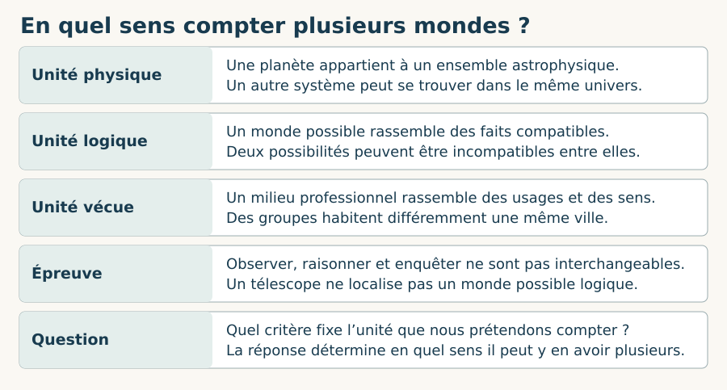
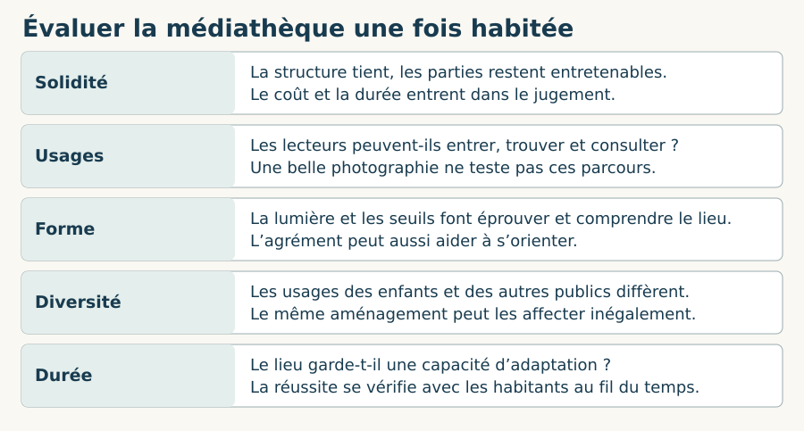

# BEL · AL — Philosophie (oral tronc commun 22 juin commission 2) 2026 · Corrigé guidé

*Corrigé rédigé par IA, non officiel. Signalez toute erreur.*

**Rédaction** · GPT-6.2 Astra Ultra · vitesse non renseignée

**Autocontrôle** · GPT-6.2 Astra Ultra · vitesse non renseignée

**Révision** · GPT-6.2 Astra Ultra · vitesse non renseignée

Le [feuillet du 22 juin, commission 2](https://www.ens.psl.eu/sites/default/files/sujet_oraux_philo_tc_22_juinal.pdf) contient 12 billets de deux sujets. Les développements suivent leur ordre. Le jury a mis en gras le premier sujet sur 4 billets et le second sur 8. Le choix est indiqué à chaque billet. Le [rapport du jury](https://www.ens.psl.eu/sites/default/files/2026_al_rapport_oral_philosophie_tc.pdf#page=7) permet de vérifier les choix. Au billet 7, le premier intitulé suit la formulation du feuillet.

Lisez à haute voix les deux sujets du billet puis annoncez votre choix au début de l’exposé. Seul un dictionnaire de langue française est autorisé, à l’exclusion des dictionnaires de noms propres. Pour essayer l’autre sujet, utilisez la question d’entretien et la piste de réponse placées après son développement.

## Vérifier les choix et préparer le dialogue

Selon le rapport (p. 7), quatre candidats ont retenu le premier intitulé et huit le second. Les deux propositions de chaque billet sont données dans l’ordre de la feuille du 22 juin. Le rapport écrit « Crime et châtiment » pour le titre que la feuille ponctue d’un point d’interrogation. La couche texte du dernier billet remplace un trait d’union par un soulignement. La leçon de vingt minutes intervient après 1 h 30 de préparation, avec dix minutes d’entretien. Ces douze questions de reprise sont des propositions d’entraînement.

1. **En quoi le monde possible de Leibniz diffère-t-il d’une planète lointaine ?** Une planète serait située dans le même univers physique que nous. Une possibilité incompatible avec ce qui est arrivé ne doit pas se chercher quelque part dans l’espace. Pour la philosophie, faire apparaître une distinction nouvelle à l’occasion d’un objet récent.
2. **Est-ce encore de la politesse si je n’éprouve aucune affection ?** Oui, la convention rend précisément possible l’échange entre étrangers. Elle devient oppressante si elle impose une déférence unilatérale. Pour les livres, relier les effets de la lecture à une condition matérielle de circulation.
3. **Le remords du personnage suffit-il à justifier une peine publique ?** Il concerne sa relation à son acte. Les institutions doivent encore établir la qualification, les faits et la proportion d’une sanction. Pour l’ornement, retirer mentalement la frise et décrire ce qui reste de l’orientation vers l’entrée.
4. **Pourquoi raturer serait-il un acte de pensée ?** Comparer deux formulations oblige à décider quelle relation l’on veut réellement affirmer. Dans la réflexion sur la cruauté, ne pas mettre au même niveau l’événement naturel et la conduite de ceux qui organisent la réponse.
5. **Pourquoi un récit des origines ne suffit-il pas à légitimer une règle ?** La cause et la valeur répondent à des questions différentes. La règle peut avoir changé d’effets ou recevoir des raisons nouvelles. Pour le portrait, comparer la ressemblance exigée d’une photographie d’identité à celle d’un portrait expressif.
6. **Dire que les ressources héritées comptent efface-t-il l’effort ?** Non, cela précise les conditions dans lesquelles un effort est ou non reconnu. Sur les récits, reprendre un détail dont le dénouement transforme la signification et expliquer la construction de cette attente.
7. **La métaphysique découvre-t-elle une chose supplémentaire ?** Elle peut interroger l’identité ou la causalité présupposée par une science particulière. La difficulté est de préciser ses critères d’examen. Sur la société, nommer le caractère commun aux formes animales et humaines, puis ce qui réclame un autre niveau d’explication.
8. **S’intéresser à la vie municipale est-il un conflit d’intérêts ?** Non, ce dernier requiert une interférence entre une charge et un avantage distinct susceptible d’altérer la décision. Pour les images, proposer une légende que la provenance de la photo permet de réfuter.
9. **Un bâtiment inaccessible peut-il être réussi ?** On peut y admirer un dispositif de lumière. Son inaccessibilité compromet sa réussite comme bâtiment destiné à un public. Pour le mal, distinguer l’existence d’un dommage et l’existence supposée d’un principe mauvais qui l’expliquerait à lui seul.
10. **Une vallée travaillée depuis des siècles est-elle sans valeur naturelle ?** Ses espèces et ses relations écologiques existent même si elles ont une histoire d’interventions humaines. Sur la bureaucratie, rechercher le recours accessible à la personne dont la situation n’entre dans aucune catégorie prévue.
11. **Pourquoi ne suffit-il pas de complimenter les apprenties ?** Une contribution peut être vantée en privé et effacée lors de la présentation publique. Examiner qui peut signer et répondre du travail. Pour le nom, demander à l’enfant de prévoir un effet de l’éclipse après l’avoir reconnue.
12. **Le sentiment de choisir prouve-t-il une absence de toute cause ?** Il atteste une différence vécue avec la contrainte, qu’il faut examiner. Une raison découverte plus tard peut corriger la première interprétation. Sur la fiction, retrouver un indice textuel qui limite une interprétation et permet d’en préférer une autre.

## 1. Y a-t-il de la nouveauté en philosophie ?

*Sujet choisi sur ce billet — La pluralité des mondes*

Un résultat mathématique acquis peut servir ensuite sans qu’il soit nécessaire de rouvrir toute sa démonstration. En philosophie, on retourne à Platon parce que la distinction qu’il propose peut encore modifier la façon dont un problème se présente. Faut-il conclure que rien n’y est jamais nouveau ? Une discussion sur la responsabilité d’une décision confiée à un système automatisé reprend des questions anciennes d’imputation, mais oblige à distinguer des rôles que leur formulation classique pouvait laisser ensemble, concevoir, entraîner, employer et contester un dispositif. Une nouveauté philosophique peut ainsi résider dans un problème devenu visible, dans une distinction ou dans l’argument qui défait une alternative reçue. La nouveauté d’un objet ou d’un vocabulaire n’en est pas la preuve. Il faut montrer ce que l’on ne pouvait pas discerner aussi précisément avant le travail des concepts.

**À l’entretien. Une nouvelle manière de poser une vieille question est-elle déjà une découverte ?** Comparer deux formulations dont l’une présuppose ce que l’autre met en doute. Il y a nouveauté philosophique si la reformulation modifie ce qu’il faut démontrer ou les objections auxquelles une réponse doit résister.

### La pluralité des mondes

Deux mondes peuvent-ils être plusieurs si « le monde » désigne par définition la totalité de ce qui existe ? L’objection oblige à préciser le principe d’unité. Les *Entretiens sur la pluralité des mondes* de Fontenelle ouvrent par l’astronomie la possibilité d’autres terres et d’autres habitants. Plusieurs mondes au sens de systèmes ou de lieux habitables peuvent appartenir au même univers physique. Leur possibilité ne démontre pas qu’ils sont habités.

Leibniz parle aussi de mondes possibles. Ce qui les distingue n’est plus une distance qu’un instrument pourrait mesurer, mais des séries complètes de choses compatibles ou incompatibles entre elles. Enfin « le monde du musicien » désigne un ensemble d’usages, de relations et de significations dont le voisin peut être en partie exclu. Confondre ces sens ferait passer une diversité d’expériences pour une découverte astronomique ou une alternative logique pour une région de l’espace. Parler de pluralité devient rigoureux quand on dit ce qui fait l’unité d’un monde et ce qui permet de compter plusieurs unités selon ce même critère.

## 2. Le monde des livres

*Sujet choisi sur ce billet — La politesse est-elle nécessaire ?*

Dans une bibliothèque, deux volumes voisins peuvent avoir été écrits à mille ans d’intervalle. Le classement leur permet d’entrer dans une même recherche et un renvoi peut faire de l’un le commentaire de l’autre. Le « monde des livres » est ainsi plus qu’un tas d’objets, car des institutions, des supports et des pratiques de lecture organisent leurs relations. Un livre épuisé, interdit de prêt ou jamais traduit n’occupe pas la même place pour tous les publics. Les livres ouvrent aussi des mondes par la fiction, la mémoire ou l’argument. Ce pouvoir suppose pourtant une activité de lecture et des conditions matérielles de circulation. Opposer un monde livresque irréel à un monde extérieur véritable méconnaît les effets réels des textes. Prendre l’imprimé pour toute l’expérience ferait l’erreur inverse, en oubliant ce que l’enquête hors des livres peut corriger.

**À l’entretien. Une bibliothèque fermée constitue-t-elle encore un monde de livres ?** Les volumes existent matériellement. L’accès, les lecteurs et les renvois entre ouvrages rendent possible un espace de discussion. Préciser lequel de ces sens du mot « monde » répond à la question.

### La politesse est-elle nécessaire ?

Deux inconnus qui doivent se partager un espace étroit peuvent traverser la rencontre grâce à une demande et à un signe de reconnaissance. La politesse rend le rapport prévisible sans qu’ils aient à se connaître ni à éprouver de l’affection. Elle est ainsi particulièrement importante là où la sympathie n’est pas acquise. Faudrait-il en conclure que chacune des règles de bienséance en vigueur est nécessaire ?

Il existe des codes qui transforment une différence d’éducation en motif d’exclusion ou qui exigent des subordonnés une déférence sans retour. La réserve peut aussi étouffer la protestation légitime de celui que l’on presse de « rester poli ». Il faut donc séparer le besoin pratique de formes de reconnaissance des formes particulières et historiquement variables qu’il reçoit. Une politesse défendable fait place à chacun dans la relation, y compris à la personne qui doit y exprimer un désaccord. On peut justement abandonner une convention lorsqu’une manière plus réciproque de se parler remplit mieux cette exigence.

## 3. L’ornement

*Sujet choisi sur ce billet — Crime et Châtiment ?*

Une frise sur une façade paraît s’ajouter à un mur qui tiendrait très bien sans elle. On la définit volontiers par son caractère accessoire. Pourtant elle donne l’échelle, relie des ouvertures et signale l’importance d’une entrée. Sa suppression laisse debout le bâtiment mais peut transformer la manière de le comprendre ou de s’y orienter. L’ornement n’est donc superflu que selon une définition préalable de la fin. Une décoration peut également masquer un défaut ou imposer une richesse de signes qui rend l’usage confus. Il faut examiner quels rapports elle fait voir, à quelle pratique elle contribue et ce que coûte sa présence. Cela permet de juger un ornement sobre ou abondant sans présupposer que la qualité de la forme exige toujours le dénuement ou toujours la profusion.

**À l’entretien. Ôter l’ornement laisse-t-il toujours l’objet intact ?** Enlever un motif d’une façade ne fait pas nécessairement tomber le bâtiment. Mais ce motif pouvait signaler une entrée ou faire apparaître une proportion. Séparer la stabilité matérielle des conditions de perception et d’usage.

### Crime et Châtiment ?

Un dommage et un malheur survenant ensuite à son auteur ne forment pas encore un crime et son châtiment. Le crime suppose une qualification, puis le châtiment l’attribution publique d’une responsabilité et une réponse justifiable. D’où vient le droit de répondre à un tort par une peine ? La vengeance du plaignant peut attester une souffrance réelle, mais elle donne à une partie le pouvoir de fixer seule la mesure du dommage et de la réponse.

Une peine justifiée demande au contraire une règle antérieure, des preuves, un examen contradictoire et une proportion. Les fins invoquées restent discutables, reconnaître le tort, protéger et rendre possible une réinsertion ne sont pas des opérations identiques. Le roman de Dostoïevski dont le titre résonne dans le billet permet d’ajouter une distinction. Le remords de Raskolnikov, son aveu et la peine prononcée ne coïncident ni dans le temps ni dans leur justification. La conscience personnelle peut s’interroger alors même que la justice doit encore instruire. Le lien entre crime et châtiment relève ainsi d’une institution à justifier dans chaque cas, et non d’une compensation qui s’accomplirait d’elle-même.

## 4. La nature est-elle cruelle ?

*Sujet choisi sur ce billet — Écrire et penser*

Une sécheresse fait dépérir une récolte alors que le travail a été mené avec soin. La cruauté désigne ordinairement une manière d’être sensible à la souffrance d’autrui tout en la voulant ou en l’acceptant avec indifférence coupable. Or un épisode météorologique ne connaît ni les cultivateurs ni leur peine. Lui appliquer le mot donne expression à la douleur et au sentiment d’injustice que l’événement suscite, sans établir une intention dans la nature. Des phénomènes du vivant comportent aussi comportements, apprentissages et sensibilité, qu’il faut examiner espèce par espèce. On ne saurait leur prêter sans enquête une culpabilité morale humaine. La distinction rend plus précise notre responsabilité. La sécheresse n’est pas un agent cruel, tandis que l’organisation humaine de l’accès à l’eau peut être justement jugée au regard des souffrances évitables.

**À l’entretien. Dire d’un orage qu’il est cruel nous apprend-il quelque chose sur lui ?** La formule peut exprimer la souffrance des habitants. Pour imputer une cruauté, il faut encore demander si l’événement procède d’une intention ou d’une indifférence susceptible de reproche.

### Écrire et penser

L’élève commence une phrase qu’elle croyait claire et découvre, au moment de choisir le pronom, qu’elle ne sait plus à quoi il renvoie. L’écriture n’a pas seulement enregistré une pensée déjà achevée. Elle lui a fourni une forme extérieure qui révèle une difficulté. Raturer, déplacer une phrase et relire le début pendant qu’on compose la fin permettent de comparer des formulations que l’esprit ne maintiendrait pas aussi facilement présentes ensemble.

Faut-il alors nier que l’on puisse penser sans écrire ? Une personne reconnaît un visage, imagine un parcours ou construit oralement une objection. Écrire est l’une des techniques qui transforment la pensée, avec des gains et des risques propres. Une formule élégante peut stabiliser trop tôt une distinction fragile. Une note ancienne peut inversement permettre de retrouver la prémisse oubliée d’un désaccord. Le rapport est réciproque, car une question oriente le geste d’écrire, puis la trace rend la question autrement disponible à celui qui l’a écrite et à ceux qui la liront.

## 5. L’origine

*Sujet choisi sur ce billet — L’origine*

Demander l’origine d’un fleuve, d’une institution et d’une obligation semble dans chaque cas remonter vers un commencement. Pourtant l’eau qui alimente une source a elle-même une histoire, et un premier décret sur une école ne suffit pas à expliquer pourquoi des familles y ont progressivement confié leurs enfants. L’origine peut désigner un point temporel retenu comme début ou le processus qui a rendu une forme possible. Elle peut enfin être invoquée comme titre de légitimité, ce qui requiert un argument différent.

Dans le *Discours sur l’origine et les fondements de l’inégalité*, Rousseau distingue une reconstruction destinée à comprendre des conditions de possibilité d’une chronique ayant recueilli toutes les dates du passé. L’enquête sur la naissance d’un avantage nous aide à défaire l’illusion qu’il serait naturel ou éternel. Mais une règle née dans des circonstances contestables peut recevoir ensuite une meilleure justification, et une intention généreuse peut produire une institution injuste. Rechercher l’origine est fécond si l’on détermine quelle question on pose et pourquoi sa réponse éclaire le présent sans décider toute seule de sa valeur.

### Qu’est-ce qu’un portrait ?

Une photographie d’identité permet d’attester que la personne présente correspond au document. Un portrait peint peut rendre quelqu’un reconnaissable à une posture ou à une relation avec son milieu, quitte à déformer des proportions. La ressemblance n’est donc pas une grandeur unique. Un portrait vise quelqu’un en particulier et construit sous certains traits la manière de le faire apparaître à autrui. L’absence de son nom n’abolit pas nécessairement cette visée, tandis qu’une silhouette générique ne devient pas portrait du seul fait qu’elle ressemble à un passant. Reste une tension éthique et esthétique. Le modèle peut se découvrir dans cette image ou contester le rôle où elle l’enferme. Le portrait est une proposition de reconnaissance, portée par des moyens précis, qui reste ouverte au désaccord.

**À l’entretien. Une caricature déformante peut-elle être un portrait fidèle ?** Elle accentue certains traits au point de les rendre reconnaissables. Vérifier si ces choix donnent accès à un aspect de la personne ou reconduisent simplement un stéréotype déjà disponible.

## 6. La réussite sociale

*Sujet choisi sur ce billet — La réussite sociale*

Deux anciens élèves gagnent des revenus comparables. L’un estime avoir réussi parce qu’il a retrouvé le métier de ses parents, l’autre parce qu’il a pu quitter le milieu auquel on le destinait. L’expression « réussite sociale » peut désigner la reconnaissance d’un statut mesurable ou l’accomplissement d’un projet. Son ambiguïté devient politique lorsqu’un indicateur public, salaire ou titre, est employé comme mesure unique de la valeur d’une personne.

Il faut examiner qui détermine les biens valorisés et comment les chances d’y accéder sont distribuées. Les travaux de Bourdieu sur les capitaux économique, culturel et social aident à comprendre pourquoi deux efforts comparables n’obtiennent pas nécessairement la même reconnaissance. Ils ne font pas disparaître la réalité d’un accomplissement individuel. Ils empêchent de tirer du seul rang atteint un jugement sur le mérite personnel. Une société peut rendre des réussites visibles et transmettre des moyens de les atteindre. Elle devient injuste lorsqu’elle transforme l’échec sous un critère particulier en indignité générale ou lorsqu’elle ferme les voies d’accès dont elle vante ensuite les vainqueurs.

### Pourquoi aimons-nous les histoires ?

Au début d’un récit, une clé est posée sur une table. Après la dernière page, le lecteur se souvient de ce geste comme d’une promesse manquée. Les histoires donnent au temps une forme qui permet d’attendre, de s’étonner et de reconsidérer un détail. Dans *Temps et récit*, Ricœur étudie la mise en intrigue qui rassemble des événements hétérogènes sans les réduire à une simple liste. Le plaisir tient aussi aux voix, aux rencontres et parfois à la possibilité de vivre un détour sans en subir les conséquences réelles. Pourtant, une histoire trop cohérente peut donner à une suite contingente l’apparence d’un destin ou nous faire oublier ce qu’elle a laissé de côté. Aimer les histoires n’impose pas de les croire toutes. Ce goût peut devenir une attention aux diverses manières de composer et de partager une expérience.

**À l’entretien. Peut-on aimer une histoire précisément parce qu’elle déçoit notre attente ?** Un récit peut faire comprendre rétrospectivement une action qui paraissait absurde. La surprise vaut alors par la réorganisation de ce qu’on a entendu, sans se réduire au plaisir de deviner l’issue.

## 7. La société ne peut-elle être qu’humaine ?

*Sujet choisi sur ce billet — L’objet de la métaphysique*

Une colonie d’abeilles présente une coordination des tâches et des communications. L’observation fournit des raisons de parler de société animale si le terme désigne une organisation relativement durable d’interactions entre êtres vivants. Réserver le mot à l’humanité par définition fermerait l’enquête. À l’inverse, assimiler une cité à une ruche ferait disparaître un trait déterminant de nombreuses sociétés humaines. Leurs membres instituent des règles, peuvent demander publiquement pourquoi elles obligent et les contester en leur nom propre. Même ces capacités se développent avec des héritages matériels et des relations au vivant que la seule introspection ne révèle pas. La réponse dépend du niveau de comparaison pertinent. Des sociétés peuvent exister hors de l’humanité, tandis que le droit, l’histoire des institutions et le débat sur leur justice appellent des concepts supplémentaires pour décrire certaines formes humaines d’association.

**À l’entretien. Une colonie animale suffit-elle à réfuter une définition humaine de la société ?** Examiner ce que l’exemple établit, comme la coopération durable et la répartition des tâches. Demander ensuite si la définition retenait aussi la possibilité de contester les règles. La conclusion dépend du critère avancé.

### L’objet de la métaphysique

Un biologiste demande comment vit cet organisme. Le métaphysicien peut demander ce que signifie persister comme le même être quand toutes sortes de composants se renouvellent. Il ne découvre pas alors un corps de plus à côté de celui dont on étudie la vie. Son interrogation porte sur les déterminations les plus générales que les enquêtes particulières emploient lorsqu’elles identifient des objets, des causes ou des possibilités.

Aristote donne une formulation classique à cette visée en étudiant l’être en tant qu’être. Il reste une difficulté sur la méthode. Si aucun objet d’expérience particulier ne suffit à trancher une thèse sur l’être en général, comment distinguer le savoir d’une spéculation arbitraire ? La critique de Kant examine les conditions et les limites de l’usage de la raison, notamment lorsqu’elle prétend connaître des totalités qui ne sont pas données dans l’expérience. L’objet de la métaphysique peut ainsi se chercher dans les principes de ce qui est et dans l’examen des concepts par lesquels nous y avons accès. Les deux démarches doivent préciser comment leurs affirmations peuvent être discutées.

## 8. L’intérêt

*Sujet choisi sur ce billet — L’intérêt*

Quelqu’un étudie les abeilles « par intérêt ». La phrase peut signifier qu’il espère un profit, ou que l’objet l’attire assez pour qu’il lui consacre du temps sans rémunération. L’intérêt désigne donc à la fois ce qui compte pour un agent et l’attention par laquelle un objet prend de l’importance à ses yeux. En tirer la conclusion que toute action est égoïste confond le fait que j’ai une raison de faire quelque chose avec la thèse selon laquelle cette raison serait toujours mon avantage personnel.

Une élue possède des parts dans une entreprise susceptible de recevoir une commande municipale. Le conflit d’intérêts ne tient pas à ce qu’elle s’intéresse au dossier. Il vient de ce qu’une raison personnelle de gagner peut peser sur une décision qu’elle doit prendre au nom d’autres personnes. On dispose ainsi d’un critère précis pour distinguer les sens. Quels biens sont en jeu, pour qui, et à quel titre appartient-il à l’agent de les poursuivre ? L’intérêt apparaît parfois comme une condition de l’attention, parfois comme une raison de se retirer d’une décision, parfois comme un avantage commun à construire.

### Faut-il se méfier des images ?

La photographie d’une file d’attente montre des personnes effectivement présentes devant un bâtiment. Une légende erronée peut pourtant la faire passer pour l’image d’une autre ville ou d’une autre année. La confiance doit donc distinguer ce qui a laissé une trace, le cadre qui sélectionne cette trace et l’interprétation proposée. Mais se méfier de toute image au point de lui refuser toute valeur de preuve priverait justement de la possibilité de repérer la fausse légende par comparaison avec d’autres vues, dates et témoignages. Une image construite peut encore transmettre une vérité, comme un schéma dont la convention est explicitée. La bonne attitude consiste à proportionner la confiance à la question posée, à la provenance, aux conditions de production et aux moyens de vérification.

**À l’entretien. Une image peut-elle être trompeuse tout en étant authentique ?** Une photo sans retouche, recadrée pour exclure la moitié d’une assemblée, peut induire une conclusion fausse. Examiner les conditions de prise de vue et la proposition que sa présentation invite à accepter.

## 9. L’existence du mal

*Sujet choisi sur ce billet — Qu’est-ce qu’un bâtiment réussi ?*

Une injustice reconnue suffit à établir que des torts ont lieu. Affirmer que « le mal existe » peut cependant ajouter l’idée que toutes les mauvaises actions participent d’une même réalité autonome. Comment passer du jugement sur une situation à une thèse sur ce qui existe ? Une promesse non tenue met quelqu’un en difficulté. Le manque est réel par ses effets alors même que l’obligation trahie n’était pas une chose matérielle. La théorie de la privation d’Augustin rend intelligible ce type de réalité dépendante d’un bien dont l’accomplissement était attendu. En outre, la maladie d’un proche et le refus délibéré de le secourir ne mettent pas en jeu la même responsabilité. Il faut donc prendre au sérieux souffrances et injustices sans convertir leur nom commun en explication de leurs causes. La question « quel mal ? » prépare celle de ce qu’on peut reconnaître, réparer ou prévenir.

**À l’entretien. Expliquer un acte mauvais fait-il disparaître le mal ?** Connaître les pressions qui ont pesé sur une décision peut nuancer l’attribution de responsabilité. Il reste à décrire le tort subi et la norme transgressée. L’explication causale ne remplit pas ces deux tâches.

### Qu’est-ce qu’un bâtiment réussi ?

Une médiathèque remarquable sur les photographies reste difficile à parcourir pour les jeunes enfants, bruyante pour ses lecteurs et coûteuse à entretenir. L’exemple oblige à distinguer une façade appréciée, un espace habitable et une œuvre appelée à durer. La triade que l’on trouve chez Vitruve, solidité, utilité et beauté, fournit des exigences dont aucune ne suffit isolément. Le lieu peut servir au moment de l’ouverture et devenir rapidement impropre à d’autres publics ou à un nouvel usage.

Mais il serait trompeur de réduire la beauté à un supplément que l’on ajouterait après avoir satisfait toutes les fonctions. La disposition de la lumière et des seuils peut à la fois orienter, donner une atmosphère au travail et rendre le lieu accueillant. Il faut aussi demander pour qui le bâtiment réussit et qui assumera les charges que ses qualités visibles dissimulent. La réussite tient à un accord durable, susceptible d’évoluer, entre structure, usages, milieu et expérience sensible. Elle se juge donc avec les habitants autant que devant les plans.

## 10. La bureaucratie

*Sujet choisi sur ce billet — Faut-il revenir à la nature ?*

Un dossier instruit selon des règles écrites et conservé dans des archives peut être repris par une autre personne lorsque le premier agent quitte son poste. Le traitement d’une demande n’a plus à dépendre d’une faveur personnelle. Weber étudie cette continuité à travers la compétence des fonctions, la hiérarchie et les dossiers propres à la bureaucratie moderne. Le même dispositif peut toutefois imposer à un usager une preuve impossible à produire parce que sa situation n’entre dans aucune case. La régularité formelle n’est alors plus le moyen de garantir ses droits, elle menace de s’y substituer. La difficulté n’est pas de choisir entre toute règle et la libre décision du guichetier. On peut apprécier une organisation en demandant comment elle justifie ses critères, traite les exceptions prévues et rend accessible un recours sans restaurer l’arbitraire de la faveur.

**À l’entretien. Un formulaire protège-t-il contre l’arbitraire ?** Il rend comparables les demandes et oblige à produire des motifs. S’il empêche d’examiner un cas pertinent qu’aucune case ne prévoit, la même règle devient source d’injustice. Examiner la possibilité d’un recours.

### Faut-il revenir à la nature ?

Un habitant quitte la ville pour une vallée qu’il croit préservée. Les sentiers, les vergers et la rivière aménagée qu’il admire portent pourtant des siècles de travail. À quelle « nature » propose-t-on de revenir, et quels usages faudrait-il effacer pour atteindre cet état ? La difficulté est aussi normative. Qu’un processus soit naturel ne suffit pas à le rendre sain ou juste, tandis que certaines interventions humaines restaurent les conditions d’un milieu vivant.

Chez Rousseau, l’hypothèse d’un état de nature ne vaut pas comme simple invitation à remonter le temps. Elle permet de distinguer ce qui tient à certaines institutions de ce que l’on disait inévitable. Le retour peut donc prendre un sens critique, reprendre contact avec des dépendances matérielles et réexaminer des formes de vie qui les détériorent. Il faut alors définir des objectifs présents, qualité de l’eau, continuité des habitats ou usage équitable des terres, et discuter leurs conséquences pour ceux qui y vivent. L’orientation vers la nature devient défendable par ce travail, et non par la seule nostalgie d’une origine.

## 11. Le désir de reconnaissance

*Sujet choisi sur ce billet — Le désir de reconnaissance*

Deux apprenties accomplissent le même travail. L’une obtient des compliments élogieux à condition de rester invisible quand le résultat est présenté, l’autre peut signer, expliquer et discuter l’ouvrage. On peut recevoir des marques d’approbation sans être reconnu comme auteur. Le désir de reconnaissance ne se ramène donc ni à la vanité ni au souhait d’être admiré davantage que le voisin.

Dans la *Phénoménologie de l’esprit*, Hegel examine le rapport où une conscience attend d’une autre la confirmation de sa propre indépendance. Une reconnaissance imposée à quelqu’un que l’on prive lui-même de liberté ne possède pas la valeur recherchée. La distinction se vérifie aussi socialement. Un salaire convenable importe et pourtant ne répare pas toujours l’effacement d’une contribution. Inversement, les louanges ne paient pas les heures effectuées. La reconnaissance désirable associe donc une place effective, des droits et la possibilité de répondre comme sujet. Elle devient dépendance appauvrissante lorsqu’aucune valeur ne semble plus pouvoir être éprouvée sans l’approbation continue d’un public.

### Nommer les choses, est-ce les comprendre ?

L’enfant qui sait dire « éclipse » a déjà appris à isoler un phénomène et à en parler avec quelqu’un. Mais il peut encore croire qu’une éclipse est un nuage faisant de l’ombre au Soleil. Le nom facilite l’identification, la recherche de témoignages et la comparaison de cas. Comprendre réclame au moins une relation explicative ou un usage suffisamment déterminé pour répondre à une question nouvelle, par exemple pourquoi l’événement n’est visible que depuis certaines régions. Inversement, on peut saisir pratiquement qu’une pièce bloque le mouvement d’une horloge avant de connaître son nom de métier. Nommer et comprendre se soutiennent quand le vocabulaire permet de formuler et de tester des différences. Le mot devient un obstacle si le fait de le répéter donne l’illusion que le mécanisme a été expliqué.

**À l’entretien. Savoir le nom d’une maladie donne-t-il déjà une explication ?** Le nom peut réunir des symptômes et guider l’enquête. Si l’on répond que le patient tousse parce qu’il a « la maladie qui fait tousser », on a simplement renommé le fait à expliquer.

## 12. Fiction et liberté

*Sujet choisi sur ce billet — La liberté s’éprouve-t-elle ?*

En lisant une fable narrée par un animal, je peux suspendre les contraintes ordinaires qui empêchent un tel narrateur de parler. La fiction ouvre des possibles et peut mettre à distance une habitude que l’on prenait pour une nécessité. Mais l’imagination d’un lecteur n’est pas libre de faire signifier n’importe quoi à chaque phrase. La cohérence du récit, les conventions du genre et les indices laissés sur la page rendent certaines interprétations plus défendables que d’autres. Une fiction peut aussi enfermer en répétant des stéréotypes ou en proposant le même destin comme seul dénouement vraisemblable. La liberté qu’elle offre tient donc à une activité réglée d’exploration et de reprise. On peut y éprouver d’autres points de vue puis retourner au monde commun avec une question qu’on n’avait pas songé à poser.

**À l’entretien. En quoi suivre une histoire inventée peut-il exercer la liberté du lecteur ?** On peut envisager les raisons d’un personnage puis refuser sa décision. L’imagination ouvre des possibles, mais une fiction peut aussi reconduire des attentes convenues. Examiner ce qu’elle permet réellement de remettre en question.

### La liberté s’éprouve-t-elle ?

Devant deux chemins également praticables, je peux éprouver une hésitation réelle avant de prendre celui de gauche. En quoi cette expérience témoigne-t-elle de ma liberté ? Le sentiment d’avoir pu faire autrement paraît immédiat. Il ne suffit pas à établir que ma décision serait absolument sans causes. Des raisons jusque-là ignorées pourraient avoir rendu l’un des chemins plus attirant à mes yeux. Inversement, savoir que j’ai des raisons de préférer un chemin ne démontre pas que j’ai été forcé.

L’épreuve devient plus précise lorsqu’on compare l’hésitation ordinaire à la découverte d’une barrière. Une option que je croyais ouverte ne l’était pas. Je découvre aussi une liberté en contestant l’interdiction et en obtenant une voie de recours effective. La liberté se connaît donc par l’expérience vécue de se déterminer et par des épreuves pratiques où l’on vérifie ce que l’on peut effectivement faire ou modifier. Aucune sensation isolée n’épuise sa signification. La réflexion sur les raisons et l’examen des conditions sociales donnent à cette expérience une portée qu’une simple impression de spontanéité ne garantit pas.
