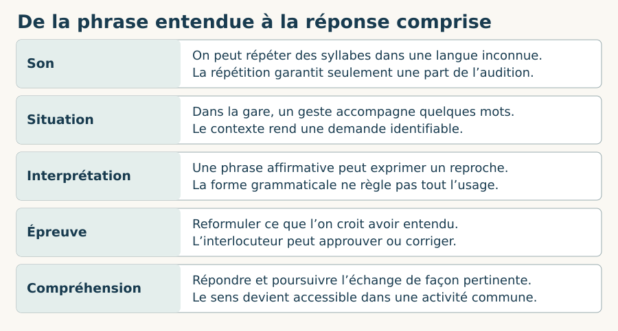
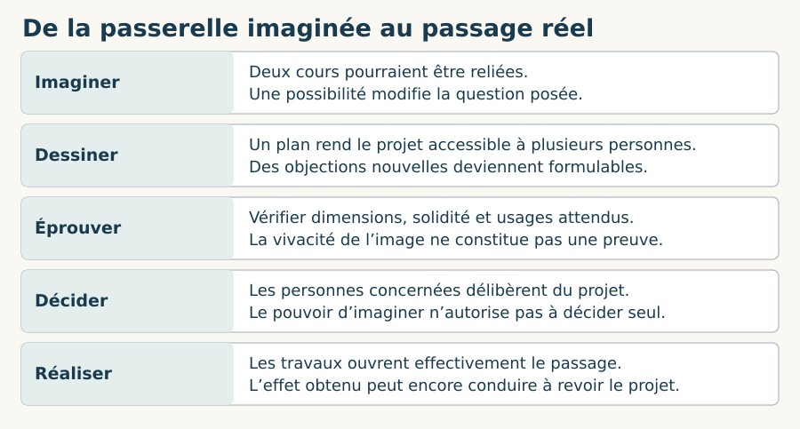

# BEL · AL — Philosophie (oral tronc commun 23 juin) 2026 · Corrigé guidé

*Corrigé rédigé par IA, non officiel. Signalez toute erreur.*

**Rédaction** · GPT-6.2 Astra Ultra · vitesse non renseignée

**Autocontrôle** · GPT-6.2 Astra Ultra · vitesse non renseignée

**Révision** · GPT-6.2 Astra Ultra · vitesse non renseignée

Le [feuillet du 23 juin](https://www.ens.psl.eu/sites/default/files/sujet_oraux_philosophie_2_23_juinal.pdf) contient 11 billets de deux sujets. Les développements suivent leur ordre. Le premier sujet a été choisi sur chacun des 11 billets. Le [rapport du jury](https://www.ens.psl.eu/sites/default/files/2026_al_rapport_oral_philosophie_tc.pdf#page=7) permet de vérifier les choix.

Lisez à haute voix les deux sujets du billet puis annoncez votre choix au début de l’exposé. Seul un dictionnaire de langue française est autorisé, à l’exclusion des dictionnaires de noms propres. Pour essayer l’autre sujet, utilisez la question d’entretien et la piste de réponse placées après son développement.

## Préparer les onze reprises

La feuille place le second sujet entre parenthèses et la page 7 du rapport met en gras le premier de chaque billet, choisi par le candidat. Les réponses suivent cet ordre. La préparation dure 1 h 30, l’exposé vingt minutes et le dialogue dix minutes. Les relances suivantes permettent de travailler ce dernier moment.

1. **Un amour sans retour est-il déjà une amitié ?** On peut tenir profondément à quelqu’un sans que la bienveillance soit mutuellement reconnue. Cette reconnaissance compte spécifiquement pour l’amitié. Sur les classifications, choisir une question que le rangement des livres par taille empêche de résoudre.
2. **Un silence peut-il faire partie de la musique ?** Un silence attendu après un motif en prolonge la tension. Il n’est pas un son et pourtant son placement change la phrase. Pour la nostalgie, imaginer le retour au même lieu avec une personne qui n’y possède aucun souvenir.
3. **Comment vérifier que l’on a compris ?** Dans une demande pratique, une réponse appropriée, une reformulation ou une question précise donnent des critères publics. Pour la mauvaise foi, demander quels éléments montrent une éviction active d’une question plutôt qu’une simple erreur.
4. **Est-on sincère lorsqu’on tient un rôle auquel on ne se réduit pas ?** Une présidente peut loyalement faire respecter un droit de parole tout en restant en désaccord sur le fond. Pour l’outil, comparer la canne et le thermomètre afin de distinguer extension de portée et nouvelle capacité de lecture.
5. **Comment un contrat peut-il être réel sans faire obstacle comme un mur ?** Il peut modifier des obligations et autoriser une réclamation selon des procédures publiques. Sur les promesses, vérifier ce qui donnait à autrui une attente légitime et ce qu’une impossibilité ultérieure change réellement.
6. **Une chaise de musée peut-elle échouer comme siège ?** L’exposition peut lui donner la fonction d’interroger l’objet. Cela ne garantit pas qu’elle satisfasse les usages annoncés si on la présente comme siège. Sur la souveraineté, distinguer le détenteur d’une compétence d’exécution de sa source constitutionnelle.
7. **Se protéger rend-il une conduite moins courageuse ?** Une précaution peut rendre plus efficace la défense d’un bien et mieux répartir les risques. Le courage n’exige pas d’aimer le danger. Sur la foule, suivre le moment où des voyageurs séparés deviennent attentifs aux mouvements les uns des autres.
8. **Le fleuve doit-il parler pour être personne juridique ?** Des représentants peuvent agir dans l’intérêt légalement défini de l’entité. Il faut contrôler leur mandat et leur responsabilité. Sur la bêtise, demander quelle objection devrait faire interrompre un raisonnement bien exécuté mais hors sujet.
9. **Quel effet une règle peut-elle avoir sur des forces inégales ?** Un recours accessible et une obligation de motiver changent les moyens effectifs de contester. Sur la danse, décrire ce que produit le même pas selon son rythme et sa relation aux autres danseurs.
10. **L’origine sociale d’une opinion la rend-elle fausse ?** Elle renseigne sur les conditions dans lesquelles on l’adopte. Un autre examen porte sur les preuves et les raisons qui peuvent la soutenir. Pour la pensée solitaire, nommer une objection venue d’autrui que l’on peut ensuite refaire seul.
11. **En quel sens une passerelle imaginée change-t-elle déjà la situation ?** Le projet ouvre un choix aux personnes consultées. La possibilité matérielle requiert encore des épreuves et le passage réel des travaux. En politique, dire qui participe à la définition du but avant d’apprécier les moyens pour l’atteindre.

## 1. Amour et amitié

Une amie accueille avec joie le succès de quelqu’un qu’elle voit désormais moins souvent. Le sentiment est capable de préférer, au moins dans cette circonstance, le bien de l’autre à la satisfaction de l’avoir près de soi. Retrouve-t-on la même structure dans l’amour ? Les deux liens peuvent comporter attachement, sollicitude et joie partagée. Les distinguer par une intensité plus grande de l’amour ferait de certaines amitiés profondes un embarrassant contre-exemple. Les distinguer par la seule exclusivité ferait oublier qu’un amour parental ou fraternel ne fonctionne pas comme un couple.

Aristote, dans les livres VIII et IX de l’*Éthique à Nicomaque*, insiste pour l’amitié accomplie sur une bienveillance mutuelle et reconnue, attachée à la personne elle-même. On peut aimer quelqu’un qui ne nous aime pas en retour. Appeler « amitié » le même rapport unilatéral est déjà plus difficile. La réciprocité reconnue dessine donc une ligne de distinction, sans séparer complètement les domaines. Un amour peut acquérir les caractères d’une amitié et une amitié devenir aimante sans exiger de l’autre une disponibilité totale.

### À quoi servent les classifications ?

Une bibliothèque pourrait ranger les livres par taille afin qu’ils tiennent au mieux sur les étagères. Le lecteur qui cherche toutes les éditions d’un auteur préférera un autre principe. Classer fait gagner une possibilité d’action en sélectionnant un caractère pertinent, avec des pertes que l’on peut préciser. Il existe aussi des classifications explicatives, comme celles qui regroupent des espèces selon des parentés et conduisent à rechercher des propriétés communes. Le choix des critères y est éprouvé par l’enquête, et non laissé à la commodité seule. Enfin, classer des personnes peut modifier la façon dont elles sont traitées. Une bonne classification indique donc à quelle question elle répond, quels cas mettent ses frontières en difficulté et dans quelles conditions ses catégories peuvent être révisées.

**À l’entretien. Une même collection peut-elle recevoir deux classements justes ?** Classer des outils par matériau aide à les conserver, les classer par geste aide à les retrouver à l’atelier. Le but éclaire le choix du critère. Les cas limites permettent d’en éprouver la pertinence.

## 2. De quoi la musique est-elle l’art ?

Deux pianistes jouent les mêmes hauteurs dans le même ordre. Une accentuation et un léger retard au retour du thème font entendre chez l’un une reprise qui hésite, chez l’autre une affirmation immédiate. Définir la musique comme l’art des sons ne suffit donc pas, puisque le silence, la durée attendue et le souvenir du son précédent contribuent aussi à la forme perçue. Il faut encore expliquer comment une suite devient un mouvement que l’auditeur peut suivre.

La musique peut évoquer une marche, une voix ou une scène. Mais toute pièce ne représente pas un objet, et deux auditeurs peuvent entendre la même tension harmonique sans l’associer au même sentiment. Hanslick, dans *Du beau dans la musique*, insiste sur le mouvement des formes sonores et conteste que la production d’un sentiment déterminé soit le principe qui définit le beau musical. On peut reprendre cette difficulté sans supprimer l’expression. Une organisation temporelle rend possibles des attentes, des écarts et des réponses sensibles dont l’exécution et l’écoute poursuivent le sens. La musique est en ce sens l’art de faire entendre des rapports dans le temps.

### La nostalgie

J’entends la chanson qui passait dans un café de mon ancienne ville. Ce que je voudrais retrouver est-il la salle, la période de ma vie ou la manière dont cette chanson les rassemble aujourd’hui ? La nostalgie donne à l’absence une figure sensible et tend à réorganiser les souvenirs autour de ce qui paraît perdu. Un retour physique au lieu peut la décevoir, même si la salle a peu changé, parce que je ne reviens pas avec l’âge et les attentes d’autrefois. Ce sentiment ne se réduit ni à une erreur ni à un savoir fidèle sur le passé. Il peut reconnaître un attachement durable ou effacer des difficultés bien réelles. L’examiner consiste à distinguer le bien dont on garde le désir de l’impossibilité de répéter toute la situation qui l’avait fait aimer.

**À l’entretien. Pourquoi regretter une époque dont on connaît aussi les défauts ?** Distinguer le jugement sur les conditions de vie passées et le désir de retrouver une relation ou un avenir alors possible. Ce que la nostalgie vise n’est pas nécessairement toute l’époque qu’elle évoque.

## 3. Entendre et comprendre

Je peux répéter avec exactitude une phrase dans une langue que j’ignore. Les sons et même leur contour interrogatif me sont accessibles, mais je ne sais pas répondre à ce qui m’est demandé. Inversement, dans une gare bruyante, les gestes d’un voyageur et la situation peuvent me faire comprendre sa demande alors que plusieurs mots m’ont échappé. L’audition et la compréhension se distinguent donc sans être deux étapes qui se suivraient toujours mécaniquement.

Le double sens français d’« entendre », percevoir et saisir le sens, enregistre le travail de l’attention. Comprendre une parole peut exiger de savoir dans quelle circonstance une formule apparemment affirmative constitue un reproche ou une demande. Chez Wittgenstein, l’usage d’une expression dans une activité commune aide à rendre compte de ces différences. Le signe le plus sûr d’une compréhension n’est pas de lui superposer une image intérieure, mais de pouvoir répondre, reformuler ou poursuivre convenablement la relation. Cela laisse aussi la place au malentendu et à sa correction. Celui qui écoute peut demander si ce qu’il a entendu est bien ce que l’autre voulait lui faire comprendre.

### La mauvaise foi

Une personne s’engage à rendre service puis explique qu’elle « n’avait pas le choix » alors qu’une autre option, certes pénible, lui était apparue. Le problème n’est pas seulement de transmettre une information fausse à autrui. Elle se présente à elle-même sa conduite sous une description qui évite d’en répondre. Dans *L’Être et le Néant*, Sartre analyse la mauvaise foi à travers les manières de se réduire à un rôle ou de nier les contraintes réelles de sa situation. Il faut rendre compte de cette conduite sans imaginer deux consciences parfaitement séparées, l’une sachant tout et l’autre ignorant sincèrement tout. Une attention sélective et une manière d’écarter certaines questions permettent d’en comprendre le mouvement. Le diagnostic demande néanmoins des raisons. Tout désaccord sur un motif ou toute erreur d’interprétation n’est pas un indice de mauvaise foi.

**À l’entretien. Suffit-il de se tromper sur soi pour être de mauvaise foi ?** Comparer l’erreur corrigée dès qu’apparaît une preuve et la conduite qui évite systématiquement toute mise à l’épreuve. La difficulté est d’expliquer comment une personne contribue à maintenir sa propre méprise.

## 4. Jouer son rôle

Une présidente de séance laisse finir une intervention avec laquelle elle est en profond désaccord. Elle joue son rôle en garantissant un temps de parole, sans avoir à feindre une adhésion personnelle. Le rôle peut ainsi ouvrir un espace de liberté à d’autres précisément parce qu’il limite la conduite de celui qui le tient. Le comédien, lui, joue en rendant intelligible une personne distincte de lui. Une même expression couvre donc une fonction sociale et une pratique de représentation, avec des critères différents de fidélité et de réussite.

La comparaison devient féconde lorsque l’on demande quelle marge d’interprétation demeure. Une règle ne précise pas tous les détails de la conduite, et un rôle peut être injuste ou assigné à quelqu’un sans qu’il ait pu le discuter. Dire « je ne faisais que jouer mon rôle » peut alors masquer une décision dont la personne demeure comptable. Jouer son rôle avec justesse demande de reconnaître les attentes légitimes attachées à la position et les circonstances qui obligent à les interroger. On peut tenir une fonction sans prétendre que toute son existence s’y réduit.

### L’outil prolonge-t-il le corps ?

La canne rend sensible une bordure avant que le pied ne l’atteigne. L’usage exercé prolonge l’espace de perception, comme le montre l’analyse de Merleau-Ponty dans la *Phénoménologie de la perception*. Mais un instrument n’est pas toujours un bras allongé. Un thermomètre rend lisible une grandeur selon une échelle construite que le corps seul ne possédait pas. Un outil collectif peut également redistribuer des tâches entre plusieurs personnes. Prolonger peut donc signifier accroître la portée d’un geste, transformer la sensibilité ou instaurer une capacité nouvelle. Il faut examiner l’apprentissage et les conditions matérielles de l’usage. C’est l’activité coordonnée d’un corps, d’un dispositif et d’un milieu qui explique ce qui devient possible.

**À l’entretien. Un instrument accroît-il toujours les possibilités du corps ?** Une canne ouvre l’espace perceptible à distance. Un poste de travail mal ajusté peut au contraire réduire l’amplitude d’un geste. Distinguer le prolongement matériel et l’apprentissage qui rend ce pouvoir disponible.

## 5. Qu’est-ce que le réel ?

Sur une scène, une porte peinte donne l’impression d’ouvrir un passage. Elle est réellement une surface colorée, réellement porte dans l’histoire jouée et inutilisable pour sortir de la salle. Demander « est-ce réel ? » oblige déjà à préciser sous quel aspect l’affirmation est éprouvée. Cette pluralité ne met pas toutes les propositions sur le même plan. Une personne qui veut sortir rencontre une résistance que sa croyance ne suffira pas à supprimer.

La résistance constitue donc un indice de réalité, sans en épuiser la notion. Un accord de prêt produit des obligations bien réelles sans former un obstacle matériel comme une cloison. Sa réalité suppose des pratiques et des institutions communes, et elle se vérifie par leurs effets. Inversement, un objet éloigné que personne ne peut actuellement toucher peut être établi par des observations et des inférences contrôlées. Le réel est ce dont une affirmation doit répondre au-delà du seul fait d’être crue. La façon de répondre varie selon que l’on interroge un corps, un événement ou une institution, mais la possibilité d’être démenti reste décisive.

### La valeur des promesses

Promettre de venir demain donne à quelqu’un une raison d’organiser son temps autour d’une présence future. Une simple prévision du genre « je serai probablement là » ne l’autorise pas à me demander de la même façon pourquoi j’ai manqué. Une promesse crée un engagement et expose le promettant à devoir répondre de son avenir. Elle a de la valeur parce qu’elle rend une coopération possible malgré l’incertitude et reconnaît à l’autre une attente légitime. Tout engagement annoncé ne possède pourtant pas une valeur illimitée. Il faut considérer ce qui pouvait être promis, les contraintes, le consentement et les droits de tiers. Une impossibilité imprévue peut modifier l’obligation d’exécuter sans supprimer le devoir de prévenir, d’expliquer et parfois de réparer.

**À l’entretien. Pourquoi une promesse oblige-t-elle si elle portait sur un avenir incertain ?** Le destinataire peut organiser sa conduite en se fiant à la parole donnée. Comparer un empêchement imprévisible et une simple préférence nouvelle. L’obligation peut subsister sous la forme d’explications ou de réparation.

## 6. Le design est-il un art ?

Une chaise qui paraît élégante mais fait glisser celui qui s’assied échoue à l’usage qu’elle annonce. Pour un objet de design, la forme se juge avec la manière dont elle fait agir, la fabrication envisagée et le public. Est-ce une raison d’exclure le design des arts ? L’architecture et la céramique montrent déjà que des contraintes d’usage et de matériau peuvent soutenir une invention esthétique. La répétition industrielle ne supprime pas davantage toute création. Le projet peut porter précisément sur la façon dont une forme demeure intelligible et agréable à grande échelle.

Il reste une différence avec certaines œuvres exposées pour une fin de contemplation ou d’interrogation. La chaise doit aussi pouvoir rendre le service dont elle tire son nom, sauf lorsqu’elle est présentée comme œuvre qui en détourne délibérément la fonction. La question demande donc davantage qu’un verdict d’appartenance. Le design possède une dimension artistique lorsqu’il invente des formes sensibles qui redéfinissent les manières d’habiter et d’agir. Sa qualité comporte simultanément des exigences d’usage, de fabrication et d’accessibilité que l’estime d’un musée ne règle pas à elle seule.

### La souveraineté

Un conseil décide d’un impôt à la majorité. Il exerce une compétence publique, mais ses pouvoirs peuvent être limités par la Constitution et par la juridiction à laquelle un citoyen peut s’adresser. Tout pouvoir de décider n’est donc pas souverain. La souveraineté désigne une autorité ultime sous un rapport déterminé, la source à laquelle sont rapportées les compétences ou la capacité d’un État à ne pas relever d’un autre. Avec Rousseau, l’attribution de la souveraineté au peuple pose la question de la différence entre le souverain et ceux qui exercent le gouvernement. Dire que le peuple est souverain ne rend pas chacun individuellement maître de la loi, pas plus que cela ne confère à un gouvernant le pouvoir d’identifier sa volonté à celle de tous. Il faut examiner les procédures et les limites qui donnent sens à cette attribution.

**À l’entretien. S’engager par traité est-il forcément perdre sa souveraineté ?** Distinguer le pouvoir de prendre un engagement et le fait de subir une décision étrangère. Examiner qui a autorisé le traité, quelle marge demeure et devant qui les autorités doivent répondre de leur décision.

## 7. Faut-il vivre dangereusement ?

Une personne qui prend publiquement la défense d’un collègue traité injustement risque de perdre l’approbation de son groupe. Elle peut néanmoins avoir de bonnes raisons d’agir, alors qu’elle n’aurait aucune raison de rechercher cette perte pour elle-même. Le danger indique la possibilité d’un dommage. Il ne fournit pas, par sa seule présence, la valeur d’une conduite. Il s’agit donc de séparer l’acceptation d’un risque au nom d’une fin et l’admiration de l’exposition au risque comme style de vie.

La prudence d’Aristote permet de penser une décision réglée par les circonstances et les biens en jeu. Le courage y est distinct de la témérité comme du renoncement systématique devant ce qui inquiète. Se ménager des soutiens, rendre un problème visible par des voies collectives et limiter les dommages possibles peuvent mieux servir une cause que l’héroïsation d’une épreuve individuelle. Une existence entièrement soumise à l’évitement de tout risque peut perdre de vraies possibilités d’agir et de rencontrer. Il ne s’ensuit aucun devoir de vivre dangereusement. La question juste est celle des biens qui valent d’être défendus et des moyens responsables de le faire.

### La foule

À la sortie d’une gare, des voyageurs vont d’abord dans plusieurs directions. Un changement d’affichage attire bientôt leur attention sur la même issue. La proximité physique devient une situation de dépendance réciproque, chacun tenant compte du mouvement des autres. La foule ne se définit donc pas seulement par un nombre, ni par une volonté unique. L’accélération d’un mouvement et la propagation d’une attente peuvent se produire sans que chacun ait le même motif. À l’inverse, des inconnus peuvent s’organiser spontanément pour laisser passer une personne en difficulté. Réduire toute foule à une irrationalité essentielle manquerait ces formes de coopération. Il faut examiner les conditions du lieu, de l’information et de la possibilité de communiquer qui modifient la conduite collective.

**À l’entretien. Les personnes dans une file d’attente forment-elles déjà une foule ?** Faire varier le nombre, l’orientation des gestes et l’apparition d’une attention commune. Une forte densité de personnes n’explique pas à elle seule la manière dont elles commencent à agir les unes sur les autres.

## 8. La nature a-t-elle des droits ?

Un fleuve pollué a des caractéristiques écologiques réelles, mais peut-il être titulaire d’un droit si aucun courant ne peut déposer une requête ? Avoir un droit et pouvoir l’exercer soi-même sont déjà distincts pour un enfant. La représentation lève une première objection sans prouver que toute réalité naturelle soit partout une personne juridique. Il faut distinguer le droit positif, qui dépend d’une institution, et la question morale de savoir quelles réalités méritent une protection en elles-mêmes.

Le *Te Awa Tupua Act* adopté en Nouvelle-Zélande en 2017 reconnaît comme personne juridique Te Awa Tupua, le fleuve Whanganui envisagé comme un tout vivant et indivisible, et organise une représentation. Cette solution a une histoire liée aux rapports des iwi au fleuve. Elle ne se réduit pas à attribuer une voix humaine à une rivière. Elle change notamment qui peut agir et au nom de quel intérêt. Reconnaître des droits à une entité naturelle est donc juridiquement possible. L’enjeu philosophique consiste à justifier la portée du droit, à rendre la représentation responsable et à ne pas effacer les relations déjà entretenues par les communautés concernées.

### La bêtise

Une personne instruit soigneusement un calcul et refuse d’examiner si la quantité calculée répond à la question qu’on lui pose. Elle peut être très compétente et commettre pourtant une bêtise. L’idée est plus précise que le simple défaut de connaissances. Elle peut désigner une manière de persévérer dans un automatisme de jugement quand la situation exige de s’arrêter et de changer de question. Flaubert, notamment dans *Bouvard et Pécuchet*, fait sentir le rôle des discours tout faits répétés avec assurance. Mais qualifier une personne de bête risque précisément de clore l’examen sous une étiquette commode. Il vaut mieux déterminer l’opération qui fait défaut, remarquer une différence, accepter un contre-exemple ou se demander si la bonne question est posée. La critique devient alors aussi applicable à nos certitudes.

**À l’entretien. Peut-on tenir un raisonnement impeccable et faire preuve de bêtise ?** On peut déduire correctement les conséquences d’un classement tout en refusant de voir qu’il est hors sujet. Situer le défaut dans le choix du problème ou le jugement sur la situation.

## 9. En politique, faut-il ne croire qu’au rapport de force ?

Un groupe de salariés obtient plus facilement d’être reçu lorsqu’il parle d’une voix commune. Le rapport des capacités d’action pèse incontestablement sur la décision. En conclure que seul ce rapport compte ferait cependant disparaître la différence entre être capable d’imposer une mesure et être autorisé à la prendre. Rousseau examine dans *Du contrat social* le prétendu droit du plus fort. Si le droit cessait dès qu’une force plus grande apparaît, il n’ajouterait aucun sens à la simple constatation du fait.

La difficulté inverse serait de traiter la règle de droit comme si la distribution réelle des ressources ne changeait rien à son exercice. Un recours ouvert à tous peut rester hors d’atteinte de ceux qu’une procédure longue ruine. La politique requiert donc l’enquête sur les pouvoirs effectifs et la discussion des raisons qui peuvent les rendre légitimes. L’information, l’engagement public et les institutions durables peuvent transformer le rapport des capacités parce que les acteurs ont des raisons de coopérer et de se tenir à des règles communes. La force explique des issues possibles. Elle ne dit pas laquelle est juste ni pourquoi un accord obligerait demain le plus puissant.

### La danse

Traverser une scène et traverser une rue peuvent mobiliser les mêmes pas sans constituer la même action. Dans une danse, le passage peut faire sentir la durée, la pesanteur ou la relation entre des corps pour celui qui le fait comme pour celui qui le regarde. Une chorégraphie fixe certains rapports et laisse à l’interprète le détail de leur réalisation. La danse peut aussi exister comme pratique collective sans public séparé et sans partition préalablement écrite. Vouloir la définir uniquement par la présence d’une musique ou par la beauté conventionnelle des gestes en exclurait de nombreuses formes. Sa singularité tient au travail du mouvement corporel comme matière de sens, selon des règles et des traditions dont les danseurs peuvent renouveler l’usage.

**À l’entretien. Deux personnes dansent-elles de la même façon en exécutant les mêmes pas ?** Comparer l’accentuation, l’anticipation du partenaire et le rapport à la musique. Une suite de positions peut rester reconnaissable tandis que sa qualité expressive change.

## 10. D’où viennent nos opinions politiques ?

J’adopte une opinion après une conversation avec une amie. Elle m’a donné des arguments, mais je l’écoutais parce que je lui fais confiance et parce qu’un événement avait rendu le sujet important pour moi. Demander l’origine des opinions conduit ainsi vers plusieurs niveaux, famille et milieu, institutions scolaires, expérience personnelle, médias et délibération. Aucun n’explique seul ce que chacun finira par penser.

Une enquête sociologique peut établir une probabilité de voter d’une certaine façon selon des positions sociales, sans faire d’un vote singulier une conséquence mécanique de l’origine. Surtout, expliquer comment j’ai reçu une opinion ne suffit ni à la réfuter ni à l’établir. Elle peut être transmise par habitude et se révéler justifiée, ou naître d’une discussion sincère et reposer sur une donnée inexacte. La réflexion politique gagne donc à tenir deux questions ensemble. À quels circuits de confiance et d’information suis-je exposé, et quelles raisons résistent encore à l’examen si ces circuits sont élargis ou contestés ? Une origine reconnue peut devenir l’occasion d’une révision.

### La solitude de la pensée

Nul ne comprend un argument à ma place. Une classe entière peut approuver une proposition et je n’y vois encore qu’une suite de signes jusqu’à ce que je puisse refaire l’inférence. Cette solitude engage ma responsabilité de jugement. Elle ne signifie pas que la pensée s’effectue avec des moyens que j’aurais créés seul. Les mots, la question et les exemples employés me viennent d’activités partagées, et l’objection d’un interlocuteur peut révéler la prémisse que je négligeais. Même en silence, je peux reprendre un désaccord à travers lequel je pense. La solitude est féconde lorsqu’elle rend possible une appréciation personnelle, puis un retour vers l’échange. Elle devient isolement stérile si elle soustrait la pensée à toute correction.

**À l’entretien. Penser seul exige-t-il d’oublier toute parole reçue ?** Une objection lue la veille peut orienter la délibération silencieuse. Distinguer l’absence physique d’interlocuteur et la responsabilité de juger soi-même des raisons apprises au contact d’autrui.

## 11. Que peut l’imagination ?

Un architecte imagine un passage ouvert entre deux cours qui semblaient devoir rester séparées. Il rassemble des éléments reçus de la perception et les réorganise en une possibilité que l’expérience présente ne montre pas encore. Cette puissance n’opère pas uniquement dans la rêverie ou dans l’art. Pour comprendre le plan du voisin, prévoir l’effet d’une modification ou éprouver une objection, il faut pouvoir rendre présent ce qui ne l’est pas actuellement.

L’imagination peut aussi donner une consistance trompeuse à ce qui n’a jamais été éprouvé. Il suffit d’imaginer que l’autre nous désapprouve pour interpréter tous ses silences comme des indices. D’où la nécessité de distinguer former un possible, croire un fait et entreprendre une action. Dans le cas de la passerelle, le dessin communique l’hypothèse, le calcul et la consultation des usagers l’éprouvent, la construction seule la réalise. L’imagination peut étendre le champ de nos questions et de nos projets. Sa fécondité se mesure à ce qu’elle donne à voir et à discuter, tandis que son pouvoir demeure limité par les conditions du réel et par les autres personnes concernées.

### Gouverner

Un équipage a besoin de tenir une direction en s’adaptant au vent. L’image aide à distinguer la décision d’un but et le choix variable des moyens. Appliquée à la cité, elle rencontre une limite essentielle. Les citoyens ne sont pas des passagers dont un pilote connaîtrait seul la destination. Gouverner consiste à prendre en charge des décisions qui engagent un ensemble humain, avec des compétences, des procédures et l’obligation de pouvoir en répondre. Une administration peut exécuter efficacement une mesure dont la finalité reste injustifiée. Inversement, une fin approuvée ne dispense pas de vérifier les effets de l’action. Un bon gouvernement se juge donc à sa capacité de décider, de rendre publiques ses raisons et de laisser les gouvernés participer, contester et corriger la direction prise.

**À l’entretien. Administrer efficacement suffit-il à gouverner ?** Deux politiques peuvent être mises en œuvre avec la même efficacité et poursuivre des fins opposées. Le choix des fins, la justification publique et la possibilité de demander des comptes constituent des questions supplémentaires.

