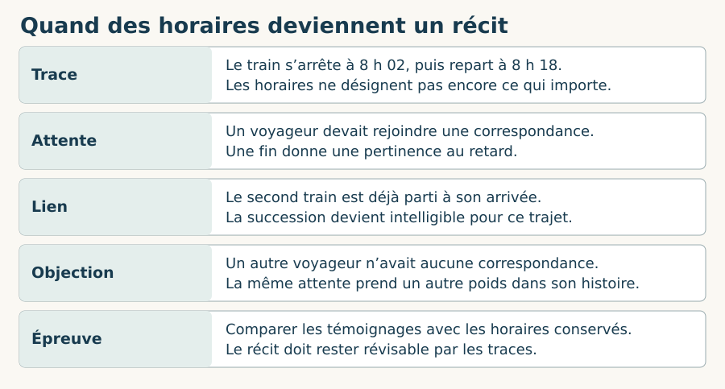
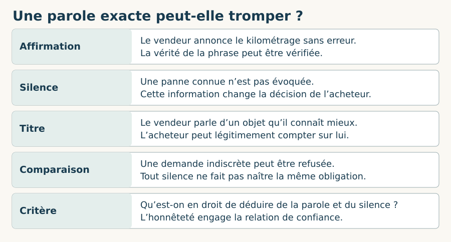

# BEL · AL — Philosophie (oral tronc commun 24 juin) 2026 · Corrigé brut

*Corrigé rédigé par IA, non officiel. Signalez toute erreur.*

**Rédaction** · GPT-6.2 Astra Ultra · vitesse non renseignée

**Autocontrôle** · GPT-6.2 Astra Ultra · vitesse non renseignée

**Révision** · GPT-6.2 Astra Ultra · vitesse non renseignée

Le [feuillet du 24 juin](https://www.ens.psl.eu/sites/default/files/sujet_oraux_philosophie_24_juin_al.pdf) contient 12 billets de deux sujets. Les développements suivent leur ordre. Le premier sujet a été choisi sur chacun des 12 billets. Le [rapport du jury](https://www.ens.psl.eu/sites/default/files/2026_al_rapport_oral_philosophie_tc.pdf#page=7) permet de vérifier les choix.

Lisez à haute voix les deux sujets du billet, choisissez pendant les 90 minutes de préparation et annoncez votre choix au début des 20 minutes d’exposé. L’entretien dure ensuite 10 minutes. Le coefficient est de 3. Seul un dictionnaire de langue française est autorisé, à l’exclusion des dictionnaires de noms propres.

## 1. Interpréter une œuvre d’art

Deux spectateurs voient un visage éclairé à demi dans un tableau. Le premier parle d’une menace, le second d’une apparition que le peintre aurait voulu laisser indécise. Interpréter commence quand on passe d’une description à une hypothèse sur ce que les rapports de formes font signifier. Les deux lectures ne se valent pas simplement parce qu’elles ont été formulées. On peut demander comment le reste du tableau, sa destination et les choix visibles de composition soutiennent ou contrarient chacune.

Faut-il alors trouver l’intention unique de l’auteur ? Une lettre du peintre peut rendre impossible une attribution historique fantaisiste, mais le résultat d’une œuvre dépasse parfois le projet annoncé. De plus, interpréter une sonate au piano signifie accomplir une possibilité de la partition par une exécution qui ne se réduit pas à un commentaire. Dans les deux sens, c’est une activité réglée et inventive. Une interprétation forte permet de voir ou d’entendre une relation que l’œuvre rend possible et que l’on peut à son tour éprouver. Elle accepte d’être corrigée par ce qui résiste à la première lecture.

### Faut-il des héros ?

Un récit d’entraide peut donner à des lecteurs le courage de prendre au sérieux une injustice qu’ils croyaient inévitable. Le héros rend alors visible une possibilité commune jusque-là peu reconnue. Mais concentrer sur une seule figure toute l’attention risque d’effacer les contributions ordinaires et de transformer une conduite exceptionnelle en obligation déraisonnable pour chacun. Une société qui exige constamment des héros doit peut-être d’abord se demander pourquoi ses institutions abandonnent des personnes à de pareilles épreuves. L’admiration est justifiable quand elle ouvre la discussion sur ce qui mérite d’être défendu et sur les conditions qui l’ont rendu possible. Elle devient dangereuse lorsqu’elle fait d’une personne un modèle infaillible ou dispense les autres de leur part de responsabilité.

## 2. L’âme et le corps

Je peux dire que je suis inquiet et qu’un nœud se forme dans mon estomac. Décrire deux aspects suffit-il à établir deux substances distinctes ? L’inquiétude a un sens, par exemple l’attente d’une nouvelle. La modification corporelle possède des causes et des manifestations observables. L’une ne se localise pas dans le corps à la façon d’un objet que l’on extrairait, et la connaissance de l’autre ne dit pas encore de quelle nouvelle je me soucie.

Descartes distingue la pensée et l’étendue tout en insistant, dans la sixième *Méditation*, sur l’union éprouvée de l’âme et du corps, notamment dans la faim et la douleur. Une autre perspective, celle d’Aristote dans le *De l’âme*, comprend l’âme comme principe du vivant organisé, et non comme un occupant venu s’installer dans une mécanique. Ces distinctions permettent de rouvrir la question posée par l’inquiétude. Une même personne vit, pense et ressent corporellement une situation. Expliquer les rapports entre ces opérations demande de ne pas convertir trop vite une différence de vocabulaire en séparation réelle ni de faire disparaître les significations sous une seule description mécanique.

### Pense-t-on différemment d’une langue à l’autre ?

Deux interlocuteurs décrivent le même trajet en choisissant l’un des points cardinaux, l’autre des repères relatifs au corps. Le vocabulaire et les habitudes de description peuvent orienter l’attention et la mémoire vers certains rapports. Cette observation n’autorise pas à affirmer que le locuteur d’une langue serait incapable de concevoir une relation qu’il exprime d’ordinaire au moyen d’une périphrase. Traduire, apprendre une langue et revenir sur une ambiguïté dans la sienne montrent justement que l’on peut se déplacer entre des formulations. La diversité linguistique produit des différences dans les chemins familiers de la pensée. Elle ne constitue pas un enfermement absolu. L’enjeu d’une comparaison précise est de distinguer une différence d’expression, une habitude d’attention et une impossibilité logique.

## 3. Peut-on se défaire de ses préjugés ?

Avant de pousser une porte sur laquelle une poignée est visible, je m’attends à pouvoir l’ouvrir sans enquête particulière. Une anticipation est indispensable à l’action. Elle devient préjugé si, devant une indication contraire, je continue à prendre ce que je pensais d’avance pour une raison suffisante. Il faut distinguer l’hypothèse révisable de l’opinion que l’on soustrait à l’épreuve, surtout lorsque celle-ci concerne des personnes aussitôt enfermées dans un jugement de groupe.

Se défaire d’un préjugé identifié est possible. Un enseignant peut, par exemple, confronter ses attentes sur la qualité d’une copie à une correction anonyme puis revenir sur les critères qui l’avaient égaré. Peut-on toutefois se défaire par décision de tous ses préjugés à la fois ? L’examen lui-même commence dans une langue, des habitudes de comparaison et une histoire que nous ne dominons pas entièrement. Dans la tradition de l’herméneutique, Gadamer interroge ces anticipations de compréhension et la façon dont une rencontre peut les mettre à l’épreuve. L’émancipation requiert ainsi un travail continu, individuel et collectif, dont la preuve tient à la possibilité concrète de corriger ses jugements.

### La matière

Un potier ne traite pas la terre comme une absence de forme prête à recevoir absolument n’importe quel projet. Son humidité et sa composition rendent certaines épaisseurs possibles et en font céder d’autres. La matière n’est donc pas seulement ce qui subsiste lorsqu’on retire mentalement toutes les qualités. Dans le rapport aristotélicien de la matière et de la forme, on peut demander de quoi telle chose est faite et quelle organisation en fait telle chose déterminée. Cette question change d’échelle avec la physique, qui construit d’autres concepts du constituant matériel à partir de mesures et de modèles. Aucune expérience du poids ou du toucher ne livre d’un coup la nature de toute matière. On peut reconnaître sa résistance sans la réduire à l’image familière d’une masse compacte et inerte.

## 4. Justice et vengeance

Une victime peut attendre d’un jugement public que le tort soit nommé devant ceux qui le niaient. Le même désir de voir la situation redressée pourrait aussi animer une demande de vengeance. Pourquoi tracer une différence, si la justice fait parfois subir une peine à celui qui a causé un dommage ? La mesure d’une vengeance est en principe commandée par la réponse de la personne ou du groupe atteint. Elle risque de ne jamais se clore, puisque l’autre partie peut compter la réponse comme un tort supplémentaire.

Un tiers institué exige des preuves, entend la défense et distingue réparation civile, peine et protection. Cette médiation n’exonère pas l’institution de justifier sa propre action. Une peine disproportionnée ou une procédure inaccessible peuvent aggraver le sentiment d’injustice sous le nom même de justice. L’exigence véritable ne consiste donc pas à demander à la victime de se désintéresser de sa cause. Elle consiste à faire droit à sa plainte dans une forme qui ne lui confère pas le pouvoir de prononcer seule le dernier mot, qui protège les personnes concernées et qui laisse ouvertes des voies de recours définies.

### Chanter

Une phrase parlée et la même phrase chantée ne font pas seulement passer les mêmes mots sous deux emballages. Tenir une voyelle, placer une respiration à un certain endroit et faire attendre une résolution musicale modifient ce que quelqu’un peut entendre dans ces mots. Il est aussi possible de chanter sans paroles ou de chanter à plusieurs au point que chacun se règle sur les autres voix. Chanter désigne alors une manière d’engager ensemble le corps, le temps et l’écoute. Cela peut exprimer une émotion déjà éprouvée, mais aussi la faire naître ou en transformer la qualité. Aucune de ces descriptions ne suffit à décider de la valeur d’un chant. Il faut examiner la pratique effective, qui chante avec qui, selon quelles formes et avec quel effet sur la relation.

## 5. Avons-nous besoin de récits ?

Un journal de bord aligne les heures auxquelles un train s’arrête. Pour comprendre pourquoi un voyageur a manqué une correspondance, on doit relier le retard à une attente, à un horaire et à la suite de son trajet. Un récit organise les événements selon ce qui leur donne du poids dans une histoire. Ce travail peut être indispensable pour expliquer une action et pour rendre une expérience partageable à quelqu’un qui ne l’a pas vécue.

Mais une vie doit-elle à tout prix former une histoire cohérente ? Un témoignage fragmentaire garde sa valeur même si la personne ne sait pas encore quel sens lui donner. Une belle intrigue peut aussi masquer les hasards ou les données contraires qui la défont. Dans *Temps et récit*, Ricœur étudie le pouvoir de mise en intrigue. L’utiliser avec justesse oblige également à laisser les traces éprouver la composition, surtout dans un récit historique. Nous avons besoin de récits pour articuler certaines expériences du temps et de l’action. Nous avons aussi besoin de savoir les interrompre, les confronter et en accepter plusieurs lorsque la cohérence d’un seul ferait taire des expériences différentes.

### L’excuse et le pardon

Quelqu’un explique qu’il n’a pas transmis un message parce qu’il ne l’a jamais reçu. Si les faits le confirment, le reproche perd son fondement. Une excuse peut ainsi réduire ou écarter la responsabilité. Pardonner suppose une autre situation, où un tort demeure imputable et où la personne lésée décide de ne plus régler toute sa relation à l’auteur sur ce tort. Le pardon ne transforme pas la faute en innocence et ne supprime pas automatiquement le droit à réparation ou l’intervention de la justice. Exiger le pardon au nom de l’explication reçue risquerait de priver la personne atteinte de sa place dans la décision. Il faut donc entendre les excuses, établir les responsabilités et laisser au pardon, lorsqu’il advient, le caractère d’un geste que personne ne peut faire à la place d’autrui.

## 6. Les personnes et les choses

Je peux prêter mon livre sans lui demander son accord. Je ne peux pas prêter le temps d’une amie dans les mêmes conditions. La différence tient moins à une propriété immédiatement visible qu’au statut de quelqu’un qui peut former des fins, consentir et présenter une réclamation. La formule de l’humanité chez Kant invite à ne jamais traiter une personne simplement comme un moyen. Coopérer consiste souvent à demander à quelqu’un un service, tout en reconnaissant sa capacité à décider à quelles conditions il le rend.

La distinction rencontre toutefois des cas qui en précisent la portée. Une personne qui ne peut actuellement s’exprimer reste titulaire d’une dignité et de droits. Une chose peut être inaliénable en raison de sa valeur commune, sans devenir une personne humaine. Et la personnalité juridique peut être reconnue à des entités collectives. Il faut donc distinguer catégorie juridique, considération morale et propriété physique. La frontière entre personnes et choses protège contre l’appropriation des individus. La faire jouer avec discernement exige de dire quelle opération, propriété, vente, représentation ou consentement, on entend permettre ou interdire dans chaque cas.

### Peut-on dire que le temps passe ?

Un train passe devant quelqu’un qui reste sur le quai. Devant quoi le temps passerait-il, et à quelle vitesse ? La comparaison spatiale devient embarrassante si l’on suppose un second temps qui mesurerait le passage du premier. Elle reste pourtant intelligible dans l’expérience, ce qui était attendu devient présent puis objet de souvenir. Augustin, au livre XI des *Confessions*, interroge cette tension à partir de l’attente, de l’attention et de la mémoire. Une horloge mesure des intervalles à travers des changements réguliers. Elle ne montre pas le temps comme un objet mobile de plus. On peut donc parler du temps qui passe pour désigner la transformation des rapports entre présent, souvenir et avenir, à condition de ne pas prendre l’image du mouvement pour une explication littérale.

## 7. Hésiter

Devant deux lettres de candidature, une jurée suspend son choix parce qu’une expérience professionnelle lui paraît pouvoir être interprétée de deux manières. Son hésitation n’atteste ni l’absence de raisons ni un défaut de caractère. Elle découvre au contraire une raison de vérifier son critère. L’hésitation se distingue de l’incertitude sur un fait lorsque plusieurs possibilités d’action se présentent avec des motifs incompatibles ou difficiles à comparer.

Elle peut néanmoins se prolonger après que toute information accessible a été examinée. Chercher encore un indice peut alors masquer le refus d’assumer la part de jugement qui demeure dans une décision. Aristote rattache la délibération à ce qui dépend de nous et peut être autrement. On ne délibère pas utilement sur chaque fait qui se soustrait à notre pouvoir. Une hésitation féconde identifie l’élément qui pourrait faire une différence, un témoignage à entendre ou un principe à préciser. Quand aucun renseignement supplémentaire n’est raisonnablement disponible, décider revient à répondre du choix sous cette incertitude, sans faire passer la décision pour une certitude qu’elle ne possède pas.

### Le document

Une liste de prix conservée dans une boîte devient un document pour qui enquête sur l’approvisionnement d’une ville. Son existence antérieure ne dépend pas de l’historien, mais son rôle de document dépend de la question qu’il lui adresse. Il faut déterminer qui l’a produite, dans quelle monnaie, pour quels achats et quelle période. Même un faux peut être un document authentique sur une tentative de falsification, tout en cessant de prouver le fait qu’il prétendait attester. Marc Bloch insiste sur le travail critique qui permet de faire parler des témoignages volontaires ou involontaires. La matérialité d’une trace limite les récits compatibles avec elle. Elle ne dispense jamais de reconstruire les conditions de sa signification et de la confronter à d’autres pièces.

## 8. Peut-on prouver l’existence ?

Une démonstration qu’il existe un nombre pair compris entre deux entiers donnés peut consister à le construire et à vérifier ses propriétés. Prouver qu’une espèce vit dans une vallée demande des observations documentées. Le verbe « exister » n’intervient pas selon les mêmes règles dans une construction mathématique et dans l’enquête sur un être matériel. Ne pas voir un animal pendant une visite ne démontre pas son absence.

La difficulté métaphysique apparaît lorsqu’on prétend tirer l’existence effective d’une chose de sa seule définition. Kant soutient dans sa critique de la preuve ontologique que l’existence n’est pas un prédicat réel qu’on ajouterait au concept d’une chose pour le rendre plus complet. Décrire exactement un objet possible ne fournit pas à soi seul la raison d’affirmer que cet objet est effectivement donné. Il faut donc demander de quelle existence, de quelle preuve et de quel domaine il s’agit. Ni un refus universel de toute preuve ni une confiance universelle dans la seule analyse des concepts ne fait justice à la diversité de nos pratiques de démonstration et d’attestation.

### Les mythes

Une communauté raconte la fondation de sa ville par deux frères. Le récit peut demeurer décisif dans une fête civique même si aucune archive ne confirme les personnages. Le mythe organise alors des rapports entre des lieux, une origine et des obligations communes. Le rapport à la vérité n’est pas celui d’un compte rendu que l’on vérifierait phrase par phrase, ce qui ne met pas ses usages à l’abri de la critique. Une origine légendaire peut faire taire d’autres habitants ou légitimer un pouvoir. La comparaison de versions, importante chez Lévi-Strauss, permet d’identifier des transformations et des oppositions au lieu de chercher seulement la version authentique. Les mythes donnent une forme partageable à des problèmes. Comprendre cette fonction laisse entière la discussion sur ce que leur représentation autorise ou exclut.

## 9. La beauté a-t-elle une histoire ?

Dans un musée, le classement des tableaux et l’histoire des restaurations modifient les occasions que nous avons de trouver certaines œuvres belles. Cela suffit à montrer que les conditions de notre jugement ont une histoire. Mais la question va plus loin. Est-ce seulement l’accès à une beauté permanente qui varie, ou les critères mêmes selon lesquels une forme vaut-elle la peine d’être regardée ?

L’histoire des jardins met la difficulté au travail. Un axe rectiligne peut être admiré pour l’ordre qu’il fait paraître, un jardin irrégulier pour la surprise qu’il ménage à la promenade. Les manières de se déplacer, les arts du paysage et les discours sur la nature offrent des raisons historiquement situées à ces appréciations. Cela ne transforme pas tout jugement en caprice daté. On peut encore inviter un autre visiteur à essayer le même parcours et à examiner ce qu’il éprouve. La prétention au partage analysée par Kant dans le jugement de goût n’exige pas que tous les hommes aient déjà jugé de même. La beauté a donc une histoire dans les formes et les regards qui la font reconnaître, et cette histoire reste ouverte à des rencontres qui déplacent les accords hérités.

### Manger

Un plat répond à la faim, mais sa préparation, l’heure du repas et le fait de le partager appartiennent à une histoire sociale. L’acte d’incorporer ce qui était extérieur à soi se trouve à la rencontre d’une nécessité vitale et d’une pratique symbolique. L’invitation à manger peut reconnaître l’autre comme hôte. Imposer un menu unique sans tenir compte d’un besoin médical ou d’une conviction peut au contraire entraver sa participation. Il faut aussi considérer qui a cuisiné et dans quelles conditions les aliments arrivent sur la table. Manger ne se réduit donc ni à l’absorption de nutriments ni à la mise en scène d’une culture. C’est une dépendance corporelle que les sociétés organisent, partagent et transforment de façons susceptibles d’être jugées.

## 10. Tenir sa parole

Tenir sa parole prend du temps. La personne qui promet aujourd’hui engage un soi futur qui pourra avoir changé de préférences. Pourquoi le désir nouveau n’annule-t-il pas le premier ? Parce qu’une promesse faite à quelqu’un lui donne déjà une raison d’agir et une autorité pour demander des comptes. Tenir parole préserve la confiance de l’autre et manifeste, selon la distinction de Ricœur entre identité comme permanence des traits et comme maintien de soi, une continuité qui ne dépend pas de l’immobilité du caractère.

Cependant une fidélité littérale pourrait trahir l’objet de la promesse. J’ai promis un déplacement pour accompagner une amie. Une fermeture imprévue empêche ce trajet précis et je peux chercher avec elle un autre moyen d’être effectivement présent. L’impossibilité doit être expliquée, et la révision ne se décide pas seul lorsque l’engagement a créé une attente légitime. Tenir sa parole signifie donc répondre durablement d’une parole donnée, dans son bénéfice, ses conditions et ses limites. Cela peut exiger l’exécution exacte, une demande de déliaison ou une réparation, selon ce que l’on doit réellement à celui qui a compté sur nous.

### À quoi servent les encyclopédies ?

On peut lire une encyclopédie pour vérifier un nom et en sortir avec une question nouvelle grâce au renvoi vers une discipline voisine. L’ouvrage exerce une double fonction, localiser une connaissance et construire des relations entre des domaines séparés. Dans l’*Encyclopédie* de Diderot et d’Alembert, les planches relatives aux métiers font aussi accéder des procédés techniques à la dignité de savoir public. Ce dispositif implique des choix de sélection dont il faut pouvoir rendre compte. Une entrée silencieuse sur des pratiques minoritaires peut donner à son lecteur l’illusion d’une exhaustivité. Les encyclopédies servent le mieux l’autonomie lorsqu’elles permettent de remonter vers leurs sources, de comparer des définitions et de reconnaître ce que leur classement ne contient pas encore.

## 11. L’honnêteté

Un vendeur indique exactement le kilométrage d’un véhicule mais omet de signaler la panne qu’il sait susceptible de se reproduire. Toutes les phrases qu’il a prononcées peuvent être vraies. Cela suffit-il à le dire honnête ? L’honnêteté concerne la façon de se rapporter aux attentes légitimes d’autrui dans une pratique de confiance. Elle demande davantage que l’absence littérale d’une phrase fausse et ne réclame pourtant pas de révéler toutes les informations personnelles dont on dispose.

Pour déterminer ce qui doit être dit, examinons le titre sous lequel on parle et ce dont dépend la décision de l’autre. Le vendeur possède une information décisive à laquelle l’acheteur n’a pas le même accès. La personne à qui l’on demande sans raison un détail intime peut au contraire refuser la question sans manquer d’honnêteté. L’exigence porte aussi sur soi, dans la disposition à reconnaître que certaines raisons furent omises ou embellies. Être honnête ne se mesure ni à la brutalité d’un aveu ni à une prétention de transparence totale. Il s’agit de répondre loyalement de ce que ses paroles et ses silences donnent à autrui de bonnes raisons de croire.

### De quoi y a-t-il histoire ?

Il y a des changements que l’on peut dater sans avoir encore construit l’histoire d’un objet. Une courbe annuelle des prix devient une histoire du marché lorsqu’une enquête détermine qui échange, selon quelles institutions et pourquoi les catégories de mesure ont varié. L’histoire n’est pas réservée pour autant aux seuls États ou aux seules intentions individuelles. Des paysages, des gestes ou des maladies peuvent en devenir les objets, avec des sources et des méthodes appropriées. Il faut encore distinguer l’histoire telle qu’elle advient et l’histoire connaissable à partir des traces disponibles. Un objet devient historiquement étudiable lorsque l’on peut poser une question sur ses transformations, identifier des temporalités et examiner des indices partageables. L’historien construit cette délimitation sans inventer à volonté les événements qu’elle lui permet d’interroger.

## 12. Avons-nous besoin des œuvres d’art ?

Dire que l’on peut survivre plusieurs jours sans musique ni peinture ne règle qu’une question physiologique immédiate. Dire inversement que toute personne devrait admirer les mêmes œuvres confondrait un besoin et une prescription de goût. Il s’agit de demander ce que certaines pratiques artistiques permettent dans une vie personnelle ou commune et si cette fonction se laisse remplacer sans perte.

Une chanson donne à un groupe dispersé une occasion de faire entendre un souvenir commun. Un tableau rend visible une expérience qu’aucune information sommaire n’avait réussi à partager. Ces exemples ne signifient pas que seule l’œuvre nommément choisie aurait pu avoir cet effet. Ils montrent qu’un monde où seul compte l’utile déjà mesuré nous retirerait des formes d’attention, de représentation et de relation. L’œuvre peut également déranger au lieu de consoler et nous faire découvrir un besoin dont nous n’avions pas conscience. Nous avons besoin de la possibilité de faire, d’éprouver et de discuter des œuvres pour développer ces facultés communes et singulières. Cela donne de bonnes raisons de rendre l’art accessible sans imposer à chacun le contenu de son expérience.

### Pacifier

Un conflit disparaît de la place publique parce que les personnes qui le portaient n’osent plus parler. Est-ce une pacification réussie ? La cessation visible du désordre compte, mais elle ne dit pas ce qui a été fait des désaccords et des droits. Pacifier peut signifier faire cesser une hostilité immédiate ou établir des conditions dans lesquelles les différends se règlent durablement selon des procédures communes. Ce second sens exige de reconnaître les parties, d’ouvrir des recours et de rendre possibles des engagements auxquels chacune peut raisonnablement se fier. Le mot a également pu masquer une domination historique sous le langage du retour à l’ordre. Son emploi appelle donc une question de vérification, qui peut désormais se faire entendre, de quelle manière et sous quelles garanties ? Une paix durable laisse place à des désaccords qu’il devient possible de traverser ensemble.
