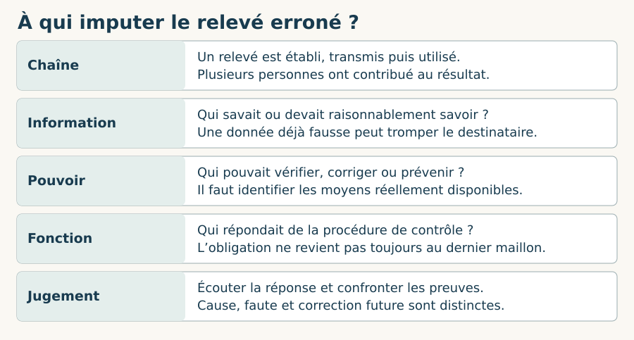
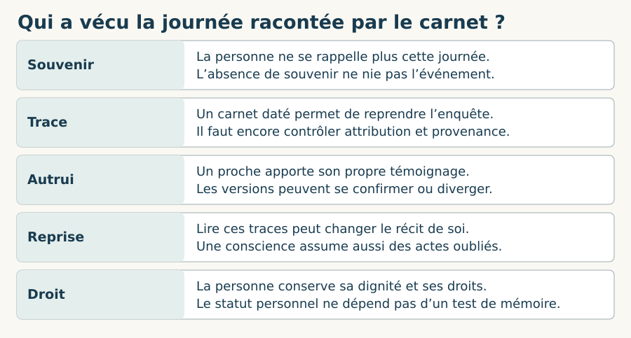

# BEL · AL — Philosophie (oral tronc commun 26 juin commission 2) 2026 · Corrigé guidé

*Corrigé rédigé par IA, non officiel. Signalez toute erreur.*

**Rédaction** · GPT-6.2 Astra Ultra · vitesse non renseignée

**Autocontrôle** · GPT-6.2 Astra Ultra · vitesse non renseignée

**Révision** · GPT-6.2 Astra Ultra · vitesse non renseignée

Le [feuillet du 26 juin, commission 2](https://www.ens.psl.eu/sites/default/files/sujet_oraux_philosophie_2_al.pdf) contient 12 billets de deux sujets. Les développements suivent leur ordre. Le premier sujet a été choisi sur chacun des 12 billets. Le [rapport du jury](https://www.ens.psl.eu/sites/default/files/2026_al_rapport_oral_philosophie_tc.pdf#page=8) permet de vérifier les choix. Dans l’[index officiel](https://www.ens.psl.eu/rapports-et-sujets-du-concours-2026-section-des-lettres-groupe-al), les liens du 29 reprennent les fichiers datés du 26.

Lisez à haute voix les deux sujets du billet puis annoncez votre choix au début de l’exposé. Seul un dictionnaire de langue française est autorisé, à l’exclusion des dictionnaires de noms propres. Pour essayer l’autre sujet, utilisez la question d’entretien et la piste de réponse placées après son développement.

## Douze exercices d’entretien

La feuille du 26 juin, commission 2, donne les alternatives entre parenthèses. Les premiers termes sont les choix attestés en gras dans le rapport, page 8. La préparation dure 1 h 30 et précède vingt minutes de leçon et dix minutes de questions. Chaque relance ci-dessous est un exercice proposé pour approfondir un billet.

1. **Une cérémonie peut-elle réussir si tous n’éprouvent pas le même sentiment ?** Elle peut reconnaître publiquement un statut sans uniformiser les affects. Il faut examiner si l’on demande aux participants de prendre acte ou d’exprimer un accord. Sur le consensus, faire la différence entre accord obtenu et silence imposé.
2. **Avoir causé quelque chose suffit-il à être fautif ?** Non, la faute requiert un examen de la règle, des connaissances et des moyens d’agir. Pour le détail, dire quelle hypothèse la trace sur le cadre permet de tester et quelle autre origine elle pourrait avoir.
3. **Une cabane éloignée est-elle hors de la civilisation ?** Son plan, ses outils et le statut du terrain prolongent des relations collectives. La distance reste un moyen d’éprouver d’autres usages. Sur la contingence, distinguer « je ne sais pas pourquoi » et « cela aurait pu ne pas être ».
4. **Un individu doit-il prouver qu’il parle pour être respecté comme humain ?** Sa dignité ne dépend pas d’une épreuve de performance. L’enquête sur les capacités animales et humaines répond à une autre question. Pour le mensonge, demander quel droit à l’information l’interlocuteur possède.
5. **Une cause sincère rend-elle juste tout refus de la loi ?** Il faut des raisons publiquement discutables et une attention aux droits des autres. Sur l’art, préciser que l’apprentissage du regard transforme la perception du paysage sans agir matériellement sur les nuages.
6. **Écouter ceux qui contestent le projet affaiblit-il l’engagement ?** Cela peut lui donner une fin et des moyens mieux ajustés à la réalité des lecteurs et des personnels. Pour l’attente, comparer le repos sur le quai avec l’impossibilité de quitter une file sans perdre son tour.
7. **Pourquoi le bon fonctionnement social ne suffit-il pas ?** Une distribution injuste des tâches peut se reproduire longtemps. L’analogie avec les organes doit donc laisser place à la discussion des fins. Sur l’autorité, demander dans quel domaine précis le témoin mérite crédit.
8. **Une habitude ancienne suffit-elle à produire une règle de droit ?** Il faut aussi identifier une obligation reconnue et une manière d’en discuter la portée lorsqu’elle est contestée. Pour habiter, observer ce que le logement permet d’organiser au fil du temps.
9. **Une démocratie devrait-elle faire disparaître tous les conflits ?** Leur expression réglée permet de rendre visibles des intérêts et des torts. Elle exclut que vaincre un adversaire signifie lui retirer ses droits. Pour le design, comparer deux poignées répondant à la même fin pour des usagers différents.
10. **Parler et avoir voix au chapitre sont-ils équivalents ?** Un témoin peut être entendu physiquement sans que son témoignage soit accepté comme une raison d’examiner une décision. Pour la révolution, isoler le changement dans la source déclarée de l’autorité.
11. **Que vaut un souvenir que d’autres traces démentent ?** Il témoigne de mon expérience présente de me souvenir, mais l’attribution de l’événement doit être réexaminée. Pour le politique, distinguer le concurrent légitime de l’ennemi désigné comme étranger aux droits communs.
12. **Comment connaître un monde animal sans le lui inventer ?** Faire varier les observations, comparer les réponses et mettre à l’épreuve les hypothèses anthropomorphiques. Pour le passé, citer une trace dont l’authenticité ou la datation pourrait faire changer la conclusion.

## 1. Les cérémonies

La remise d’un diplôme ne change parfois rien à la date officielle d’obtention. Ce que la cérémonie ajoute est une situation où la qualification devient publiquement reconnue par des personnes présentes ensemble. Les gestes et les paroles ne communiquent pas seulement un renseignement, ils inscrivent une transition dans une mémoire commune. Dans d’autres cas, un acte prononcé selon les procédures contribue lui-même à produire le changement de statut. L’analyse des actes de langage d’Austin permet de demander qui a compétence, dans quelle circonstance et pour quel effet.

Cette puissance peut aussi être mise en scène là où l’accord manque. Une assistance debout peut donner l’apparence d’une unanimité que personne n’a réellement eu l’occasion d’exprimer. Inversement, refuser tous les rites comme de simples apparences empêcherait de voir le travail de reconnaissance et de deuil qu’ils rendent possible. Juger une cérémonie exige de distinguer ce qu’elle commémore, ce qu’elle institue et ce que la participation signifie pour chacun. Sa forme vaut par les relations qu’elle rend visibles et par la place qu’elle laisse aussi à ceux qui n’en partagent pas tous les présupposés.

### Faut-il toujours viser le consensus ?

Un conseil qui décide d’une règle commune a intérêt à ce que chacun puisse en comprendre les raisons. Un accord large peut stabiliser la décision et révéler que les objections sérieuses ont été prises en compte. Mais exiger l’unanimité avant toute action rend possible un blocage permanent, et traiter tout désaccord comme une faute peut étouffer une minorité. Un silence obtenu sous pression ne fournit aucune preuve d’un accord réfléchi. L’objectif raisonnable est donc de construire des conditions équitables de discussion, puis d’annoncer la règle de décision et les possibilités de révision. Le consensus mérite d’être recherché quand il résulte de l’examen et respecte la possibilité de rester en désaccord. Il ne constitue pas une fin qui rendrait acceptable n’importe quelle manière de l’obtenir.

**À l’entretien. Un accord unanime clôt-il nécessairement la délibération ?** Examiner comment s’est formée l’unanimité. Une objection écartée par la pression du groupe reste une objection. L’existence d’un procès-verbal et la possibilité de rouvrir la question donnent un contenu à l’accord.

## 2. À quelles conditions est-on responsable ?

Une erreur résulte d’un relevé mal transmis. Participer à la chaîne qui l’a produite suffit-il à la rendre imputable ? Une personne peut être une cause matérielle de l’erreur tout en ayant reçu un relevé déjà faux qu’elle n’avait aucun moyen raisonnable de vérifier. Inversement, un responsable de service peut devoir répondre d’une procédure de contrôle défectueuse sans avoir personnellement recopié le nombre. Responsabilité causale, faute et obligation de rendre des comptes ne se superposent pas.

On doit donc demander ce que chacun pouvait savoir, quelles options étaient disponibles, quelles obligations découlaient de sa fonction et quels effets il pouvait raisonnablement prévoir. L’ignorance ne disculpe pas toujours, notamment lorsqu’on avait précisément le devoir de s’informer. Une responsabilité tournée vers l’avenir peut encore obliger à agir pour éviter que l’erreur se répète, même après une défaillance sans faute individuelle établie. À ces conditions s’ajoute une exigence de procédure, permettre à la personne de répondre et contrôler les preuves. Une imputation juste est une attribution argumentée, dont la portée change avec le type de responsabilité examiné.

### Le sens du détail

Un restaurateur remarque sur un cadre une trace de fixation presque invisible. Ce détail devient important parce qu’il peut modifier la manière dont on reconstitue l’accrochage d’origine. Le sens du détail ne consiste donc pas à accumuler indistinctement les petites observations. Il unit attention et jugement sur ce qui pourrait mettre une hypothèse à l’épreuve. Une minuscule irrégularité peut aussi n’être qu’un accident récent sans rapport avec l’histoire recherchée. Pour lui donner sa vraie portée, il faut comparer, dater et revenir à l’ensemble. Le détail a une double valeur, il permet de corriger une représentation générale et peut empêcher de voir le principal lorsqu’on lui accorde un poids que rien ne justifie.

**À l’entretien. À quel moment une petite différence devient-elle un détail décisif ?** Une virgule change parfois le sens d’une consigne. Comparer les deux lectures et leurs effets permet de montrer pourquoi ce trait importe ici. Sa taille matérielle n’est pas la mesure de sa portée.

## 3. Peut-on fuir la civilisation ?

Une personne qui quitte la ville pour une maison isolée emporte des outils, parle une langue apprise et consulte des cartes établies collectivement. Elle a changé de milieu sans sortir de toutes les relations à travers lesquelles elle sait habiter ce lieu. La civilisation peut désigner un mode technique et institutionnel particulier ou, de façon plus large, des formes de vie héritées et organisées. Fuir certaines contraintes est possible. Sortir totalement de toute médiation sociale par un simple déplacement l’est beaucoup moins.

La critique de la civilisation garde pourtant un sens. Le retrait volontaire peut rendre visibles des dépendances auparavant inaperçues et ouvrir un autre partage du temps ou des ressources. Dans *Walden*, Thoreau expérimente une manière de vivre qui reste matériellement et intellectuellement en rapport avec la société voisine. La distance acquise sert à interroger les fins ordinaires de l’activité. Il faut donc distinguer une fiction d’origine absolument pure et une expérience située de transformation. Certaines choses quittées continueront de soutenir la vie nouvelle, ce qui n’abolit pas la valeur critique du changement effectivement accompli.

### La contingence du monde

Ma présence dans une pièce s’explique par un rendez-vous qui aurait pu être reporté. Le caractère contingent d’un fait signifie qu’il est mais aurait pu être autrement. Peut-on étendre sans autre argument cette modalité à la totalité du monde ? De la contingence de chaque événement examiné ne suit pas immédiatement celle de l’ensemble, pas plus qu’une explication d’un fait particulier ne répond à la demande de savoir pourquoi il y a quelque chose. Leibniz articule cette demande au principe de raison suffisante et distingue ce qui est nécessaire de ce qui existe dans un monde possible déterminé. Pour en discuter, il faut séparer ce que nous ne savons pas prévoir, ce qui manque d’explication connue et ce qui pourrait réellement ne pas être. L’ignorance d’une nécessité ne prouve pas à elle seule la contingence.

**À l’entretien. Ce qui aurait pu être autrement est-il pour autant sans cause ?** L’emplacement d’une gare dépend de décisions et de contraintes identifiables. D’autres tracés étaient possibles. Distinguer l’explication du tracé retenu et la démonstration qu’aucun autre monde n’était possible.

## 4. Humanité et animalité

Le biologiste classe l’être humain parmi les animaux. Dans la langue morale, le même mot « animalité » peut servir à retrancher quelqu’un de l’humanité à cause d’une conduite jugée brutale. Ce changement de sens est dangereux. Une classification biologique ne détermine pas le statut moral d’une personne et la condamnation d’un geste ne retire pas à son auteur sa dignité. Comment penser la continuité du vivant et les différences qui comptent sans convertir celles-ci en injures ou en privilèges arbitraires ?

La comparaison des pratiques fait apparaître des différences de langage, de transmission et d’institution, mais aussi des apprentissages, des attachements et des formes de coopération partagés avec certaines espèces. Elle demande des critères précis et attentifs à la diversité du vivant. Définir l’humanité par une performance qu’un individu devrait réussir pour être respecté exclurait ceux qui ne peuvent actuellement parler ou argumenter. L’humanité désigne une appartenance et une exigence de considération, l’animalité rappelle notre dépendance commune à l’égard de corps et de milieux. Les distinguer selon les questions posées évite aussi de transformer l’attention aux animaux en une simple ressemblance avec nous.

### Pourquoi mentir ?

Cacher une faute, préserver une surprise ou tenter d’éviter un reproche font apparaître des motifs différents de tromper. Expliquer le motif ne suffit pas à justifier la conduite. Le mensonge exploite généralement l’attente de sincérité d’autrui pour orienter sa représentation de la situation et par là sa décision. Une personne qui feint de tenir une promesse obtient aujourd’hui un avantage en transférant à demain le coût de sa parole. Une demande d’information illégitime appelle toutefois une autre question, le demandeur a-t-il seulement droit à une réponse ? On peut parfois refuser de parler sans affirmer un faux. Pour juger d’un motif de mentir, il faut demander quelle confiance est engagée, qui supportera les effets de la tromperie et quelles autres réponses respecteraient mieux les personnes concernées.

**À l’entretien. Taire une information et mentir relèvent-ils toujours du même motif ?** Comparer une discrétion demandée par un ami et une réponse fausse destinée à tromper un client. Examiner l’intention, le droit d’interroger et les conséquences du silence avant d’attribuer une justification morale.

## 5. La désobéissance civile

Des citoyens refusent publiquement de se conformer à une règle qu’ils tiennent pour injuste et donnent leurs raisons à ceux qui partagent avec eux les institutions. Pourquoi ce refus se réclame-t-il encore du droit ? Dans *Théorie de la justice*, Rawls analyse une désobéissance publique, politique, non violente et consciencieuse adressée au sens de la justice de la majorité dans une société presque juste. Cette caractérisation permet de distinguer la demande de révision d’un acte qui ne chercherait qu’un avantage privé.

La publicité d’une cause ne garantit pourtant pas sa justice. Il faut examiner les droits en jeu, la possibilité effective de faire entendre la plainte et les effets sur les autres membres de la communauté. Une démocratie gagnerait peu à tenir toutes les lois pour révisables en théorie tout en disqualifiant systématiquement ceux qui signalent l’insuffisance de voies de recours. Inversement, le simple fait d’être sincère ne crée pas une exemption générale. La désobéissance civile met ainsi à l’épreuve la relation entre légalité et légitimité, en appelant à des raisons qu’une communauté peut discuter même quand elle en conteste la conclusion.

### Entre l’art et la nature, qui imite l’autre ?

Un peintre compose un coucher de soleil à partir d’observations. Plus tard, des promeneurs désignent un ciel réel comme « un Turner ». Dans le premier cas, le paysage fournit des phénomènes que l’artiste sélectionne et transforme. Dans le second, la peinture a donné une habitude de voir qui rend l’atmosphère reconnaissable sous un autre rapport. L’aphorisme paradoxal de Wilde dans *Le Déclin du mensonge* éclaire cette seconde direction. Il ne signifie pas que les nuages auraient physiquement copié le tableau. L’art peut imiter des configurations naturelles et surtout modifier la manière dont elles apparaissent à un regard cultivé. Les directions de l’imitation ne sont compatibles qu’après avoir distingué production matérielle, représentation et formation de l’attention.

**À l’entretien. Une peinture peut-elle apprendre à regarder un paysage ?** Après avoir étudié des contrastes peints, le promeneur remarque une lumière jusque-là négligée. La peinture ne produit pas cette lumière. Elle transforme les habitudes grâce auxquelles le paysage devient perceptible.

## 6. Militer

Assister régulièrement aux réunions d’une association de défense de l’accès aux bibliothèques, écouter des usagers et porter une demande auprès d’un conseil municipal constituent un engagement militant. Ce qui le distingue d’une simple préférence est la continuité d’une action orientée vers une cause que d’autres peuvent reprendre. Le militant parle souvent au nom d’un groupe. Comment éviter que la fidélité à cette cause ne devienne fidélité inconditionnelle à sa propre organisation ?

Il faut d’abord examiner ce que l’intervention change pour les personnes concernées et la place qu’on leur laisse dans la formulation des demandes. Des horaires étendus peuvent servir certains lecteurs mais créer des charges invisibles pour les personnels. Dans *Le Savant et le Politique*, Weber distingue l’attention à la cohérence d’une conviction et la responsabilité envers les conséquences prévisibles d’un engagement. Les deux exigences entrent parfois en tension sans que l’on puisse en supprimer une. Militer de manière responsable demande de soutenir collectivement une raison d’agir et d’accepter les informations ou les objections qui conduiraient à corriger les moyens et, si nécessaire, la cause telle qu’on l’avait formulée.

### L’attente

Un voyageur arrive en avance et lit sur le quai. Un autre, privé d’information sur une correspondance indispensable, regarde l’horloge toutes les minutes. Ils disposent objectivement du même intervalle. L’attente organise autrement ce temps par l’événement espéré et par la possibilité, ou l’impossibilité, de se consacrer à autre chose. Elle peut être active, préparer un accueil, s’exercer ou écouter, ou devenir une prise exercée par autrui sur notre disponibilité. Dans le rapport à une promesse, faire attendre sans prévenir peut ainsi déprécier le temps de l’autre. Comprendre l’attente consiste à décrire non seulement sa durée mais l’horizon, la maîtrise des informations et les possibilités d’action qui lui donnent sa qualité vécue.

**À l’entretien. Pourquoi une heure d’attente ne ressemble-t-elle pas toujours à une autre ?** Comparer un délai annoncé et un retard sans terme connu. La durée mesurée est la même. Les possibilités de mener un autre projet et de faire confiance à une promesse changent l’expérience du temps.

## 7. Une société est-elle analogue à un organisme ?

Une ville dépend d’une distribution de l’eau, de la collecte des déchets et de moyens de communication dont les défaillances affectent rapidement l’ensemble. L’analogie organique permet de remarquer des dépendances que l’on manquerait en regardant les activités séparément. Durkheim appelle « organique » la solidarité liée à la différenciation des fonctions dans *De la division du travail social*. Une analogie aide à formuler une question. Elle ne démontre pas que toute organisation sociale fonctionne comme un corps vivant.

Les personnes qui concourent à un même service peuvent discuter du but, refuser certaines conditions et transformer les règles de leur coordination. Une menace commence quand on traite un groupe en désaccord comme on traiterait un élément défaillant qu’il faudrait éliminer. De plus, une répartition durable du travail peut être injuste, alors même que le système continue de fonctionner. La santé d’un organisme et la justice d’une société ne se définissent donc pas par le même critère. La comparaison éclaire l’interdépendance. Le jugement politique doit encore reconnaître que les parties sont des acteurs capables de juger du tout et de partager le pouvoir d’en modifier les fins.

### L’argument d’autorité

Je crois la date d’un manuscrit sur le témoignage d’une spécialiste dont je ne peux pas refaire en quelques minutes toute l’expertise. Mon raisonnement peut être raisonnable si sa compétence est pertinente, si elle renvoie à des indices accessibles et si les lectures concurrentes ont pu intervenir. Il se transforme en argument d’autorité fermé lorsqu’un nom ou un titre tient lieu de preuve et disqualifie d’avance toute objection. La différence porte donc sur le rôle accordé à la source, sur le domaine de compétence et sur les possibilités de contrôle. Une science ou une société sans aucune confiance dans les témoignages serait impraticable. Une confiance révisable, proportionnée aux raisons de croire tel témoin dans tel domaine, laisse subsister l’obligation de juger.

**À l’entretien. Quand est-il raisonnable de se fier à l’avis d’un spécialiste ?** Vérifier sa compétence sur la question, les contrôles auxquels son résultat a été soumis et les raisons d’un éventuel désaccord. Une division du travail intellectuel est défendable si elle conserve des moyens de vérification.

## 8. Droit et coutume

Des voisins laissent depuis longtemps un passage dans une cour commune. Cette pratique peut être une simple commodité jusqu’au jour où quelqu’un affirme qu’il serait illégitime de fermer le passage, même en l’absence d’un service amical particulier. On passe alors de « cela se fait » à « on est tenu de le faire ». L’habitude répétée ne constitue pas automatiquement un droit. La coutume susceptible de valoir norme associe une pratique et la conviction d’une obligation dont une communauté ou une juridiction peut reconnaître la portée.

La loi écrite apporte publicité, précision et possibilité de rupture avec un usage injuste. Elle ne crée pourtant pas toutes les règles à partir de rien. Elle peut reprendre une coutume, la préciser ou l’écarter lorsqu’elle contredit une garantie supérieure. Inversement, un texte appliqué sans attention aux usages réels peut manquer les relations qu’il voulait organiser. Le droit et la coutume se distinguent donc selon les manières d’établir, d’identifier et de contester la règle. Ils s’éclairent mutuellement lorsqu’on suit un litige concret et qu’on demande qui reconnaît l’obligation et selon quelle procédure.

### Habiter

Un voyageur a dormi une nuit dans une chambre d’hôtel. Un voisin occupe depuis longtemps un appartement dans lequel il lui est interdit de déplacer le moindre meuble. Résider, s’abriter et habiter ne désignent pas exactement la même expérience. Habiter suppose de pouvoir reconnaître des chemins, disposer des objets, nouer des relations et donner une certaine continuité à sa présence. La propriété juridique facilite parfois cette prise, mais un locataire peut habiter pleinement un lieu et un propriétaire en demeurer étranger. Il faut donc examiner le temps, la sécurité de l’occupation et les usages permis. Une ville habitable offre plus qu’un stock de logements. Elle doit aussi rendre possibles les manières concrètes de s’orienter, de rencontrer et de prendre part au voisinage.

**À l’entretien. Une adresse administrative suffit-elle pour dire qu’on habite quelque part ?** Regarder si la personne peut y organiser son temps, recevoir quelqu’un et maintenir des relations dans le voisinage. L’adresse établit un statut. L’habitation implique aussi une certaine prise sur un milieu.

## 9. Conflit et démocratie

Dans un régime où plusieurs partis peuvent se présenter, leur désaccord ne signale pas forcément l’échec du lien politique. Il manifeste que la décision publique est ouverte à une pluralité d’intérêts et de jugements. Le conflit devient même une ressource lorsqu’il met en discussion une injustice que l’accord apparent des dirigeants rendait invisible. Mais toute querelle n’est pas démocratique par sa seule intensité. Un groupe qui veut retirer à ses contradicteurs l’égalité des droits cherche à fermer l’espace commun du différend.

La démocratie institue donc la possibilité du conflit et des moyens de le traverser, vote, droit d’opposition, publicité des raisons et recours juridictionnels. L’issue d’une décision doit être applicable sans faire du perdant un exclu du prochain débat. Il faut aussi regarder l’accès effectif à ces institutions, car un droit de réponse purement théorique peut masquer l’inégalité des ressources. Le conflit et la démocratie se soutiennent dans la mesure où des adversaires disposent d’une qualité reconnue pour faire valoir leurs raisons, accepter une issue provisoire et reprendre la discussion quand la situation change.

### La forme suit-elle la fonction ?

Une poignée allongée permet de saisir la porte. Mais de nombreuses formes remplissent cette fonction et l’une d’elles peut être inaccessible à quelqu’un qui ne peut refermer la main. La maxime associée à l’architecte Louis Sullivan permet de contester un ornement qui gêne la destination d’un objet. Elle ne fournit pas une formule qui déduirait une seule forme d’un besoin donné. Les matériaux, les corps et les usages comptent dans ce choix. De plus, une forme peut faire découvrir une fonction imprévue, comme un large rebord qui devient un lieu où s’asseoir. Forme et fonction se modifient dans un processus de conception et d’usage. La maxime est un principe d’examen fécond si l’on demande quelle fonction, pour quel utilisateur et au prix de quelles autres possibilités.

**À l’entretien. Pourquoi plusieurs chaises peuvent-elles remplir la même fonction avec des formes différentes ?** Faire varier le matériau, la posture et les usages du lieu. La fonction contraint la conception mais ne détermine pas à elle seule toutes les formes. Une nouvelle forme peut même suggérer une autre manière de s’asseoir.

## 10. L’usage de la parole

Dans une assemblée, demander la parole peut signifier demander un temps de micro. Pourtant la capacité de produire un discours audible n’assure pas que sa plainte sera comprise ou même admise comme relevant du débat. Il faut distinguer l’usage individuel des ressources d’une langue et les conditions collectives qui donnent un effet à certaines paroles. Un vote déclaré ouvert par une personne compétente modifie la situation. La même formule lancée du public n’a pas automatiquement ce pouvoir. Austin analyse de telles conditions de réussite des actes de parole.

Mais l’usage vivant ne se réduit pas aux fonctions autorisées. Un témoignage inattendu peut faire apparaître un tort qu’aucune catégorie institutionnelle n’avait prévu d’entendre. À l’inverse, une personne peut utiliser sa maîtrise de la parole pour monopoliser le temps disponible ou imposer un vocabulaire qui disqualifie son interlocuteur. Bien user de la parole engage donc l’attention aux actes que nos mots accomplissent et aux conditions de réponse qu’ils laissent ouvertes. Parler ensemble comprend aussi soutenir la possibilité effective pour quelqu’un d’autre de demander des comptes, de reformuler ou de se taire.

### Qu’est-ce qu’une révolution ?

Appeler révolution toute accélération technique rend mal compte de ce qui change dans une révolution politique. Il faut établir le principe d’après lequel la discontinuité est jugée décisive. En 1789, la formulation de la souveraineté nationale modifie la source au nom de laquelle une autorité peut légitimement édicter la loi. Les effets institutionnels et sociaux de cette rupture s’étendent dans le temps et ne se confondent pas avec une seule journée. Une transformation rapide peut au contraire laisser intactes les règles de succession ou les hiérarchies essentielles. Définir une révolution demande donc de préciser le domaine, l’ordre antérieur et les conditions nouvelles de sa reproduction. La rupture peut être datée sous certains rapports et n’apparaître qu’après coup sous d’autres.

**À l’entretien. Une élection qui remplace tout le personnel dirigeant constitue-t-elle une révolution ?** Comparer le changement des personnes et celui des règles qui autorisent le pouvoir. La profondeur de la rupture se juge aussi aux institutions qui subsistent une fois l’événement passé.

## 11. Est-ce la mémoire qui constitue mon identité ?

Je retrouve dans un carnet le récit précis d’une journée d’enfance dont je n’ai plus aucun souvenir. Ai-je cessé d’être la personne qui l’a vécue ? Locke étudie dans l’*Essai sur l’entendement humain* le lien entre identité personnelle et capacité d’une conscience à se reconnaître dans des actions passées. Le souvenir éclaire la manière dont je peux dire « c’est moi qui l’ai fait » et reprendre une action comme mienne. Il n’apporte toutefois pas un inventaire complet de tout ce qui m’est arrivé.

Un faux souvenir peut être très vif et un événement oublié rester attesté par des documents ou par autrui. L’identité reconnue en droit, la continuité du corps et les relations qui engagent une personne ne s’évanouissent pas si sa mémoire faiblit. Il faut donc se demander en quel sens la mémoire « constitue ». Elle donne une continuité vécue à certaines expériences et contribue à leur signification présente. Elle n’est ni un critère infaillible d’attribution ni une condition que chaque personne devrait réussir pour conserver sa dignité et ses droits. La reprise personnelle du passé a aussi besoin de traces et d’autres voix.

### Ami et ennemi

Une personne peut être mon adversaire dans une élection sans cesser d’être mon amie. À l’inverse, un ennemi public peut m’être personnellement inconnu. Carl Schmitt, dans *La Notion de politique*, attribue à la distinction entre ami et ennemi une portée politique spécifique et distingue celle-ci d’une antipathie privée. L’analyse a le mérite de montrer qu’une collectivité peut instituer des frontières d’appartenance et les présenter comme décisives. Elle devient insuffisante si tout le politique se trouve réduit à cette opposition. Une démocratie suppose aussi la figure de l’adversaire légitime, dont on conteste le programme et dont on garantit cependant les droits. La question est alors de savoir quels désaccords une institution peut accueillir sans les transformer en inimitié et qui bénéficie ou pâtit du tracé de la frontière.

**À l’entretien. Un adversaire électoral doit-il être traité comme un ennemi ?** Une opposition peut être profonde tout en reconnaissant à chacun le droit de concourir et de revenir devant les électeurs. Distinguer la rivalité réglée et la négation de la légitimité de l’autre.

## 12. Le monde de l’animal

Une tique, un chien et une personne traversent le même jardin sans se rapporter aux mêmes signes. Dire qu’ils ont chacun un monde ne signifie pas que trois jardins physiques occupent le même lieu. Uexküll appelle *Umwelt* le milieu propre qui se constitue dans les rapports entre des perceptions et des actions caractéristiques de l’animal. Une odeur qui ne retient pas l’attention du promeneur organise la conduite du chien. Partir de cette différence aide à éviter de traiter toute forme de vie comme une version incomplète de la nôtre.

Ce monde propre ne signifie pourtant pas que l’on connaisse par une analogie spontanée ce que l’animal éprouve ou qu’il demeure enfermé dans un répertoire absolument immuable. L’observation des comportements, des apprentissages et des variations de situation peut démentir les interprétations les plus familières. Il faut aussi reconnaître la diversité des espèces que le singulier « l’animal » rassemble trop vite. Parler d’un monde de l’animal est défendable si cette expression devient une invitation à décrire la manière dont tel vivant fait sens dans son milieu et les limites de notre accès à son expérience.

### Le passé est-il objet de science ?

L’historien ne peut recommencer une élection ancienne pour observer ses variantes à volonté. Pourtant, il peut authentifier des listes, comparer leurs chiffres et corriger une assertion sur le nombre de votants. La possibilité de contrôle public et de réfutation ne suppose pas partout la répétition expérimentale du phénomène. Il y a aussi des sciences de traces, qui élaborent des hypothèses à partir de données présentes sur des configurations disparues. Le passé comme totalité ne se livre pas d’un coup et toute question ne reçoit pas une réponse avec les sources conservées. Mais certains énoncés sur le passé peuvent être établis, discutés ou abandonnés selon des méthodes explicites. La scientificité de l’enquête tient à ce rapport réglé aux preuves et à leurs lacunes, y compris lorsqu’elle propose un récit.

**À l’entretien. Comment vérifier une proposition sur un événement qu’on ne peut pas reproduire ?** Confronter des témoignages indépendants, dater une trace et examiner ce qui contredirait l’hypothèse. La répétition de l’événement manque. La comparaison publique des preuves, elle, demeure possible.
