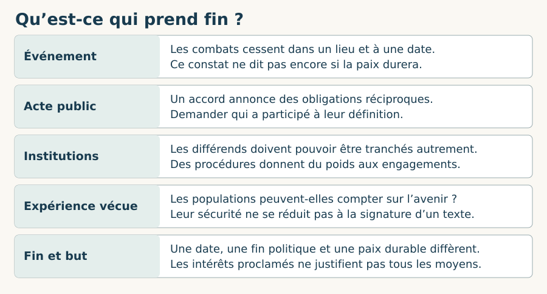
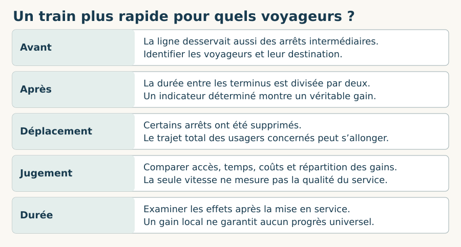

# BEL · AL — Philosophie (oral tronc commun 26 juin commission 3) 2026 · Corrigé guidé

*Corrigé rédigé par IA, non officiel. Signalez toute erreur.*

**Rédaction** · GPT-6.2 Astra Ultra · vitesse non renseignée

**Autocontrôle** · GPT-6.2 Astra Ultra · vitesse non renseignée

**Révision** · GPT-6.2 Astra Ultra · vitesse non renseignée

Le [feuillet du 26 juin, commission 3](https://www.ens.psl.eu/sites/default/files/sujet_oraux_philosophie_3_al.pdf) contient 12 billets de deux sujets. Les développements suivent leur ordre. Le jury a mis en gras le premier sujet sur 8 billets et le second sur 4. Le choix est indiqué à chaque billet. Le [rapport du jury](https://www.ens.psl.eu/sites/default/files/2026_al_rapport_oral_philosophie_tc.pdf#page=8) permet de vérifier les choix. Dans l’[index officiel](https://www.ens.psl.eu/rapports-et-sujets-du-concours-2026-section-des-lettres-groupe-al), les liens du 29 reprennent les fichiers datés du 26.

Lisez à haute voix les deux sujets du billet puis annoncez votre choix au début de l’exposé. Seul un dictionnaire de langue française est autorisé, à l’exclusion des dictionnaires de noms propres. Pour essayer l’autre sujet, utilisez la question d’entretien et la piste de réponse placées après son développement.

## Préparer l’entretien à partir des choix effectifs

La troisième commission du 26 juin donne douze paires séparées par une barre. Le rapport p. 8 met le sujet choisi en gras. Huit premiers et quatre seconds intitulés ont été retenus. La page 2 du rapport évoque une prestation sur « La fin de la guerre » en distinguant les références mobilisées et la qualité de leur usage conceptuel. Les questions ci-dessous sont des entraînements originaux aux dix minutes d’entretien qui suivent vingt minutes de leçon et 1 h 30 de préparation.

1. **Une exception laisse-t-elle encore une règle de principe ?** Oui, si ses raisons sont accessibles à tout dossier comparable et peuvent être contrôlées. Sur l’artiste, distinguer le pouvoir de modifier une œuvre et celui d’en imposer toutes les lectures.
2. **Peut-on dater la fin d’une guerre ?** On peut dater un texte ou la cessation des combats dans un lieu défini. La sûreté durable des populations exige l’examen d’autres conditions. Pour l’originalité, demander ce que l’interprète peut créer en jouant exactement les notes écrites.
3. **Un mythe dont il existe plusieurs versions est-il discrédité ?** La variation peut faire partie de sa transmission et montrer quelles relations sont retravaillées. Sur le pardon, vérifier si le tort demeure établi avant de parler de l’effacement personnel du ressentiment.
4. **L’obéissance d’une personne prouve-t-elle son accord ?** Le geste peut répondre à une coordination légitime, à la peur ou à l’habitude. Il faut en identifier la raison. Sur la beauté, distinguer ce qui surprend un instant et ce qui donne une singularité durable à la forme.
5. **La peur est-elle un argument contre une technique ?** Elle signale un dommage possible et invite à produire des preuves et des garanties. Elle ne démontre pas à elle seule que le dommage adviendra. Pour le caractère, distinguer une disposition relativement stable d’une essence à laquelle toute exception serait impossible.
6. **La non-violence exige-t-elle de se taire sur une injustice ?** Ce silence pourrait précisément contribuer à la maintenir. La question porte sur les fins, les moyens et la voix des personnes affectées. Pour l’existence, comparer les preuves d’un objet mathématique et d’un événement historique.
7. **Justifier un ordre du monde justifie-t-il moralement chaque souffrance ?** La compatibilité de principes métaphysiques et la permission de traiter quelqu’un comme un moyen ne sont pas le même jugement. Sur le rêve, distinguer l’expérience réelle d’avoir rêvé et la réalité externe de l’événement représenté.
8. **Qu’est-ce qui manifeste l’altérité d’autrui dans une conversation ?** Une réponse peut me corriger et mettre en échec une attente que rien dans mon monologue ne modifiait. Pour les proverbes, comparer deux maximes opposées et expliciter la situation qui rend l’une pertinente.
9. **Un amour est-il faux faute d’être réciproque ?** Non, l’attachement et le bien souhaité peuvent être réels. La réciprocité libre permet d’autres relations sans être due comme un paiement. Pour la raison suffisante, demander quel type de raison est recherché avant d’employer le mot « pourquoi ».
10. **Que doit préciser une revendication de progrès ?** Le critère, la situation de départ, les personnes affectées et la durée considérée. Sur l’art abstrait, décrire les relations effectivement offertes à la perception au lieu de les déduire du mot « abstrait ».
11. **Comment le fleuve peut-il être représenté ?** Un mandat juridique définit qui agit et à quel titre. La personnalité ne fournit pas automatiquement un moyen financier ou un critère écologique. Sur l’indicible, distinguer une difficulté provisoire de formulation et une limite structurelle de la description.
12. **Garder un secret est-il une manière de tromper ?** Il faut examiner qui pouvait légitimement compter sur l’information. Certains silences protègent un droit, d’autres compromettent une décision. En histoire de la philosophie, préciser à quelle question ancienne répondait d’abord l’argument qu’on veut reprendre aujourd’hui.

## 1. Avoir des principes

*Sujet choisi sur ce billet — Avoir des principes*

Une personne refuse une faveur qui servirait sa carrière parce qu’elle fausserait une procédure de sélection. Avoir des principes signifie ici soumettre une décision avantageuse à une règle qui compterait aussi pour un autre. La constance rend sa conduite prévisible et permet de lui demander des comptes. Mais on reproche également à certains d’appliquer leurs principes avec un aveuglement qui finit par détruire ce qu’ils voulaient préserver.

Si la règle interdit toute exception de procédure, que faire de la candidature qu’une panne générale a empêché de déposer ? L’équité chez Aristote interroge précisément la limite d’une règle générale face à un cas singulier. Introduire une exception justifiée pour tous ceux qui ont subi la panne diffère d’une faveur secrète au bénéfice d’un ami. Avoir des principes n’oblige donc pas à tenir toute formulation pour définitive. Cela exige d’en expliciter les raisons, d’examiner à qui une exception serait également accessible et de soutenir publiquement la décision. L’attitude de principe se distingue alors à la fois de l’opportunisme et de la rigidité satisfaite d’elle-même.

### L’artiste est-il maître de son œuvre ?

Avant l’exposition, une artiste choisit une disposition, reprend une couleur et signe le résultat. Cette maîtrise comme pouvoir de faire et de modifier est indéniable, bien que les résistances du matériau et les habitudes acquises interviennent déjà dans la création. Une fois l’œuvre visible, elle demeure son auteur sans déterminer seule tout ce que les spectateurs y discernent. Une lettre de l’artiste peut éclairer un motif, mais une interprétation attentive peut relever un effet qu’elle n’avait pas anticipé. Toutes les lectures ne se valent pas pour autant. Certaines se heurtent à des traits publics de l’œuvre. Il faut ainsi distinguer l’autorité sur la réalisation, les droits qui subsistent après publication et le pouvoir, plus limité, de fixer définitivement le sens.

**À l’entretien. Une interprétation imprévue par l’artiste peut-elle être juste ?** Revenir à un détail de l’œuvre que cette lecture rend intelligible. L’intention déclarée est une source pertinente. Elle ne suffit pas à éliminer d’avance tout effet argumenté que l’auteur n’avait pas anticipé.

## 2. La fin de la guerre

*Sujet choisi sur ce billet — La fin de la guerre*

« La fin » désigne un terme et peut aussi signifier un but. Une guerre peut s’achever dans les faits le jour où cessent les combats, sans que les populations se sachent à l’abri d’une reprise. Quant au but proclamé, il ne garantit ni la justice du conflit ni la qualité de l’ordre qui le suit. Il faut donc distinguer la cessation des hostilités, le règlement politique et la construction de conditions de paix.

Le congrès de Vienne de 1814–1815 permet d’interroger l’ambition d’établir un ordre durable après les guerres napoléoniennes. La composition diplomatique du règlement indique aussi qui fut admis à définir cet ordre. Dans *Vers la paix perpétuelle*, Kant demande ce qui distinguerait une véritable paix d’une trêve conservant les raisons de la prochaine lutte. Des garanties publiques, des institutions et une possibilité de régler les différends selon des règles modifient la manière dont les collectivités se rapportent à l’avenir. Le jury cite Vienne, Dorgelès et Kant à propos d’un exposé entendu. La leçon proposée ici retient la distinction conceptuelle entre l’arrêt datable et la transformation, plus lente et contestable, des rapports entre les personnes et les États.

### Une œuvre d’art doit-elle être originale ?

Une interprète joue une suite de Bach sans en modifier les notes et propose pourtant une écoute singulière par le tempo et l’articulation. L’originalité ne consiste donc pas nécessairement à créer une matière sans précédent. Elle peut se trouver dans un rapport nouveau à une forme reçue. Inversement, un procédé insolite peut rester arbitraire et sans portée. L’originalité devient une exigence historique forte dans certaines conceptions de l’artiste, mais ne saurait servir de mesure identique à toutes les œuvres, notamment à une icône ou à une interprétation musicale. Pour juger une œuvre, il faut examiner ce qu’elle fait du modèle et ce qu’elle donne effectivement à percevoir. La transgression d’une convention est une possibilité de création, sans être en elle-même une preuve de réussite.

**À l’entretien. Une variation sur un thème connu doit-elle être tenue pour moins bonne ?** Faire entendre ce qui se conserve, puis ce qu’une modification du tempo ou de l’harmonie fait découvrir. L’écart quantitatif avec le modèle et la qualité de l’expérience proposée sont deux critères différents.

## 3. Qu’est-ce qu’un mythe ?

*Sujet choisi sur ce billet — Qu’est-ce qu’un mythe ?*

Un récit fondateur peut fixer le lien d’une communauté à une montagne, même si les géologues expliquent autrement l’origine du relief. Appeler le récit « mythe » ne consiste donc pas simplement à constater une erreur scientifique. Il faut demander quelles relations il organise, entre humains, milieux et générations, et comment sa transmission donne sens à des pratiques. Plusieurs versions peuvent circuler sans que les participants cherchent nécessairement une formulation unique mot à mot.

L’analyse structurale des mythes chez Lévi-Strauss attire l’attention sur les transformations d’une version à l’autre et les oppositions qu’elles retravaillent. Un mythe n’est pourtant pas protégé de toute critique. Lorsqu’un récit fondateur devient une preuve supposée de supériorité ou d’exclusion, il faut examiner sa mobilisation présente, les faits qu’il prétend établir et la place laissée aux autres voix. Le mythe est une forme narrative collective qui organise des questions et des rapports que la seule chronologie n’épuise pas. Le comprendre exige de reconnaître ses effets et de distinguer leurs justifications possibles d’une simple affirmation de son ancienneté.

### Le pardon

Pardonner suppose un tort dont on reconnaît encore la réalité. Si l’auteur n’a jamais commis l’acte, justice lui est rendue en dissipant l’accusation, non en lui faisant grâce. Le pardon transforme le rapport entre une personne et celui qui lui a fait tort, sans abolir magiquement les conséquences ni imposer une réconciliation. Il peut être précédé d’un aveu ou d’une réparation. Pourtant, dire que l’auteur aurait « acheté » son pardon par une indemnisation lui conférerait un pouvoir sur la réponse de la victime. Un tiers peut proposer une médiation et une institution trancher les obligations publiques. Ni l’un ni l’autre ne dispose de la parole personnelle de celui qui a subi le tort. Le pardon est possible comme ouverture d’une histoire nouvelle, sans devenir un devoir général qu’on adresserait aux victimes.

**À l’entretien. Pardonner implique-t-il de renoncer à demander réparation ?** La victime peut renoncer au ressentiment et demander encore que le dommage soit réparé. Distinguer la relation personnelle, les conséquences matérielles et la responsabilité devant une collectivité.

## 4. Obéir

*Sujet choisi sur ce billet — Obéir*

À l’arrêt du feu rouge, une conductrice s’immobilise sans qu’un agent soit présent. Le même geste peut procéder de la peur d’une amende, de l’habitude ou de la reconnaissance d’une règle de circulation qui protège des inconnus. L’obéissance ne se confond donc ni avec l’impulsion mécanique ni avec l’approbation enthousiaste de l’ordre reçu. Elle suppose une relation où une direction donnée est prise comme raison d’agir, y compris lorsqu’elle va contre un désir actuel.

Cette structure ouvre une question de légitimité. Un supérieur peut être compétent dans un domaine et sortir de son mandat en réclamant une faveur personnelle. Demander des raisons et distinguer les domaines d’autorité font alors partie d’une obéissance qui n’abdique pas le jugement. La distinction kantienne entre certains usages d’une fonction et l’usage public de la raison permet de comprendre comment une coordination pourrait subsister avec l’examen critique des règles. Elle ne dispense pas de poser la difficulté des ordres injustes et des voies de recours. Obéir peut soutenir une liberté commune si la règle est justifiable et révisable. Le fait d’avoir reçu un ordre ne supprime pas toute responsabilité dans son exécution.

### Le beau est-il toujours bizarre ?

La formule de Baudelaire « Le beau est toujours bizarre » invite à examiner ce qui détache une forme de l’indifférence. Une légère dissymétrie dans un portrait peut donner à la figure une présence qu’une régularité parfaite aurait rendue anonyme. La bizarrerie peut alors désigner une singularité difficile à réduire à une recette. Elle peut aussi signifier une étrangeté voyante recherchée pour elle-même. Un détail inattendu qui détourne sans raison le regard de l’ensemble ne rend pas nécessairement l’œuvre belle. Inversement, une forme longtemps familière peut redevenir saisissante lorsqu’on y distingue des rapports jusque-là inaperçus. Si le beau exige une singularité éprouvée, il ne dépend pas toujours d’une anomalie spectaculaire. Il faut dire en quel sens une œuvre résiste à l’habitude et ce que cette résistance fait percevoir.

**À l’entretien. Pourquoi confond-on parfois ce qui étonne et ce qui est beau ?** Une forme insolite arrête le regard. Il faut encore examiner ce qu’elle fait percevoir une fois la surprise dissipée. Un contraste familier peut rester beau même quand on ne s’en étonne plus.

## 5. Le caractère

*Sujet choisi sur ce billet — Faut-il avoir peur de la technique ?*

Un enfant qu’on dit timide intervient soudain avec assurance pour expliquer un problème qu’il connaît bien. A-t-il changé de caractère ou croyait-on avoir nommé une disposition stable à partir de situations trop étroites ? Le caractère donne une intelligibilité à la continuité d’une conduite. Il devient une étiquette quand il fait de tout geste à venir la manifestation inévitable d’une essence. Chez Aristote, les dispositions éthiques se constituent par des actes et des habitudes. Elles orientent ce que l’on remarque et la manière dont on répond, sans dispenser de juger les circonstances. Avoir du caractère peut signifier tenir un engagement malgré la pression, alors que « avoir mauvais caractère » peut désigner une habitude que l’on gagnerait à modifier. Parler du caractère est défendable si l’on décrit des dispositions acquises et révisables en laissant une place aux situations et aux apprentissages qui les transforment.

**À l’entretien. Un geste isolé permet-il de juger le caractère d’une personne ?** Chercher ce que l’acte doit aux circonstances, puis le comparer à d’autres décisions. Attribuer une disposition aide à expliquer certaines régularités. L’attribution doit rester ouverte à l’apprentissage et au changement.

### Faut-il avoir peur de la technique ?

Un dispositif d’orientation permet d’accéder à un bâtiment qu’on ne connaissait pas. Il peut aussi devenir la seule manière d’y entrer, à l’exclusion des personnes qui ne disposent pas de l’équipement requis. Les effets d’une technique dépendent de choix de conception, d’institutions et de rapports de pouvoir. La peur peut rendre attentif à un dommage négligé. Elle devient peu éclairante si elle fait de « la technique » un seul agent qui progresserait indépendamment de ses usagers et de ses responsables.

Le *Principe responsabilité* de Jonas interroge la conduite à tenir lorsque la puissance technique a des effets lointains dont certains pourraient être irréversibles. Prendre une hypothèse au sérieux exige de préciser les scénarios, les preuves, les personnes touchées et les moyens de correction. Cela n’équivaut pas à tenir systématiquement la prévision la plus sombre pour certaine. La question normative porte donc sur l’usage de la peur. On a des raisons d’examiner certains dangers, de construire des garanties et d’en répartir la maîtrise. La décision collective gagne à convertir l’inquiétude en enquête contrôlable.

## 6. La non-violence

*Sujet choisi sur ce billet — La non-violence*

S’abstenir de répondre à une humiliation peut exprimer la peur ou le choix de ne pas reproduire la domination subie. L’absence de geste violent ne définit donc pas encore la non-violence comme position morale et politique. Celle-ci soumet le rapport entre la fin et les moyens à une exigence, ne pas traiter les personnes dont on conteste la conduite comme des obstacles dont l’élimination suffirait à régler le désaccord. Gandhi insiste sur le rapport entre une recherche de la vérité et les moyens par lesquels on prétend la défendre.

Il reste une difficulté de responsabilité. Déclarer la paix au nom d’autrui peut conduire à lui demander de supporter seul une injustice que l’on refuse de voir. Une non-violence sérieuse exige de nommer le tort, de laisser entendre les personnes affectées et de rendre possible une action commune pour que la situation change. Elle ne peut être évaluée seulement par la pureté de l’intention. Sa force philosophique tient à la cohérence qu’elle réclame entre le respect de l’autre dans la fin recherchée, la qualité de la relation présente et la transformation effective de ce qui empêche des personnes de vivre à égalité.

### Peut-on prouver l’existence ?

Un mathématicien peut établir l’existence d’une solution sans la connaître sous une forme directement calculable. Une historienne prouve l’existence passée d’une personne grâce à des traces indépendantes et contrôlées. Les opérations diffèrent, l’une porte sur un objet défini dans une théorie, l’autre sur une réalité passée dont les documents sont les indices présents. Lorsque Kant examine la preuve ontologique de l’existence de Dieu, il conteste que l’existence soit une propriété qui compléterait le concept à la manière d’une qualité nouvelle. Une définition, si cohérente soit-elle, ne fait pas surgir son objet dans le monde. La réponse ne peut donc être une négation de toutes les preuves ni une seule recette universelle. Il faut exposer le domaine, les règles de preuve et ce que l’existence revendiquée signifierait dans ce domaine.

**À l’entretien. Définir très précisément une chose suffit-il à établir qu’elle existe ?** On peut convenir des propriétés d’un bâtiment projeté. Il faut une autre raison pour affirmer que le bâtiment a été construit. Distinguer ce qu’implique un concept et ce qui permet d’identifier un cas réel.

## 7. Le monde du rêve

*Sujet choisi sur ce billet — Peut-on justifier l’existence du mal ?*

Dans un rêve, une maison familière ouvre sur une plage inconnue et ces deux lieux semblent appartenir naturellement au même itinéraire. Au réveil, l’étrangeté de la transition saute aux yeux. Le rêve produit donc un monde au sens d’un ensemble momentanément habitable de significations et de perceptions, sans fournir par là un monde extérieur sur lequel nous pourrions compter ensemble. Dans la première *Méditation*, Descartes utilise l’expérience du rêve pour interroger les signes qui permettraient de distinguer avec certitude une expérience présente de sa ressemblance imaginaire. Le problème ne se réduit pas à dire que tout serait toujours également incertain. La reprise du souvenir, la cohérence des situations et la confrontation aux observations d’autrui changent la justification d’une croyance. Le rêve est réel comme expérience vécue, tandis que les événements qu’il fait apparaître demandent d’autres preuves pour être affirmés du monde commun.

**À l’entretien. Le rêve forme-t-il un monde même si ses lieux changent en un instant ?** Comparer la cohérence suffisante pour agir dans une scène et la continuité que l’on pourrait vérifier en revenant au même endroit. Dire quel sens du mot « monde » résiste à cette différence.

### Peut-on justifier l’existence du mal ?

Expliquer pourquoi une digue a cédé peut aider à prévenir une autre catastrophe. Cela ne justifie pas la souffrance des habitants, au sens où elle serait devenue bonne ou méritée. Le verbe « justifier » requiert donc une distinction initiale entre rendre raison et donner une raison morale d’accepter. Dans les *Essais de Théodicée*, Leibniz cherche à rendre compatibles la bonté et la puissance divines avec l’existence du mal dans le meilleur ensemble de choses possibles. L’argument porte sur une totalité dont aucun mal isolé ne permet d’évaluer directement la valeur.

Une objection demeure, avons-nous accès à la comparaison entre ces totalités et le droit d’annoncer à la personne atteinte que son malheur était nécessaire au bien du tout ? Même une explication qui rendrait cohérentes des propositions métaphysiques ne dispenserait pas de secourir ni d’identifier les responsabilités évitables. On peut examiner la cohérence de certaines justifications sans faire de la victime un moyen dont nous pourrions déclarer le prix acceptable à sa place.

## 8. Y a-t-il une sagesse des nations ?

*Sujet choisi sur ce billet — L’existence d’autrui*

Les proverbes transmettent des observations accumulées et des manières de juger, comme l’invitation à prendre conseil avant d’agir. Un autre proverbe pourra louer l’occasion saisie sans attendre. Cette tension n’établit pas que la tradition soit vide. Elle montre que l’emploi d’une formule exige un discernement sur le cas présent que la formule seule ne procure pas. L’expression « des nations » pose aussi un problème. Attribuer à tout un peuple une voix unique efface les désaccords et les circulations historiques de proverbes semblables entre langues. Il existe des savoirs pratiques partagés, transmis et transformés, dont chacun peut se servir pour éprouver une conduite. Il serait excessif d’élever leur ancienneté ou leur diffusion en garantie de vérité. Une sagesse transmise reste vivante dans la possibilité de discuter ses maximes et leurs domaines d’usage.

**À l’entretien. Que vaut un proverbe lorsqu’un autre recommande la conduite inverse ?** Opposer la prudence à la maxime qui conseille l’audace. Leur coexistence révèle des expériences accumulées. Encore faut-il juger dans quel cas chacune s’applique, ce qu’aucune formule ne décide seule.

### L’existence d’autrui

Je vois un voisin répondre à ma question, mais je ne fais pas l’expérience de son point de vue comme je fais l’expérience du mien. Si je traite son corps uniquement comme une chose observée, comment passerais-je ensuite de ses mouvements à l’existence d’un autre sujet ? Le raisonnement par analogie peut fournir une raison, il agit et parle d’une manière que je reconnais. Il risque pourtant de reconstruire l’autre comme un double de moi, alors que le désaccord ou la surprise manifestent précisément qu’il ne m’appartient pas.

La rencontre est déjà une situation où une réponse peut me démentir et où ma parole peut être accueillie ou refusée. La difficulté demeure, car cette présence immédiate d’un interlocuteur ne me donne pas accès à tout ce qu’il éprouve. Son témoignage, le respect de son silence et la possibilité de réparer un malentendu ont un sens parce que sa vie ne se réduit pas à ce que j’en observe. L’existence d’autrui se reconnaît donc dans une relation sensible, langagière et morale qui exige d’assumer à la fois l’accès à un autre sujet et sa véritable altérité.

## 9. Aimer et être aimé

*Sujet choisi sur ce billet — Aimer et être aimé*

Un enfant peut être aimé avant de savoir le dire et avant d’être capable de rendre ce qu’il reçoit. Aimer et être aimé occupent donc des positions différentes dans une relation, sans constituer un échange de prestations équivalentes. Aimer peut signifier se réjouir d’un bien qui advient à l’autre, se soucier de lui et accepter que ce bien ne coïncide pas toujours avec notre présence. Être aimé peut apporter une assurance essentielle, mais peut également devenir une contrainte si le bienfaiteur prétend fixer le prix de son affection.

Le désir de réciprocité n’est pas en lui-même un défaut. Une relation où chacun peut répondre librement découvre des biens communs qu’un attachement unilatéral ne suffit pas à produire. Pourtant un ordre de rendre le même sentiment anéantirait ce qu’il exige, car ni le sentiment ni le consentement ne peuvent être attribués à la place de l’autre. Aimer et être aimé deviennent donc des expériences qui peuvent se rejoindre sans s’impliquer logiquement. Une relation juste ménage la capacité d’exprimer, de refuser ou de transformer cet attachement.

### Le principe de raison

Lorsque l’horloge s’arrête, je cherche pourquoi. Le principe de raison, formulé notamment par Leibniz, affirme de façon plus ambitieuse que rien n’est sans raison suffisante pour qu’il en soit ainsi plutôt qu’autrement. Il faut distinguer une cause antérieure, une preuve logique et une raison d’agir. Un retard peut avoir une cause mécanique sans constituer ma raison personnelle de manquer une réunion. Comme règle d’enquête, le principe incite à ne pas transformer une ignorance en explication ultime. Comme thèse sur tout ce qui existe, il soulève la difficulté de la régression et du rapport entre les faits contingents et une raison qui les expliquerait. Le fait que nous ayons une raison de chercher ne nous donne donc pas encore une explication suffisante de chaque chose.

**À l’entretien. Exiger une raison revient-il à supposer que nous pouvons toujours la connaître ?** Une enquête peut échouer faute d’archives sans établir que l’événement n’a pas de cause. Distinguer l’exigence qui guide la recherche et la thèse sur la manière dont la réalité est constituée.

## 10. Le progrès

*Sujet choisi sur ce billet — Le progrès*

Une nouvelle ligne ferroviaire réduit de moitié le temps de trajet entre deux villes et supprime plusieurs arrêts intermédiaires. Il y a un gain mesurable pour certains déplacements. Peut-on le déclarer progrès sans examiner ce qui advient aux voyageurs des arrêts supprimés ? Il faut toujours nommer un état de départ, un critère d’amélioration, des destinataires et une durée. Changer n’est pas déjà progresser, et progresser sous un rapport ne garantit pas un gain sous tous les autres.

L’idée d’un progrès de l’humanité entière suppose une mesure plus exigeante encore. Une extension de droits politiques peut constituer un bien justifiable devant tous, tout en restant fragile dans l’histoire et inégalement accessible en pratique. On évite ainsi deux excès, lire dans chaque nouveauté une direction nécessaire de l’histoire ou refuser toute comparaison de peur d’imposer une échelle absolue. Nous pouvons établir des progrès déterminés et en discuter les conditions de diffusion. Leur reconnaissance doit inclure les coûts, les exclusions et la possibilité d’une régression qui demanderait un nouvel effort collectif.

### En quel sens dit-on d’une œuvre d’art qu’elle est abstraite ?

Une toile composée de bandes colorées n’est pas abstraite au sens où elle manquerait de matière. Sa surface, sa texture et les distances entre les bandes se présentent très concrètement. On peut dire qu’elle est abstraite parce qu’elle ne représente pas de façon reconnaissable un objet extérieur ou parce qu’elle isole, à partir d’un motif, certaines relations de forme. Ces sens ne sont pas identiques. Une peinture géométrique peut procéder d’un projet qui n’a jamais cherché à simplifier un paysage préalable. Inversement, le portrait le plus figuratif sélectionne et organise lui aussi des traits. L’abstraction désigne donc un rapport particulier à la représentation et une orientation de l’attention vers certaines relations. Elle ne signifie ni absence de sens ni rupture obligatoire avec toute expérience sensible.

**À l’entretien. Une peinture abstraite doit-elle nécessairement ne rien représenter ?** Observer un rapport de forces entre des formes de couleur. L’absence d’objet immédiatement identifiable peut laisser subsister une organisation expressive, voire des allusions. Décrire ce qui se donne à voir avant de trancher.

## 11. L’indicible

*Sujet choisi sur ce billet — La nature a-t-elle des droits ?*

Après avoir écouté une musique nouvelle, une personne dit qu’elle ne trouve pas les mots pour désigner ce qui l’a touchée. Trois possibilités se présentent. Elle peut manquer pour l’instant d’un vocabulaire, l’expérience peut résister par nature à la traduction intégrale en propositions, ou bien une situation sociale peut rendre une parole difficile à prononcer ou à faire entendre. Les confondre transformerait toute hésitation en interdiction absolue de dire. Le paradoxe est qu’appeler quelque chose « indicible » constitue déjà une manière de le situer dans le langage. Il reste une différence entre tout décrire et inviter autrui à écouter un passage, reprendre une métaphore ou reconnaître une limite. On peut donc parler rigoureusement des conditions dans lesquelles les mots échouent sur une dimension de l’expérience, et chercher d’autres modes de partage sans promettre une transparence parfaite.

**À l’entretien. Dire « je ne peux pas le dire » est-ce contradictoire ?** Nommer une difficulté n’en fournit pas encore le contenu. Comparer le mot qui manque momentanément et l’expérience qu’aucune formulation déterminée ne semble épuiser. Le geste de désigner la limite ne la supprime pas.

### La nature a-t-elle des droits ?

Une rivière peut être protégée parce que son eau sert à des personnes ou parce qu’une institution entend reconnaître une valeur propre à son intégrité écologique. Le passage de l’un à l’autre transforme les intérêts que l’on peut défendre et le titre sous lequel on agit. Il faut distinguer constater des protections juridiques, attribuer des droits à une entité et lui reconnaître en droit positif la personnalité. Ces décisions sont liées sans être synonymes ni universelles.

En Nouvelle-Zélande, le *Te Awa Tupua Act* de 2017 reconnaît Te Awa Tupua comme un tout vivant et indivisible et comme une personne juridique, avec une représentation organisée. Le fleuve Whanganui ne parle pas à la barre comme un témoin humain. Des personnes instituées exercent une fonction définie en rapport avec son intérêt et avec l’histoire des iwi concernés. La solution répond donc à une objection commune, l’incapacité de s’exprimer n’exclut pas toute titularité. Reste à construire des représentants responsables, des moyens réels d’action et des critères défendables de décision. La nature peut recevoir des droits déterminés sans qu’une réponse uniforme soit déjà valable pour tout ce que ce nom rassemble.

## 12. Toute vérité est-elle bonne à dire ?

*Sujet choisi sur ce billet — Toute vérité est-elle bonne à dire ?*

Je sais qu’une camarade a confié un projet qu’elle n’a pas encore rendu public. La proposition que je pourrais énoncer est vraie. Cela suffit-il à la rendre bonne à communiquer à n’importe quelle personne, à n’importe quel moment ? La valeur de vérité d’un énoncé dépend de ce qu’il affirme. La valeur morale de sa divulgation dépend aussi du titre du locuteur, du droit de l’interlocuteur, des attentes de confidentialité et des effets raisonnablement prévisibles.

Un responsable qui se tait sur un défaut important dont des usagers subiront les conséquences abuse toutefois de cette distinction s’il prétend seulement préserver leur tranquillité. Il faut donc demander qui est fondé à connaître l’information et sur quelle décision elle doit pouvoir peser. La discrétion et la dissimulation coupable se distinguent selon ces raisons publiques et relationnelles. Toute vérité n’est pas bonne à dire en toutes circonstances. Le refus d’une divulgation ne crée pas pour autant un droit général à mentir. Prévenir, différer, demander le consentement ou refuser explicitement la question sont des conduites qui ne donnent pas à autrui les mêmes raisons de croire et d’agir.

### L’histoire de la philosophie

Lire un débat ancien sur la liberté impose de reconstituer le sens que ses termes prenaient dans une controverse particulière. Une lecture purement actuelle risquerait d’attribuer à un auteur une réponse à une question qu’il ne posait pas. Mais raconter seulement les circonstances extérieures laisserait inexplicable la possibilité qu’un argument nous oblige encore à revoir une distinction présente. L’histoire de la philosophie étudie ainsi à la fois des textes historiquement situés et des prétentions à donner des raisons dont l’examen reste possible. Comparer plusieurs usages d’un même terme peut révéler une transformation des problèmes, et non seulement une succession d’opinions. La lecture la plus féconde rend l’argument assez précis pour pouvoir le discuter et assez étranger pour ne pas lui faire dire ce que le lecteur attendait déjà.

**À l’entretien. Pourquoi relire une philosophie dont certaines connaissances sont dépassées ?** Reconstituer le problème qui rendait sa thèse plausible et les raisons qu’elle avançait. Certaines prémisses peuvent avoir disparu tandis qu’une distinction reste féconde. La lecture historique permet de tester cette différence.
