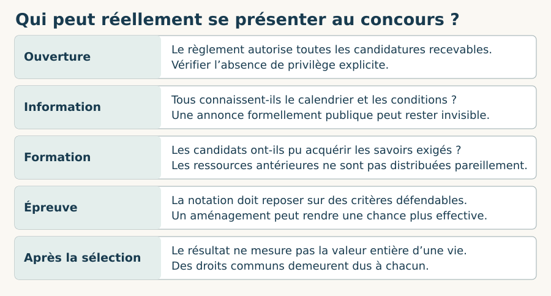

# BEL · AL — Philosophie (oral tronc commun 30 juin) 2026 · Corrigé brut

*Corrigé rédigé par IA, non officiel. Signalez toute erreur.*

**Rédaction** · GPT-6.2 Astra Ultra · vitesse non renseignée

**Autocontrôle** · GPT-6.2 Astra Ultra · vitesse non renseignée

**Révision** · GPT-6.2 Astra Ultra · vitesse non renseignée

Le [feuillet du 30 juin](https://www.ens.psl.eu/sites/default/files/sujet_oraux_philosophie_al.pdf) contient 12 billets de deux sujets. Les développements suivent leur ordre. Le jury a mis en gras le premier sujet sur 7 billets et le second sur 5. Le choix est indiqué à chaque billet. Le [rapport du jury](https://www.ens.psl.eu/sites/default/files/2026_al_rapport_oral_philosophie_tc.pdf#page=9) permet de vérifier les choix. L’[index de l’ENS](https://www.ens.psl.eu/rapports-et-sujets-du-concours-2026-section-des-lettres-groupe-al) date ce feuillet de la commission 3.

Lisez à haute voix les deux sujets du billet, choisissez pendant les 90 minutes de préparation et annoncez votre choix au début des 20 minutes d’exposé. L’entretien dure ensuite 10 minutes. Le coefficient est de 3. Seul un dictionnaire de langue française est autorisé, à l’exclusion des dictionnaires de noms propres.

## 1. Les mots disent-ils les choses ?

*Sujet choisi sur ce billet — La répétition*

Le mot « table » n’a ni quatre pieds ni la couleur du meuble devant moi. Saussure distingue dans le signe linguistique un signifiant et un signifié. Leur relation ne reproduit pas une ressemblance naturelle entre le son du mot et la chose. Pourtant je peux te demander de poser un livre sur cette table et nous pouvons corriger un malentendu en indiquant le meuble dont il s’agit. Les mots atteignent les choses au sein d’usages, d’actions et de circonstances partagés. Leur généralité sélectionne certains traits, puisque le même nom vaut pour des tables très différentes. Elle peut masquer une singularité et soutenir des énoncés précis lorsque le contexte et les descriptions la restituent. Dire les choses ne consiste donc pas à les dupliquer en paroles, mais à pouvoir en parler de façons que leur présence, leur absence et les réponses d’autrui rendent vérifiables.

### La répétition

Un musicien répète chaque matin la même phrase. S’il reproduisait exactement les mêmes gestes sans rien modifier, on comprendrait difficilement le progrès de l’interprétation. Il y a répétition parce qu’une forme reste identifiable, différence parce que la place de chaque reprise dans le temps et dans l’apprentissage a changé. La difficulté est de préciser ce qui demeure le même. On peut répéter une formule mot à mot pour lui donner dans un contexte nouveau une force ironique que n’avait pas la première occurrence.

Dès lors, la répétition peut aussi bien libérer l’attention par l’habitude qu’enfermer une personne dans un geste qu’elle n’examine plus. Bergson, dans *Matière et mémoire*, distingue la leçon apprise par répétition du souvenir singulier de chacune de ses lectures. La première donne une capacité actuelle de réciter, le second retient un événement qui ne revient pas à l’identique. Reconnaître une répétition demande ainsi une forme conservée et des occurrences distinctes. Sa valeur dépend des différences qu’elle permet de produire, de remarquer ou au contraire de masquer.

## 2. Qu’est-ce qu’un malentendu ?

*Sujet choisi sur ce billet — Qu’est-ce qu’un malentendu ?*

Deux personnes conviennent de se retrouver « à la gare ». L’une attend à l’entrée des voyageurs, l’autre au hall routier qui porte localement le même nom. Elles peuvent répéter sincèrement la même formule et néanmoins soutenir des attentes incompatibles. Un malentendu diffère donc d’un simple désaccord, où les thèses s’opposent sur un sens déjà suffisamment partagé, et d’un mensonge, dont l’effet est recherché par quelqu’un qui connaît la divergence.

Sa singularité tient souvent à ce que chacun croit d’abord avoir compris et ne sait pas qu’une question devrait être posée. Le contexte, les expériences antérieures et les conventions locales complètent silencieusement les mots. Lorsque l’attente est déçue, une reformulation ou une action commune peut rendre visible ce qui différait. Pourtant un malentendu peut aussi toucher la portée d’un acte, une plaisanterie reçue comme un reproche ou une demande entendue comme un ordre. Le dissiper n’impose pas d’effacer tout conflit. Il permet de déterminer sur quoi il y avait réellement divergence et quelles raisons restent à discuter.

### Posséder

Un emprunteur garde un livre dans son sac et peut s’en servir. Il ne peut pas légitimement le vendre comme s’il en était propriétaire. Possession de fait, usage et titre de propriété doivent donc être distingués. Posséder peut encore désigner le rapport à une compétence, lorsque quelqu’un « possède » une langue. Ce savoir ne se transmet pas par le simple transfert d’un objet et je ne le perds pas en l’enseignant. Ces contrastes interdisent de traiter la possession comme une relation naturelle toujours identique entre un sujet et sa chose. Elle dépend des pouvoirs déterminés dont dispose la personne, des droits d’autrui et des pratiques auxquelles la chose est destinée. L’enjeu devient moral et politique lorsque l’exclusivité d’un pouvoir affecte l’accès d’autres personnes à une ressource nécessaire.

## 3. Qui a un destin ?

*Sujet choisi sur ce billet — Qui a un destin ?*

On parle du destin d’une musicienne en regardant après coup des rencontres, des accidents et des apprentissages qui ont composé sa carrière. Faut-il supposer que tous ces événements lui étaient assignés dès le départ ? Le récit rétrospectif sélectionne ce qui paraît conduire à l’issue connue. Il peut donner une cohérence à une vie sans prouver sa nécessité. Dans la tragédie, le destin a souvent un sens plus fort, comme une limite qui enveloppe même les décisions par lesquelles le personnage voulait s’y soustraire.

Le mot « qui » invite aussi à regarder la distribution sociale de cette attribution. On parle du destin des figures célèbres comme si l’existence ordinaire pouvait être privée d’histoire. Toute vie comporte pourtant une situation reçue et des choix exposés à des conséquences imprévisibles. À l’inverse, annoncer à une personne qu’un milieu social lui fixe un destin peut transformer une probabilité historique en condamnation. On a un destin au sens où une trajectoire finie peut être racontée depuis certaines de ses issues. Soutenir qu’elle était écrite et entièrement indépendante de l’action exigerait un autre argument.

### La généralité

Un règlement qui interdit de bloquer les issues de tous les bâtiments dit quelque chose de général. Il abstrait des différences de taille, d’usage et de date pour viser un rapport jugé pertinent. La portée de la règle ne la transforme pas en description de tous les détails. L’universel logique « tous les triangles ont trois côtés » et la généralisation empirique « d’ordinaire, cette ligne de bus est ponctuelle » n’ont pas la même force. Un contre-exemple ne joue pas le même rôle pour une définition, une fréquence et une norme. La généralité rend possibles la classification, l’inférence et l’égalité de traitement. Son usage demande néanmoins de préciser les conditions d’application et les exceptions pertinentes, sous peine de substituer un énoncé commode à la diversité qu’il devait nous aider à comprendre.

## 4. Le manque

*Sujet choisi sur ce billet — Le manque*

Une chaise est vide à une table de famille. Une autre chaise est vide dans une salle inutilisée. L’absence d’occupant est comparable, mais seul le premier vide peut être éprouvé comme le manque de quelqu’un. Ce qui manque n’est donc pas simplement ce qui n’est pas là. Le manque se détermine par rapport à une attente, à une fin ou à un besoin. Quelque chose peut manquer objectivement à la nutrition d’une personne qui ne l’éprouve pas encore, tandis qu’un objet très désiré peut n’être nullement indispensable.

Dans le *Banquet*, le discours de Socrate met en rapport le désir et ce que l’on n’a pas ou ne possède pas de manière assurée. L’analyse ne réduit pas tout manque à un défaut qu’une acquisition effacerait. L’absence d’un ami peut faire prendre conscience d’une relation dont on ne désire précisément pas « posséder » le terme. Certains manques appellent un bien substituable, d’autres signalent la valeur d’une présence singulière, d’autres encore sont entretenus par la comparaison. Les distinguer permet de demander ce qu’une satisfaction pourrait réellement réparer.

### Que font les machines ?

Une machine à laver remue le linge selon un programme. Dire qu’elle « fait la lessive » indique une délégation effective de certaines opérations. Cela ne signifie pas que le dispositif ait déterminé quelles affaires laver, pourquoi elles importent ni comment sera réparti le temps libéré. Une machine transforme de la matière, de l’énergie ou des informations par un agencement organisé. Elle reconfigure aussi les gestes, les horaires et parfois la division sociale du travail. L’automatisation peut déplacer l’effort vers la maintenance, l’approvisionnement ou le contrôle. La question demande donc de suivre à la fois l’opération que l’appareil réalise effectivement et les responsabilités qu’une société continue d’attribuer aux personnes et aux institutions qui le conçoivent et s’en servent.

## 5. Le désordre

*Sujet choisi sur ce billet — Le désordre*

À l’issue d’un déménagement, les archives d’une association sont rangées dans des cartons sans indication. Tous les documents sont présents. Ce qui manque est la relation qui permettrait de les retrouver selon leur date, leur auteur ou leur objet. Le désordre peut donc désigner une perte d’organisation effective, mais également la présence d’un ordre que l’observateur ne reconnaît pas, comme le classement personnel dont le détenteur se sert sans peine. Quelle épreuve permet de les distinguer ? Suivre les opérations que l’organisation devait rendre possibles.

Bergson, dans *L’Évolution créatrice*, interroge la notion de désordre en examinant notamment la déception de l’esprit qui cherche un certain ordre et en rencontre un autre. Cette analyse ne fait pas de toute désorganisation une pure illusion. Si personne ne peut retrouver le document nécessaire à temps, une capacité réelle a été perdue. Elle engage à déterminer quelles relations ont disparu, lesquelles se sont substituées aux premières et pour quelle fin on juge l’arrangement. Il peut ainsi y avoir un ordre social injuste et un désordre momentanément fécond, ce qui interdit d’identifier les termes à un bien et à un mal absolus.

### Qu’est-ce qu’une nation ?

Un État dispose d’institutions sur un territoire, tandis qu’une nation désigne une communauté politique et historique dont les membres se reconnaissent un avenir en commun. Les deux ne coïncident pas toujours. Une langue commune peut soutenir des liens sans suffire à déterminer une unique nation, et une nation peut être plurilingue. Dans sa conférence *Qu’est-ce qu’une nation ?*, Renan insiste sur un héritage de souvenirs et sur un consentement présent à poursuivre une vie commune. Ces critères ouvrent une question critique, qui a voix pour raconter cet héritage et comment s’exprime ce consentement ? Une conception défendable doit laisser place aux désaccords et aux changements d’appartenance. La nation n’est ni un simple fait biologique ni le produit d’un décret instantané qui effacerait toute histoire.

## 6. Le neutre

*Sujet choisi sur ce billet — La paix peut-elle être perpétuelle ?*

Un médiateur confie les mêmes possibilités de parole à deux parties. Un appareil enregistre une température. Les deux sont parfois qualifiés de neutres, mais la neutralité désigne dans le premier cas une exigence politique ou morale d’impartialité, dans le second un idéal de mesure indépendante des préférences. Le neutre grammatical désigne encore autre chose, une catégorie d’expression qui ne correspond pas nécessairement à une absence de distinctions dans le monde. On comprend mal le sujet si l’on efface ces usages sous une seule idée d’indifférence. Une institution peut rester impartiale entre personnes et cesser de l’être si elle traite de la même façon une preuve et une rumeur. Le neutre peut donc offrir une position de retenue ou une ressource du langage. Il devient trompeur lorsqu’une décision située dissimule ses effets sous une prétendue absence de choix.

### La paix peut-elle être perpétuelle ?

Un accord met fin à un différend aujourd’hui. Comment pourrait-il engager des générations qui connaîtront d’autres désaccords et d’autres dirigeants ? La perpétuité ne saurait consister dans une promesse que plus aucun intérêt ne s’opposera. Elle demanderait des institutions capables de traiter des conflits à venir sans revenir à des hostilités. Dans *Vers la paix perpétuelle*, Kant examine des conditions internes et internationales, notamment des constitutions républicaines et une fédération d’États libres, auxquelles s’ajoute un droit cosmopolitique d’hospitalité.

Ces conditions n’apportent pas une prédiction selon laquelle la paix durerait forcément. Elles permettent de distinguer la possibilité normative d’une organisation pacifique et la garantie empirique de son succès. Une institution doit encore pouvoir se maintenir, être critiquée et accueillir des intérêts nouveaux sans devenir un pouvoir arbitraire. La paix perpétuelle est donc pensable comme tâche juridique et politique régulant des relations durables. La prétendre assurée une fois pour toutes par un règlement daté confondrait l’exigence avec son accomplissement.

## 7. Le privé et le public

*Sujet choisi sur ce billet — Le privé et le public*

La correspondance privée d’une personne est protégée par des règles publiques. Un dommage survenu dans un logement peut appeler une réponse publique sans que toute la vie des habitants devienne accessible à l’administration. Il faut donc distinguer privé comme intime, privé comme propriété et privé comme activité réservée à une personne ou à un groupe. Public peut qualifier la visibilité d’un événement, l’intérêt commun ou la compétence de l’État. Une place de village n’a pas exactement le même caractère public qu’un débat dont chacun peut vérifier les raisons.

L’enjeu est de tracer des limites à l’ingérence tout en préservant un recours lorsque « c’est privé » sert à perpétuer une injustice. La publicité d’une décision empêche qu’elle soit soustraite à l’examen, mais l’exposition des données personnelles de ceux qu’elle concerne pourrait léser des droits également fondamentaux. Le privé et le public se déterminent donc par des institutions historiquement transformables. Une frontière juste précise qui peut voir ou agir, au nom de quel intérêt, sous quel contrôle et avec quelle protection d’un espace où les personnes disposent d’elles-mêmes.

### Tenir son rôle

La personne qui préside un concours veille à donner le même temps de parole aux candidats, y compris à celui dont elle connaît peu le sujet. Tenir son rôle réclame des conduites réglées et une capacité de jugement dans les cas où la règle laisse une marge. Un malaise ou une interruption extérieure peut justifier un ajustement accessible à chacun selon la même raison. La fonction ne demande pas de convertir toute son identité en titre institutionnel. Elle ne disculpe pas non plus automatiquement toute action accomplie en son nom. On peut juger qu’une consigne excède le rôle ou qu’elle porte atteinte à des droits qui le rendent légitime. Tenir son rôle exige donc de connaître à la fois ses obligations et leurs limites, afin que d’autres puissent compter sur nous et demander des comptes.

## 8. Qu’est-ce qui est tragique ?

*Sujet choisi sur ce billet — La fin de la politique*

On qualifie parfois de tragique tout événement extrêmement malheureux. Or une pièce peut faire surgir le tragique d’une décision où deux exigences également fortes semblent incompatibles. Dans l’*Antigone* de Sophocle, les devoirs envers le mort et la loi proclamée dans la cité ne s’ajustent pas sans perte. Le personnage agit, et c’est en agissant selon une raison qui compte qu’il se heurte à une autre exigence. L’effet ne tient donc pas seulement à la quantité de souffrance. Il dépend de la manière dont une situation lie action, responsabilité et limite. Toute injustice n’est pas tragique en ce sens, surtout si l’appeler fatale empêche de voir comment la corriger. La distinction évite de confondre la reconnaissance d’une perte irréductible avec une résignation générale devant ce que l’on pourrait transformer.

### La fin de la politique

La fin peut être ce en vue de quoi l’on agit ou le point où une activité cesse. Si la politique a pour fin le bien commun, faut-il espérer son abolition une fois ce bien atteint ? Une telle conclusion suppose que tous les intérêts légitimes soient un jour définitivement accordés et toutes les fins déjà déterminées. Or une société juste peut encore discuter d’un budget, de la destination d’une place ou de l’admission d’un usage nouveau. La persistance du désaccord n’est pas en soi un défaut de gouvernement.

Aristote ouvre la *Politique* en examinant la visée de la communauté politique et du bien qu’elle recherche. Cette visée n’implique pas que les citoyens seraient de simples exécutants d’une solution connue à l’avance. Déclarer la « fin de la politique » peut signifier que l’on a transféré des décisions controversées à des experts en feignant qu’elles étaient seulement techniques. On peut en revanche rechercher la fin de certaines dominations et de certains affrontements. Une finalité défendable de la politique est d’instituer la possibilité durable de décider ensemble et de réviser ces décisions, ce qui rend son exercice toujours nécessaire.

## 9. L’immortalité

*Sujet choisi sur ce billet — L’immortalité*

Une œuvre est encore lue bien après la mort de son auteur. L’admiration qu’elle suscite constitue-t-elle pour lui une immortalité ou seulement la durée de certains effets de sa vie ? Le mot peut désigner l’absence de mort biologique, la survie personnelle après la mort ou la persistance d’une trace dans une mémoire collective. Ces sens ne s’impliquent pas mutuellement. Le nom peut disparaître alors que les gestes transmis demeurent, et la célébrité ne restitue pas à l’auteur une conscience qui éprouverait sa gloire.

Dans le *Phédon*, Platon examine des arguments visant la survie de l’âme. Leur ambition diffère d’une simple affirmation de la fécondité des souvenirs. Pour donner un sens précis à la question, il faut déterminer ce qui devrait persister pour que l’on puisse parler du même sujet et quels arguments pourraient le montrer. Le désir d’être encore présent pour autrui explique en partie la puissance de l’idée. Il ne prouve pas que cette présence soit possible sous toutes les formes que l’on imagine. La mémoire peut engager les vivants envers les disparus sans résoudre à elle seule la question métaphysique.

### Qu’est-ce qu’une institution ?

Une personne quitte une mairie et son successeur peut néanmoins délivrer des actes valables. La continuité d’une compétence au-delà de son titulaire manifeste une dimension de l’institution. Il faut des règles, des rôles reconnus, des pratiques effectives et souvent des traces qui permettent aux nouveaux venus de savoir qui peut faire quoi. Le bâtiment et le texte fondateur en sont parfois des supports sans suffire à la faire vivre. Une institution peut stabiliser les attentes et instituer des droits. Elle peut aussi prolonger des exclusions alors même que chacun de ses agents pense agir selon les usages ordinaires. La comprendre demande donc d’étudier sa genèse, ses effets présents et la possibilité d’en contester les décisions. Sa durée ne dispense jamais de justifier la manière dont elle organise les relations humaines.

## 10. La partie et le tout

*Sujet choisi sur ce billet — La partie et le tout*

Un quatuor recommence une phrase très lentement. On entend mieux chaque ligne séparée, puis l’accord formé par leur rencontre. Cet accord n’est pas une cinquième ligne que l’on pourrait isoler à son tour. Une propriété du tout peut provenir des relations de ses parties. À l’inverse, la place d’une note dans un accord lui confère une tension que la hauteur prise seule ne possédait pas. L’analyse doit donc aller des composants à leur organisation et revenir vers eux.

Ce mouvement change de portée selon les objets. Un sac contient des objets qui peuvent en être retirés sans perdre leur identité ordinaire. Un organe isolé cesse au contraire d’exercer dans la durée sa fonction vitale. Le raisonnement devient dangereux en politique lorsqu’on traite les personnes comme des organes sans droit de juger les finalités de l’ensemble. Les citoyens ont une existence et des prétentions propres, bien qu’ils dépendent d’institutions communes. Il faut chaque fois déterminer quel tout est en jeu, selon quelle relation ses parties en relèvent et sous quel rapport elles gardent une certaine indépendance.

### De quoi meurent les civilisations ?

Une administration peut disparaître tandis que sa langue, ses textes de droit et certains de ses usages nourrissent d’autres sociétés. « Mourir » ne s’applique donc pas à une civilisation comme à un organisme dont on daterait un seul décès. On peut étudier l’effondrement d’institutions, la rupture d’une transmission ou l’absorption de pratiques, sans présupposer que tout s’éteigne au même moment. Plusieurs processus, difficultés internes, changements du milieu ou rapports avec d’autres groupes, peuvent s’articuler. Une théorie qui annonce le même cycle fatal pour toutes les civilisations devrait encore prouver la comparabilité de ses unités. La question reçoit des réponses historiques situées dès qu’on définit ce qui avait une continuité, quelles traces permettent d’en suivre la transformation et du point de vue de qui on parle de perte ou d’héritage.

## 11. Qu’est-ce qu’un faux problème ?

*Sujet choisi sur ce billet — L’égalité des chances*

Demander à quelle vitesse le temps lui-même se déplace semble imiter une question physique familière. Mais une vitesse requiert un intervalle de temps auquel rapporter le trajet. Postuler un second temps pour mesurer le premier répète indéfiniment l’opération sans éclairer ce qu’on voulait comprendre. Un faux problème peut ainsi naître d’une image ou d’une règle grammaticale transportée hors de son domaine. Il faut le distinguer d’un problème véritable encore insoluble ou posé à l’aide de notions insuffisantes. Le premier se dissipe lorsqu’on montre la confusion qui l’engendrait. Le second exige une recherche dont on peut dire au moins ce qui compterait comme avancée. La critique philosophique peut rendre service en reformulant une difficulté plutôt qu’en lui donnant une réponse apparente, à condition de montrer ce qui reste de la question initiale après la clarification.

### L’égalité des chances

Une école permet à tous les candidats de passer la même épreuve. Quelqu’un qui n’a pas eu accès aux enseignements nécessaires dispose formellement du droit de s’y présenter, mais sa possibilité réelle de réussir est très différente. L’égalité des chances engage donc davantage que l’absence d’une interdiction explicite. Rawls distingue l’ouverture formelle des positions et une juste égalité des chances qui examine les effets des milieux d’origine sur l’accès aux positions.

Cela ne signifie pas que chacun devrait obtenir exactement le même résultat. Il faut déterminer ce que l’on cherche à égaliser, la possibilité de se former, d’accéder à l’information et d’exercer ses capacités dans des conditions comparables. Même une sélection correctement organisée ne suffit pourtant pas à justifier n’importe quel écart entre les places distribuées. Des conditions d’existence dignes et des droits communs restent dus à ceux qui ne l’emportent pas. L’égalité des chances est donc une exigence institutionnelle réelle, mais sa réussite se juge aussi à la manière dont la société traite ceux dont les projets ou les résultats diffèrent.

## 12. L’intérêt

*Sujet choisi sur ce billet — Que nous apporte l’écriture ?*

Un historien s’intéresse à des registres dont l’étude ne fera pas sa fortune. Dans une autre situation, un dirigeant « a intérêt » à dissimuler un mauvais résultat. Le même nom désigne une attention qui fait apparaître de nouvelles questions et un avantage rattaché à une position. Les deux peuvent se croiser mais ne doivent pas être confondus. On peut avoir un intérêt objectif à une décision sans en avoir conscience, ou se passionner pour une recherche qui coûte du temps sans porter un bénéfice mesurable. L’intérêt commun pose une difficulté supplémentaire, il ne se calcule pas toujours par l’addition des avantages privés. L’analyse devient précise si l’on demande ce qui compte, pour qui, sous quel rapport et selon quelle possibilité de juger avec d’autres du bien en jeu.

### Que nous apporte l’écriture ?

Une liste de provisions permet de reprendre une intention quand l’attention s’est déplacée. Une démonstration écrite permet de revenir à une prémisse en examinant simultanément plusieurs étapes. Un contrat signé rend une formulation consultable et contestable au-delà de la présence de ses auteurs. L’écriture nous apporte donc des formes de mémoire, de raisonnement et de coordination qui changent les opérations possibles, au-delà de la simple conservation d’une parole déjà constituée.

Dans le *Phèdre*, Platon met en scène la crainte qu’une mémoire confiée à des signes extérieurs ne donne l’apparence du savoir et rappelle qu’un texte interrogé ne répond pas comme un interlocuteur vivant. Ce défaut est aussi lié à la possibilité de transmettre à des absents et à des lecteurs imprévus. L’écriture permet ainsi de reprendre, discuter et transformer une pensée par la stabilité de sa trace. Son apport dépend des pratiques qui la rendent lisible, de l’accès aux supports et de la disposition à vérifier, au lieu de prendre la permanence d’un énoncé pour la garantie de sa vérité.
