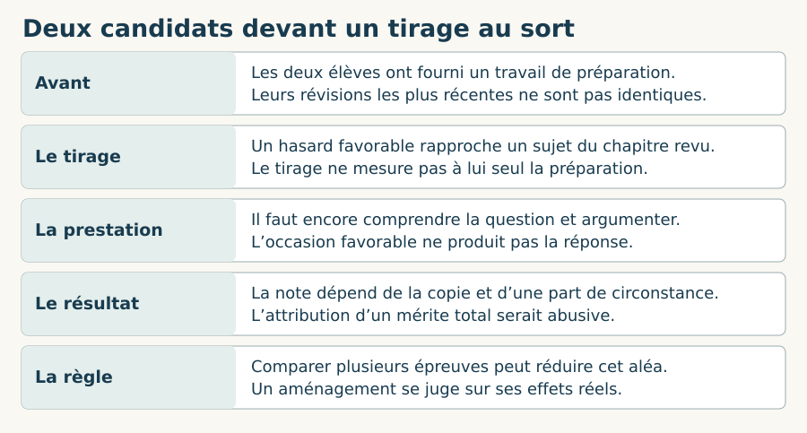
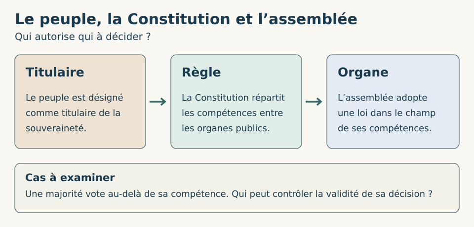
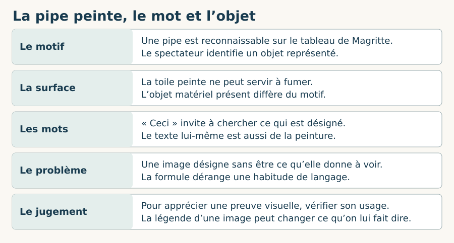
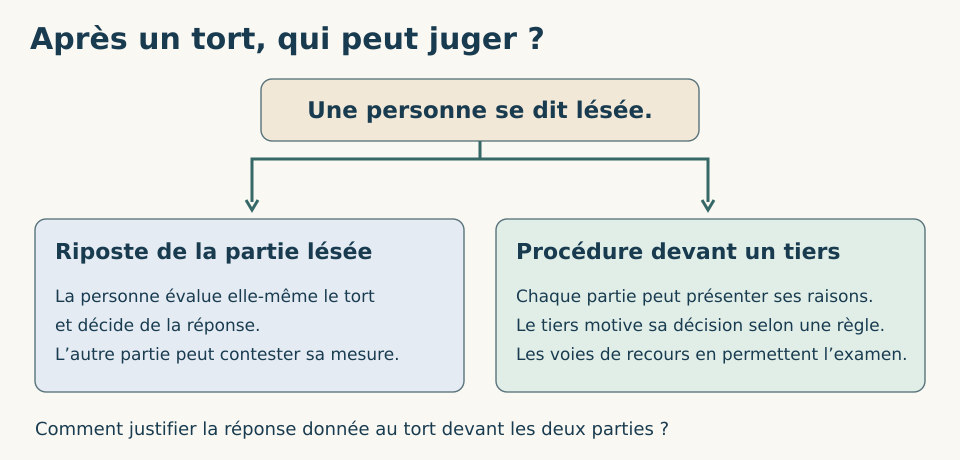
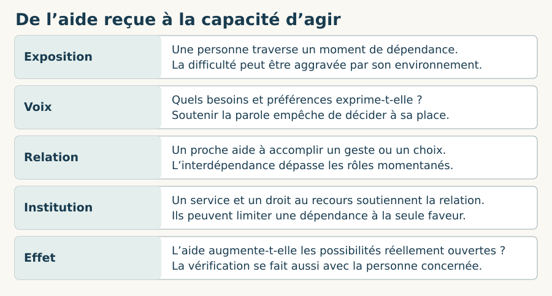
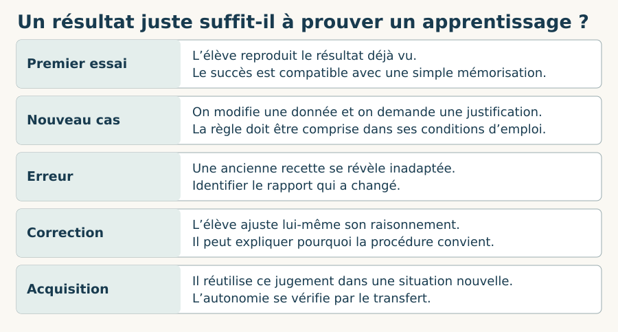

# BEL · AL — Philosophie (oral tronc commun, autres tirages du jury) 2026 · Corrigé brut

*Corrigé rédigé par IA, non officiel. Signalez toute erreur.*

**Rédaction** · GPT-6.2 Astra Ultra · vitesse non renseignée

**Autocontrôle** · GPT-6.2 Astra Ultra · vitesse non renseignée

**Révision** · GPT-6.2 Astra Ultra · vitesse non renseignée

Le rapport du jury énumère 182 billets de philosophie A/L. Douze feuillets de séance permettent d’en dater 135. Les 47 billets réunis ici forment le reste de la liste. Leur rang se compte depuis la [page 6 du rapport](https://www.ens.psl.eu/sites/default/files/2026_al_rapport_oral_philosophie_tc.pdf#page=6). Lisez les rangs 112 à 123 et 136 à 145 à la [page 8](https://www.ens.psl.eu/sites/default/files/2026_al_rapport_oral_philosophie_tc.pdf#page=8), puis les rangs 146 à 147 et 160 à 182 à la [page 9](https://www.ens.psl.eu/sites/default/files/2026_al_rapport_oral_philosophie_tc.pdf#page=9). Le jury les donne pour l’ensemble des commissions. La date et la commission de chacun restent indéterminées.

Chaque billet offre deux sujets. Le jury met en gras le sujet choisi, qui est le premier terme dans 32 cas et le second dans 15. Les deux développements suivent l’ordre du rapport. Dans l’[index officiel](https://www.ens.psl.eu/rapports-et-sujets-du-concours-2026-section-des-lettres-groupe-al), les liens du 29 juin renvoient aux feuillets qui portent la date du 26. Le [relevé des 182 paires](https://github.com/knoel99/corriges-concours/blob/d74206db70dcfac402a53244525d338900d7053c/campagnes/x-ens/philosophie-al-2026-tirages.tsv) permet de retrouver les six intitulés également proposés sur un billet daté, chaque fois avec un autre sujet.

L’épreuve est de coefficient 3. Vous lisez les deux sujets du billet devant le jury, choisissez au cours des 90 minutes de préparation et annoncez votre choix au début des 20 minutes d’exposé. L’entretien dure ensuite 10 minutes. Seul un dictionnaire de langue française est autorisé, à l’exclusion des dictionnaires de noms propres.

## Billet 112 — Faut-il craindre la mort ?

*Rapport, p. 8. Sujet choisi — Faut-il craindre la mort ?*

Une échéance dont nous ignorons la date peut nous inquiéter avant même de nous atteindre. Cette inquiétude porte-t-elle sur le fait de ne plus être, sur la séparation d’avec nos proches ou sur des projets demeurés ouverts ? Dans la Lettre à Ménécée, Épicure rappelle que, lorsque nous existons, la mort n’est pas présente, et que lorsqu’elle est là nous ne sommes plus là pour l’éprouver. L’argument dissipe l’image contradictoire d’une expérience de notre propre absence. Il n’annule pas l’importance actuelle de nos attachements. La conscience de la mortalité peut orienter le temps vers ce qui compte et soutenir le soin des personnes présentes. Nous avons des raisons de prendre au sérieux la finitude sans faire de la crainte une obligation ni la mesure d’une vie bonne.

### La simplicité

Un énoncé simple permet de comprendre d’un seul regard une relation que des détails trop nombreux cachaient. Encore faut-il savoir ce qu’il a laissé de côté. Un plan qui omet les noms des rues secondaires peut convenir pour lire les grandes directions et égarer celui qui cherche une adresse précise. La simplicité peut caractériser un objet peu composé, une représentation économique ou une attitude sans ostentation. Elle gagne une valeur intellectuelle lorsqu’on conserve les différences utiles au problème. Enlever une complication inutile clarifie. Éliminer par décret la résistance du cas réel rend seulement l’explication simpliste.

## Billet 113 — À qui devons-nous obéir ?

*Rapport, p. 8. Sujet choisi — À qui devons-nous obéir ?*

Les consignes d’un contrôleur de train, d’une enseignante et d’un ami n’obligent pas de la même manière. Une compétence peut conférer le droit de régler un trajet ou une épreuve sans donner autorité sur toute la vie de la personne. Il faut donc identifier le titre de l’autorité, le domaine de sa compétence et la possibilité de contester un ordre qui en sort. La contrainte explique qu’un ordre soit suivi, mais elle ne fonde pas encore un devoir. Rousseau, en critiquant le droit du plus fort, rappelle cette différence. Nous devons obéir aux règles justifiables d’une coopération et aux autorités dans les limites de leur mandat. Le jugement et la responsabilité ne se transfèrent jamais entièrement avec l’ordre reçu.

### Honte, pudeur, embarras

Une personne se trompe de rangée au théâtre, se sent gênée et se déplace. L’embarras tient à un écart de situation qu’une correction légère suffit souvent à résoudre. La pudeur peut la conduire à protéger une part de son intimité avant même que personne ait rien vu. La honte touche plus profondément l’image de soi exposée au regard réel ou imaginé d’autrui. Elle peut même atteindre une victime qui n’est nullement coupable. Distinguer ces affects prévient deux erreurs, transformer toute gêne en jugement moral et conclure du sentiment d’être regardé à l’existence d’une faute.

## Billet 114 — Le respect des lois

*Rapport, p. 8. Sujet choisi — Le respect des lois*

Traverser au vert sans regarder peut être dangereux si un véhicule est immobilisé sur le passage. Le respect des lois n’est pas une simple répétition de gestes. Il est reconnaissance d’une règle dont la finalité, la coordination et la sécurité commune, compte pour la conduite. Il se distingue également de l’obéissance par seule peur de la sanction. Faut-il accorder un respect inconditionnel à toute prescription dès qu’elle figure dans un code ? Une démocratie met à disposition des procédures pour critiquer, réformer et parfois faire écarter une règle incompatible avec des droits supérieurs. Respecter les lois comprend donc une fidélité aux conditions publiques du jugement. Cette fidélité demande de distinguer la contestation d’une règle et la demande d’un privilège personnel.

### Toute technique est-elle artificielle ?

Une greffe est artificielle par l’intention de la jardinière et par la préparation de la coupe. L’union des tissus est produite par un organisme vivant. Une technique s’appuie sur des propriétés dont son praticien n’est pas l’auteur. Inversement, des techniques du corps telles que les façons de nager peuvent devenir si habituelles qu’elles semblent naturelles. L’« artificiel » peut qualifier une origine humaine ou une apparence forcée. Si l’on entend le premier sens, le savoir-faire acquis comporte un artifice. S’il s’agit du second, une technique accomplie peut être parfaitement ajustée à un milieu vivant et perdre tout caractère d’affectation.

## Billet 115 — Le pouvoir corrompt-il ?

*Rapport, p. 8. Sujet choisi — Le pouvoir corrompt-il ?*

Donner à une personne le pouvoir de rédiger seule les critères d’une récompense qu’elle peut recevoir crée une tentation. Que la tentation existe ne démontre pas que son caractère soit devenu mauvais. La corruption peut être une transformation morale progressive ou le détournement concret d’une charge au profit d’un intérêt privé. Montesquieu souligne l’importance de disposer les pouvoirs de manière qu’ils se limitent. Un contre-pouvoir ne présume pas chaque titulaire malhonnête. Il limite les effets de la dépendance personnelle et donne aux intéressés les moyens de demander des comptes. Le pouvoir peut habituer au privilège lorsque les informations et les recours disparaissent. Sa prévention repose autant sur des institutions que sur la vertu individuelle.

### La classification des arts

Classer les arts selon l’espace et le temps éclaire la différence entre une composition picturale et une phrase musicale. Lessing, dans le Laocoon, examine les conséquences de la coexistence ou de la succession des signes. Une installation sonore distribue cependant des sons dans une salle qu’il faut traverser. Le cas hybride ne ruine pas nécessairement la classification, il oblige à mettre à l’épreuve le critère et ses limites. Une autre classification, par matériaux ou par institutions, mettra au jour d’autres parentés. Classer sert à expliquer des opérations, à condition de ne pas transformer le classement en prescription sur ce que chaque art devrait à jamais rester.

## Billet 116 — Se rebeller

*Rapport, p. 8. Sujet choisi — Se rebeller*

Se rebeller suppose plus qu’une préférence pour le contraire de ce qui est demandé. Celui qui refuse une humiliation peut encore reconnaître l’autorité de la règle plus générale selon laquelle chacun doit être traité avec respect. Dans L’Homme révolté, Camus s’interroge sur le passage du refus singulier à l’affirmation d’une valeur commune. Ce passage exige des raisons. Un refus peut aussi viser à conserver une position dominante ou à s’exempter de charges partagées. Le sens moral d’une rébellion se juge au tort qu’elle nomme, à la place des autres dans sa revendication et aux possibilités de coopération qu’elle ouvre. Respecter ces limites évite de confondre courage et goût de la rupture pour elle-même.

### Peut-on tout traduire ?

Une boutade fondée sur deux homophones perd son effet si l’on remplace chaque mot par un équivalent de dictionnaire. Il reste possible d’expliquer le jeu ou d’en créer un autre dans la langue d’arrivée. Tout dépend de ce que la traduction doit préserver, renseignement, rythme, ambiguïté ou expérience comique. Une traduction ne peut garantir simultanément toutes ces dimensions. L’existence de plusieurs versions justifiables ne fait pas disparaître les contresens détectables. On peut traduire beaucoup, y compris en signalant une perte, sans soutenir que tout est intégralement transportable par une unique équivalence.

## Billet 117 — La chance

*Rapport, p. 8. Sujet choisi — La chance*

Deux élèves aussi bien préparés tirent des sujets dont un seul mobilise le chapitre qu’ils viennent de réviser. La chance désigne ici un écart entre le résultat et la part que l’on peut attribuer à leur travail. Elle n’implique pas que l’événement soit sans cause. Le tirage possède des conditions déterminées tout en étant imprévisible pour les intéressés. La chance devient morale lorsque les conséquences d’une action influencent notre jugement sur son auteur alors qu’une part en échappait à son contrôle. Il faut donc distinguer attribuer une performance, reconnaître un hasard favorable et organiser une seconde épreuve pour limiter le rôle de l’aléa. L’enjeu institutionnel est de ne pas transformer le bénéfice d’un événement fortuit en mérite total.

### Dire, est-ce faire ?

Déclarer une séance ouverte produit un changement si la personne compétente prononce la formule dans les circonstances prévues. Austin montre que les paroles peuvent accomplir des actes, promettre, nommer ou demander. À l’inverse, annoncer qu’une séance a déjà commencé peut être un simple renseignement. Même l’énoncé descriptif accomplit l’acte d’affirmer et expose le locuteur à une demande de preuve. Il reste une distinction entre ce que l’on fait en parlant et l’effet que la parole obtient sur l’auditeur. Je peux lui demander de venir sans le faire venir. Il faut donc préciser l’action, ses conditions de réussite et ses éventuelles conséquences.

## Billet 118 — Le jardin

*Rapport, p. 8. Sujet choisi — Le jardin*

Le jardin est travaillé pour donner à une croissance vivante certaines conditions de forme et de durée. Il offre ainsi un cas où opposer nature et artifice explique mal ce qui se produit. Le jardinier agence des espèces, taille et arrose. Il ne décide ni de chaque poussée ni des relations de toute une saison. Un jardin d’apparat ménage des perspectives, un jardin vivrier organise des récoltes et un jardin collectif rend possible une coopération à l’échelle d’un quartier. Les fonctions peuvent se renforcer ou entrer en conflit, par exemple si une surface très visible consomme toute l’eau. Penser le jardin exige donc de tenir ensemble la forme voulue, la durée propre du vivant et les usages qui rendent le lieu commun ou exclusif.

### Mon corps m’appartient-il ?

Dire « c’est mon corps » affirme un droit décisif de consentir ou de refuser. Assimiler ce rapport à la propriété d’un objet que l’on pourrait aliéner entièrement manque toutefois que c’est avec ce corps que j’exerce ma volonté et communique une décision. Le consentement requiert une information intelligible, un pouvoir effectif de refuser et des garanties contre la pression. Une contrainte matérielle ou sociale peut rendre une prétendue liberté de disposer très inégale. Mon corps est le mien au sens d’une autonomie et d’une protection intime. La propriété patrimoniale n’en fournit qu’une métaphore partielle.

## Billet 119 — Faut-il être gentil ?

*Rapport, p. 8. Sujet choisi — Faut-il être gentil ?*

Une personne accepte toujours de remplacer ses collègues. Sa gentillesse entretient la coopération, mais devient aussi l’occasion pour d’autres de lui laisser toutes les tâches ingrates. Le sujet demande si une disposition affective aimable constitue un devoir. L’intention de ne pas blesser et l’attention aux besoins d’autrui ont une valeur morale. Elles ne suffisent pas à décider quand une demande est juste. Refuser poliment une faveur qui léserait un tiers peut être plus respectueux que céder pour conserver une réputation agréable. Il faut cultiver les gestes d’égard, tout en laissant à chacun le droit de poser une limite et de faire entendre une vérité difficile.

### La conscience du temps

L’horloge et l’impatience mesurent-elles le même temps ? Une minute objective garde sa durée tandis qu’elle semble interminable à qui attend une nouvelle. Pour entendre une mélodie, je dois aussi retenir la note précédente tout en anticipant la suite. Augustin analyse l’attention présente, la mémoire et l’attente dans le livre XI des Confessions. Cette structure éclaire comment une succession peut être vécue comme un déroulement et non comme une série d’instants sans rapport. La mesure publique et la conscience du temps ne s’annulent donc pas. Elles répondent à des questions différentes sur une expérience qui peut être comparée, partagée et diversement éprouvée.

## Billet 120 — Grandir

*Rapport, p. 8. Sujet choisi — Grandir*

Un enfant gagne plusieurs centimètres pendant une année. Un adulte lui dit aussi qu’il a grandi parce qu’il sait reconnaître un tort et demander de l’aide. La même expression désigne maturation corporelle, acquisition d’aptitudes et transformation du rapport aux autres. Les rythmes ne coïncident pas toujours. Être déclaré « grand » peut ouvrir une liberté ou faire peser une responsabilité pour laquelle les moyens manquent encore. Grandir n’est donc ni une simple mesure ni une marche linéaire vers l’absence de toute dépendance. Une autonomie accrue peut se manifester dans la capacité de choisir ses appuis et d’en répondre. L’éducation gagne à reconnaître les progrès réels sans transformer un âge en verdict global sur une personne.

### Une société sans religion est-elle possible ?

Une société peut distinguer ses institutions civiles de toute confession commune et offrir des droits à des croyants et à des non-croyants. Cela ne suffit pas à établir qu’aucun de ses membres n’aura de croyances religieuses. Il faut donc séparer société sans religion officielle et société sans aucune pratique religieuse. Durkheim analyse la puissance de rassemblement des rites. D’autres pratiques, juridiques, culturelles ou civiques, peuvent également produire un temps partagé et des obligations. Leur capacité à faire du lien n’en fait pas nécessairement des religions. Une communauté politique peut ainsi se construire autour de droits et d’engagements communs en protégeant la diversité des convictions.

## Billet 121 — Rêver

*Rapport, p. 8. Sujet choisi — Rêver*

Dans un rêve, une personne étrangère semble connue depuis toujours. L’esprit produit un monde dont la cohérence paraît suffisante pendant qu’on le vit. Rêver désigne aussi, à l’état de veille, former un projet encore absent. Le premier processus n’est pas généralement choisi, le second peut s’ordonner à une décision. Les confondre conduit soit à tenir tout projet pour une illusion, soit à prêter au rêve nocturne le contrôle d’un plan. Le doute cartésien fait du rêve une épreuve de nos raisons de croire une perception présente. Il n’enlève pas toute distinction entre rêver et agir. Le réveil, la mémoire et la vérification par autrui permettent de confronter le monde imaginé aux résistances du monde commun.

### Qu’est-ce qu’un témoin ?

Un témoin ne garantit pas un fait parce qu’il parle avec assurance. Son témoignage revendique une présence ou un accès particulier à ce qui est arrivé. La distance, le moment et la possibilité de confusion doivent être examinés. Être de bonne foi ne donne pas une mémoire sans erreur. Inversement, le caractère situé de tout témoin ne rend pas vaine la confrontation de plusieurs témoignages indépendants avec des traces matérielles. Un témoin est donc une personne qui peut répondre de ce qu’elle atteste et dont la parole entre dans une procédure de vérification. Dire « je ne sais pas » sur un détail peut renforcer la précision du reste.

## Billet 122 — L’empathie

*Rapport, p. 8. Sujet choisi — L’empathie*

Une amie croit sentir très vivement la gêne de quelqu’un qui doit prendre la parole. Elle risque pourtant de lui attribuer sa propre peur, alors que l’autre éprouve surtout de l’impatience. L’empathie peut désigner l’effort pour comprendre une perspective ou la résonance affective devant l’état d’autrui. Ces deux opérations se corrigent l’une l’autre par l’écoute de ce que la personne exprime. En outre, une connaissance précise des affects de l’autre pourrait être utilisée à son détriment. L’empathie ne suffit donc pas à constituer une vertu morale. Elle devient une ressource pour la justice lorsqu’elle rend attentif à un besoin sans remplacer l’autre ni faire dépendre ses droits de la facilité que nous avons à nous imaginer à sa place.

### La nature a-t-elle une histoire ?

Parler d’histoire naturelle a pu désigner l’inventaire descriptif des espèces. La géologie et l’évolution donnent une autre portée à l’expression. Les couches d’un terrain et les parentés du vivant permettent d’établir des transformations irréversibles à partir de traces présentes. Ce devenir n’exige pas qu’une intention ait conçu chaque étape. D’autre part, le concept même de nature et les milieux transformés par les humains possèdent une histoire culturelle. Ces deux histoires se rencontrent lorsque l’étude de pollens anciens éclaire l’effet d’un mode de culture sur un paysage. Il faut distinguer l’historicité des êtres et celle des catégories avec lesquelles nous les connaissons.

## Billet 123 — Pourquoi y a-t-il plusieurs philosophies ?

*Rapport, p. 8. Sujet choisi — Pourquoi y a-t-il plusieurs philosophies ?*

Deux philosophes peuvent examiner la liberté en partant l’un de la délibération vécue, l’autre des causes naturelles dont dépend la décision. La différence ne tient pas nécessairement à une ignorance que le premier progrès des sciences devrait dissiper. Les questions, critères de réponse et présupposés sont eux-mêmes examinés dans l’argumentation. Une pluralité de traditions peut mettre au jour des distinctions qu’une solution tenue pour acquise faisait oublier. Il n’en découle pas que toutes les affirmations se valent. On peut vérifier la conséquence d’un argument, confronter ses exemples et contester la cohérence de ses concepts. La pluralité des philosophies demeure féconde tant qu’elle devient discussion justifiable, et non collection d’opinions soustraites à l’examen.

### Le pur et l’impur

Une eau dite pure au laboratoire et une pratique dite impure dans un rituel ne relèvent pas du même contrôle. Une analyse établit la présence de certains composés, tandis qu’une règle culturelle attribue des places, des interdits et des conditions d’usage. Mary Douglas étudie dans De la souillure les rapports entre ces classifications et les frontières d’un ordre symbolique. Cette étude n’assimile pas toute exigence sanitaire à un rite. Elle demande quelle transgression ou quel mélange une société désigne comme souillure. La distinction devient dangereuse si la qualification d’impureté sert à retirer des droits à une personne. Il faut donc préciser la norme invoquée et la justification de ses effets.

## Billet 136 — Le conflit

*Rapport, p. 8. Sujet choisi — Qu’est-ce qu’un paysage ?*

Deux voisins peuvent préférer des couleurs différentes sans que leurs préférences s’opposent dans leurs effets. Un conflit commence lorsque leurs demandes ou leurs projets se rencontrent sur un enjeu qu’ils ne peuvent régler indépendamment, par exemple la destination d’un jardin commun. Il suppose ainsi une relation qu’il met en tension. Simmel a montré que le conflit lui-même peut constituer un mode de socialisation, en faisant apparaître des groupes, des règles et des prétentions jusque-là implicites. Il peut aussi défaire la relation si chaque partie entend supprimer la possibilité même du désaccord. Le conflit ne se juge pas sur sa seule intensité. Il faut savoir quel objet il rend discutable, si les parties sont reconnues et ce que le règlement permet de transformer.

### Qu’est-ce qu’un paysage ?

Le même bassin fluvial est un territoire mesuré sur une carte, un milieu habité par des oiseaux et un paysage pour quelqu’un qui en perçoit les rapports de formes et les traces d’histoire. Dire paysage suppose une manière de saisir une étendue comme ensemble depuis un certain point de vue. Il ne s’agit pas seulement d’une image subjective, car reliefs, cultures et constructions résistent à l’interprétation. Il ne s’agit pas davantage d’un donné indépendant de tout regard. Un chemin, une tradition picturale et les usages locaux peuvent rendre perceptible une relation auparavant négligée. Le paysage est donc une réalité située, à la rencontre d’une configuration matérielle, d’une sensibilité et d’une histoire des pratiques.

## Billet 137 — L’origine du langage

*Rapport, p. 8. Sujet choisi — Perdre son temps*

Un cri signale un danger sans former encore à lui seul un système de signes combinables grâce auquel on parlerait de ce qui est absent. Rechercher l’origine du langage peut vouloir dire dater une transformation chez les premiers humains ou reconstruire les conditions qui rendent un usage symbolique possible. Les deux enquêtes n’ont pas les mêmes preuves. Rousseau, dans l’Essai sur l’origine des langues, met en question la réduction de la parole à la seule satisfaction des besoins et examine le rôle des passions. Une scène hypothétique ne constitue pas un enregistrement des premières paroles. Elle peut éclairer pourquoi des êtres sociaux auraient besoin de s’adresser les uns aux autres dans des formes ouvertes et apprises, au-delà d’un signal immédiatement attaché à une situation.

### Perdre son temps

Une personne abandonne une tâche prévue pour écouter un ami. Elle a perdu du temps sous le critère du calendrier initial et gagné un moment auquel elle tenait davantage. La comptabilité des heures ne décide donc pas de leur valeur. Il y a pourtant des pertes réelles quand une attente sans information immobilise quelqu’un ou quand une distraction l’écarte durablement d’une fin qu’il reconnaît encore comme sienne. Sénèque examine dans De la brièveté de la vie le paradoxe d’existences très occupées qui laissent peu de temps à ceux qui les vivent. Apprécier la perte demande de nommer la fin concernée et la possibilité effective de reprendre la disposition de sa durée.

## Billet 138 — Y a-t-il des raisons de vivre ?

*Rapport, p. 8. Sujet choisi — Y a-t-il des raisons de vivre ?*

Au terme d’une répétition, plusieurs musiciens rentrent chez eux heureux d’avoir fait entendre ensemble une phrase qu’aucun n’aurait pu jouer seul. Une relation, une curiosité, une activité créatrice ou un engagement peuvent donner à l’existence une orientation concrète. Mais les raisons de vivre sont-elles des preuves dont une personne devrait pouvoir dresser l’inventaire à tout moment ? On confondrait alors la justification logique d’une proposition et ce qui rend une vie précieuse pour quelqu’un. Le découragement d’un jour ou la difficulté de nommer un attachement ne mesure pas la valeur d’une personne. Les raisons peuvent se découvrir dans des gestes reçus et des relations à venir, et elles se construisent parfois avec le soutien d’autrui. Elles restent plurielles et transformables, sans imposer à chacun un unique modèle de vie réussie.

### La souveraineté

Une assemblée vote un texte, mais elle peut être soumise à une Constitution qui borne ses compétences. La souveraineté demande à quelle autorité ultime sont rapportées les compétences publiques. Selon un deuxième sens, elle désigne l’indépendance d’un État vis-à-vis de tout autre. Attribuer la souveraineté au peuple interdit de l’identifier sans autre preuve à la volonté personnelle d’un dirigeant. Rousseau distingue souveraineté et gouvernement. La première concerne la source de la loi, le second son administration. Dire où réside la souveraineté ne règle donc pas encore les procédures de représentation, les limites imposées par les droits ni les moyens de contrôle dont disposent effectivement les citoyens.

## Billet 139 — Faut-il respecter la nature ?

*Rapport, p. 8. Sujet choisi — Les limites du corps*

Un promeneur respecte un milieu fragile en restant sur les chemins reconnus. Agit-il par souci du plaisir des futurs visiteurs ou parce que la vie de ce milieu a une valeur propre ? Les deux raisons peuvent soutenir la même conduite avec des conséquences différentes si aucun visiteur n’est attendu. Respecter la nature ne signifie pas en imiter toutes les opérations ni renoncer à toute intervention. Restaurer une zone humide abîmée peut être une manière de respecter les capacités de renouvellement d’un milieu. Un principe défendable exige d’identifier les êtres et les relations concernés, la vulnérabilité à nos actions et les conditions d’un usage juste pour les populations qui en dépendent.

### Les limites du corps

Un instrumentiste expérimenté agit au-delà des limites de sa peau par l’intermédiaire de son archet. Sa portée et ses habitudes changent avec l’outil. Il n’en découle pas que son corps soit disponible à un progrès illimité. Le rythme d’un geste rencontre la fatigue, la douleur ou la nécessité d’un apprentissage. Il faut distinguer la limite anatomique, la limite actuelle d’une capacité et les obstacles construits par un milieu mal aménagé. Merleau-Ponty décrit le corps propre à travers l’espace de ses prises sur le monde. Cet espace peut s’étendre ou se réduire en fonction d’une situation. Reconnaître les limites devient plus juste lorsqu’on n’attribue pas à un corps isolé toute difficulté née de son environnement.

## Billet 140 — La diversité des langues est-elle une diversité des pensées ?

*Rapport, p. 8. Sujet choisi — La diversité des langues est-elle une diversité des pensées ?*

Deux langues exigent de préciser des aspects différents d’une situation pour former une phrase ordinaire. L’une peut obliger plus souvent à dire comment une information a été obtenue, une autre permettre de le laisser au contexte. Cette différence d’habitude peut orienter l’attention sans fixer tout ce qu’il est possible de penser. Une paraphrase, un exemple ou l’apprentissage d’une seconde langue rendent visibles les distinctions qui n’étaient pas lexicalement obligatoires. La traduction éprouve donc à la fois la diversité des chemins de formulation et la possibilité de se comprendre. La diversité des langues fait varier des pratiques de pensée. Elle ne suffit pas à partager l’humanité en univers mentaux fermés sans accès réciproque.

### La tristesse

La tristesse peut se présenter au moment d’une perte, ou plus diffusement lorsque les activités familières paraissent demander davantage d’effort. Dans l’Éthique de Spinoza, la tristesse se comprend comme passage à une moindre puissance d’agir. Cette analyse dynamique se distingue du jugement moral qui reprocherait à la personne ce qu’elle éprouve. Une musique triste peut même être écoutée avec plaisir parce que sa forme donne un langage commun à une expérience difficile à dire. Les objets, les durées et les remèdes de la tristesse varient. L’examiner demande d’écouter la personne et de considérer les relations qui peuvent à nouveau la soutenir, sans transformer un sentiment en verdict sur sa vie.

## Billet 141 — L’usage des plaisirs

*Rapport, p. 8. Sujet choisi — La création artistique*

Un plaisir immédiat, manger un bon repas ou écouter longtemps de la musique, peut soutenir une vie heureuse. Le fait qu’il soit plaisant ne suffit pourtant pas à régler sa place parmi d’autres biens. Épicure invite dans la Lettre à Ménécée à considérer les effets des choix et des refus, puisque toute satisfaction n’est pas à rechercher dans toute circonstance. L’usage des plaisirs engage ainsi des relations de temps, de liberté et de considération pour autrui. Une discipline raisonnable peut élargir la variété de ce dont on jouit plutôt que l’appauvrir. L’enjeu n’est pas de distribuer les expériences en plaisirs honteux et légitimes par simple convention, mais d’examiner ce qu’ils rendent possible et les dépendances qui peuvent s’y former.

### La création artistique

Une sculptrice commence avec un bloc dont une irrégularité la conduit à infléchir le projet. Créer ne signifie donc pas toujours imposer à la matière une idée déjà complète. Le travail fait naître des possibilités que la première esquisse ne contenait pas distinctement. Il n’est pas non plus une survenue sans conditions. Des gestes appris, des œuvres antérieures et des institutions fournissent des moyens et des limites. Le rapport du jury décrit, à propos d’un exposé entendu sur cette question, le passage de la nouveauté de l’œuvre à la production continuée de son sens. On peut l’éprouver devant une mise en scène nouvelle d’une pièce ancienne. La création comprend des opérations d’invention, de réalisation et de reprise dont les auteurs et les temps peuvent différer.

## Billet 142 — Les mots peuvent-ils nous manquer ?

*Rapport, p. 8. Sujet choisi — Les mots peuvent-ils nous manquer ?*

Au moment d’expliquer une douleur ou de témoigner d’un événement inédit, quelqu’un peut plusieurs fois reprendre sa phrase. Le manque peut être un mot momentanément inaccessible, une distinction que la langue habituelle marque mal ou une difficulté à se faire entendre dans un vocabulaire qui disqualifie une expérience. Ces cas n’appellent pas la même réponse. Un synonyme suffit parfois, ailleurs une comparaison, un récit ou un terme collectif nouveau rend partageable ce qui restait indistinct. On peut indiquer avec des mots une limite du langage sans soutenir qu’il est absolument impossible de parler. Le manque devient même une occasion de créer des expressions, à condition de ne pas demander à la personne une transparence immédiate qu’aucun mot ne garantit.

### La liberté de conscience

Avoir la liberté de conscience signifie pouvoir former et réviser ses convictions, y compris religieuses, sans être contraint d’adhérer à une doctrine. Le droit concerne aussi celui qui ne professe aucune religion et celui qui change d’avis. Une autorité peut obtenir une déclaration de conformité sans produire une conviction véritable. Mais l’absence de pouvoir sur les pensées intérieures n’épuise pas la liberté, car la menace sur l’emploi ou l’éducation peut empêcher l’expression et l’examen commun des convictions. Il faut donc distinguer la protection du for intérieur et les conditions d’exercice des libertés dans un espace partagé, où les droits d’autrui interviennent également.

## Billet 143 — L’ordre du monde peut-il changer ?

*Rapport, p. 8. Sujet choisi — L’ordre du monde peut-il changer ?*

L’ordre du monde peut désigner les régularités physiques ou l’organisation sociale que des humains ont fini par tenir pour naturelle. Une éclipse imprévue par un observateur ne signifie pas qu’une loi de la nature a changé. Une révolution politique peut en revanche transformer les institutions qui ordonnent la distribution du pouvoir. Il faut aussi distinguer le changement dans le monde et le changement des lois censées en rendre compte. Un modèle révisé après une observation nouvelle témoigne d’abord d’une transformation de notre savoir. Demander si l’ordre même peut changer exige donc de préciser quel niveau demeure stable pour rendre le changement intelligible. Sans un tel repère, on ne saurait dire ce qui a réellement pris fin et ce qui a été redécrit.

### L’amour de l’argent

L’argent sert à obtenir des biens très différents. Désirer cette capacité générale d’échange peut libérer d’une dépendance ponctuelle, notamment lorsqu’on peut répondre à une dépense imprévue. L’amour de l’argent commence à poser une difficulté particulière lorsque le moyen devient fin et que chaque acquisition accroît le désir de conserver ou d’accumuler plutôt qu’elle ne permet un usage. Simmel, dans la Philosophie de l’argent, examine cette transformation des rapports entre moyens et fins. Critiquer l’accumulation sans limites ne justifie pas de reprocher à qui manque de ressources son souci de sécurité. Il faut distinguer le pouvoir concret d’agir, le prestige du chiffre et la relation à autrui que l’argent règle ou déforme.

## Billet 144 — Gouverner

*Rapport, p. 8. Sujet choisi — Poésie et pensée*

Gouverner suppose une direction collective et une compétence pour prendre des décisions qui n’existaient pas déjà sous forme de consignes. Le modèle du pilote éclaire l’ajustement à un milieu variable, mais les citoyens ne sont pas un chargement dont le trajet serait connu du seul gouvernant. Ils ont des droits et peuvent eux-mêmes déterminer quelle destination est souhaitable. Un gouvernement doit donc être évalué selon ses fins, ses résultats et sa manière de rendre des comptes. Réduire son activité à la bonne administration de moyens déjà choisis permettrait de soustraire à la discussion la décision la plus importante, ce qui mérite d’être poursuivi ensemble.

### Poésie et pensée

Un vers qui s’interrompt avant le mot attendu fait éprouver une relation que la reformulation en prose peut seulement mentionner. La poésie peut-elle penser par ces opérations mêmes ou ne ferait-elle qu’orner une thèse déjà formulée ailleurs ? Dans un sonnet, les reprises de sons et la bascule entre quatrains et tercets peuvent amener le lecteur à réviser ce qu’il croyait entendre. Cette transformation est un acte de pensée sans prendre nécessairement la forme d’une démonstration. Toute ambiguïté poétique n’est pas pour autant une vérité profonde. Il faut décrire la construction précise qui fait surgir une distinction ou éprouver une question. La poésie pense lorsqu’elle donne au langage la capacité de mettre en jeu sa propre manière de saisir l’expérience.

## Billet 145 — La musique adoucit-elle les mœurs ?

*Rapport, p. 8. Sujet choisi — L’anarchie*

Une chorale apprend à régler sa voix sur celles des autres. Cette pratique peut former une attention et une coopération utiles à la vie commune. Il serait pourtant excessif de tirer de cette expérience une loi selon laquelle toute musique rendrait ses auditeurs pacifiques ou justes. Le contexte, le répertoire et l’organisation d’un public donnent des effets très différents à l’écoute collective. Une même marche peut rassembler et exclure. La formule sur l’adoucissement des mœurs désigne donc une puissance éducative possible plus qu’un résultat automatique. Elle devient une hypothèse précise lorsqu’on décrit quelle habitude d’écoute se forme, dans quelles relations et avec quelle possibilité de discussion.

### L’anarchie

Une association peut se coordonner sans chef permanent, par des règles partagées et des responsabilités révocables. L’anarchie politique interroge la nécessité d’un pouvoir souverain séparé pour rendre durable une telle coopération. Dire que l’absence du chef engendre par définition le désordre ferait de la conclusion une prémisse. Il faut aussi éprouver l’hypothèse en sens inverse, comment traiter un litige durable, garantir les droits d’une minorité et empêcher les personnes influentes d’exercer un pouvoir informel sans recours ? Le problème porte sur la forme et le contrôle de l’autorité, et non sur le simple nombre de règles. Une expérience locale éclaire cette possibilité sans garantir qu’elle résolve toutes les questions d’échelle et de durée.

## Billet 146 — La paix est-elle de ce monde ?

*Rapport, p. 9. Sujet choisi — La trahison des images*

On connaît des périodes et des lieux où des populations vivent durablement sans hostilités ouvertes. Cela donne une réponse d’existence minimale à la question « de ce monde ». Une paix plus forte exige aussi des institutions capables de traiter les différends sans laisser les personnes dépendre de la bonne volonté provisoire d’un autre pouvoir. Kant, dans Vers la paix perpétuelle, formule une exigence juridique qui permet de juger des arrangements imparfaits. La distance entre l’idéal et les faits ne suffit ni à rendre l’idéal impossible ni à garantir sa réalisation. Elle invite à déterminer ce que les expériences pacifiques ont effectivement institué et quelles exclusions fragilisent encore l’accord.

### La trahison des images

Une pipe est peinte au-dessus de la formule « Ceci n’est pas une pipe ». Dans La Trahison des images de Magritte, on ne peut effectivement pas remplir de tabac la représentation. Le tableau ne fait pas que dénoncer les images comme des mensonges. Il interroge l’habitude de les tenir ici pour les choses, ailleurs pour de simples équivalents de noms. Une photographie correctement datée peut attester une présence, tout en devenant trompeuse sous une légende inexacte. Il faut distinguer représentation, objet représenté et usage de l’image. Ce qui trahit peut être une attente que nous avions placée dans l’image plutôt qu’une tromperie qui appartiendrait à toute représentation.

## Billet 147 — Qu’est-ce qu’un maître ?

*Rapport, p. 9. Sujet choisi — Qu’est-ce qu’un maître ?*

Le maître de musique possède un savoir-faire que l’élève ne peut pas apprendre en une seule démonstration. Le maître d’un domaine peut, dans un autre sens, disposer d’un pouvoir sur ceux qui y travaillent. Compétence pour transmettre et pouvoir d’ordonner ne se justifient pas de la même façon. Un bon maître enseigne des critères grâce auxquels l’élève pourra entendre par lui-même quand une phrase est juste, et éventuellement discuter l’interprétation du maître. Une autorité qui entretient au contraire l’incapacité de juger conserve des dépendants. La question demande donc quel rapport de maîtrise est en jeu. Dans l’éducation, sa réussite se voit notamment lorsqu’elle augmente la capacité de celui qui apprend à se passer de l’approbation personnelle du professeur.

### Le renoncement

Renoncer peut être se détourner d’un projet devenu impossible, ou choisir de ne pas exercer une possibilité encore ouverte parce qu’une autre fin compte davantage. Une bénévole qui refuse une responsabilité pour préserver du temps à un proche n’a pas nécessairement capitulé. Elle a reconnu une limite et hiérarchisé des engagements. À l’inverse, présenter comme renoncement libre l’abandon d’une formation inaccessible financièrement peut masquer une contrainte. On peut juger du sens du geste en demandant quelle option était réellement disponible, ce que l’agent savait et ce qu’il s’efforce de préserver. Le renoncement peut ainsi être perte subie, retrait prudent ou acte positif de détermination.

## Billet 160 — La bonne conscience

*Rapport, p. 9. Sujet choisi — Quand y a-t-il peuple ?*

Un responsable se félicite d’avoir appliqué la même procédure à tous. Une personne montre ensuite que la procédure entière la prive d’un recours accessible aux autres. La bonne conscience peut être le sentiment légitime d’avoir agi selon des raisons que l’on peut exposer, ou l’assurance qui dispense de chercher ce que l’on a omis. Le sentiment ne fournit pas sa propre preuve. Il faut distinguer l’absence de remords de la justice de l’acte. Une conscience qui accepte d’entendre les effets qu’elle n’avait pas prévus peut reconnaître un bien accompli sans devenir suffisante. L’examen critique ne commande pas pour autant la culpabilité permanente, il réclame des raisons et la disposition à les réviser.

### Quand y a-t-il peuple ?

Une assemblée rassemblée sur une place est un ensemble de personnes présentes. Pour devenir un peuple au sens politique, elle doit pouvoir se reconnaître concernée par des décisions communes et instituer des formes d’appartenance qui valent aussi pour les absents. Une majorité momentanée ne se confond pas avec l’ensemble de ceux qui sont soumis à la règle. Rousseau retourne vers l’acte par lequel un peuple est un peuple avant d’étudier le pouvoir qu’il institue. Cette interrogation oblige à examiner le droit du dissident, les frontières de la citoyenneté et la possibilité de participer. Il y a peuple quand une pluralité peut agir politiquement dans un cadre commun sans que sa diversité soit annulée.

## Billet 161 — Faut-il se libérer des habitudes ?

*Rapport, p. 9. Sujet choisi — Faut-il se libérer des habitudes ?*

Une habitude de lecture libère de l’effort de déchiffrer chaque lettre et permet de concentrer l’attention sur une phrase. Une habitude de juger quelqu’un sur son accent peut au contraire empêcher d’entendre ce qu’il dit. « Se libérer » des habitudes sans distinction supprimerait autant de capacités acquises que de contraintes. Il s’agit de déterminer si une répétition augmente les possibilités d’agir et de répondre à l’imprévu ou si elle rend la conduite insensible à ses raisons. Changer une habitude demande souvent un autre apprentissage et un milieu qui le soutienne, plutôt qu’un simple acte de volonté nu. Une liberté exercée comprend des habitudes disponibles, critiquables et transformables.

### Le soldat

La fonction du soldat se définit dans un cadre politique et juridique qui confie à une personne une mission publique et des obligations particulières. La présence d’une hiérarchie ne signifie pas que toute responsabilité passe au supérieur. L’obéissance institutionnelle demeure bornée par le droit et par l’exigence de reconnaître des personnes comme titulaires de protections. Le sujet interroge aussi une situation civique singulière, servir sous des règles spécifiques tout en demeurant membre de la communauté des citoyens. Une société peut reconnaître ce service et discuter publiquement les décisions qui l’engagent. Étudier le soldat comme fonction évite d’identifier sa personne à une seule vertu supposée ou à une préférence personnelle pour le conflit.

## Billet 162 — Justice et vengeance

*Rapport, p. 9. Sujet choisi — Justice et vengeance*

La justice et la vengeance supposent fréquemment une faute initiale reconnue par une personne qui en souffre. Une réponse devient vengeance lorsque la partie offensée détermine elle-même la mesure du retour et traite le nouveau dommage comme équivalent au premier. Une institution de justice intervient par une procédure, une qualification des faits et des garanties de contestation. Cette différence ne rend pas toute peine prononcée automatiquement juste. Une institution qui reprend le ressentiment d’un groupe sans examen des preuves trahirait sa fonction. Rendre justice implique d’entendre la victime et de limiter publiquement les conditions de la réponse. La réparation de ce qui peut l’être et la protection des droits restent distinctes du plaisir de faire subir une perte en retour.

### Pourquoi voyager ?

Voyager peut satisfaire un besoin de déplacement ou le désir d’être dépaysé. On peut néanmoins transporter toutes ses habitudes avec soi et ne rencontrer du pays que ses propres attentes. Le voyage devient une épreuve de jugement lorsque le visiteur accepte de voir son interprétation corrigée, de découvrir les usages des lieux et d’examiner sa place temporaire parmi ceux qui les habitent. Cela ne transforme pas chaque séjour en obligation d’authenticité. Le repos et la visite d’un proche sont aussi de bonnes raisons. Il faut considérer les conditions concrètes de cette mobilité et ses effets sur les habitants. Le simple nombre de kilomètres ne garantit ni la connaissance ni l’ouverture à autrui.

## Billet 163 — L’origine

*Rapport, p. 9. Sujet choisi — Peut-on se mettre à la place d’autrui ?*

L’origine d’un mot peut désigner la première occurrence conservée, un emprunt plus ancien ou le contexte qui a transformé son sens. Ces réponses ne se contredisent pas nécessairement, car elles n’interrogent pas la même naissance. Chercher l’origine d’une institution peut de même éclairer les rapports dont elle est issue, sans établir par là si l’institution actuelle est justifiée. L’étymologie d’un mot ne commande pas tous ses usages présents. Il faut distinguer le point de départ choisi pour l’enquête, les conditions de formation et le fondement que l’on invoque aujourd’hui. Ce tri permet à la généalogie de rendre un héritage discutable sans le disqualifier ou le consacrer par sa seule ancienneté.

### Peut-on se mettre à la place d’autrui ?

Prendre le siège de quelqu’un n’est pas prendre sa place au sens moral. Il faudrait comprendre ce qu’il peut décider avec son histoire, son information et ses contraintes, dont certaines me sont étrangères. L’imagination aide à suspendre mon premier jugement. Elle peut aussi imposer une projection, « à ta place j’aimerais cela », sans écouter ce que l’autre répond. Le rapport du jury cite à propos de cette question un recours à l’ethnographie et aux enquêtes de Jeanne Favret-Saada. Observer et se laisser instruire dans une relation donne à l’imagination une épreuve concrète. On peut tenter un déplacement partiel et révisable, mais personne ne devient le propriétaire du point de vue ou de la parole d’autrui.

## Billet 164 — Le dépaysement

*Rapport, p. 9. Sujet choisi — Le dépaysement*

Une rue familière paraît étrangère après une longue absence. À l’inverse, un hôtel reproduisant partout les mêmes normes peut réduire le dépaysement au milieu d’un voyage lointain. Le dépaysement ne dépend donc pas seulement de la distance. Il se produit lorsque des repères habituels cessent de guider immédiatement la perception et l’action. Cette désorientation peut inquiéter ou rendre à nouveau visibles des conventions qui passaient pour naturelles. Elle n’assure pas à elle seule une connaissance des autres, car le visiteur peut transformer sa surprise en cliché. Le dépaysement devient formateur lorsque l’étrangeté suscite une enquête sur les usages réels et un retour critique vers ses propres habitudes.

### Nécessité et contingence

Une éclipse calculée a lieu nécessairement sous les conditions retenues par le modèle. Ma décision d’aller l’observer sur une colline plutôt qu’en ville est contingente si une autre conduite demeurait possible. Il faut distinguer la nécessité logique, la nécessité sous des lois et la contrainte pratique dans une situation. Il faut de même séparer contingent et imprévisible. Un résultat peut être prévisible sans être logiquement nécessaire, et une nécessité peut échapper à notre connaissance. Ce repérage empêche d’inférer du simple fait qu’un événement est arrivé qu’il ne pouvait pas en aller autrement. Examiner la contingence revient à préciser sous quelles conditions on peut soutenir une possibilité alternative.

## Billet 165 — L’artificiel

*Rapport, p. 9. Sujet choisi — Qui croire ?*

Un matériau de synthèse est artificiel en raison de son procédé de production. Un ton de voix paraît artificiel parce qu’il sonne affecté. Passer de la première qualification au second jugement comme si toute intervention humaine était mauvaise constitue une confusion. Un dispositif artificiel peut soutenir une fonction vitale et s’intégrer avec souplesse à l’activité. Inversement, ce qui arrive sans intervention humaine peut être nuisible. Interroger l’artificiel demande de préciser ce qui a été produit, selon quelle intention et avec quels effets. La distinction d’origine conserve son intérêt pour attribuer des responsabilités et suivre les dépendances. Elle ne prescrit pas à elle seule d’approuver ou de rejeter le résultat.

### Qui croire ?

Deux témoins situent un événement à des heures incompatibles. Faire confiance au plus sûr de lui évite l’enquête sans rien résoudre. Il faut interroger la possibilité de voir, l’indépendance des sources, la compétence pertinente et les raisons qu’aurait quelqu’un de se corriger. Le témoignage d’une spécialiste mérite du crédit dans son domaine, et cette autorité grandit lorsqu’elle permet de remonter aux preuves et annonce ses incertitudes. Le scepticisme systématique serait aussi peu raisonnable que la crédulité, puisque nos connaissances dépendent de témoignages et de vérifications partagés. Croire quelqu’un demande une confiance proportionnée, révisable et liée à une question déterminée.

## Billet 166 — La conscience politique

*Rapport, p. 9. Sujet choisi — La conscience politique*

Une personne qui découvre les effets des horaires de transport sur ses chances de trouver un emploi peut passer d’un récit exclusivement personnel à une question de décision publique. La conscience politique commence souvent avec la perception de ce qui relie une situation individuelle à des institutions révisables. Elle ne se confond pas avec l’inscription dans un parti ni avec une certitude immédiate quant à la solution. Elle suppose des informations, l’écoute d’autres situations et une comparaison des moyens d’action. Elle devient dogmatique si toute objection est interprétée d’avance comme la preuve d’un manque de conscience chez celui qui la formule. Une conscience politique s’éprouve dans le pouvoir de demander des raisons, d’agir avec d’autres et de corriger son jugement sur les effets.

### Le salut vient-il de la raison ?

Le salut peut vouloir dire se tirer d’un péril déterminé, orienter une vie ou espérer une délivrance religieuse. Un raisonnement peut discerner un moyen de sortir d’une difficulté sans assurer que l’action sera possible ni fixer seul ce qui mérite d’être sauvé. Dans la tradition philosophique, connaître les causes de ce qui nous trouble peut transformer notre rapport aux affects et à la nécessité. Dans une conception religieuse, la grâce ou la foi jouent un rôle qu’aucune démonstration ne remplace. Il faut donc annoncer le sens retenu, puis distinguer la raison qui examine des croyances, celle qui guide une action et l’hypothèse selon laquelle elle suffirait à produire tout salut.

## Billet 167 — Peut-on renoncer à sa liberté ?

*Rapport, p. 9. Sujet choisi — Peut-on renoncer à sa liberté ?*

Un contrat de travail retire certaines possibilités pendant des heures définies et peut offrir en retour des ressources pour de nouveaux projets. Abandonner une option n’équivaut donc pas à renoncer à toute liberté. L’hypothèse plus forte d’une renonciation totale se heurte à une difficulté chez Rousseau. Si je me défais définitivement de tout droit de vouloir ou de contester, au nom de quelle volonté la contrainte ultérieure continuera-t-elle d’obliger légitimement ? Une personne peut subir une perte réelle de liberté, et un consentement donné sous dépendance mérite examen. On peut engager sa liberté de manière limitée et responsable. La prétendre entièrement aliénable supprimerait la qualité d’agent à laquelle on faisait appel pour justifier l’acte.

### La fiction

Une fiction propose un monde ou une situation dont l’auteur et le lecteur n’exigent pas immédiatement l’attestation comme fait réel. Un récit à la première personne peut pourtant réemployer une rue connue et des événements établis. La fiction ne se définit donc pas par la fausseté de chaque phrase, mais aussi par des conventions d’usage et par la place qu’elles donnent à l’imagination. Une variation inventée peut aider à comprendre une relation, comme un cas hypothétique permet de séparer deux motifs confondus dans l’expérience ordinaire. Elle peut également renforcer des clichés. Sa valeur demande d’examiner la forme et la portée de ce qu’elle nous fait éprouver.

## Billet 168 — Que faire de la tradition ?

*Rapport, p. 9. Sujet choisi — La vulnérabilité*

Une tradition rassemble des pratiques reçues dont l’origine n’est pas nécessairement connue de chaque participant. La conserver peut donner une mémoire et des ressources à ceux qui viennent après nous. En faire une règle intangible transforme pourtant le passé en autorité qui n’aurait plus à répondre des exclusions qu’elle reproduit. La rejeter à cause de sa seule ancienneté ignorerait aussi ce que les générations successives ont déjà modifié pour la maintenir vivante. La bonne question est celle des possibilités de transmission, de réinterprétation et de refus. Que peut-on apprendre de cette pratique, qui y prend part et à quelles conditions ceux qu’elle engage peuvent-ils en changer le sens ?

### La vulnérabilité

Une personne malade dépend aujourd’hui d’une aide que demain elle pourra rendre à quelqu’un d’autre. La vulnérabilité désigne l’exposition à une atteinte et le besoin de relations susceptibles de nous soutenir. L’assimiler à une pure passivité risque de priver de voix précisément ceux que l’on prétend protéger. Le rapport du jury décrit sur ce sujet une leçon ayant interrogé le passage de l’autonomie isolée à l’interdépendance, en s’appuyant notamment sur les pensées du care. Une aide devient plus juste lorsqu’elle examine les capacités et les préférences particulières, tout en reconnaissant un besoin commun de soutien à différents moments d’une vie. Il faut aussi agir sur les institutions qui rendent inégalement vulnérable, au-delà du seul geste individuel de sollicitude.

## Billet 169 — La grâce

*Rapport, p. 9. Sujet choisi — La grâce*

Une danseuse paraît accomplir un mouvement difficile sans que l’effort se voie. Une personne reçoit une grâce judiciaire, qui modifie l’exécution d’une peine. Une grâce religieuse peut encore désigner un don qui ne se déduit pas du mérite de celui qui le reçoit. Ces sens partagent l’idée de quelque chose qui excède une stricte mécanique de calcul, mais leurs conditions de jugement diffèrent. La grâce du geste exige souvent un patient apprentissage. La grâce juridique pose la question du pouvoir de déroger à une décision régulière et de l’équité de cet usage. Le don religieux s’inscrit dans un rapport à la liberté et à la foi. Distinguer ces opérations évite de faire passer l’aisance esthétique pour absence de travail ou la faveur politique pour une beauté dispensée de justification.

### Que gagne-t-on à travailler ?

Le salaire est un gain essentiel, mais il ne résume pas ce que peut faire acquérir un travail. Un apprentissage développe des capacités, une coopération crée des liens et la réalisation visible d’un ouvrage donne prise sur le monde commun. Ces bénéfices dépendent toutefois des conditions d’emploi. Une tâche répétitive sans pouvoir d’initiative peut user les capacités qu’elle était censée développer. Inversement, un travail non rémunéré peut produire une valeur importante tout en faisant supporter une charge inégalement distribuée. Demander ce qu’on gagne exige ainsi de préciser qui travaille, qui recueille le produit et quelles libertés sont augmentées ou réduites dans la durée.

## Billet 170 — La délibération

*Rapport, p. 9. Sujet choisi — La délibération*

Deux élus déposent chacun un bulletin différent après une discussion. Ont-ils délibéré même si aucun n’a changé d’avis ? Oui, si chacun a dû répondre aux objections, examiner d’autres conséquences et pouvoir modifier son choix. Non, si les interventions n’ont fait que mettre en scène une décision acquise. Pour Aristote, la délibération porte sur des actions possibles, dépendantes de nous et dont les moyens ne sont pas immédiatement évidents. La délibération commune ajoute des exigences de distribution de la parole et de publicité des critères. Elle ne garantit pas le résultat juste, mais distingue une décision argumentée du seul agrégat de préférences. Elle doit pouvoir se clore provisoirement sans interdire la révision quand des faits nouveaux apparaissent.

### De quoi se souvient-on ?

Je sais par cœur une chanson et me rappelle une répétition précise où j’ai changé un accord. Bergson, dans Matière et mémoire, distingue la mémoire-habitude du souvenir d’un événement singulier. La seconde rappelle un passé auquel je me rapporte comme mien. Elle ne fonctionne pas pour autant comme une copie inchangée. Une photographie ou le récit d’un proche peut m’aider à retrouver un détail et peut aussi introduire un élément que je n’avais jamais vu. Se souvenir porte sur une expérience passée à partir d’un présent qui la reconstruit. Il faut distinguer la fidélité que vise le souvenir et les contrôles disponibles pour établir certains faits.

## Billet 171 — Le devenir

*Rapport, p. 9. Sujet choisi — Avons-nous besoin de spectacles ?*

Un arbre change chaque saison sans cesser d’être cet arbre. Si l’on définit l’être par la permanence rigoureusement immobile, le changement devient une difficulté presque insoluble. Si tout se modifie sans aucune continuité, on ne peut plus dire de quoi il y a devenir. Aristote distingue ce qui reste sujet du changement, les formes qu’il acquiert et les possibilités dont l’actualisation explique la transformation. Cette manière d’analyser n’oblige pas à traiter toute histoire comme le développement d’une fin déjà fixée. Un changement historique peut inventer de nouvelles possibilités. Penser le devenir exige de préciser quelles relations demeurent reconnaissables, quelle nouveauté est produite et à quelle échelle de temps on la saisit.

### Avons-nous besoin de spectacles ?

Une représentation théâtrale réunit un public autour d’une action fictive qui peut rendre une expérience audible à des inconnus. Le spectacle peut former un espace d’attention commune. Il peut aussi faire de chacun un consommateur de scènes dont les conditions lui échappent. Debord, dans La Société du spectacle, critique une forme d’organisation des rapports sociaux à travers les images, ce qui ne revient pas à condamner toute scène ou toute fête. Le besoin à interroger n’est pas une nécessité biologique, mais une possibilité de se représenter ensemble le monde et d’en discuter. Cela donne des raisons de soutenir des spectacles divers tout en demandant qui se montre, qui regarde et qui peut répondre.

## Billet 172 — Penser par soi-même

*Rapport, p. 9. Sujet choisi — Penser par soi-même*

« Penser par soi-même » demande de pouvoir donner des raisons que l’on comprend et assume. Il ne s’agit pas de produire seul tous les faits, toutes les langues et tous les arguments dont on se sert. Kant, dans sa réponse à la question des Lumières, appelle à se servir de son propre entendement et souligne la portée de l’usage public de la raison. Suivre un avis expert peut être compatible avec cette autonomie si l’on sait pourquoi on lui fait confiance, dans quel domaine et sous quelles possibilités de contrôle. Répéter son intuition contre toute preuve serait aussi peu autonome que copier une autorité sans l’examiner. L’autonomie de pensée se construit dans des relations qui permettent de demander, comprendre et contester des raisons.

### L’amour rend-il aveugle ?

Un parent attend le meilleur d’un enfant qu’il aime et refuse parfois de reconnaître une difficulté qu’une autre personne lui signale. L’amour peut orienter l’attention jusqu’à occulter une objection. Il peut aussi rendre perceptible un changement d’humeur trop discret pour un observateur indifférent. La même intensité affective ne garantit donc ni clairvoyance ni aveuglement. L’enjeu est le rapport au jugement de l’autre et à ce qui contredit l’image désirée. Aimer quelqu’un comme une personne singulière peut conduire à corriger cette image. Ne chercher que la confirmation de son propre désir rend l’amour aveugle à celui qu’il prétend viser.

## Billet 173 — Peut-on ne pas être soi-même ?

*Rapport, p. 9. Sujet choisi — Peut-on ne pas être soi-même ?*

Une personne joue un rôle professionnel qu’elle éprouve comme étranger à ses convictions. Elle dit « je ne suis plus moi-même » tout en sachant parfaitement de quelle personne il s’agit. La contradiction se dissipe si l’on distingue l’identité numérique, demeurer cet individu, et la possibilité de reconnaître sa manière d’agir comme sienne. Le décalage peut avoir des causes diverses, contrainte sociale, apprentissage d’une habitude ou évolution d’un désir. Il serait excessif d’imaginer derrière toute transformation un moi authentique entièrement fixé à l’avance. On peut ne pas se reconnaître et chercher à reprendre une action sans cesser d’être une personne à laquelle des droits demeurent dus. La question exige de préciser à quel titre on parle de soi et de quelle continuité l’expérience fait défaut.

### Les bonnes manières

Laisser finir une phrase et éviter de dévoiler une confidence sont des usages qui peuvent reconnaître l’autre dans une relation. Mais connaître la manière attendue de tenir un couvert ou de s’adresser à une autorité peut également fonctionner comme marque de distinction sociale. Il faut donc séparer l’égard réciproque et le code particulier qui l’exprime dans un milieu. La règle est défendable si elle facilite la coexistence et peut être expliquée à ceux qui ne la connaissent pas. Elle devient un instrument de domination si les initiés transforment un apprentissage inégal en jugement sur la dignité d’une personne. Les bonnes manières ont ainsi une valeur variable avec leurs effets et leur degré de réciprocité.

## Billet 174 — Pourquoi punir ?

*Rapport, p. 9. Sujet choisi — Pourquoi punir ?*

Punir suppose qu’un acte ait été qualifié selon des règles et imputé à une personne. Les raisons ensuite avancées peuvent différer, reconnaître publiquement la gravité d’un tort, protéger les personnes, prévenir une répétition ou préparer une réinsertion. Une peine ne réalise pas automatiquement toutes ces fins. Faire de quelqu’un un pur exemple pour les autres peut violer la proportion due à son acte. La perspective de Beccaria, dans Des délits et des peines, invite à interroger la nécessité des peines et le pouvoir de les prononcer. Punir n’est donc justifiable qu’avec des garanties de preuve, une finalité défendable et une mesure révisable selon le droit. La réparation d’un dommage et le soutien à la victime restent des demandes distinctes que la sanction seule ne satisfait pas toujours.

### La vie quotidienne

Le trajet matinal, la préparation d’un repas et l’attente d’un message ont en commun de s’inscrire dans une répétition qui les rend rarement dignes d’un récit public. La vie quotidienne n’est toutefois ni uniforme ni insignifiante. Ses rythmes distribuent du temps et des possibilités, révélant par exemple qui organise les repas et qui dispose de loisirs. Les analyses de Michel de Certeau s’attachent aux usages inventifs par lesquels les personnes reprennent des espaces et des objets déjà organisés. Le quotidien peut abriter initiative, attachement et injustice. Le décrire demande une attention aux pratiques effectivement vécues plutôt qu’un jugement de banalité fondé sur leur seule fréquence.

## Billet 175 — La solitude

*Rapport, p. 9. Sujet choisi — La solitude*

Une musicienne répète seule et éprouve cette solitude comme une liberté de reprendre vingt fois une phrase. À un autre moment, elle se sent seule au milieu d’une salle pleine faute de pouvoir y adresser une parole qui compte pour quelqu’un. La solitude désigne donc un retrait matériel et une expérience du lien qui ne coïncident pas nécessairement. Le retrait choisi peut ménager l’occasion de juger et de créer. L’isolement imposé peut priver de soutien et de reconnaissance. Vouloir en faire une condition universellement supérieure de la pensée oublierait que la langue et les ressources d’une réflexion viennent largement d’autres personnes. Une solitude habitable repose souvent sur la possibilité réelle de revenir vers les autres, et sur des conditions qui rendent cette rencontre accessible.

### Être et apparaître

Un visage paraît triste. L’interlocuteur peut se tromper sur l’état de la personne, mais l’apparence n’est pas toujours l’écran derrière lequel se cacherait l’être véritable. La tristesse peut précisément devenir perceptible dans un geste ou une voix. Un objet apparaît différemment suivant la lumière, sans que toutes ses apparences soient arbitraires. Distinguer être et apparaître exige de trouver un critère de reprise, observer sous d’autres conditions, écouter la personne ou confronter des descriptions. Il faut donc laisser place à l’apparence trompeuse et à l’apparaître comme mode d’accès à une réalité. L’opposition cesse alors d’être un partage immédiat entre vérité invisible et surface sans valeur.

## Billet 176 — La contradiction

*Rapport, p. 9. Sujet choisi — La contradiction*

Dire d’une porte qu’elle est ouverte et qu’elle est fermée à la même heure, au même degré et sous le même rapport paraît interdire de se prononcer sur son état. Le principe de non-contradiction, formulé notamment par Aristote dans la Métaphysique, exige cette précision des rapports. Dire qu’elle est ouverte au personnel avec badge et fermée au public n’est pas contradictoire. Il faut également distinguer l’incompatibilité logique de propositions et les tensions pratiques que l’on qualifie de « contradictions » dans une institution. Une école peut proclamer l’égalité tout en produisant des conditions inégales. Identifier la tension exige alors des faits et des normes, au-delà de la forme grammaticale. La contradiction peut réfuter une thèse ou ouvrir une enquête selon ce qu’on a exactement établi.

### « Malheur aux vaincus »

« Malheur aux vaincus » peut décrire avec amertume le fait que la défaite laisse des personnes à la merci du vainqueur. Cela ne constitue pas une raison de leur refuser des protections. Une victoire établit un rapport de puissance dans certaines circonstances, sans suffire à donner au jugement du vainqueur valeur de justice. Des institutions de droit et de mémoire cherchent précisément à protéger les personnes même privées des moyens de se faire entendre. Le mot « malheur » peut ainsi conduire à deux usages opposés, légitimer le fait accompli ou nommer une vulnérabilité qui appelle des garanties. Le sens moral de la formule dépend de ce passage entre le constat et la norme.

## Billet 177 — Le courage

*Rapport, p. 9. Sujet choisi — Apprendre*

La peur peut faire reconnaître ce qui compte et les risques d’une décision. Le courage ne consiste donc pas à ne rien craindre. Dans l’Éthique à Nicomaque, Aristote le distingue à la fois de la témérité et d’une peur qui détournerait d’un bien justifié. Une élève qui admet publiquement une erreur importante et demande qu’on la corrige peut faire preuve de courage sans chercher un danger. La conduite se juge par la fin, les possibilités réelles et la façon de prendre en compte ceux qui en supporteront les effets. Célébrer sans limite le courage d’un individu peut également dissimuler la responsabilité d’une organisation qui aurait dû le soutenir. Le courage est une vertu située, compatible avec la prudence et la solidarité.

### Apprendre

Un élève reproduit le résultat d’un exercice, puis échoue lorsqu’on change les données. Il a retenu une réponse sans avoir encore acquis l’opération. Apprendre peut désigner une connaissance déclarée, une capacité de faire ou une transformation de l’attention. Le test de transfert distingue l’exercice qui a produit une simple répétition de celui qui donne un jugement utilisable dans une situation nouvelle. L’erreur joue alors un rôle positif lorsqu’on comprend ce qui l’a rendue plausible et comment la corriger. Le maître peut guider les étapes mais personne ne réalise à la place de l’élève l’acte de comprendre. Un apprentissage réussi augmente sa capacité à s’orienter sans devoir reproduire à l’identique la situation de l’enseignement.

## Billet 178 — La puissance

*Rapport, p. 9. Sujet choisi — À quoi sert la connaissance du passé ?*

Une graine peut devenir un arbre dans certaines conditions sans être déjà un arbre miniature auquel il suffirait de laisser du temps. La puissance au sens aristotélicien désigne une capacité qui se distingue de son actualisation. La puissance d’une personne, d’un État ou d’une technique suppose aussi des possibilités dont la réalisation dépend d’un milieu et de la coopération d’autrui. Il ne faut donc pas confondre posséder une ressource, avoir le pouvoir de l’employer et obtenir le résultat souhaité. Une collectivité peut être plus puissante par le partage de connaissances ou l’organisation de droits, sans qu’un membre domine davantage les autres. L’analyse doit préciser qui peut faire quoi, avec quels appuis, sous quelles limites et pour quelle fin.

### À quoi sert la connaissance du passé ?

Les archives d’une réforme scolaire montrent qu’une règle aujourd’hui ordinaire a remplacé plusieurs solutions concurrentes. Le passé peut ainsi desserrer l’illusion de nécessité qui entoure le présent. Il permet également de reconnaître des responsabilités, des dettes et des effets qui persistent. Mais un précédent historique ne décide pas automatiquement de ce qu’il faut faire maintenant. Des institutions, des connaissances et des personnes ont changé. La connaissance du passé sert à comparer avec méthode, à restituer des voix et à éclairer les conditions d’un choix, non à fournir une recette infaillible. Elle a aussi une valeur indépendante d’un bénéfice immédiat, rendre justice à ce qui est attesté même lorsque cela contrarie nos projets.

## Billet 179 — Le nombre fait-il la force ?

*Rapport, p. 9. Sujet choisi — Le jeu*

Cent personnes qui ne peuvent pas se coordonner peuvent avoir moins d’influence qu’une petite équipe dont chaque membre sait quoi faire. Le nombre ajoute des ressources possibles, mais elles ne deviennent une force collective qu’avec des relations de confiance, de l’information et une forme de coordination. Dans un vote, une majorité acquiert aussi un pouvoir de décision parce qu’une règle publique attribue une fonction particulière au décompte. Le nombre ne garantit ni la vérité d’une proposition ni la justice de son application. Une minorité doit conserver des droits après le scrutin. Il faut donc distinguer les effets matériels d’un grand nombre, sa capacité d’organisation et le titre politique que peut ou non lui conférer une institution.

### Le jeu

Le joueur d’échecs accepte des restrictions qui n’auraient aucun sens si le seul but était de déplacer un morceau de bois jusqu’à une case. La règle rend possible une activité et des habiletés qui n’existaient pas indépendamment de la partie. Mais tous les jeux ne supposent ni compétition ni vainqueur, comme le rappellent les ressemblances de famille analysées par Wittgenstein. L’enjeu peut porter sur la fiction, l’essai ou la joie de faire varier une forme. Le jeu ouvre un cadre où certaines conséquences sont suspendues tout en créant de véritables émotions et obligations de fair-play. Sa liberté réclame la possibilité d’entrer, de sortir ou de discuter les conditions de participation.

## Billet 180 — Faut-il obéir aux lois ?

*Rapport, p. 9. Sujet choisi — Faut-il obéir aux lois ?*

Une règle de circulation commune permet à des personnes qui ne se connaissent pas de traverser en se fiant à des attentes stables. L’obligation d’obéir a ici une raison publique, qui diffère de la crainte de se faire prendre. Toutefois, dire que les lois garantissent la coexistence ne signifie pas que toute prescription effectivement édictée soit juste. Une citoyenne peut demander la révision d’une règle qui exclut certaines personnes du droit qu’elle proclame. Le respect de la procédure et les conséquences d’une contestation doivent être discutés. La légalité d’un texte établit son appartenance à un ordre juridique. La justification morale de l’obéissance dépend aussi des droits, des possibilités de recours et des raisons auxquelles les personnes soumises à la règle peuvent avoir accès.

### Le cœur

« J’ai le cœur serré » peut signifier qu’une nouvelle m’attriste, tandis qu’un médecin parlant du cœur peut examiner sa fonction de circulation. Le langage du cœur ne se laisse pas réduire à l’anatomie. Dans les Pensées de Pascal, le cœur intervient aussi dans un ordre de connaissance distinct de certaines démonstrations discursives. Il ne s’agit pas de donner à toute émotion le statut d’une preuve. Comprendre le terme exige de suivre la question, fonctionnement d’un organe, valeur d’un attachement ou manière de saisir un principe. L’usage affectif peut témoigner d’une importance réelle et le raisonnement peut en examiner les conséquences. L’opposition toute faite du cœur et de la raison efface ces relations.

## Billet 181 — Sait-on toujours ce que l’on veut ?

*Rapport, p. 9. Sujet choisi — Sait-on toujours ce que l’on veut ?*

Je veux accepter une mission intéressante et garder le temps que je consacre déjà à un proche. Avant d’avoir défini la durée et les moyens nécessaires, je ne sais pas si mes intentions sont compatibles. Savoir ce que l’on veut n’est donc pas toujours lire une donnée intérieure déjà achevée. La délibération transforme parfois un désir vague en projet ou découvre qu’une raison que l’on invoquait en cachait une autre. Cela n’autorise pas un observateur à prétendre connaître infailliblement mes motifs à ma place. Les actes et les conséquences peuvent m’instruire, le dialogue aussi. Nous savons certaines de nos intentions et pouvons en répondre, sans bénéficier d’une transparence immédiate sur leur genèse, leur hiérarchie et ce qu’elles exigeraient réellement.

### La raison d’État

La raison d’État désigne un argument selon lequel la sauvegarde de la communauté politique pourrait justifier une décision exceptionnelle. Il faut distinguer la protection d’une institution commune et la préservation de la position de ses dirigeants. Confondre les deux permettrait de présenter toute critique comme une menace publique. Une invocation recevable devrait pouvoir préciser le bien menacé, les règles qui bornent le pouvoir et les moyens de contrôle ou de révision. La difficulté est que le secret réclamé au nom de l’urgence peut empêcher la vérification de ses propres raisons. La formule doit donc ouvrir une enquête exigeante sur les droits et la responsabilité, plutôt que tenir lieu de justification définitive.

## Billet 182 — L’utopie

*Rapport, p. 9. Sujet choisi — L’utopie*

L’île décrite dans l’Utopie de Thomas More peut être lue à la fois comme une société imaginaire et comme une manière de rendre visibles les choix de la société de ses lecteurs. L’utopie ne se réduit donc pas à une prévision fausse parce qu’elle n’est pas encore réalisée. Elle déplace le point de comparaison et rend pensables d’autres rapports de propriété, de pouvoir ou de travail. Cependant un modèle qui prétendrait régler d’avance toutes les fins légitimes risquerait d’interdire la contestation de ceux qui devraient l’habiter. Une utopie féconde ouvre un espace d’examen des possibilités et accepte que ses propres institutions soient mises à l’épreuve. C’est cette capacité critique, autant que la distance au présent, qui lui donne une valeur philosophique.

### À quelles conditions la discussion est-elle possible ?

Deux personnes parlent alternativement sans se répondre. L’alternance matérielle des voix ne suffit pas à former une discussion. Il faut au moins un objet assez commun pour que les raisons se rencontrent, un accès intelligible aux termes et une possibilité de poser une objection à laquelle l’autre puisse réellement répondre. Un désaccord profond ne ferme pas nécessairement l’échange, mais une menace qui interdit de changer d’avis ou de refuser le vocabulaire peut le rendre fictif. L’égalité de dignité, des règles de temps et la disponibilité des preuves contribuent à l’effectivité d’une discussion. Son succès ne se mesure pas à la seule convergence finale. Pouvoir clarifier le motif d’un désaccord persistant peut déjà être un résultat rationnel.
