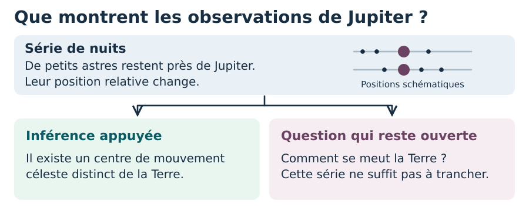

# BEL AL — Philosophie 2026 · Corrigé brut

*Corrigé rédigé par IA, non officiel. Signalez toute erreur.*

**Rédaction** · Claude Opus 4.8 · effort non renseigné · vitesse non renseignée

**Révision (tour 1)** · GPT-6 · effort non renseigné · vitesse non renseignée

**Révision (tour 2)** · modèle exact non renseigné (famille GPT-6) · effort non renseigné · vitesse non renseignée

**Lecture du rapport du jury** · GPT-6.2 Astra Ultra · vitesse non renseignée

**Révision** · GPT-6.2 Astra Ultra · vitesse non renseignée

**Révision (tour 4)** · GPT-6.2 Astra Ultra · vitesse non renseignée

Composition de philosophie (banque d'épreuves littéraires, filière AL), session 2026 : 6 heures, calculatrice non autorisée. Sujet : « L'autorité de la science ».

**Problématique** : « l'autorité de la science » est-elle une contradiction dans les termes, ou la science détient-elle une forme d'autorité qui lui est propre — et à quelles conditions cette autorité reste-t-elle légitime ?

* * *

Lorsque, pour clore un débat, l'on affirme qu'une thèse est « scientifiquement prouvée », on ne prétend pas seulement énoncer une vérité : on entend faire taire la contestation. L'invocation de « la science » fonctionne alors comme un argument d'autorité — on croit parce que c'est la science qui le dit, non parce qu'on l'a soi-même vérifié. Or ce même geste se réclame d'une discipline qui, depuis Galilée, se définit par le refus de croire sur parole. Il y a là une tension immédiate que le sujet cristallise.

Qui fait autorité obtient d’être écouté par quelqu’un qui lui reconnaît qualité pour se prononcer. Dans « Qu’est-ce que l’autorité ? », Hannah Arendt distingue cette relation de la contrainte, qui impose l’obéissance par la force, et de la persuasion, où les interlocuteurs apprécient eux-mêmes les arguments. Cette analyse éclaire le cas du savant. Lorsqu’une géomètre me démontre un théorème et que j’en saisis la preuve, je peux désormais soutenir la conclusion en mon propre nom. Si je m’en remets à son jugement parce qu’elle a étudié le problème et que j’en suis incapable, je lui reconnais une autorité. La proposition est la même. Ce qui change, c’est ma raison d’y souscrire.

La géométrie rend la distinction particulièrement nette. Elle laisse pourtant en suspens la situation ordinaire du savoir. Comment puis-je juger de l’adéquation d’un instrument dont je ne connais pas la fabrication, de la force d’une enquête dont je ne peux reprendre toutes les observations ? Même un chercheur travaille avec des résultats qu’il tient d’autrui. Il y aurait donc de l’autorité jusque dans l’enquête qui demande à chacun d’examiner ses raisons.

D'où le problème. La science tient-elle son autorité de ce qu'elle a raison — auquel cas il s'agirait d'une autorité d'un genre singulier, celle de la preuve, à laquelle le savant lui-même se soumet — ou bien a-t-elle raison, aux yeux du plus grand nombre, de ce qu'elle a autorité, c'est-à-dire d'un prestige social qui impose ses conclusions sans qu'on les examine ? Et si la science ne se fonde que sur le refus de toute autorité reçue, comment comprendre qu'elle puisse devenir, dans la cité, une nouvelle forme de dogmatisme — une autorité au sens même qu'elle récusait ? Comprendre l'autorité de la science, c'est donc interroger à la fois sa nature et sa légitimité.

Nous partirons de ce qui donne sa valeur à une proposition scientifique, pour comprendre comment cette valeur confère du crédit à ceux qui la défendent. Nous chercherons alors jusqu’où ce crédit peut orienter une action commune et à quelles conditions il mérite de le faire.

* * *

Le rapport de droit entre la science et l'autorité se lit d'abord dans la manière dont la science moderne s'est constituée : non pas contre des ennemis extérieurs seulement, mais contre l'argument d'autorité lui-même. L'autorité se reconnaît à ceci qu'elle obtient l'obéissance sans démontrer sa légitimité : le père, le magistrat, le prêtre sont obéis en vertu de ce qu'ils sont ou de ce qu'ils représentent, non en vertu des raisons qu'ils exposent. Or le propre de l'énoncé scientifique est inverse : il ne vaut que par les raisons et les expériences qui l'établissent, indépendamment de qui le profère. Un théorème n'est pas plus vrai parce qu'il est énoncé par un prix Nobel ; une mesure n'est pas plus juste parce qu'elle émane d'une autorité prestigieuse. La science relève donc, dans les termes d'Arendt, non de l'autorité mais de la persuasion rationnelle : elle ne commande pas, elle convainc. De ce point de vue, « l'autorité de la science » serait une contradiction dans les termes : la science a raison, elle n'a pas autorité.

Ainsi, en janvier 1610, Galilée observe à plusieurs reprises de petits points lumineux près de Jupiter. D’une nuit à l’autre, ils se retrouvent tantôt à l’est, tantôt à l’ouest de la planète tout en l’accompagnant dans son déplacement parmi les étoiles. C’est cette série de positions, et non la seule présence de points dans la lunette, qui lui permet de les interpréter comme des astres tournant autour de Jupiter. L’observation réfute la prétention à faire de la Terre le centre de tous les mouvements célestes. Elle laisse en revanche ouverte la question du mouvement de la Terre elle-même. Le lecteur du *Messager des étoiles* sait ainsi ce qu’il devrait retrouver en observant à son tour, mais aussi ce qu’il n’est pas autorisé à conclure. L’astronome gagne du crédit en permettant de contrôler son propos jusque dans ses limites.

Comparer deux nuits apprend qu’une disposition des points lumineux a changé. Les observations successives font ensuite apparaître qu’ils accompagnent Jupiter sur le ciel. C’est la combinaison de ces relations qui soutient l’hypothèse de corps tournant autour de Jupiter. Le dessin d’une seule nuit laisserait plusieurs hypothèses ouvertes.

Dans sa *Réponse à la question : Qu’est-ce que les Lumières ?* (1784), Kant reprend à Horace la devise *Sapere aude* et l’explicite comme le courage de se servir de son propre entendement. Un astronome qui tient son résultat de collègues peut exercer ce courage en publiant les raisons de le mettre en doute. La possibilité, pour d’autres, de lire ses objections puis d’y répondre fait de l’examen une affaire publique. Les Lumières sont la sortie de la minorité, c'est-à-dire de l'état où l'on s'en remet à l'autorité d'autrui — le livre qui pense à ma place, le directeur de conscience qui décide pour moi. La raison ne reconnaît d'autre tribunal qu'elle-même. S'il faut donc parler d'une autorité de la science, ce ne peut être que celle de la raison et du fait, devant lesquels le savant lui-même s'incline : une autorité sans *auctor*, qui n'appartient à personne parce qu'elle s'impose à tous également. La science n'exercerait pas une autorité, elle en délivrerait.

L’exigence d’autonomie n’abolit pourtant pas les médiations. Pour suivre Galilée, il fallait disposer d’une lunette convenable, savoir la pointer et observer à plusieurs dates. Le destinataire pouvait raisonnablement tenir le résultat pour probable avant d’avoir lui-même réuni ces conditions. Comment cette dépendance envers une compétence reconnue peut-elle contribuer à la connaissance ?

* * *

La connaissance repose sur une division du travail. L’astronome qui utilise des tables établies par un collègue ne refait pas chaque observation. Il peut pourtant s’interroger sur la précision annoncée, sur les vérifications effectuées par d’autres ou sur les conditions d’emploi de ces tables. De même, devant la publication d’un taux de chômage, le lecteur dépend du travail des enquêteurs pour connaître la situation de personnes qu’il n’a jamais rencontrées. Il peut néanmoins examiner les critères retenus pour compter un chômeur, la population interrogée et les effets d’un changement de définition. Dans les deux cas, le témoignage d’autrui procure des raisons de croire, à la mesure de ce qui a été contrôlé. La compétence de l’expert serait invoquée abusivement si son seul nom dispensait de répondre à une objection précise. La dépendance à son égard peut au contraire accroître la capacité de juger de celui qui accepte de le consulter.

Ce crédit se mue en prestige institutionnel. La figure de l'expert détient une autorité qui déborde largement le domaine du vrai : il est convoqué pour légitimer la décision publique, et « la science » devient une source de légitimité politique. Max Weber, dans *Le Savant et le Politique*, en avertissait : la science peut établir les moyens d'une fin, non fonder la fin elle-même ; le savant qui prétend, au nom de sa compétence, dicter à la cité ce qu'elle doit vouloir outrepasse sa fonction. Quand la décision politique se déguise en conclusion scientifique, l'autorité de la science couvre en réalité une démission du débat : c'est la tentation technocratique, où le « c'est prouvé » dispense de délibérer.

Le danger se précise quand le savant conserve devant la cité le prestige qu’il a gagné auprès de ses pairs. Imaginons un ingénieur consulté sur la protection d’un quartier exposé aux crues. Sa compétence lui permet de comparer les hauteurs d’eau probables suivant le tracé d’une digue et d’indiquer où le risque serait déplacé. S’il estime ensuite qu’il faut protéger d’abord tel quartier, sa parole conserve le prestige de l’expertise. Pourtant, à ce stade, son avis suppose une priorité accordée à certaines pertes ou à certaines populations. Cet exemple fait saisir le ressort du scientisme sans le réduire à un excès de confiance. Il consiste ici à transporter le crédit d’un jugement auquel la modélisation donne droit vers une décision dont les raisons restent à débattre.

Il faut donc trancher. Si l'autorité effective de la science est réelle et même nécessaire, mais qu'elle risque de se figer en dogme contraire à l'esprit même de la science, où réside sa *légitimité* ? Qu'est-ce qui distingue l'autorité légitime de la science de sa contrefaçon dogmatique ?

* * *

Une première garantie tient à la manière dont la communauté traite ses erreurs. Pour Popper, une théorie empirique s’expose à des observations qu’elle exclut et qui pourraient l’obliger à se réviser. Préciser quels niveaux d’eau rendraient le modèle de crue inadéquat rend l’expertise plus exigeante, même si l’ingénieur doit encore distinguer une erreur de mesure d’un défaut du modèle. La réfutabilité permet de comprendre pourquoi le maintien d’une théorie empirique requiert des épreuves. Elle explique moins, à elle seule, pourquoi les habitants auraient des raisons de croire que de telles épreuves ont été menées ou qu’un résultat gênant serait rendu public. Pour répondre à cette seconde question, il faut examiner l’organisation du travail scientifique.

Merton appelle « scepticisme organisé » la pratique collective qui expose même le travail d’un savant reconnu à l’examen d’autrui. Il s’agit d’une exigence que des institutions peuvent remplir ou trahir. Une équipe rémunérée pour évaluer la digue doit pouvoir publier un résultat défavorable au commanditaire. La déclaration du financement renseigne les habitants sur les intérêts en présence. Si une seconde équipe peut examiner les séries de mesures et éprouver les hypothèses du modèle, une objection motivée peut avoir un effet sur l’avis final, même lorsqu’elle émane d’un chercheur moins établi. L’autorité acquise par la première équipe se trouve alors consolidée ou corrigée par des personnes qui n’ont aucun devoir de lui donner raison. Ce qui mérite la confiance des habitants, c’est la possibilité effective d’un tel examen et la réponse qu’il a reçue.

La portée politique de cette autorité apparaît lorsque l’avis est remis aux élus. Un modèle, si précis soit-il, ne fixe pas à lui seul le poids à donner au déplacement de familles, à la protection d’une école ou à la sauvegarde d’un milieu naturel. Le passage des faits à une prescription requiert au moins une prémisse sur ce qui mérite protection, difficulté que Hume fait apparaître dans le *Traité de la nature humaine*. Un contradicteur peut donc admettre le diagnostic de crue et contester le projet de digue en demandant que l’on étudie un autre mode de protection. Réciproquement, une assemblée ne modifiera pas par son vote la hauteur d’eau que subirait le quartier pour un débit donné. Si de nouvelles mesures rendent une ancienne prévision insuffisante, c’est encore une enquête qui doit en préciser les conséquences pour le choix collectif.

L’application d’Arendt a ainsi une limite instructive. Celui qui écoute l’ingénieur lui reconnaît une compétence qu’il n’a pas lui-même. Mais il garde le droit de demander sur quoi repose l’avis reçu, d’en contester la portée et de participer aux décisions qui le concernent. Cette liberté demeure formelle si seuls les commanditaires ont accès aux motifs de l’expertise. Elle devient effective quand les hypothèses, les alternatives et les motifs d’incertitude sont rendus discutables.

* * *

« L’autorité de la science » désigne donc une relation entre ceux qui établissent un résultat et ceux qui ont des raisons d’en tenir compte. L’observation des satellites de Jupiter montre ce qu’une personne compétente peut légitimement demander à autrui de reconnaître. Le cas de l’expertise montre pourquoi cette reconnaissance dépend aussi des conditions dans lesquelles une objection peut être portée, instruite et rendue publique. Le crédit des sciences peut alors orienter une décision jusque dans la cité. Il oblige à répondre des conséquences prévisibles de nos choix, en laissant à ceux qui les assument la responsabilité d’en justifier les fins.

La question à poser devant un avis savant devient dès lors précise. Sur quoi porte exactement le jugement de l’expert, et quelles raisons avons-nous de lui accorder autorité sur ce point ?
