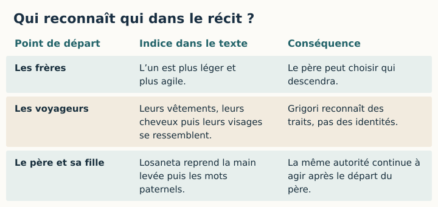

# BEL A/L — Polonais, commentaire et traduction 2026 · Corrigé brut

*Corrigé rédigé par IA, non officiel.*

**Rédaction** · GPT-6.2 Astra Ultra · vitesse non renseignée

Anna Kańtoch, *Diabeł w maszynie* (2019).

[Sujet officiel](https://www.ens.psl.eu/sites/default/files/al_lve_commun_commentaire_traduction_2026.pdf#page=16) · [Rapport du jury](https://www.ens-lyon.fr/sites/default/files/2026-10/Polonais%202026.pdf#page=2)

## Komentarz

W opowiadaniu Anny Kańtoch zwyczajna rada ojca wystarcza, żeby rozstrzygnąć, który z dwóch braci ma zejść w przepaść. Pod koniec fragmentu ta sama rodzina nie umie odpowiedzieć na pytanie, co się dzieje pod jej własnym dachem. Pomiędzy tymi scenami pojawia się druga para mężczyzn. Dlaczego podobieństwo, które u bliźniaków nie dziwi nikogo, na widok podróżnych budzi niepokój? Kańtoch zaczyna od drobnych różnic między bliskimi sobie ludźmi, żeby pokazać, jak zawodna staje się znajomość rodzinnego porządku, kiedy brak świadectwa o pochodzeniu obcych.

**Co można dostrzec z bliska?** Narracja najpierw oddziela twarz Andreu od jego myśli. Czytelnik wie, ile kosztuje go pozostanie na górze, choć obserwator niczego by po nim nie poznał. Bliźniacy są do siebie na tyle niepodobni, by lżejszemu przypaść mogło zadanie, które starszy uważa za swój obowiązek. Kilkanaście minut różnicy wieku ma dla Andreu znaczenie moralne; dla ojca rozstrzygają sprawność i ciężar ciała. Na dole punkt widzenia przechodzi na Grigoriego. Jego szacunek głębokości i rozważania o przypadku wprowadzają dwie możliwe odpowiedzi na pytanie, czy ktoś ocalał. Potem światło wyodrębnia szczegóły: twarz, ramię, ruch piersi. Daje pewność, że pierwszy podróżny żyje, ale każda następna rzecz, którą chłopiec widzi wyraźniej, czyni całość mniej zrozumiałą.

**Kiedy podobieństwo przestaje pomagać w rozpoznaniu?** Drugiego człowieka Grigori najpierw dostrzega jako postać w cieniu. Ubranie można powtórzyć; trudno zignorować ten sam sposób związania identycznych włosów. Kolejne formy słowa „identyczny” każą czytelnikowi porównywać szczegóły w tym samym rytmie co chłopiec. Dopiero kiedy ten odwróci leżącego, podobieństwo obejmie także twarze. Przysłowiowe krople wody stają się tu kroplami deszczu. Ulewa należy zarazem do porównania i do świata przedstawionego: w jej szumie ma zniknąć pytanie zadane z góry, później naprawdę ginie w niej przekleństwo. Grigori słyszał ojca, choć zamierza udać, że nie słyszał. Poznanie i posłuszeństwo, przed chwilą tak ściśle ze sobą związane u Andreu, na moment się rozchodzą. Nic jeszcze nie pozwala rozstrzygnąć, czy podobieństwo przybyszów ma nadprzyrodzone źródło.

**Kto we dworze rozstrzyga, czego należy się obawiać?** Dwie zamknięte komnaty tworzą przestrzenny odpowiednik dwóch ciał. Postępowanie wicehrabiego wobec lekarza jest przy tym trzeźwe, a scena chwilami komiczna. Z pomocy przy nastawieniu ręki ojciec korzysta, przepis na osobliwy okład posyła w ogień. W kaplicy porządek wraca w szepcie wspólnej modlitwy, w rozdzieleniu pocałunków i skinień między dzieci, nawet w podobnym kolorze włosów matki i rodzeństwa. Przekonanie o bezpieczeństwie rodziny zostaje jednak przypisane matce. Czytelnik przynosi do tej sceny wiadomość o dwu nieznajomych leżących w zamku. Gdy ojciec podnosi rękę, Grigori milknie. Ten sam gest wykonuje później Losaneta, by przerwać spór braci. Powtarza także pocieszenie ojca. Andreu wyciąga z niewiedzy nakaz działania, ona zaś znajduje w niej argument za spokojem. Jej słodki uśmiech zamyka rozmowę, lecz nie rozwiązuje zagadki.

Tak działa w tym fragmencie figura sobowtóra. Nie ogranicza się do dwóch nieprzytomnych gości. W znanej rodzinie podobne gesty przechodzą z ojca na córkę i podtrzymują jego władzę nawet po jego wyjściu. U obcych ścisła powtarzalność rysów pozbawia Grigoriego podstaw do rozpoznania. Na końcu znamy więc lepiej dom, który udzielił podróżnym schronienia, niż samych przybyszów. Właśnie w tym domu ich obecność każe na nowo odczytać pozornie uspokajające zapewnienie o bezpieczeństwie.

## Version française — lignes 24 à 34

Grigori posa la lanterne sur le flanc de la voiture renversée, entrouvrit la portière, qui s’ouvrait à présent vers le haut comme une trappe dans un plancher, et jeta un coup d’œil à l’intérieur. La lumière de la lanterne se refléta dans les éclats de la vitre brisée ; un éclair arracha à l’obscurité le visage pâle du voyageur. L’homme avait perdu connaissance. Il avait les cheveux sombres collés par le sang et le bras gauche tordu suivant un angle anormal, mais il était assurément vivant. Le garçon fronça les sourcils. Ce n’était pas à la vue de la poitrine du blessé que soulevait une respiration irrégulière, mais à celle d’une seconde silhouette, étendue dans l’ombre. Il abaissa la lampe en se penchant plus avant dans la voiture. Le blessé était vêtu de façon identique, il avait les mêmes cheveux sombres, noués de façon identique sur la nuque. Grigori sentit une pointe d’inquiétude. Que diable ?

— Quelqu’un a survécu ? cria d’en haut Symeon de Limayrac, mais le garçon décida de faire la sourde oreille. Il dirait plus tard, pour s’excuser, qu’à cause du bruit de la pluie il n’avait pas entendu la question.

