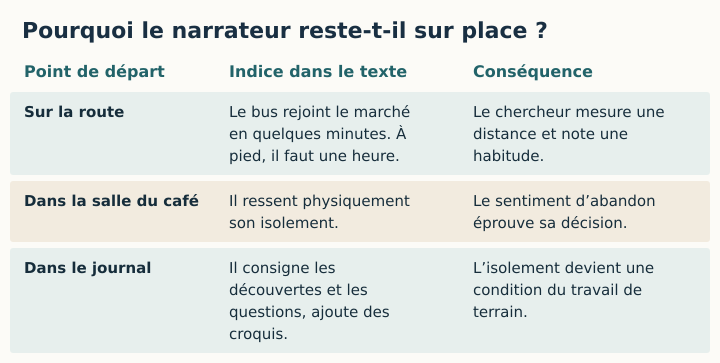

# BEL A/L — Polonais, thème Lyon 2026 · Corrigé brut

*Corrigé rédigé par IA, non officiel.*

**Rédaction** · GPT-6.2 Astra Ultra · vitesse non renseignée

Timour Muhidine, *La fille de l’ethnographe* (2022).

[Sujet officiel](https://www.ens-lyon.fr/sites/default/files/2026-04/Epreuve%20de%20sp%C3%A9cialit%C3%A9%202026.pdf#page=17) · [Rapport du jury](https://www.ens-lyon.fr/sites/default/files/2026-10/Polonais%202026.pdf#page=15)

## Thème rédigé

Styczeń 1967 roku. Już od dwóch długich lat mieszkam w tym miasteczku we Franche-Comté, u podnóża Jury. Mała stacja, na której zatrzymuje się pociąg z Paryża, zanim ruszy dalej ku Szwajcarii i Lozannie, tonie wśród drzew i zawsze świeci pustkami. Po przyjeździe trzeba poczekać na autobus, który w kilka minut dowozi na rynek, bo pieszo szłoby się tam dobrą godzinę. Zauważyłem, że mieszkańcy D. niewiele się przemieszczają. Jeśli nie mają samochodu, rzadko dokądś jeżdżą. Nie sądźcie jednak, że trafiłem tu przypadkiem, z rozgoryczenia czy z braku lepszego wyjścia. Dokładnie rozważyłem, co taki pobyt, takie odosobnienie w regionie mało znanym, który moi koledzy badacze omijają, może dać nauce.

[…]

W sali kawiarni, gdzie stoi kilka stołów z chropowatego drewna i elektryczny piecyk, na tym ludzkim pustkowiu, gdzie rozproszone światło zdaje się tłumić wszelkie uczucia, mam wrażenie, że samotność wbiła mi się w serce jak pal. Początkowy niepokój, jaki budził we mnie pobyt w obcym kraju, przerodził się w poczucie opuszczenia. A przecież powtarzam sobie, że sam wybrałem to odosobnienie w imię nauki. Między stolikami snują się rozmowy, a muzyka rozrywkowa, dobrze znana każdemu, kto tu bywa, pomaga otrząsnąć się z odrętwienia. Ta atmosfera, zarazem kojąca i smutna, utwierdza mnie w przekonaniu, że przywykłem już do tutejszego krajobrazu. Życie toczy się dalej, a ja uczę się żyć z tą zagadką.

Kiedy tu zamieszkałem, postanowiłem równolegle z badaniami prowadzić dziennik. Zapisuję w nim swoje odkrycia i pytania, jakie sobie stawiam. Dołączam szkice, dzięki którym łatwiej sobie wyobrazić to, co opisuję. Moja codzienność jest prosta i jednostajna. Zajmuję prawie pustą kawalerkę w kamiennym budynku niedaleko centrum. O ile w ogóle można to nazwać centrum! Ot, zacieniony plac, na którym skupia się życie miasteczka i który już z nadejściem jesieni wygląda, jakby na dobre pogrążył się w żałobie. […]

W końcu mogę mieć pretensje tylko do siebie. Mogłem zostać w Paryżu albo poszukać większego miasta, ale to miasteczko jest idealnym terenem badań. Wbrew radom moich mistrzów, którzy nie pochwalali decyzji o podjęciu tych badań antropologicznych, sądzę, że miałem nosa. O tym, czym jest francuska cywilizacja, rozstrzygają drobiazgi prowincjonalnego życia, najskrytsze zakamarki społeczności, która nie wystawia się na widok cudzoziemców ani przejezdnych.

