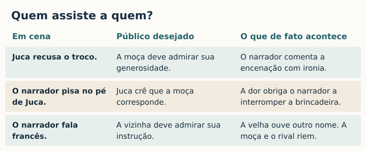

# BEL A/L — Portugais, commentaire et traduction 2026 · Corrigé guidé

*Corrigé rédigé par IA, non officiel. Signalez toute erreur.*

**Rédaction** · GPT-6.2 Astra Ultra · vitesse non renseignée

## Présentation du sujet

L’épreuve commune dure six heures et autorise le dictionnaire unilingue. Le commentaire en portugais porte sur les 86 lignes de la chronique. La version française commence au moment où arrive l’omnibus, ligne 17, et s’arrête au refus du jeune homme de reprendre sa monnaie, ligne 39.

[Sujet officiel, pages 18 et 19](https://www.ens.psl.eu/sites/default/files/al_lve_commun_commentaire_traduction_2026.pdf#page=18) · [Rapport du jury, pages 2 à 5](https://www.ens-lyon.fr/sites/default/files/2026-10/Portugais%202026.pdf#page=2)

## Préparer une lecture des quatre-vingt-six lignes

> [!INDICATION]
> Dans les deux scènes du billet et du tabac, à qui les hommes s’adressent-ils ? De qui veulent-ils surtout être vus ou entendus ?

#### Solution

Le receveur attend que Juca paie. La jeune fille est pourtant la destinataire du geste par lequel il brandit le billet et refuse sa monnaie. La vieille voyageuse a besoin de tabac. La phrase française du narrateur est en réalité destinée à la jeune fille auprès de laquelle il veut briller. Dans la première scène, le narrateur se plaît à commenter la prétention de son rival. Dans la seconde, la même prétention lui vaut de devenir la risée des voyageurs.

**S’appuyer sur la langue de la première personne.** Relever le passage de *me pareceu* au possessif *nosso*. Au premier regard, l’identité du prétendant relève encore d’une inférence. Les termes ultérieurs associent le lecteur à la comédie que le narrateur construit sur cette inférence. De même, *vizinha* dit exactement ce qui lie la jeune fille au narrateur, la proximité des sièges. *Ex-vizinha* au dernier arrêt dit ce qu’il reste de ce lien.

**Mettre en scène les pieds.** Pour expliquer le quiproquo, reconstituer la place de chacun avant de raconter les gestes. Juca croit viser le pied de la jeune fille. Le narrateur retire le sien, puis réplique avec le pied resté libre. Juca se croit payé de retour. Quand la pression ravive la douleur d’un cor, le narrateur doit attirer à haute voix l’attention de tous. Ce mécanisme physique oblige l’observateur à se montrer.

> [!JURY]
> Le rapport identifie Luís Carlos Martins Pena et le titre de la chronique. Le sujet donne les noms des deux directeurs de l’anthologie de 2020. Maintenir cette distinction permet de replacer l’omnibus dans la ville brésilienne du XIXe siècle et de rendre compte de la modernité propre au moyen de transport à cette époque.

## Commentaire rédigé en portugais

#### Solution

Um homem que promete não se demorar na descrição do ônibus leva quase quarenta linhas para fazê-lo partir. Em “Minhas aventuras numa viagem nos ônibus”, crônica de Luís Carlos Martins Pena recolhida na antologia *O sino e o relógio*, o atraso é o primeiro dos prazeres da viagem. Do bairro das Laranjeiras ao Largo do Rossio, o narrador encontra sucessivas oportunidades para observar os outros, representar o seu próprio papel diante deles e, por fim, pagar o preço dessa exibição. O que acontece com a promessa inicial de igualdade quando aqueles que pareciam meros objetos de sua curiosidade também começam a rir?

Logo na primeira frase, o passeio fica em segundo lugar entre os divertimentos de que o narrador mais gosta, perdendo só para o baile. O domingo da próxima cena será vivido dentro de uma máquina de produzir encontros. A pequenez da moeda acompanha a grandeza da façanha a ela atribuída: livros e sermões em quantidade não conseguiram o que consegue a modesta tarifa (ll. 3–5). A bênção com que o narrador encerra esse elogio soa por sua vez como o remate de um sermão. Mas a igualdade assim proclamada tem uma condição bem precisa. É preciso possuir a moeda, querer embarcar e ainda encontrar lugar. A passageira que chega tarde servirá de prova dessa última restrição. Já cheia, a viatura permite ao narrador transformar em espetáculo a decepção de quem ficou na estrada.

Antes mesmo de haver um veículo na cena, ouve-se gente falar. O narrador apresenta os dois homens que esperam com ele sobretudo por sua maneira de pronunciar as palavras. As indicações entre parênteses deixam o leitor distinguir o que os compadres dizem daquilo que pretendiam dizer. O diálogo sobre a bandeira holandesa retoma esse dispositivo (ll. 60–69). Um compadre pretende corrigir o outro e, ao fazê-lo, oferece a palavra mais engraçada da conversa. Os dois vão embora a pé. A consequência dá um sentido novo à inquietação daquele que, já no início, receava que a comadre se aborrecesse com a demora. Em poucas intervenções descontínuas a crônica produz uma pequena história completa.

O narrador também se apossa das palavras que designam os outros. A jovem senta-se ao seu lado e logo será «minha vizinha». Um rapaz lhe *parece* ser o namorado dela (l. 23). Bastam alguns parágrafos para se tornar «nosso namorado», como se bastasse convidar o leitor a reconhecer um tipo para conhecer a relação entre duas pessoas. A bengala com que o narrador se vê quase tentado a atingir o rival mede a sua distância em relação ao observador imparcial que pretendia ser. Na cena do bilhete, o rapaz certifica-se de que a moça veja a nota e, depois de recusar o troco, olha para ela a fim de conferir o efeito de seu gesto. O elogio do narrador faz simultaneamente as vezes do aplauso de um espectador e da vaia de um concorrente. E a jovem, que os dois homens imaginam ser o público de suas proezas, não lhes dá então resposta alguma.

A disposição dos corpos transforma a próxima cena numa experiência de leitura. A moça está ao lado do narrador e o rapaz, em frente a ela. Graças a um solavanco, o primeiro ganha por acaso a proximidade que o outro procura em segredo. Sob o campo de visão dos demais, um pé pisa o do narrador, que o retira e percebe que o outro o segue. O rapaz imagina pressionar o pé da amada. Quando o narrador apoia por sua vez o pé livre sobre o do rival, este julga receber a resposta que desejava. O leitor sabe de quem são os três pés em jogo, enquanto o namorado ignora justamente o que daria sentido a seus próprios gestos. A alegria nos olhos e o movimento dos beiços desenvolvem em cima a ilusão que se produz embaixo. Mas os calos do narrador doem. A superioridade de quem montou a brincadeira acaba no exato momento em que o corpo exige que ele fale. O pronome de tratamento e a pergunta em voz alta rompem a intimidade imaginada, chamam a atenção de todos e devolvem o narrador ao olhar da vizinha e do pai dela.

O último diálogo produz outra distribuição das vozes. Interpelado por uma mulher que quer tabaco, o narrador fala francês para que a jovem o ouça (ll. 73–81). Seu exibicionismo tem, portanto, o mesmo destinatário que a generosidade ostensiva de Juca. A interlocutora ouve um nome de fruta, *jenipapo*, onde ele pretendia fazer ouvir uma frase francesa. A confusão atravessa a diferença entre línguas. Quem antes se reservava o direito de explicar os erros dos compadres tem de citar a resposta irremediavelmente clara da velha. Também o rival ri, e a moça lhe faz coro. Só aí o leitor ouve uma manifestação dela dirigida aos pretendentes. Em vez de decidir entre eles como estes esperavam, ela se junta à plateia.

Quando descem, o braço da jovem vai para o pai. O rival fica no largo, o narrador vai para casa, e as designações possessivas já não servem. Basta o prefixo de «ex-vizinha» (l. 83) para desfazer a relação que o acaso dos assentos havia criado. No entanto, o homem que tanto perdeu jura voltar. Pode agora contar uma aventura em que também fez figura ridícula. A igualdade mais concreta que o ônibus lhe proporcionou foi essa possibilidade de qualquer passageiro ocupar, por um instante, o lugar de quem ri ou o de quem faz rir.

## Traduire les lignes 17 à 39

**Ce qui est su, ce qui est supposé.** Le jeune homme assis en face « paraît » être l’amoureux. La version garde cette réserve initiale même si, peu après, le narrateur lui donne ce titre sans précaution. Le diminutif de *paizinho* s’entend naturellement dans « papa », sans supposer que le père soit petit.

**Du paquet à la personne.** On distingue d’abord une forme qui roule, puis la femme qui s’essouffle. En conservant la même image pour le conseil qu’on lui donne, on mesure ce que vaut la pitié proclamée. *Lograda* indique ici que la voyageuse n’obtient pas ce qu’elle espérait. *Uma descompostura* est la réprimande qu’elle adresse au mauvais plaisant et *em troco* suggère déjà un échange.

**Qui paie qui ?** Dans la scène suivante, *troco* désigne concrètement la monnaie à rendre. La notation monétaire *5$* s’entend en mil-réis, monnaie historique du Brésil. Il s’agit de cinq mille réis. On peut conserver la notation du texte en l’expliquant. Les deux refus successifs, puis le regard vers la jeune fille, donnent son prix à la mise en scène de cet argent.

**Suivre le temps du conteur.** Le verbe au présent au début rapproche la scène du lecteur, puis le récit se déroule au passé. Dans des interventions orales comme la dernière appréciation du narrateur, conserver les exclamations et les répétitions permet d’entendre les spectateurs qui l’habitent. L’expression concessive *por mais esforços que fizesse* appelle « avoir beau » ou « quels que soient ses efforts ».

#### Solution

Enfin l’omnibus arrive et chacun de nous a acheté son billet. Une fois les voyageurs descendus, les deux compères et moi sommes montés et nous nous sommes assis. Cinq minutes plus tard est arrivée une jolie jeune fille accompagnée de son papa, et j’ai eu le bonheur qu’elle vienne s’asseoir à côté de moi. Oh ! Que c’est délicieux d’être assis dans l’omnibus à côté d’une jolie jeune fille ! Surtout quand elle ne porte pas de chapeau !!…

En moins de dix minutes, l’omnibus avait pris tous les voyageurs qu’il pouvait contenir. Parmi eux, j’enrage encore en y repensant, il y avait un jeune homme que j’ai pris pour l’amoureux de ma voisine et qui s’était assis en face d’elle. J’ai bien failli lui crever les yeux avec ma canne, mais je me suis retenu.

Nous étions sur le point de nous mettre en route quand nous avons vu, sur la chaussée, un paquet qui roulait dans notre direction. Nous n’avons pas tardé à nous apercevoir que c’était une pauvre femme grosse comme une baleine, qui courait à perdre haleine dans l’espoir de trouver encore un billet. La pauvre petite ! Elle en a été pour ses frais ! Quelles grimaces elle a faites ! Comme elle me faisait pitié, je lui ai conseillé de continuer à rouler jusqu’en ville. Pour prix de ce bon conseil, elle m’a copieusement passé un savon. Allez donc donner des conseils après ça !

— Monsieur Juca, vous n’avez pas encore payé, a dit le receveur en s’adressant à l’amoureux de ma voisine.

— Voici l’argent. Et, sortant un billet de cinq mille réis qu’il a pris grand soin de montrer à sa belle, il l’a tendu au receveur.

— Je vous rends tout de suite la monnaie.

— Inutile, inutile, je ne suis pas à cinq mille réis près.

Après cette héroïque démonstration de dédain, il a regardé sa bien-aimée d’un air intrépide.

— Bravo, bravissimo ! ai-je dit. Voilà qui marche à merveille ! C’est comme ça qu’on fait sa cour !

Le receveur a eu beau se donner du mal pour que notre amoureux reprenne sa monnaie, rien à faire.

## Bilan

Dans la copie, relier la place qu’occupe chacun dans la voiture à la place qu’il voudrait occuper dans le regard de sa voisine. Relire la version en distinguant la monnaie effectivement payée, celle que le receveur voudrait rendre et la valeur que le jeune homme prétend leur accorder.
