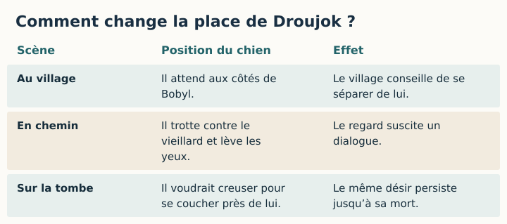

# BEL A/L — Russe, commentaire et traduction 2026 · Corrigé guidé

*Corrigé rédigé par IA, non officiel. Signalez toute erreur.*

**Rédaction** · GPT-6.2 Astra Ultra · vitesse non renseignée

## Présentation du sujet

Le commentaire en russe porte sur le récit des pages 20 et 21, du vieil homme aux premières lignes jusqu’au coucou sur le bouleau de la fin. La version s’arrête à la ligne 22, sur la promesse de se chauffer près du poêle.

[Sujet officiel, pages 20 et 21](https://www.ens.psl.eu/sites/default/files/al_lve_commun_commentaire_traduction_2026.pdf#page=20) · [Rapport du jury](https://www.ens-lyon.fr/sites/default/files/2026-10/Russe%202026.pdf#page=2)

## Construire le commentaire

> [!INDICATION]
> L’expression « à côté » change-t-elle de sens entre la mendicité dans le village et la scène du cimetière ? Qui se tient à côté de qui, et dans quelles circonstances ?

#### Solution

Au début, Droujok attend debout près de son maître. Il trotte ensuite à ses côtés dans la neige. Il suit encore le corps que les hommes emportent et finit par vouloir se coucher près de lui dans la terre. La fidélité a d’abord la forme d’une habitude, puis celle d’un désir irréalisable. On peut relier ces passages sans résumer tous les déplacements du récit.

**Une parole prêtée, une parole reçue.** Le récit introduit les pensées supposées du chien par *словно*, « comme si ». Le lecteur n’a donc pas besoin de lui prêter la parole au sens propre pour comprendre sa place dans le dialogue. Le maître l’observe longuement, croit reconnaître ce qui le préoccupe et lui demande de rester avec lui. Ce détour distingue l’entente silencieuse des deux personnages des bavardages tardifs des villageois.

**Mesurer le temps par le corps.** Les pieds du vieillard le trahissent au printemps, au moment où poussent les feuilles. Puis le chien veut remuer la terre et ne peut plus lever les pattes. La mort ne tient pas seulement à la répétition d’une secousse finale. La reprise progressive des mêmes empêchements fait éprouver l’épuisement de chacun. Les fleurs et le coucou prolongent le récit alors que ces deux corps se sont immobilisés.

> [!JURY]
> Le rapport présente le passage comme un récit de 1917 comportant une coupure. Le commentaire peut donc interpréter la transition entre l’expédition projetée et le printemps, sans inventer ce qui arrive dans la partie retranchée. Le rapport précise aussi avoir neutralisé dans la notation le choix de traduction ou de transcription des surnoms.

## Commentaire en russe

В первых строках рассказа Сергея Есенина «Бобыль и Дружок» говорится, что у старика была своя хата и собака. Слово «своя» могло бы обозначить скромный достаток. Но Бобылю приходится просить хлеба, а хата зимой оказывается нетопленой. Собака же, названная рядом с хатой, вскоре сама станет участницей разговора, потом и героем повествования. Как совершается этот переход от рассказа об одиноком бедняке к сказке о дружбе, которую в конце пересказывают уже не люди?

Бобыль появляется на краю деревни. Это точное указание места определяет и его отношение к односельчанам: к ним надо идти, стучать им под окнами, ждать, что дадут. Жители деревни считают, сколько ртов можно прокормить подаянием, и советуют ему расстаться с собакой. Совет кажется разумным только при условии, что один из этих ртов лишний. Ответ Бобыля читатель узнает по движению: старик подзывает Дружка и отходит от окна, не взяв хлеба. Важен момент отказа. Он отказывается от куска именно тогда, когда другой человек берется решать, кто ему нужен. Фраза о его угрюмости возникает уже после того, как этот немой ответ сделал его поступок вполне понятным читателю.

Постепенно открывается другой способ разговора. Дружок стоит возле окна и виляет хвостом, словно тоже ждет подачки. Потом он прижимается к Бобылю, заглядывает ему в лицо и словно хочет сказать, что никому-то они вдвоем не нужны. В обоих местах «словно» удерживает рассказчика от буквального перевода собачьих движений на человеческий язык. Но у старика есть ответ на невысказанную мысль. Дважды повторенное «взглянет» задерживает взгляд как раз на столько, чтобы читатель успел почувствовать, что между этими двумя происходит. Под окнами за повтором взгляда следовало молчание. В снегу за ним следуют тихие слова старика. То, что кажется людям необщительностью Бобыля, оборачивается способностью услышать собеседника без единого слова.

Значение имеет и то, о чем именно он говорит. За печкой нет ни полена, однако в его речи уже готовы санки, хворост и тепло у лежанки. Будущие действия выстроены одно за другим, а по мере перечисления все чаще появляется «мы». Грамматическая форма на время согревает нетопленую хату. Когда зимняя непогода отступает, эта же уверенность сжимается до короткого обещания новой жизни весной. Звуки капели и ручьев как будто обещают ему то же самое. И именно тогда, когда обещание представляется близким к осуществлению, природа начинает жить по иному счету времени, чем старик. На иве под окном появляются листья, а он уже не в силах слезть с полатей. В начале рассказа ему приходилось стоять под чужим окном. Теперь из своего окна он еще видит землю, но уже почти не может выйти к ней.

Есенин описывает умирание без длинного объяснения горя. Сначала старик еще с усилием спускается, затем уже не встает. Повтор глагола словно возвращает читателя к одной и той же попытке, чтобы тот заметил, чего становилось все меньше, пока движение не прекратилось. В прощальных словах старика о собственной смерти говорится прежде всего как об участи друга, которого он оставляет. Отсюда вопрос о том, на кого его покинуть, и просьба приходить на могилу. После смерти Бобыля повествование не заканчивается: тот, к кому была обращена просьба, может ее исполнить. Теперь впереди фразы оказывается Дружок. Хождение от одного угла к другому, вой и попытка рыть землю занимают место человеческой речи.

Люди, со своей стороны, замечают отсутствие старика, приходят к нему, обмывают тело и хоронят. Рассказ дает увидеть весь этот труд. Тем сильнее звучит замечание, что никто о покойном не заплакал. На церковной паперти остается как раз тот, кто скорбит, но кого не пускают внутрь. Раньше Дружок бежал рядом со стариком по сугробам, теперь идет рядом, когда его несут в церковь. То же простое наречие «рядом» выражает и последнее желание собаки — лечь возле друга. Однако в конце даже лапа уже не поднимается. Неспособность Дружка встать повторяет неподвижность старика на полатях, а его последняя дрожь отзывается на предсмертную дрожь Бобыля. Связь между ними сохраняется даже в том, как рассказ строит две отдельные смерти.

Кому же останется помнить об обоих? Люди, способные рассказать историю, больше в тексте не говорят. Цветы шепчут ее птицам, кукушка кукует над могилой с плакучей березы. Сказочный голос финала вырастает из тихих звуков, которые читатель научился различать еще в пути по снегу. Слова деревенских жителей сначала пытались убедить Бобыля, что от собаки разумно отказаться. История, дошедшая до нас как будто через птиц и цветы, позволяет судить о цене такой разумности по тому, кто остался возле него до самого конца.

## Traduire les lignes 1 à 22

**Nommer sans perdre le surnom.** *Бобыль* désigne traditionnellement un pauvre homme sans famille. La majuscule en fait ici un nom propre. « Bobyl » préserve ce nom, auquel la première phrase peut joindre un indice de dénuement. *Дружок* a une valeur affectueuse, perceptible dans le diminutif du mot « ami ». Une fois les deux noms posés, les conserver tout au long du récit.

**Respecter l’habitude et le projet.** Les formes du futur perfectif donnent, dans les premiers paragraphes, une scène qui pourrait se reproduire. Les imparfaits français permettent de l’entendre comme une habitude. Dans la dernière réplique, le vieillard annonce au contraire les actions qu’il entend accomplir avec Droujok. Les futurs construisent l’expédition en pensée, jusqu’à la chaleur promise.

**Lire un geste et une demande.** La douceur de la voix revient dans la répétition *тихо-тихо*. La particule attachée au pronom *ты-то* distingue le chien de tous ceux qui rechignent à les accueillir. Dans la dernière réplique, le vieillard attelle bien le chien. Il compte ramasser avec lui du bois pour chauffer l’isba.

### Version rédigée — lignes 1 à 22

Il était une fois, à l’orée d’un village, un vieux pauvre homme qu’on appelait Bobyl. Bobyl avait son isba à lui et un chien. Il allait mendier de par le monde, recueillait des morceaux de pain et se nourrissait ainsi. Jamais Bobyl ne se séparait de son chien, auquel il avait donné le doux nom de Droujok, « petit ami ». Quand Bobyl faisait le tour du village et frappait aux fenêtres, Droujok se tenait près de lui, la queue frétillante. On aurait dit qu’il attendait son aumône à lui. Parfois les gens disaient à Bobyl : « Tu ferais mieux de laisser là ton chien, Bobyl. Tu n’as déjà pas de quoi te nourrir toi-même… » Bobyl les regardait de ses yeux tristes, les regardait encore, sans rien dire. Il appelait son Droujok, s’éloignait de la fenêtre et laissait le quignon de pain.

Bobyl était taciturne, il parlait rarement à qui que ce fût.

L’hiver venait. Le vent de la tourmente soufflait, furieux, la neige balayait le sol, s’amoncelait en hautes congères.

Bobyl cheminait dans les congères. Appuyé sur son bâton, il se frayait un passage d’une cour à l’autre, et toujours Droujok trottait à côté de lui. Il se pressait contre Bobyl, levait vers lui un regard tendre, comme pour lui dire : « Personne n’a besoin de nous deux. Personne ne nous offrira un peu de chaleur. Nous sommes seuls, toi et moi. » Bobyl regardait son chien, le regardait encore et semblait deviner ses pensées. Puis il lui disait tout bas, tout bas :

— Toi au moins, Droujok, ne l’abandonne pas, ton vieux.

Bobyl marchait avec son chien et finissait par se traîner jusqu’à son isba. Elle était vieille, on n’y avait pas fait de feu. Il regardait derrière le poêle, regardait encore, fouillait dans les coins. De bois, pas une bûche. Bobyl jetait les yeux sur Droujok. Lui se tenait là, attendant ce qu’allait dire son maître.

Et Bobyl lui disait avec tendresse :

— Je vais t’atteler au petit traîneau, Droujok. Nous irons tous les deux du côté de la forêt. Nous y ramasserons des branches et des bouts de bois, nous les rapporterons, nous ferons du feu dans l’isba et nous nous chaufferons, toi et moi, près de la banquette du poêle.
