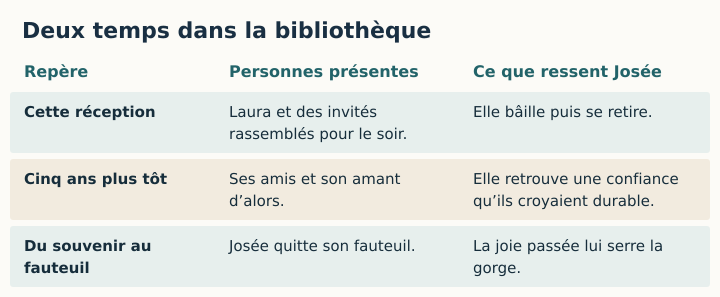

# BEL A/L — Russe, thème Lyon 2026 · Corrigé brut

*Corrigé rédigé par IA, non officiel. Signalez toute erreur.*

**Rédaction** · GPT-6.2 Astra Ultra · vitesse non renseignée

## Thème rédigé

Дом в Во был длинным зданием бывшей фермы. Модный декоратор превратил его в английский загородный особняк с глубокими кожаными диванами и отделкой из тех грубых тканей, которые стоили безумных денег и тогда были последним криком моды. Они приехали часов в пять и долго гуляли по усадьбе. «Вот мое настоящее убежище», — сказала Лора, с серьезным видом откидывая под деревьями рыжие волосы. Они съели непременные яйца всмятку. «Могу вам поклясться, что снесены они не вчера», — сказала Лора, тряхнув рыжими волосами в сторону гостей. […]

Жозе устроилась на диване и гадала, надолго ли хватит их хозяйки, которая сидела перед камином на корточках, словно Жижи, протягивая к пламени накрашенные ногти и подставляя ему свое восторженное лицо. Кроме них, приглашены были молчаливый молодой художник, две болтливые молодые женщины и, по-видимому, муж самой Лоры. Он был невысокий, худой, с голубыми глазами за стеклами очков и всякий раз, прежде чем взять сигарету из коробки от «Эрмес», словно бы колебался. Алан, совсем расслабившись, разговаривал с одной из молодых женщин о Нью-Йорке, а Жозе слегка зевнула и решила перейти в соседнюю библиотеку. «У меня все как у себя дома, — объявила Лора. — Терпеть не могу хозяек, которые навязывают гостям свое общество». После этих благих слов Жозе порылась на полках, заставленных великолепным изданием Лесажа и тщательно протертыми от пыли «Письмами» Вольтера, и погрузилась в детектив. Через десять минут она выпустила книгу из рук и закрыла глаза. Пять лет назад в этой самой комнате она была с друзьями и тогдашним своим любовником. Из Парижа они примчались на машине, пожалуй, быстрее, чем следовало, вчетвером или впятером набившись в старую машину Марка, «эм-джи», потому что в те времена ездили только всей компанией. […] Какие у нее были славные друзья, ревнивые и нежные. Им и в голову не приходило, что жизнь может их разлучить и что когда-нибудь им покажется важнее что-то другое, чем этот смех и доверие друг к другу. Жозе спросила себя, почему воспоминания эти разом и так веселы, и так мучительны, почему от них, точно от угрозы, у нее перехватывает дыхание, и встала с кресла.

[Sujet officiel, page 18](https://www.ens-lyon.fr/sites/default/files/2026-04/Epreuve%20de%20sp%C3%A9cialit%C3%A9%202026.pdf#page=18) · [Rapport du jury](https://www.ens-lyon.fr/sites/default/files/2026-10/Russe%202026.pdf#page=11)

