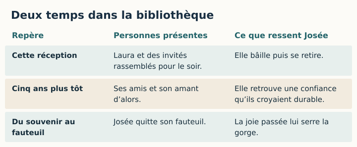

# BEL A/L — Russe, thème Lyon 2026 · Corrigé guidé

*Corrigé rédigé par IA, non officiel. Signalez toute erreur.*

**Rédaction** · GPT-6.2 Astra Ultra · vitesse non renseignée

## Présentation du sujet

Le sujet de spécialité donne quatre heures sans dictionnaire pour traduire le passage de Françoise Sagan. Il contient deux coupures signalées dans le livret.

[Sujet officiel, page 18](https://www.ens-lyon.fr/sites/default/files/2026-04/Epreuve%20de%20sp%C3%A9cialit%C3%A9%202026.pdf#page=18) · [Rapport du jury](https://www.ens-lyon.fr/sites/default/files/2026-10/Russe%202026.pdf#page=11)

## Entrer dans le souvenir de Josée

> [!INDICATION]
> Au moment où Josée ferme les yeux, la pièce change-t-elle de lieu ? Quelle différence doit-on entendre entre les deux groupes d’invités ?

#### Solution

La bibliothèque reste la même. La visite chez Laura a rassemblé des invités que Josée regarde avec un certain détachement. Cinq ans plus tôt, elle y retrouvait des gens qui ne se déplaçaient qu’ensemble. Le changement d’époque fait donc changer la valeur d’un même lieu. Un repère temporel explicite et l’opposition entre les gestes isolés du soir et les habitudes anciennes suffisent à conduire le lecteur russe vers le souvenir.

**Le décor et le prix.** Le nom Vaux désigne une localité. Les divans sont profonds et le prix des tissus contraste avec leur aspect grossier. La proposition sur la mode explique ce contraste. Le nom *Эрмес* apparaît plus loin sur une boîte de luxe, avec une nouvelle notation de prix implicite. Tout cela appartient au regard que Josée pose sur la réception.

**Rendre les répétitions.** Laura agite à deux reprises ses cheveux roux et accompagne ses gestes de deux répliques. Garder la couleur dans les deux phrases fait sentir la composition du personnage. Plus loin, « apparemment » traite le mari comme un invité parmi d’autres. Le russe peut préserver cette distance en isolant *по-видимому* dans la liste des invités.

**Une agitation passée, une émotion présente.** L’aspect imperfectif convient à leur façon habituelle de voyager en bande, alors que le perfectif marque le fait d’avoir rejoint la maison pour ce souvenir précis. La dernière question indirecte est posée par Josée. La menace n’est pas un événement nouveau dans la pièce, mais une comparaison pour son souffle oppressé.

> [!JURY]
> Le rapport recommande de comprendre Vaux comme le lieu et de respecter l’expression russe consacrée pour les œufs à la coque. Il signale également la voiture MG de Marc et la transcription conventionnelle de New York.

## Thème rédigé

Дом в Во был длинным зданием бывшей фермы. Модный декоратор превратил его в английский загородный особняк с глубокими кожаными диванами и отделкой из тех грубых тканей, которые стоили безумных денег и тогда были последним криком моды. Они приехали часов в пять и долго гуляли по усадьбе. «Вот мое настоящее убежище», — сказала Лора, с серьезным видом откидывая под деревьями рыжие волосы. Они съели непременные яйца всмятку. «Могу вам поклясться, что снесены они не вчера», — сказала Лора, тряхнув рыжими волосами в сторону гостей. […]

Жозе устроилась на диване и гадала, надолго ли хватит их хозяйки, которая сидела перед камином на корточках, словно Жижи, протягивая к пламени накрашенные ногти и подставляя ему свое восторженное лицо. Кроме них, приглашены были молчаливый молодой художник, две болтливые молодые женщины и, по-видимому, муж самой Лоры. Он был невысокий, худой, с голубыми глазами за стеклами очков и всякий раз, прежде чем взять сигарету из коробки от «Эрмес», словно бы колебался. Алан, совсем расслабившись, разговаривал с одной из молодых женщин о Нью-Йорке, а Жозе слегка зевнула и решила перейти в соседнюю библиотеку. «У меня все как у себя дома, — объявила Лора. — Терпеть не могу хозяек, которые навязывают гостям свое общество». После этих благих слов Жозе порылась на полках, заставленных великолепным изданием Лесажа и тщательно протертыми от пыли «Письмами» Вольтера, и погрузилась в детектив. Через десять минут она выпустила книгу из рук и закрыла глаза. Пять лет назад в этой самой комнате она была с друзьями и тогдашним своим любовником. Из Парижа они примчались на машине, пожалуй, быстрее, чем следовало, вчетвером или впятером набившись в старую машину Марка, «эм-джи», потому что в те времена ездили только всей компанией. […] Какие у нее были славные друзья, ревнивые и нежные. Им и в голову не приходило, что жизнь может их разлучить и что когда-нибудь им покажется важнее что-то другое, чем этот смех и доверие друг к другу. Жозе спросила себя, почему воспоминания эти разом и так веселы, и так мучительны, почему от них, точно от угрозы, у нее перехватывает дыхание, и встала с кресла.
