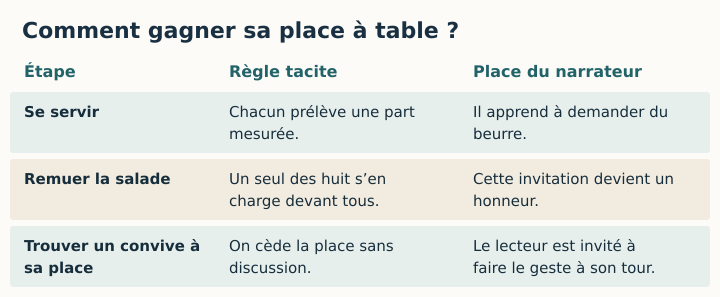

# BEL A/L — Russe, version et thème Ulm 2026 · Corrigé brut

*Corrigé rédigé par IA, non officiel. Signalez toute erreur.*

**Rédaction** · GPT-6.2 Astra Ultra · vitesse non renseignée

### Version rédigée

Mardi 8 janvier. Paris. Je commence à avoir quelque expérience de la vie à l’École normale. Je sais, par exemple, que si l’on arrive le matin à sa table et qu’il n’y reste plus de beurre, on peut toujours essayer d’aller aux cuisines en redemander à l’intendant. Il arrive qu’on ait gain de cause. D’une manière générale, on ne saurait dire qu’on meure de faim, mais on se sent presque toujours prêt à manger encore quelque chose. Les tables sont de huit et, partout où c’est possible, les plats sont apportés sans qu’on ait fait les parts. On se sert soi-même, suivant certaines règles tacites de modération, après quoi les plus entreprenants finissent en toute franchise ce qui reste.

À un moment donné, les élèves des dernières années de l’École normale entrent dans une période d’épreuves, celles de l’agrégation, qui correspondent à peu près aux examens de notre formation doctorale. Ces épreuves sont terribles. Elles durent sept heures. Les candidats préviennent consciencieusement leurs voisins de table qu’ils ne pourront pas venir déjeuner. Alors, pour les autres, c’est un régime de suralimentation somptueux. Un jour, je me suis trouvé avec un seul autre convive à une table où l’on avait servi pour huit, comme d’habitude. Nous n’avons pas pu tout manger, mais nous avons tout de même bien avancé. Nous avons partagé les restes avec les tables voisines.

Chose étonnante pour un Russe, le vin fait partie des rares choses dont il reste tout de même parfois un peu sur la table ! Dans les premiers temps, je ne pouvais pas résister à la tentation d’en profiter. Mais j’ai fini par comprendre que ceux qui renonçaient au vin étaient ceux qui comptaient travailler sérieusement.

Ce qui, en revanche, ne reste absolument jamais sur la table, même quand on mange à deux pour huit, c’est la salade. À vrai dire, la salade tient au déjeuner la place rituelle que, d’après nos idées, devrait tenir le vin. On l’apporte dans un saladier gigantesque et l’on sert la sauce à part. À un moment impossible à déterminer pour le profane, l’un des convives, celui qu’en vertu d’on ne sait quel accord secret et muet on reconnaît comme le plus estimé des huit, se lève et procède à l’opération rituelle appelée « remuer la salade ». Seul quelqu’un qui n’y comprend strictement rien pourrait croire que la chose est toute simple. L’opération prend du temps et tous la suivent avec déférence et patience. Quel honneur sans pareil me fut fait, un jour, vers la fin de l’année, quand on me dit tout à coup : « Eh bien, Andreï, nous trouvons que tu es maintenant assez grand pour nous remuer la salade aujourd’hui ! »

Chacun a au réfectoire sa place attitrée. Mais à quoi servirait la liberté, si même une place devait être attribuée d’une manière irrémédiablement définitive ? En vertu de l’indescriptible liberté normalienne, les élèves ont en effet le droit tacite d’amener au réfectoire un ami, et même une amie ! Ils n’usent pas très souvent de ce droit, mais ils en usent. Si donc, en arrivant à ta table, tu trouves à ta place un inconnu, ou à plus forte raison une dame, l’honneur te commande de t’incliner légèrement et de t’en aller voir aux autres tables si l’absence de quelqu’un ne t’y laisserait pas un petit coin.

### Thème rédigé

Раймон сел рядом с ней. Он держался с той непринужденностью, какую дает известный опыт в сердечных делах. Ведь глупыми в обществе женщин нас делают неистовство наших желаний, торопливость нашей любви. Человек, чувства которого успели несколько притупиться, больше спешит понравиться, чем полюбить. И все же рядом с этой простой, неискушенной женщиной господин де Рамьер испытывал волнение более глубокое, чем когда-либо прежде. Быть может, столь быстрым впечатлением он был обязан воспоминанию о ночи, проведенной у нее. Одно несомненно: когда он говорил с нею с таким жаром, сердце его не опровергало того, что говорили уста.

Но привычка, приобретенная в обществе других женщин, придавала его словам такую убедительность, что неопытная Индиана отдавалась их обаянию, не понимая, что все это придумано вовсе не для нее одной.

Вообще говоря, и женщины прекрасно это знают, мужчина, остроумно рассуждающий о любви, влюблен весьма умеренно. Раймон составлял исключение: он искусно выражал страсть и горячо испытывал ее. Только не страсть делала его красноречивым, а красноречие делало его страстным. Женщина начинала ему нравиться, и он становился красноречив, чтобы ее обольстить, а обольщая, влюблялся сам. Таковы чувства адвокатов и проповедников, которые начинают лить горючие слезы, едва с них градом польет пот. Ему встречались женщины достаточно проницательные, чтобы не доверять этим пылким импровизациям. Но ведь Раймон совершал ради любви то, что называют безумствами. Он увез девушку из знатной семьи, скомпрометировал женщин, занимавших весьма высокое положение в свете, дрался на трех нашумевших дуэлях […]. Человек, который делает все это, не боясь ни насмешек, ни проклятий, и умудряется избежать и тех и других, неуязвим. Он может рискнуть всем и на все надеяться.

[Sujet officiel, pages 14 et 15](https://www.ens.psl.eu/sites/default/files/al_opt_lve_vers-theme_261109.pdf#page=14)

