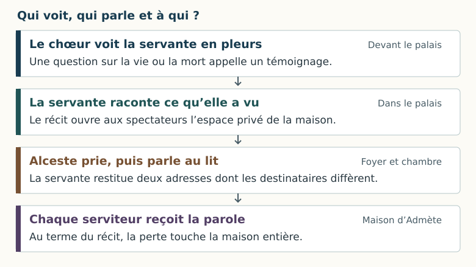

# BEL A/L — Textes antiques grecs (Ulm) 2026 · Corrigé brut

*Corrigé rédigé par IA, non officiel. Signalez toute erreur.*

**Lecture du rapport du jury** · GPT-6.2 Astra Ultra · vitesse non renseignée

**Rédaction** · GPT-6.2 Astra Ultra · vitesse non renseignée

**Autocontrôle** · GPT-6.2 Astra Ultra · vitesse non renseignée

**Révision (tour 1)** · GPT-6.2 Astra Ultra · vitesse non renseignée

## Alceste chez Euripide et les guerriers de Plutarque

### I. Commentaire d’Euripide · La mort vue depuis le palais

À l’entrée de la servante, le chœur voudrait apprendre un fait très simple. Alceste vit-elle encore ? La femme qui a vu la reine lui répond qu’on peut la dire à la fois vivante et morte. L’extrait d’*Alceste* (v. 136-198 de la pièce) s’inscrit tout entier dans l’intervalle que cette réponse ouvre. Pendant qu’une voix venue du palais raconte le dernier jour d’Alceste, celle qui va mourir continue de parler, de toucher les siens, de prendre des décisions. Par quel travail de la scène Euripide fait-il entendre, dans l’éloge d’une épouse exemplaire, ce que sa disparition aura d’irremplaçable pour toute une maison ?

**Une question publique, un témoin venu du dedans.** Du premier au seizième vers de l’extrait, les réponses resserrent l’attente sans jamais donner au chœur la certitude qu’il demandait. Ses membres voient les larmes, δακρυρροοῦσα (v. 2), avant de savoir qui ils doivent pleurer. L’opposition ζῶσαν / θανοῦσαν (v. 6) fait coexister les deux états dans la même construction, alors que le coryphée les distribuait entre les deux branches d’une interrogation. Son objection, au vers suivant, traduit la difficulté dans les termes ordinaires de la perception. Comment un mort pourrait-il encore voir ? La servante, elle, décrit un corps qui déjà s’affaisse. L’avenir inéluctable est devenu lisible dans un mouvement présent.

La rapidité des répliques crée momentanément un accord autour d’une formule d’éloge. Au vers 16, ἀρίστη, « la meilleure », distingue Alceste de toutes les femmes sous le soleil. Le mot rebondit dans la bouche de la servante, au vers 17, mais sous forme de question. Qui pourrait lui disputer ce titre ? Les interrogations suivantes donnent pour mesure au dévouement conjugal le fait de choisir de mourir pour l’époux. La ville entière le sait, πᾶσ’ … πόλις (v. 21). La servante revendique alors un savoir différent, celui des gestes accomplis ἐν δόμοις (v. 22). Au chœur qui souhaitait entendre une nouvelle, elle promet de l’émerveillement à l’écoute d’un récit. Le passage des répliques brèves à la longue prise de parole modifie ainsi la source de l’autorité. Seule l’habitante du palais peut dire à quoi ressemble, dans le temps d’une matinée, cet héroïsme déjà célébré dehors.

**Les deux paroles d’Alceste.** Les verbes du bain et de la parure (v. 23-27) rendent Alceste sujet de sa propre préparation. Elle se baigne dans l’eau du fleuve puis tire elle-même ses vêtements et ses ornements du coffre de cèdre. Ces gestes conviennent à la dignité d’une reine autant qu’à l’approche des funérailles. Devant le foyer, la servante s’efface assez pour citer Alceste au discours direct. Le public entend la mourante employer le « je » et disposer un avenir auquel elle ne participera pas. La prière distribue au fils et à la fille un mariage à venir (τῷ μὲν … τῇ δὲ, v. 30-31). À la mort prématurée de leur mère, elle oppose le temps long d’une vie menée à son terme *dans leur pays*. La femme dont le départ doit sauver un seul homme se soucie de la continuité de plusieurs existences.

La tournée des autels se déroule ἄκλαυτος ἀστένακτος (v. 38). Deux adjectifs privatifs suspendent la manifestation du chagrin. C’est à l’entrée dans la chambre qu’adviennent les larmes, ἐνταῦθα δή (v. 41), « là, précisément ». Le lit nuptial reçoit la seconde adresse. Au foyer Alceste demandait à la divinité de donner aux enfants des époux. À la couche elle parle de sa propre condition d’épouse, depuis sa première union jusqu’à la perspective d’une autre femme dans ce lit. Le nom de l’homme pour lequel elle meurt cède la place au pronom adressé à l’objet, puis le *toi* et l’époux se rejoignent dans le même refus de trahir (v. 45-46). L’adresse conjugue un adieu et un reproche, ἀπώλεσας … μόνην, « tu m’as perdue, moi seule » (v. 44-45). Une seconde épouse pourra être plus heureuse, Alceste lui conteste le privilège d’être plus fidèle. Le superlatif admirable prononcé au-dehors trouve ici son envers, la solitude de celle qui comprend que sa place pourra être occupée.

**À qui revient la douleur ?** Après les paroles adressées au lit, la servante en montre les effets sur le corps. La « crue » des larmes (πλημμυρίδι, v. 50) mesure l’écart avec les yeux secs de la scène des autels. Un récit de départ devrait mener d’un lieu au suivant. Ici, quitter la couche provoque un retour, puis d’autres, que soulignent πολλά et πάλιν (v. 53-54). L’acte qui rend Alceste exemplaire n’abolit ni l’attachement au lieu ni le désir de s’y retenir. Sa seconde entrée dans la parole de la servante a changé le rythme du spectacle. Le temps semble recommencer à chacun des retours.

Les enfants, puis les serviteurs, deviennent à leur tour sujets du verbe « pleurer ». Alceste répond à chacun. Aux enfants suspendus à son vêtement, elle donne des étreintes à tour de rôle. Aux gens de la maison, elle tend la main. Ἑκάστῳ (v. 60) donne à chaque serviteur une présence distincte au sein de l’unanimité des lamentations. L’échange de salutations compte jusque dans les voix les plus humbles. La servante qui rapporte ce détail a elle-même une place dans cette communauté du deuil. Quand elle conclut par la maison d’Admète, la survie du roi acquiert son véritable coût. Mort, il aurait péri. Ayant échappé à la mort, il possède désormais un chagrin qu’il n’oubliera jamais. La vérité du paradoxe initial n’apparaît pleinement qu’à cet instant. Mourante, Alceste anime chacun des liens qui font vivre le palais. Admète vivant devra en éprouver la perte.

**Repère de lecture**

Le chœur recueille un témoignage à l’entrée du palais. Lorsque l’adresse passe du foyer au lit, c’est la servante qui, devant lui, prête sa voix à Alceste. Les spectateurs perçoivent ainsi une parole intime en même temps que la douleur de celle qui la transmet.

### II. Traduction de Plutarque · Le souvenir de Chéronée

On dit aussi qu’Iolaos, qui était l’aimé d’Héraclès, prenait part à ses travaux et combattait à ses côtés pour le protéger. […] Il est donc naturel que le bataillon, lui aussi, reçoive le nom de « sacré », de même que Platon a appelé l’amant un ami animé d’un souffle divin.

Il demeura, dit-on, invaincu jusqu’à la bataille de Chéronée. Après la bataille, Philippe parcourait les morts du regard quand il s’arrêta à l’endroit où se trouvaient étendus les trois cents. Tous, en armes, avaient fait face aux sarisses et gisaient mêlés les uns aux autres. Frappé d’admiration, Philippe apprit que c’était là le bataillon des amants et des aimés. Il fondit en larmes et prononça ces mots. « Puissent-ils périr misérablement, ceux qui soupçonnent ces hommes d’avoir fait ou subi quoi que ce soit de honteux ! »

[Énoncé officiel](https://www.ens.psl.eu/sites/default/files/al_textes_antiques_grec_261102.pdf) · [Rapport du jury](https://www.ens.psl.eu/sites/default/files/2026_al_rapport_ecrit_tronc_commun_grec_textes_antiques.pdf)
