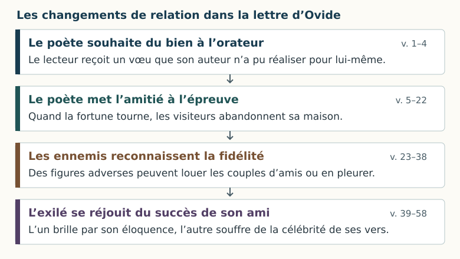

# BEL A/L — Textes antiques latins (Ulm) 2026 · Corrigé guidé

*Corrigé rédigé par IA, non officiel. Signalez toute erreur.*

**Lecture du rapport du jury** · GPT-6.2 Astra Ultra · vitesse non renseignée

**Rédaction** · GPT-6.2 Astra Ultra · vitesse non renseignée

**Autocontrôle** · GPT-6.2 Astra Ultra · vitesse non renseignée

**Révision (tour 1)** · GPT-6.2 Astra Ultra · vitesse non renseignée

## L’épreuve de six heures

Le fascicule présente d’abord le poème à commenter, son latin et une traduction de lecture, puis donne un autre auteur pour la version, à la page 4. Dans le premier exercice, citer de brefs passages d’Ovide pour expliquer le travail de l’élégie. Dans le second, suivre exactement l’extrait de Tacite jusqu’au dernier présent de narration.

## Préparer le commentaire

Dans les premiers vers, entourer les pronoms avant d’interpréter les oiseaux ou la météorologie. Le premier *tibi* (v. 1) place l’orateur du côté de celui qui reçoit. Le datif de l’ami et celui du poète sont à nouveau présents dans le dernier distique. Entre les deux, ces pronoms ont reçu un sens plus riche. L’un a acquis la célébrité grâce à son art, l’autre souffre de celle que lui a donnée le sien. Cette observation permet de construire une introduction à partir d’un rapport concret entre deux voix.

Aux vers 23 à 38, identifier le lien entre les membres du couple cité, puis situer celui qui les admire ou les pleure. Les rôles sont distincts, et cette différence donne son poids à l’exemple.

À la deuxième lecture, demander à chaque exemple mythologique qui apprécie la fidélité de qui. Chacun fait intervenir un personnage extérieur au couple d’amis, parfois son adversaire. L’intérêt du catalogue ne se réduit donc pas à la notoriété des couples. Il fournit à l’ami vivant sous Auguste des précédents qui autorisent sa sympathie pour un relégué.

Pour suivre l’élégie jusqu’au bout, relever les sens successifs de la lumière. Au début, l’éclat de la fortune attire les faux amis. Au vers 40, le ciel intérieur du poète s’éclaircit du bonheur d’autrui. Au vers 56, c’est de lumière que son œuvre aurait dû être privée. Il est possible d’observer ce dernier retournement sans identifier le destinataire par un nom, que le texte ne donne pas, ni réduire les malheurs du poète au titre d’une seule de ses œuvres.

## Préparer la version

*Pontiae mulieris nuptae* est un génitif qui complète *amore*. Dans la première phrase, l’argent achète deux choses de construction différente. *Adulterium* est un nom à l’accusatif et *ut omitteret maritum* une proposition. *Promittens* fait entendre une promesse d’Octavius, tandis que *pactus*, participe d’un déponent, désigne l’engagement qu’il a reçu de Pontia.

Quand Pontia devient libre, la note du sujet lui attribue *nectere*. Les infinitifs *nectere, causari, exuere* sont narratifs. Ils peuvent former trois verbes personnels en français. *Modo … modo* dessine ensuite une autre série d’infinitifs narratifs, cette fois avec Octavius pour sujet. Dans *quae sola reliqua esset*, le féminin *quae* a pour antécédent *salutem*. Le subjonctif permet de faire entendre « à l’en croire ». Le génitif *eius* marque l’autre personne, Pontia, à la décision de laquelle il prétend s’en remettre.

Au moment de la demande, le texte passe au présent. La relative introduite par *qua* dépend de *noctem unam* et traduit l’apaisement qu’Octavius dit attendre. Le caractère rapporté de cette attente justifie le conditionnel en français. Conserver enfin la brièveté des trois propositions finales et s’arrêter au point où s’interrompt le texte imprimé.

## Proposition complète

### I. Commentaire d’Ovide · L’épreuve de l’amitié dans les *Tristes*

Un exilé souhaite à son ami de n’avoir jamais à vérifier une vérité dont sa propre vie apporte la preuve. Ce paradoxe donne son mouvement à l’élégie des *Tristes*. Le destinataire, un orateur resté à Rome, peut encore lire avec bienveillance l’œuvre de celui que sa disgrâce a isolé. Comment écrire sur la défection des amis, tout en faisant de la lecture de ce poème un acte d’amitié ? Ovide éprouve d’abord la valeur d’une règle dérivée de son expérience. Il en cherche ensuite la limite dans le jugement des ennemis eux-mêmes, avant de faire de l’éclat singulier du destinataire la matière d’un don personnel.

**Du vœu pour l’autre à la loi du malheur.** *Detur* (v. 1) ouvre le poème par un souhait, avant même l’identification de celui qui le reçoit. Au vers 2, le lecteur est dit *non inimicus*. La litote fixe un seuil modeste et pourtant décisif. Lire un exilé sans hostilité constitue déjà une faveur. Le mouvement du distique suivant distribue les rôles en deux pronoms, *pro te* et *pro me* (v. 3-4). Les vœux de celui qui écrit sont restés sans effet pour lui. Il souhaite qu’ils aient plus de pouvoir pour son correspondant. Ce n’est donc pas une leçon délivrée d’en haut. Le demandeur offre d’abord à l’autre ce dont il a éprouvé le manque.

Les deux futurs du distique suivant font presque entendre un proverbe. À la foule des jours heureux succédera, si les temps se couvrent, le seul *solus* (v. 6). Les oiseaux suivent la blancheur, les fourmis l’abondance du grenier, l’ombre celui qui marche au soleil. L’ombre est la figure la plus troublante. On la croit d’autant plus fidèle qu’elle accompagne tous les pas. Qu’il passe un nuage et elle abandonne celui auquel elle semblait appartenir. Le vocabulaire météorologique du vers 6 prend dans cette image sa valeur probatoire. Mais le comparant ne devient une loi humaine que lorsque *uulgus*, au vers 13, nomme la foule complaisante. Ovide ramène alors la démonstration à son point de départ. Il voudrait que tout cela pût rester faux pour son ami (*tibi*, v. 15), même si son propre sort (*meo*, v. 16) l’oblige à le reconnaître. La bienveillance du poète se mesure à ce souhait d’avoir tort pour un autre.

**Qui autorise à rester fidèle ?** La maison que l’on fréquentait est maintenant un édifice ébranlé. *Dum stetimus* (v. 17) présente d’abord le poète lui-même debout. Au vers 19, c’est sa maison qui menace ruine. Dans la fuite « prudente » des visiteurs, l’épithète *cauta* (v. 20) laisse entendre la raison de ceux qui abandonnent l’ami. Se tenir près d’un homme frappé, c’est s’exposer aux feux de la même foudre. L’image permet d’évoquer le pouvoir qui a relégué Ovide avant de le nommer. Le *sed tamen* du vers 23 ouvre une issue à l’ami resté à Rome. César lui-même estime la fidélité chez un ennemi détesté. L’éloge de sa modération entre parenthèses (v. 25) rend audible la précaution avec laquelle un exilé doit formuler cette assurance.

L’originalité de la série mythologique tient aux témoins convoqués. Ovide pourrait se borner à nommer quatre célèbres couples d’amis. Il fait parler de Pylade par Thoas, évoquer Patrocle dans la bouche d’Hector, juger le dévouement de Thésée par le dieu des Enfers, imaginer enfin les larmes de Turnus à la nouvelle de la fidélité d’Euryale et de Nisus. Le dernier témoin est directement apostrophé, *tibi, Turne* (v. 33). Ce nouveau « toi » prête à l’ami lecteur l’émotion d’un autre. La gradation des marques d’assentiment va de l’approbation aux joues trempées de larmes. Le poète conserve la prudence de celui qui argumente par récit reçu, *narratur*, *dicunt*, puis *credibile est*. Si même l’adversaire peut répondre ainsi, l’ami du poète peut le faire à plus forte raison. Le retour à la première personne, *ei mihi* (v. 36), dévoile pourtant la distance entre ce que les exemples rendent possible et les rares contemporains effectivement émus.

**Rendre à l’orateur le don de sa lecture.** Aux larmes qui devraient accompagner sa disgrâce, Ovide oppose un fait surprenant. L’avancement de son ami le réjouit. *Serena* (v. 40) éclaircit le ciel qui s’était obscurci au vers 6. Cette éclaircie devient possible parce que le bonheur de deux personnes ne varie pas nécessairement ensemble. L’ami s’élève et le poète exilé trouve encore dans cette réussite une raison qui lui est propre de se réjouir. Les temps du récit remontent à une parole ancienne. *Vidi* (v. 41), *dixi* (v. 47), *tuli* (v. 52) attribuent à Ovide un acte antérieur à la lettre. Il avait reconnu très tôt les dispositions de son ami, dont la parole rend bonne chaque cause, et lui avait prédit une vaste scène. Sous la métaphore de la scène, il faut entendre la publicité d’une carrière d’orateur.

Comment s’autorise cette prophétie ? L’inventaire des signes divinatoires (v. 49-50) retarde la formule très courte *augurium ratio est* (v. 51). Le poète avait apprécié un caractère, une conduite et l’usage d’un talent. La raison lui suffisait pour en conjecturer le succès. Il peut donc revendiquer, en célébrant une cause rendue bonne par l’éloquence, un jugement qui appartient à sa propre parole poétique. Cette reconnaissance mutuelle devient cruelle au dernier retournement. *Ingenium* à découvert profite à l’orateur. Avec *at nostrum* (v. 55), Ovide voudrait que son talent, lui, fût demeuré dans l’obscurité. La lumière que fuyaient les amis de mauvais temps, puis celle qui faisait rayonner l’orateur, devient un danger pour le poète connu du pouvoir. Dans le dernier distique, *tibi* et *mihi*, les verbes *prosunt* et *nocuere*, disposent dans les deux vers les effets divergents des arts de chacun. Cette divergence ne détruit pas le lien. L’homme que son œuvre a desservi compose encore, pour l’ami que sert son éloquence, l’éloge capable de franchir la distance de l’exil.

### II. Traduction de Tacite · Octavius et Pontia

À la même époque, Octavius Sagitta, tribun de la plèbe, éperdu d’amour pour une femme mariée, Pontia, achète à force de riches présents ses faveurs adultères, puis obtient au même prix qu’elle quitte son mari. Il lui promet de l’épouser lui-même et reçoit d’elle sa promesse de mariage. Mais, dès qu’elle fut libre, elle multiplia les délais, allégua la volonté contraire de son père, puis, ayant entrevu la possibilité d’un époux plus riche, se dégagea de ses promesses.

Octavius, de son côté, tantôt se lamentait, tantôt proférait des menaces. Il protestait qu’il y avait perdu sa réputation, épuisé sa fortune, et finissait par s’en remettre à sa décision à elle pour son salut, seul bien, disait-il, qui lui restât. Comme elle continuait de le repousser, il réclame pour se consoler une seule nuit, qui l’apaiserait et lui permettrait à l’avenir de se modérer. Une nuit est fixée. Pontia confie la garde de sa chambre à une servante mise dans le secret. Lui entre avec un seul affranchi, une arme cachée sous son vêtement.

[Énoncé officiel](https://www.ens.psl.eu/sites/default/files/textes_antiques_261101.pdf) · [Rapport du jury](https://www.ens.psl.eu/sites/default/files/2026_al_rapport_latin_ecrit_textes_antiques.pdf)
