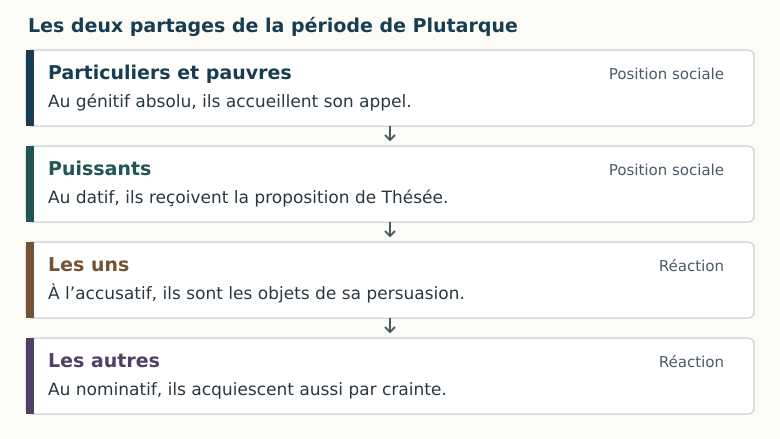

# BEL A/L — Version grecque (Lyon) 2026 · Corrigé brut

*Corrigé rédigé par IA, non officiel. Signalez toute erreur.*

**Lecture du rapport du jury** · GPT-6.2 Astra Ultra · vitesse non renseignée

**Rédaction** · GPT-6.2 Astra Ultra · vitesse non renseignée

**Autocontrôle** · GPT-6.2 Astra Ultra · vitesse non renseignée

**Révision (tour 1)** · GPT-6.2 Astra Ultra · vitesse non renseignée

## Comment Thésée réunit l’Attique

Après la mort d’Égée, Thésée conçut un grand et admirable projet. Il réunit les habitants de l’Attique dans une seule ville et fit d’eux le peuple unique d’une seule cité. Ils vivaient jusque-là dispersés, difficiles à convoquer dans l’intérêt commun de tous. Il leur arrivait même d’être en désaccord et de se faire la guerre entre eux.

Il allait donc d’un lieu à l’autre et s’efforçait de les convaincre, bourg par bourg, famille par famille. Les simples particuliers et les pauvres accueillirent aussitôt son appel. Aux puissants, il proposait un régime sans roi, une démocratie qui ne ferait appel à lui que pour commander en temps de guerre et veiller sur les lois, et qui, pour tout le reste, accorderait à tous une part égale. Voilà comment il persuadait les uns. Les autres redoutaient sa puissance, déjà grande, et son audace. Ils préféraient accepter ces mesures en se laissant persuader plutôt que d’y être contraints.

Il supprima donc les prytanées, les salles du Conseil et les magistratures de chaque communauté. Il établit pour tous un seul prytanée et une seule salle du Conseil à l’endroit où la ville s’élève aujourd’hui. Il donna à la cité le nom d’Athènes et institua les Panathénées comme sacrifice commun. Il célébra encore le sacrifice des Métoikia le seize du mois d’Hécatombaion, jour où l’on sacrifie encore à présent. Ayant renoncé à la royauté comme il s’y était engagé, il organisait la cité en commençant par les dieux.

**Repère de lecture**

Chez Plutarque, deux classements se succèdent. La première opposition porte sur la condition des habitants auxquels Thésée s’adresse. La seconde suit les réactions des puissants à sa proposition. Une reprise française telle que « parmi eux » évite de faire revenir les pauvres comme groupe opposé aux riches une seconde fois.

[Énoncé officiel](https://www.ens-lyon.fr/sites/default/files/2026-04/Epreuve%20de%20sp%C3%A9cialit%C3%A9%202026.pdf#page=5) · [Rapport du jury](https://www.ens-lyon.fr/sites/default/files/2026-11/Grec%202026.pdf#page=2)
