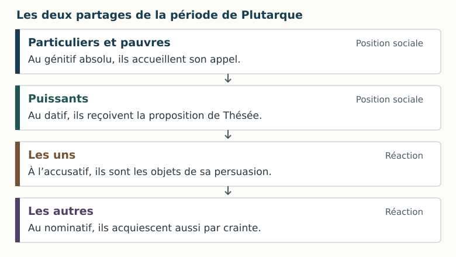

# BEL A/L — Version grecque (Lyon) 2026 · Corrigé guidé

*Corrigé rédigé par IA, non officiel. Signalez toute erreur.*

**Lecture du rapport du jury** · GPT-6.2 Astra Ultra · vitesse non renseignée

**Rédaction** · GPT-6.2 Astra Ultra · vitesse non renseignée

**Autocontrôle** · GPT-6.2 Astra Ultra · vitesse non renseignée

**Révision (tour 1)** · GPT-6.2 Astra Ultra · vitesse non renseignée

## Le passage et l’épreuve

Dans la *Vie de Thésée* (24, 1-4), Plutarque raconte comment un roi transforme des communautés dispersées en une seule cité et renonce lui-même à la royauté. La version de spécialité dure quatre heures. Le fascicule autorise les dictionnaires grec-français. Le titre imprime le nom de Thésée, sujet à restituer dès la première phrase.

## Lignes 1 à 5 · Rassembler un territoire, constituer un peuple

Βαλόμενος décrit le projet conçu par Thésée. Les deux aoristes qui suivent réalisent deux opérations différentes sur le même groupe. Συνῴκισε désigne le rassemblement dans un centre urbain, εἰς ἓν ἄστυ. Ἀπέφηνε construit un objet, les habitants déjà nommés, et un attribut de cet objet, ἕνα δῆμον. Le résultat politique répond au déplacement spatial. Le numéral « un seul » revient trois fois sous des formes et des genres différents.

Les participes ὄντας, διαφερομένους et πολεμοῦντας sont tous à l’accusatif pluriel et se rapportent aux habitants. Leurs dissensions sont antérieures au rassemblement. La première note du sujet donne la valeur adverbiale de ἔστι δ᾽ ὅτε. Le καί qui suit renchérit sur la difficulté de rassembler les habitants et introduit un cas extrême, leur conflit ouvert.

## Lignes 5 à 12 · Deux partages successifs

Quel est le premier verbe personnel ? Ἔπειθε, à l’imparfait, décrit un travail répété de persuasion. Son objet se tire de la première phrase. Κατά distribue les visites par communautés et par familles. Il y a ensuite deux manières de répartir les interlocuteurs dans cette longue période.

Identifier d’abord le complément de la proposition faite par Thésée. À l’intérieur du groupe ainsi désigné, repérer ensuite les deux pronoms opposés et donner à chacun son rôle dans sa proposition.

Les simples particuliers et les pauvres forment le sujet d’un génitif absolu. Pour les puissants, le datif τοῖς δυνατοῖς dépend de προτείνων, dont le sujet est Thésée. La différence des cas signale le passage de ceux qui acceptent à ceux auxquels il propose des institutions.

Que ferait la démocratie promise ? Les deux participes futurs, χρησομένην et παρέξουσαν, s’accordent avec δημοκρατίαν. Χρῆσθαι régit le datif αὐτῷ, « de lui ». Les deux datifs apposés, ἄρχοντι et φύλακι, définissent les seules attributions que Thésée conserverait. La suite précise ce qui est offert à tous à parts égales. Au second ἔπειθεν, les uns sont à l’accusatif, objets du verbe. Les autres, οἱ δέ, passent au nominatif et deviennent le sujet de ἐβούλοντο. Leur acquiescement s’explique aussi par leur crainte.

## Lignes 13 à 19 · Les institutions et la date

Καταλύσας et ποιήσας sont deux participes aoristes rapportés à Thésée. Ils placent la suppression des autorités locales et la création d’institutions communes avant la nomination de la ville et l’institution du sacrifice. La relation ἐνταῦθα … ὅπου relie une localisation du passé au présent du narrateur. Πρυτανεῖον est le prytanée, bâtiment civique qui abrite le foyer commun, et βουλευτήριον le lieu où siège le Conseil.

Pour la date des Métoikia, le sujet porte τῇ ἕκτῃ ἐπὶ δέκα. L’ordinal ἕκτῃ est le féminin de « sixième ». Dix plus six donnent donc le **seize** d’Hécatombaion. Le rapport, p. 4, reproduit les mêmes mots grecs puis les explique par « le dix-huitième jour ». La traduction suit le grec imprimé, vérifiable à l’avant-dernière phrase de l’énoncé. Le pronom féminin ἣν permet de restituer le nom du jour.

Ἀφείς se rapporte à la promesse de constituer un gouvernement sans roi. Le dernier imparfait διεκόσμει ouvre sur l’organisation durable de la cité. Enfin ἀρχόμενος avec ἀπό exprime le point de départ de cette organisation, la religion civique que viennent d’illustrer les deux sacrifices.

## Traduction suivie

Après la mort d’Égée, Thésée conçut un grand et admirable projet. Il réunit les habitants de l’Attique dans une seule ville et fit d’eux le peuple unique d’une seule cité. Ils vivaient jusque-là dispersés, difficiles à convoquer dans l’intérêt commun de tous. Il leur arrivait même d’être en désaccord et de se faire la guerre entre eux.

Il allait donc d’un lieu à l’autre et s’efforçait de les convaincre, bourg par bourg, famille par famille. Les simples particuliers et les pauvres accueillirent aussitôt son appel. Aux puissants, il proposait un régime sans roi, une démocratie qui ne ferait appel à lui que pour commander en temps de guerre et veiller sur les lois, et qui, pour tout le reste, accorderait à tous une part égale. Voilà comment il persuadait les uns. Les autres redoutaient sa puissance, déjà grande, et son audace. Ils préféraient accepter ces mesures en se laissant persuader plutôt que d’y être contraints.

Il supprima donc les prytanées, les salles du Conseil et les magistratures de chaque communauté. Il établit pour tous un seul prytanée et une seule salle du Conseil à l’endroit où la ville s’élève aujourd’hui. Il donna à la cité le nom d’Athènes et institua les Panathénées comme sacrifice commun. Il célébra encore le sacrifice des Métoikia le seize du mois d’Hécatombaion, jour où l’on sacrifie encore à présent. Ayant renoncé à la royauté comme il s’y était engagé, il organisait la cité en commençant par les dieux.

[Énoncé officiel](https://www.ens-lyon.fr/sites/default/files/2026-04/Epreuve%20de%20sp%C3%A9cialit%C3%A9%202026.pdf#page=5) · [Rapport du jury](https://www.ens-lyon.fr/sites/default/files/2026-11/Grec%202026.pdf#page=2)
