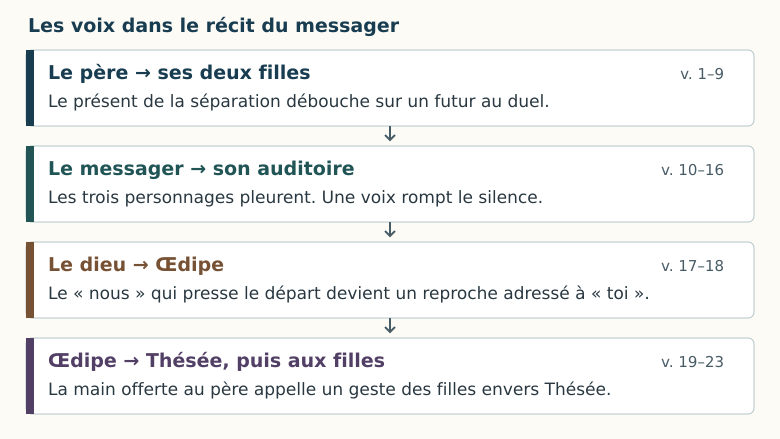

# BEL A/L — Version grecque (Ulm) 2026 · Corrigé brut

*Corrigé rédigé par IA, non officiel. Signalez toute erreur.*

**Lecture du rapport du jury** · GPT-6.2 Astra Ultra · vitesse non renseignée

**Rédaction** · GPT-6.2 Astra Ultra · vitesse non renseignée

**Autocontrôle** · GPT-6.2 Astra Ultra · vitesse non renseignée

**Révision (tour 1)** · GPT-6.2 Astra Ultra · vitesse non renseignée

## Les derniers adieux d’Œdipe

« Mes enfants, vous voici, dès aujourd’hui, sans père. Car tout ce qui était mien a péri, et vous n’aurez plus à prendre de moi des soins si pénibles. Bien rudes soins, je le sais, mes filles. Mais une seule parole suffit à effacer toutes ces peines. De personne vous n’avez reçu d’amour plus grand que de l’homme qui est ici devant vous. C’est privées de cet amour que, toutes deux, vous passerez désormais ce qui vous reste de vie. »

Sur de telles paroles, tous, serrés dans les bras les uns des autres, pleuraient à gros sanglots. Quand enfin leurs lamentations prirent fin et que plus aucun cri ne s’élevait, le silence régnait. Soudain une voix l’appela avec éclat, si bien que elle fit d’un coup se dresser les cheveux sur la tête de tous, saisis d’effroi. Car un dieu l’appelle, et l’appelle encore, avec insistance. « Toi, là ! Oui, toi, Œdipe ! Qu’attendons-nous pour partir ? Voilà bien longtemps que tu nous fais attendre. »

Dès qu’il comprit qu’un dieu l’appelait, Œdipe demande à Thésée, roi du pays, de venir auprès de lui. Quand Thésée se fut approché, Œdipe dit ces mots. « Mon cher ami, donne-moi ta main en gage de la foi que tu jures à mes enfants. Et vous, mes filles, donnez-lui la vôtre. »

**Repère de lecture**

Dans le récit du messager, la première adresse du père vise ses deux filles. À la fin, le discours passe de Thésée aux filles. Le français doit rendre ce changement d’allocutaire à l’intérieur d’une même réplique, au moment où le geste de la main engage successivement les deux parties.

[Énoncé officiel](https://www.ens.psl.eu/sites/default/files/al_version_lat-grec_261103.pdf#page=3) · [Rapport du jury](https://www.ens.psl.eu/sites/default/files/2026_al_rapport_ecrit_version_grecque.pdf)
