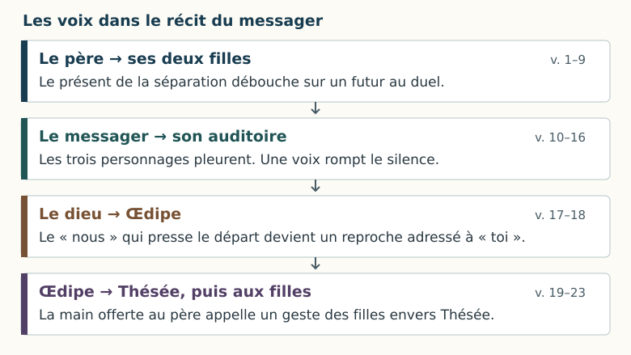

# BEL A/L — Version grecque (Ulm) 2026 · Corrigé guidé

*Corrigé rédigé par IA, non officiel. Signalez toute erreur.*

**Lecture du rapport du jury** · GPT-6.2 Astra Ultra · vitesse non renseignée

**Rédaction** · GPT-6.2 Astra Ultra · vitesse non renseignée

**Autocontrôle** · GPT-6.2 Astra Ultra · vitesse non renseignée

**Révision (tour 1)** · GPT-6.2 Astra Ultra · vitesse non renseignée

## Qui prend la parole ?

Dans *Œdipe à Colone* (v. 1611-1633), un messager raconte des adieux auxquels il a assisté. Les guillemets du sujet donnent successivement la parole au père, au dieu puis au père de nouveau. Le lecteur entend l’appel avant qu’Œdipe en identifie l’origine. Dans cette version de quatre heures, conserver ce temps de découverte évite d’ajouter le nom d’un dieu que Sophocle laisse anonyme.

## Vers 1 à 9 · À qui attribuer l’amour ?

Dans la première phrase, πατήρ est le sujet de ἔστι et ὑμῖν est au datif. La tournure grecque permet de dire « vous avez un père ». Avec οὐκ et ἔτι, elle devient « vous n’avez plus de père ». Le présent fait éprouver la séparation dès le moment où Œdipe parle. Au vers suivant, τἀμά se développe en τὰ ἐμά. Ce pluriel neutre commande le parfait singulier ὄλωλε, qui exprime le résultat acquis de la perte.

Le futur ἕξετε a pour objet τροφήν. Le mot désigne ici l’ensemble des soins dont le vieillard dépendait. La reprise au féminin σκληράν permet de garder « soins » d’une phrase à la suivante. En revanche, ἕν et μόνον sont des neutres singuliers qui encadrent l’idée d’ἔπος. Une parole va répondre à l’ensemble des épreuves.

Pour construire les vers 7 à 9, réunir d’abord πλέον et ἤ, les deux termes de la comparaison. Les filles sont le sujet de ἔσχεθ’ et reçoivent l’amour. L’homme qui se désigne devant elles est leur père. Le relatif οὗ dépend du participe « privées de » et peut reprendre l’amour ou le père. Nous retenons l’amour, qui donne à la fin des adieux un écho au vers 7. Le duel διάξετον justifie « toutes deux ».

## Vers 10 à 18 · Du bruit des pleurs à celui de la voix

L’imparfait ἔκλαιον fait durer les pleurs. Le masculin pluriel πάντες y associe le père et les filles. L’aoriste ἀφίκοντο marque le terme de leurs plaintes. L’imparfait ἦν maintient ensuite le silence assez longtemps pour que l’appel le rompe. Le grec emploie deux fois le même adverbe de soudaineté. La seconde occurrence accompagne la réaction physique des témoins.

La consécutive introduite par ὥστε contient στῆσαι, infinitif aoriste actif à valeur causative. C’est la voix qui fait dresser les cheveux. Le féminin ὀρθίας s’accorde avec τρίχας, tandis que le masculin δείσαντας reprend les témoins saisis de peur. « À tous » conserve la portée de πάντας. Le présent καλεῖ fait ensuite entendre la voix comme si elle retentissait sous nos yeux. La première personne du pluriel dans μέλλομεν associe le dieu et Œdipe au départ. La deuxième personne dans τἀπὸ σοῦ attribue l’attente à Œdipe seul.

Relire l’impératif adressé à Thésée, puis le pronom pluriel qui enchaîne l’adresse aux filles. On peut expliciter le vocatif en français pour rendre sensible ce changement sans ajouter un autre locuteur.

## Vers 19 à 23 · À qui donner la main ?

Le participe καλούμενος a le même sujet que le verbe de perception. Ce qu’Œdipe comprend, c’est que l’appel lui est adressé. Dans la phrase suivante, Θησέα est à l’accusatif et désigne celui qui doit venir. Le petit datif οἱ renvoie à Œdipe, vers qui il vient. Le sujet change donc deux fois dans la dernière période. Thésée s’approche, puis Œdipe prononce la demande.

Πίστιν est le complément de l’impératif δός. L’adjectif ὁρκίαν fait du don de la main un engagement sous serment. Dans la toute dernière proposition, le verbe et son complément restent sous-entendus. Le démonstratif τῷδε, « à cet homme-ci », invite les filles à tendre leur main à Thésée, qui se tient désormais auprès d’elles.

## Traduction suivie

« Mes enfants, vous voici, dès aujourd’hui, sans père. Car tout ce qui était mien a péri, et vous n’aurez plus à prendre de moi des soins si pénibles. Bien rudes soins, je le sais, mes filles. Mais une seule parole suffit à effacer toutes ces peines. De personne vous n’avez reçu d’amour plus grand que de l’homme qui est ici devant vous. C’est privées de cet amour que, toutes deux, vous passerez désormais ce qui vous reste de vie. »

Sur de telles paroles, tous, serrés dans les bras les uns des autres, pleuraient à gros sanglots. Quand enfin leurs lamentations prirent fin et que plus aucun cri ne s’élevait, le silence régnait. Soudain une voix l’appela avec éclat, si bien que elle fit d’un coup se dresser les cheveux sur la tête de tous, saisis d’effroi. Car un dieu l’appelle, et l’appelle encore, avec insistance. « Toi, là ! Oui, toi, Œdipe ! Qu’attendons-nous pour partir ? Voilà bien longtemps que tu nous fais attendre. »

Dès qu’il comprit qu’un dieu l’appelait, Œdipe demande à Thésée, roi du pays, de venir auprès de lui. Quand Thésée se fut approché, Œdipe dit ces mots. « Mon cher ami, donne-moi ta main en gage de la foi que tu jures à mes enfants. Et vous, mes filles, donnez-lui la vôtre. »

[Énoncé officiel](https://www.ens.psl.eu/sites/default/files/al_version_lat-grec_261103.pdf#page=3) · [Rapport du jury](https://www.ens.psl.eu/sites/default/files/2026_al_rapport_ecrit_version_grecque.pdf)
