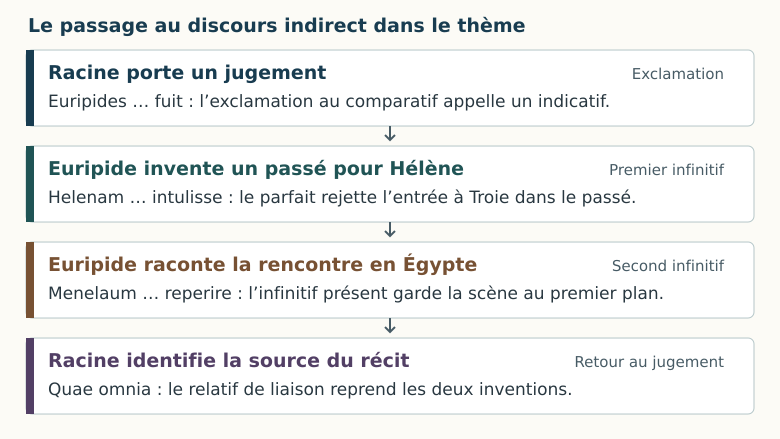

# BEL A/L — Version latine et court thème (Ulm) 2026 · Corrigé brut

*Corrigé rédigé par IA, non officiel. Signalez toute erreur.*

**Lecture du rapport du jury** · GPT-6.2 Astra Ultra · vitesse non renseignée

**Rédaction** · GPT-6.2 Astra Ultra · vitesse non renseignée

**Autocontrôle** · GPT-6.2 Astra Ultra · vitesse non renseignée

**Révision (tour 1)** · GPT-6.2 Astra Ultra · vitesse non renseignée

## Le règne de Numa et l’Hélène d’Euripide

### I. Version · Tite-Live

Ainsi entré en possession du pouvoir royal, Numa entreprend de donner à la ville nouvelle, fondée par la force des armes, une fondation toute neuve, celle du droit, des lois et des mœurs. Il voyait qu’en pleine guerre on ne pouvait s’y accoutumer. À ses yeux, le service des armes rendait les esprits farouches et il fallait adoucir ce peuple fier en lui faisant perdre l’habitude des armes. Il fit donc construire, au bas de l’Argilète, le temple de Janus pour signaler la paix et la guerre. Ouvert, il indiquerait que la cité était en armes. Fermé, que tous les peuples d’alentour étaient en paix.

Depuis le règne de Numa, le temple a ensuite été fermé deux fois. La première, sous le consulat de Titus Manlius, après la fin de la première guerre punique. La seconde, ce que les dieux ont accordé à notre génération de voir, après la guerre d’Actium, quand l’empereur César Auguste eut établi la paix sur terre et sur mer.

Une fois le temple fermé, Numa avait uni par des alliances et des traités les cœurs de tous ses voisins. Délivré de tout souci quant aux dangers extérieurs, il craignit que l’oisiveté ne donnât libre cours aux passions que contenaient auparavant la peur de l’ennemi et la discipline militaire. Avant toute chose, jugea-t-il, il fallait inspirer la crainte des dieux, moyen d’une efficacité extrême auprès d’une foule inexpérimentée et encore fruste en ces temps reculés.

Comme cette crainte ne pouvait pénétrer dans les esprits sans quelque récit inventé de prodige, il feint d’avoir la nuit des entretiens avec la déesse Égérie. C’est sur ses avis, dit-il, qu’il établit les rites les plus agréables aux dieux et qu’il assigne à chacune des divinités ses propres prêtres.

### II. Court thème · Racine

Quanto audacior fuit Euripides in ea tragoedia quae *Helena* inscribitur! In ea enim palam repugnat opinioni quam tota Graecia communiter tenet. Fingit enim Helenam numquam Troiam pedem intulisse atque, ea urbe incensa, Menelaum suam uxorem in Aegypto reperire, unde illa non discesserit. Quae omnia in ea opinione posita sunt quam soli Aegyptii probabant.

**Repère de lecture**

Dans le thème de Racine, Ménélas retrouve Hélène après l’incendie de Troie. Ce repère du récit est compatible avec un infinitif présent dans la proposition infinitive. Le choix du temps latin dépend ici du rapport avec le récit attribué à Euripide, tandis que l’incendie reste antérieur à la rencontre.

[Énoncé officiel](https://www.ens.psl.eu/sites/default/files/al_opt_vers_lat_261104.pdf) · [Rapport du jury](https://www.ens.psl.eu/sites/default/files/fait_2026_al_rapport_option_ecrit_version_latine_court_theme.pdf)
