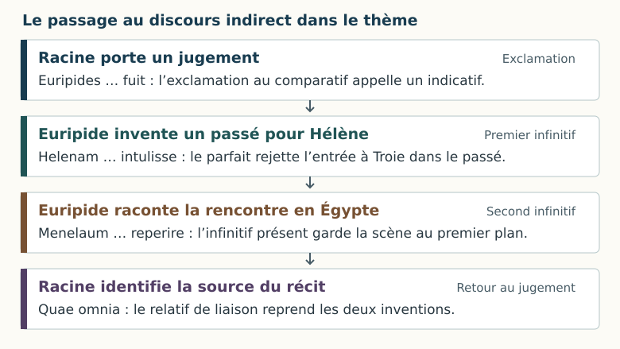

# BEL A/L — Version latine et court thème (Ulm) 2026 · Corrigé guidé

*Corrigé rédigé par IA, non officiel. Signalez toute erreur.*

**Lecture du rapport du jury** · GPT-6.2 Astra Ultra · vitesse non renseignée

**Rédaction** · GPT-6.2 Astra Ultra · vitesse non renseignée

**Autocontrôle** · GPT-6.2 Astra Ultra · vitesse non renseignée

**Révision (tour 1)** · GPT-6.2 Astra Ultra · vitesse non renseignée

## Deux exercices en cinq heures

La page 2 du fascicule demande de traduire en français un passage de Tite-Live sur le roi Numa, puis en latin un paragraphe de Racine sur le choix dramatique d’Euripide. Pour la version, conserver le jeu entre la Rome des origines et l’époque du narrateur. Pour le thème, distinguer ce que Racine affirme de ce qu’Euripide fait arriver à ses personnages.

## I. Construire la version

**Comment fonder une ville déjà fondée ?** *Conditam* désigne la première fondation, *de integro condere* le projet de refondation. Deux groupes à l’ablatif mettent face à face les moyens de l’une et de l’autre. Dans la lecture retenue, *regno potitus* signifie « devenu maître de la royauté ». L’accusatif *urbem nouam*, détaché en tête de phrase, est repris par *eam* devant *condere*. Le rapport, p. 1, propose aussi de lire *urbem* avec *potitus [est]*, comme l’objet d’une relative substantive. La reprise par *eam* et le redoublement du verbe de fondation restent essentiels dans les deux lectures.

**Comment reconnaître le temple quand le latin dit seulement Janus ?** Le participe *ratus* introduit le raisonnement de Numa. À ses yeux, la vie militaire durcit les esprits, tandis que la désaccoutumance doit adoucir le peuple. Des deux infinitives, la seconde présente une obligation, *mitigandum [esse]*. Le prédicat principal arrive à *Ianum … fecit*. Les participes *apertus* et *clausus* reprennent le temple de Janus et encadrent les deux messages intelligibles aux citoyens. *In armis esse ciuitatem* et *pacatos [esse] … omnes populos* dépendent de *significaret*.

**À quel moment se place le narrateur ?** *Bis* annonce une série close par *semel* et *iterum*. La première guerre punique et la guerre d’Actium se situent longtemps après Numa. *Nostrae aetati* rapproche la seconde fermeture de Tite-Live et de ses contemporains. Dans *pace terra marique parta*, *pace* et *parta* forment un ablatif absolu. Auguste, introduit par *ab*, est celui qui a obtenu la paix sur terre et sur mer. Avec *clauso eo* le récit retrouve Numa.

**Comment rendre la dernière décision ?** Attendre *ratus est*, puis chercher l’infinitive qu’il gouverne. Le groupe *deorum metum iniciendum [esse]* en est le noyau. *Rem … efficacissimam* qualifie cette décision tout entière. Le but négatif en *ne* est préventif. Ce que Numa veut éviter, c’est que la paix extérieure relâche les esprits. Au début de la dernière phrase, le relatif de liaison *qui* reprend la crainte, *metus*, de genre masculin en latin. Après *simulat*, le roi est le bénéficiaire des entretiens et le sujet des deux infinitifs finaux. *Eius* désigne la déesse dont viennent les avis.

## II. Construire le thème

Refaire la phrase en distinguant le moment où Racine juge le poète, l’entrée supposée à Troie et la scène de la rencontre. Indiquer à chaque étape le sujet de l’infinitif permet aussi de contrôler les accusatifs.

*Quanto*, à l’ablatif de différence, porte sur le comparatif *audacior*. L’exclamation est indépendante, d’où l’indicatif *fuit*. Le titre grec francisé « Hélène » redevient le nominatif latin *Helena*. Le substantif *opinioni* est au datif après *repugnat*. La relative précise que cette opinion est partagée dans toute la Grèce.

Après *fingit*, Racine attribue à Euripide deux inventions qui demandent chacune un sujet à l’accusatif. L’infinitif parfait *intulisse* place l’entrée à Troie dans le passé nié d’Hélène. Le présent *reperire* donne en revanche à voir le moment où Ménélas retrouve son épouse. *Suam* s’accorde avec *uxorem* et renvoie au sujet de cette seconde infinitive, Ménélas.

Trois lieux, trois syntaxes. L’entrée dans une ville appelle *Troiam*, accusatif de direction sans préposition. La découverte dans un pays se dit *in Aegypto*. Le départ d’un lieu est repris par l’adverbe *unde*. La relative au subjonctif parfait *discesserit*, dépendante de l’énoncé introduit au présent par *fingit*, présente le séjour continu d’Hélène comme un élément de l’intrigue. L’incendie antérieur tient dans l’ablatif absolu *ea urbe incensa*. Enfin le relatif de liaison *quae omnia* permet à Racine de reprendre la parole et de porter son jugement sur les deux inventions réunies.

## Proposition complète

### I. Version · Tite-Live

Ainsi entré en possession du pouvoir royal, Numa entreprend de donner à la ville nouvelle, fondée par la force des armes, une fondation toute neuve, celle du droit, des lois et des mœurs. Il voyait qu’en pleine guerre on ne pouvait s’y accoutumer. À ses yeux, le service des armes rendait les esprits farouches et il fallait adoucir ce peuple fier en lui faisant perdre l’habitude des armes. Il fit donc construire, au bas de l’Argilète, le temple de Janus pour signaler la paix et la guerre. Ouvert, il indiquerait que la cité était en armes. Fermé, que tous les peuples d’alentour étaient en paix.

Depuis le règne de Numa, le temple a ensuite été fermé deux fois. La première, sous le consulat de Titus Manlius, après la fin de la première guerre punique. La seconde, ce que les dieux ont accordé à notre génération de voir, après la guerre d’Actium, quand l’empereur César Auguste eut établi la paix sur terre et sur mer.

Une fois le temple fermé, Numa avait uni par des alliances et des traités les cœurs de tous ses voisins. Délivré de tout souci quant aux dangers extérieurs, il craignit que l’oisiveté ne donnât libre cours aux passions que contenaient auparavant la peur de l’ennemi et la discipline militaire. Avant toute chose, jugea-t-il, il fallait inspirer la crainte des dieux, moyen d’une efficacité extrême auprès d’une foule inexpérimentée et encore fruste en ces temps reculés.

Comme cette crainte ne pouvait pénétrer dans les esprits sans quelque récit inventé de prodige, il feint d’avoir la nuit des entretiens avec la déesse Égérie. C’est sur ses avis, dit-il, qu’il établit les rites les plus agréables aux dieux et qu’il assigne à chacune des divinités ses propres prêtres.

### II. Court thème · Racine

Quanto audacior fuit Euripides in ea tragoedia quae *Helena* inscribitur! In ea enim palam repugnat opinioni quam tota Graecia communiter tenet. Fingit enim Helenam numquam Troiam pedem intulisse atque, ea urbe incensa, Menelaum suam uxorem in Aegypto reperire, unde illa non discesserit. Quae omnia in ea opinione posita sunt quam soli Aegyptii probabant.

[Énoncé officiel](https://www.ens.psl.eu/sites/default/files/al_opt_vers_lat_261104.pdf) · [Rapport du jury](https://www.ens.psl.eu/sites/default/files/fait_2026_al_rapport_option_ecrit_version_latine_court_theme.pdf)
