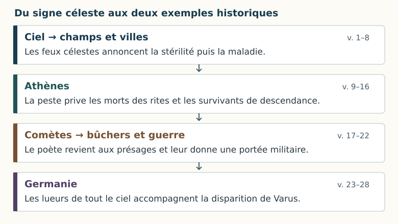

# BEL A/L — Version latine (Lyon) 2026 · Corrigé brut

*Corrigé rédigé par IA, non officiel. Signalez toute erreur.*

**Lecture du rapport du jury** · GPT-6.2 Astra Ultra · vitesse non renseignée

**Rédaction** · GPT-6.2 Astra Ultra · vitesse non renseignée

**Autocontrôle** · GPT-6.2 Astra Ultra · vitesse non renseignée

**Révision (tour 1)** · GPT-6.2 Astra Ultra · vitesse non renseignée

## Les feux du ciel selon Manilius

Jamais le ciel ne s’est embrasé de feux sans conséquence. Les paysans déçus se lamentent sur leurs champs desséchés et, entre les sillons stériles, le laboureur épuisé ramène ses jeunes bœufs attristés sous un joug qui n’a servi à rien. Ou bien une flamme mortelle, qui leur brûle la moelle, saisit les corps en les accablant de graves maladies et d’une lente consomption. Elle emporte des peuples qui s’effondrent et, à travers des villes tout entières, on célèbre des funérailles publiques dans l’embrasement des tombeaux.

Telle fut l’épidémie qui décima les habitants du pays d’Érechthée et porta en terre l’antique Athènes au fil des convois de gens morts en temps de paix. Ils se précipitaient alors vers leur destin, chacun s’abattant sur le cadavre d’un autre. L’art du médecin n’avait plus sa place et les prières restaient sans effet. Les devoirs envers les morts avaient cédé devant la maladie. Aux morts manquaient les funérailles et les larmes. Le feu lui-même, épuisé, avait défailli, et les corps brûlaient, leurs membres entassés pêle-mêle. Ce peuple, jadis si grand, eut à peine un héritier.

Voilà les malheurs que présagent souvent les comètes quand elles brillent. Avec leurs torches viennent les funérailles, et elles menacent la terre de bûchers qui se consument sans fin, alors que le monde est malade et la nature elle-même, à qui il est échu d’être le tombeau des hommes.

Bien plus, les feux du ciel annoncent les guerres, les troubles soudains et les prises d’armes que suscitent de secrètes trahisons. Ainsi, tout récemment, en pays étranger, quand, le traité rompu, la farouche Germanie emporta le général Varus et teignit les campagnes du sang de trois légions, des lueurs menaçantes s’allumèrent çà et là dans tout l’univers. La nature elle-même nous fit la guerre par ses feux, nous opposa ses forces et nous menaça de la fin.

**Repère de lecture**

Les exemples d’Athènes et de Germanie n’illustrent pas le même danger. Le premier développe les effets d’une épidémie sur les vivants et les morts, le second la perte militaire associée à Varus. Le retour aux comètes entre les deux marque une articulation du raisonnement du poète.

[Énoncé officiel](https://www.ens-lyon.fr/sites/default/files/2026-04/Epreuve%20de%20sp%C3%A9cialit%C3%A9%202026.pdf#page=4) · [Rapport du jury](https://www.ens-lyon.fr/sites/default/files/2026-10/Latin%202026.pdf#page=2)
